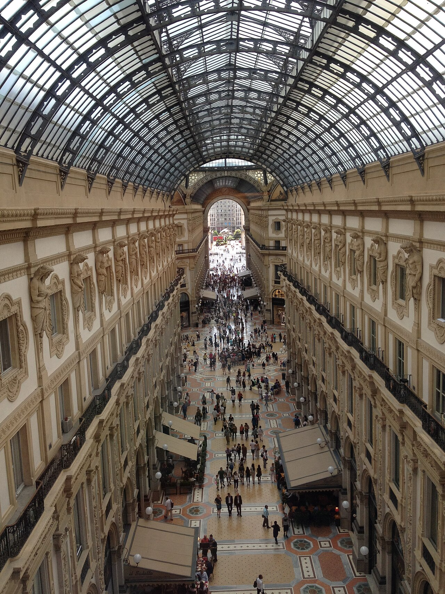
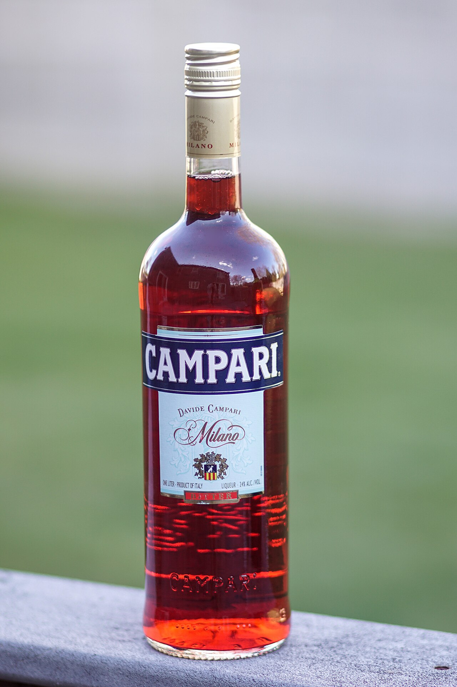

# Camparino in Galleria

Under the glass roof of the Galleria Vittorio Emanuele II, between the Duomo and La Scala, a small bar occupies a corner of the northern arcade. The room is narrow, the counter is high, the ceiling is decorated, and the aperitivo crowd stands rather than sits. This is Camparino in Galleria. It is not the oldest bar in Milan and not the largest, but it is one of the most visible: a family business that became a brand, a brand that became a historic bar, and a bar that was restored to look like its own early-20th-century self.

Figure: The interior arcade of the Galleria Vittorio Emanuele II in Milan; Camparino occupies the northern arcade facing Piazza Duomo, and this photograph shows the Galleria's architecture and mosaic floor rather than the bar interior. Image: Dispe, CC0, via Wikimedia Commons ([source page](https://commons.wikimedia.org/wiki/File:Galleria_Vittorio_Emanuele_II_di_Milano_-_Interno_-_Vista_da_un_piano_alto.JPG)).

## Location and history

The story begins in 1867, when Gaspare Campari opened Caffè Campari in the Galleria. The Galleria had opened the same year, so the bar's premises are as old as the building. Campari had been developing his bitter infusion since the 1860s, and the café became the place where the drink was served and promoted. Gaspare's son Davide was born in 1867, the same year; he would later take over the business and expand it.

In 1915 Davide Campari opened Camparino, a smaller bar above or adjacent to the family café, depending on the account. The name means “little Campari,” and the bar was designed as a more modern, faster-paced space for aperitivo. The original Camparino had a direct soda-water system: carbonated water ran from the cellar to the bar, so a Campari and soda could be assembled quickly. That detail is part of the bar's identity as a modern drinking machine rather than a traditional café.

The interior decoration is Liberty style, the Italian version of Art Nouveau. Eugenio Quarti, a furniture maker, Alessandro Mazzucotelli, a wrought-iron artist, and Angelo d'Andrea, a decorator, are the names associated with the room. The result is a mix of curved wood, floral ironwork, mirrors and painted panels. The bar was damaged by bombing in August 1943, during the Second World War, and repaired afterward. The Miani family ran it for decades, and in 2018 the Campari Group took it back; it reopened in 2019 after restoration.

The 2019 restoration is the reason the bar looks the way it does now. The company restored the Liberty decoration, reinstated the soda system and divided the space into three areas. The historic room is not a reconstruction of a lost original; it is a careful repair of a building that had been modified over the century.

## Space and drinks

Camparino has three areas. The Bar di Passo is the standing bar at the entrance, the fastest and least expensive option. The Sala Spiritello is a seated room with tables, more comfortable and slightly more formal. The Sala Gaspare is the historic room, used for reserved seating and special events. Each area has a different menu and a different rhythm; the bar is for a quick drink, the rooms for a longer stay.

The drinks are Campari-centered: Campari and soda, the Americano, the Negroni, the Negroni sbagliato and seasonal variations. The bar also serves coffee, wine, beer and light food. The aperitivo is the main event: a drink plus a small plate of snacks, usually in the late afternoon and early evening. The quality is high but the prices reflect the Galleria location; this is not a cheap neighborhood bar.

## How to drink

For the classic experience, order a Campari and soda or an Americano at the Bar di Passo and stand at the counter. The soda should be cold, the glass should be full, and the drink should be more bitter than sweet. If you want a Negroni, ask for it by name; the bar makes a proper one, but the aperitivo version is usually lighter.

The Sala Spiritello is better for a conversation and a longer drink; reserve if you want a table at peak times. The Sala Gaspare is for special occasions and reservations. Dress is smart casual; the Galleria is a fashion district, and the bar's clientele reflects that. Evening is the busiest time; late afternoon is easier.

## Practical information

The address is Galleria Vittorio Emanuele II, Piazza Duomo 21, 20121 Milan. The Duomo metro station is directly outside; trams and buses stop nearby. Official hours: Bar di Passo Monday–Saturday 09:30–23:00 and Sunday 09:30–22:00; Sala Spiritello Monday–Thursday 12:00–15:00 and 16:00–23:00, Friday–Saturday 12:00–24:00, Sunday 12:00–22:00. The Sala Gaspare requires a reservation and may have different hours.

The bar accepts credit cards. Reservations are recommended for the Sala Spiritello and required for the Sala Gaspare; the Bar di Passo is first come, first served. Tipping is not obligatory; rounding up or 5%–10% for table service is standard. The Galleria is a covered space, but the arcade can be cold in winter; a coat is useful.

## Etiquette and common misconceptions

The first misconception is that Camparino is the original Campari café. The family's first café was Caffè Campari, opened in 1867; Camparino opened in 1915 as a smaller, more modern bar. The second is that the Liberty interior is entirely original; it was restored and repaired after the 1943 bombing. The third is treating the bar as a museum; the Bar di Passo is a working counter and moves fast. The fourth is ordering a sweet drink and expecting it to be Campari-led; the house style is bitter. The fifth is assuming the Galleria is always quiet; it is one of Milan's busiest pedestrian spaces, and the bar is busiest before dinner.

## Nearby and routes

The Duomo, the Galleria and La Scala are within a few minutes' walk; the Brera district and the fashion quadrilateral are close. Camparino fits a Milan aperitivo route, and for the drink itself read [Campari](ref:campari), [Negroni](ref:negroni) and [Americano](ref:americano). For a comparison with a bar that became a brand in a different way, read [American Bar at the Savoy](ref:savoy) in London; for the older Italian café model, read [Antico Caffè Greco](ref:greco) in Rome.

## Further reading and see also

- [Campari](ref:campari)
- [Negroni](ref:negroni)
- [Americano](ref:americano)
- [American Bar at the Savoy](ref:savoy)
- [Antico Caffè Greco](ref:greco)

**Short definition:** A bar in Milan's Galleria Vittorio Emanuele II, Camparino was opened by Davide Campari in 1915 above the family's Caffè Campari; it is known for Campari and soda, Liberty-style decoration and a recent restoration that reopened in 2019.

Start with the address. From there, consider the current opening status, then what the place is known for. That is how a practical judgment about Camparino in Galleria is built.

[Campari](ref:campari) and [Americano](ref:americano) are the nearest useful comparisons: one clarifies address and space, the other tests operating status.

Checked on 2026-11-21: the entrance at Piazza Duomo 21 into the Galleria Vittorio Emanuele II, and the standing-area versus seated-area rules, were confirmed on the official site. "First" and "landmark" are used as historical narrative, not as an undisputed ranking. Image credits and licences are given in the captions.

**Key facts.**

| Item | Detail |
| --- | --- |
| In one line | A bar in Milan's Galleria Vittorio Emanuele II, Camparino was opened by Davide Campari in 1915 above the family's Caffè Campari; it is known for Campari and soda, Liberty-style decoration and a recent restoration that re… |
| Address | Galleria Vittorio Emanuele II, Piazza Duomo 21, 20121 Milan, Italy |
| City and country | Milan / Italy |
| Status | verified open |
| Official site | camparino.com |

**Sources and limits.** The key claims about Camparino in Galleria are checked against the following sources: Camparino (Used for the address, current hours, the three service areas and the reservation policy; no text copied), Campari Group. For current products, addresses or opening status, use camparino.com. Prices, batches and status change; the body is project-written and does not reproduce source text.

## Related images

Image: Campari. Credit: Kenneth C. Zirkel, CC BY-SA 4.0, via Wikimedia Commons ([source page](https://commons.wikimedia.org/wiki/File:Bottle_of_Campari_(United_States).jpg)). Related image for Camparino in Galleria.
