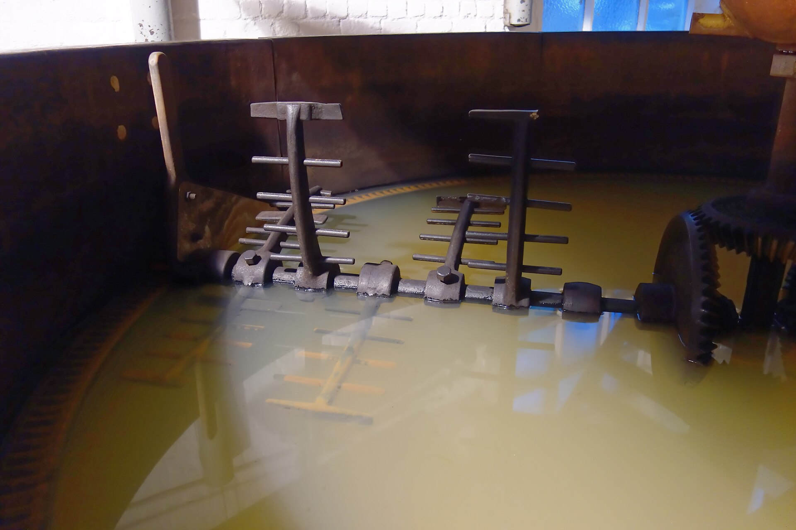

# Cantillon Brewery

Figure: Related photograph of Cantillon Brewery. Image: Abujoy, CC BY 4.0, via Wikimedia Commons ([source page](https://commons.wikimedia.org/wiki/File:Brasserie_Cantillon_02.jpg)).

## A lambic doorway in Anderlecht

Cantillon stands at Rue Gheude 56 in Anderlecht, southwest of central Brussels, postcode 1070. It lies outside the Old Town; Clemenceau metro and Brussels Midi are five and ten minutes away on foot. The brewery hides behind an unremarkable frontage among garages, warehouses and housing, and visitors may wonder whether they are in the right place until they see the barrels and the words "Musée Bruxellois de la Gueuze".

The location is part of the information. Lambic's home is not a vineyard-like countryside but Brussels and the Pajottenland to its southwest, where the Senne valley's climate and airborne microbes shape the beer. Cantillon calls itself the last lambic brewery in the city, meaning urban production and family ownership rather than Belgium having one producer left.

## 1900, and a museum that stays alive

The brewery was founded in 1900 and carries the family name; the Van Roy family later took over. In 1978 Jean-Pierre Van Roy and friends established the Brussels Gueuze Museum association, when spontaneously fermented beer was considered old-fashioned and the brewery faced closure. Guided tours, exhibitions and public brews turned the site into a living museum, with equipment still in use and beer still being made.

There is no clean line between exhibition and workshop: the copper mash tun, cooling vessel, oak barrels and stacked bottles are both display and process. On a good day you may see mashing, bottling or fruit preparation; on another, none of it.

## Spontaneous fermentation: the equipment is the exhibit

Lambic is not pitched with commercial yeast. The wort is pumped into a wide, shallow cooling vessel, cools overnight, picks up wild yeast and bacteria from the air, and then goes into oak barrels for a year or more of [fermentation](ref:fermentation) and maturation. The microbes in the wood, the cellar temperature and the weather enter the flavour; acidity, mustiness, leather, citrus and hay are its vocabulary.

Oak here is not a tool for adding vanilla and toast. Some Cantillon barrels are over a century old, and [oak ageing](ref:oak-ageing) provides slow oxidation and microbial work that make the beer dry, complex and durable. Young lambic is sharp, old lambic is calm, and gueuze blends several years before refermenting in the bottle. That is the line between [lambic](ref:lambic) and ordinary sour beer.

## The beers and a tasting order

The base is Lambic Bio, unblended young lambic with high acidity and little carbonation. Gueuze blends lambic of different years and referments in the bottle, giving fine bubbles and layered acidity. Kriek and Framboise are macerated with cherries and raspberries; Iris is dry-hopped; Saint-Gilloise, Lou Pepe and Nath are vintage series; a label reading "100% Lambic Bio" stresses that every component is organic lambic.

Taste from the driest and lightest to the richest: Lambic first, then Gueuze, then fruit and special releases. Avoid serving too cold, because ice suppresses the musty and fruity notes; pour modestly into a small tulip glass so the beer can warm. Gueuze can age further in bottle but must be kept from light and heat. Within [Belgium](ref:belgium)'s beer map these are the branch built on spontaneous fermentation.

## Two ways to visit: weekdays and Saturday tours

On weekdays (Monday, Tuesday, Thursday and Friday) from 10:00 to 16:00 the visit is self-guided and needs no booking: buy a ticket at the door, 9 EUR for adults and 8 EUR reduced, free under 16. It takes about an hour and ends with three samples: lambic, gueuze and a fruit beer. The brewery is closed on Wednesday, Sunday and public holidays; in 2026 the annual closure runs from 27 July to 1 August inclusive.

Saturday offers booked tours only, at 13 EUR for ninety minutes including a tasting. Groups over ten must arrange a private tour by email two weeks ahead; from 15 people the rate is 13 EUR per person, and for 15 or fewer it is a flat 195 EUR. Dogs are not allowed; the Brussels Museum Pass is not accepted.

## The geography and rules of lambic

Lambic is not a recipe that can be moved anywhere and reproduced. Traditionally it is tied to Brussels and the Pajottenland, where local air, cellar microbes and long maturation shape the beer. The European Union protects names such as Oude Geuze and Oude Kriek as Traditional Specialities Guaranteed, with definitions covering ingredients, blending and ageing; the exact scope is set by the regulation. Cantillon's "100% Lambic Bio" label commits it to organic ingredients and an all-lambic recipe.

For drinkers, "Oude" usually signals longer ageing and a sharper profile, while a Gueuze without that word may be younger and sweeter. Treating [sour beer](ref:sour-beer) as one broad category hides those differences; lambic acidity comes from fermentation and ageing together, not added lactic acid.

## Practical information

**Address:** Rue Gheude 56, 1070 Bruxelles, Belgium (Anderlecht). **Getting there:** Metro lines 2 or 6 to Clemenceau, about five minutes on foot; about ten minutes from Brussels Midi; trams 81 and 82 nearby. **Hours:** Monday, Tuesday, Thursday, Friday and Saturday 10:00–16:00, shop until 17:00; closed Wednesday, Sunday and holidays. **Prices:** weekday self-guided 9 EUR, reduced 8 EUR; Saturday tour 13 EUR; free under 16.

**Notes:** the cellars are cold, so bring a layer; floors are wet, so wear shoes with grip; do not touch barrels. Drivers or cyclists can buy bottles instead of tasting. Food nearby is limited. This entry does not list coordinates; use official channels for those.

**In brief:** A spontaneous-fermentation lambic brewery in Anderlecht, Brussels, founded in 1900 and home to the Brussels Gueuze Museum; weekdays allow self-guided visits, while Saturdays are tour-only and must be booked online.

For Cantillon Brewery, begin with the address. Then look at the current opening status, and finally ask what the place is known for. The answers point to different choices, not to a single score.

Start with [Lambic](ref:lambic) for address and space, then read [Belgium](ref:belgium) for operating status. Seeing both keeps Cantillon Brewery from being confused with a neighbouring idea.

**Key facts.**

| Item | Detail |
| --- | --- |
| In one line | A spontaneous-fermentation lambic brewery in Anderlecht, Brussels, founded in 1900 and home to the Brussels Gueuze Museum; weekdays allow self-guided visits, while Saturdays are tour-only and must be booked online. |
| Address | Rue Gheude 56, 1070 Brussels, Belgium |
| City and country | Brussels / Belgium |
| Status | verified open |
| Official site | cantillon.be |

**Sources and limits.** The key claims about Cantillon Brewery are checked against the following sources: Brasserie Cantillon (Used to check the structure of the lambic, gueuze, fruit beer and Iris range), Visit Brussels (Used to check the transport relationship between Anderlecht and central Brussels). For current products, addresses or opening status, use cantillon.be. Prices, batches and status change; the body is project-written and does not reproduce source text.
