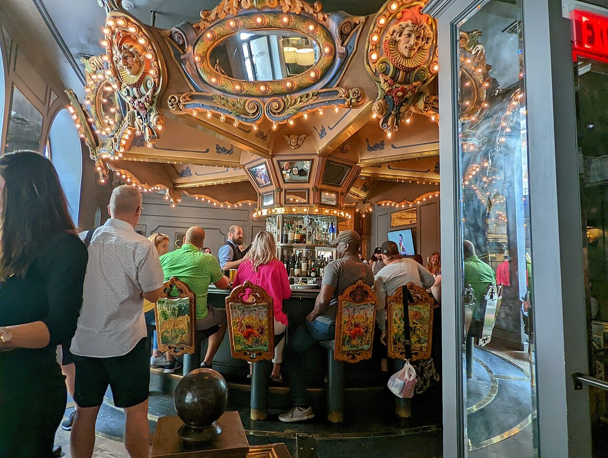
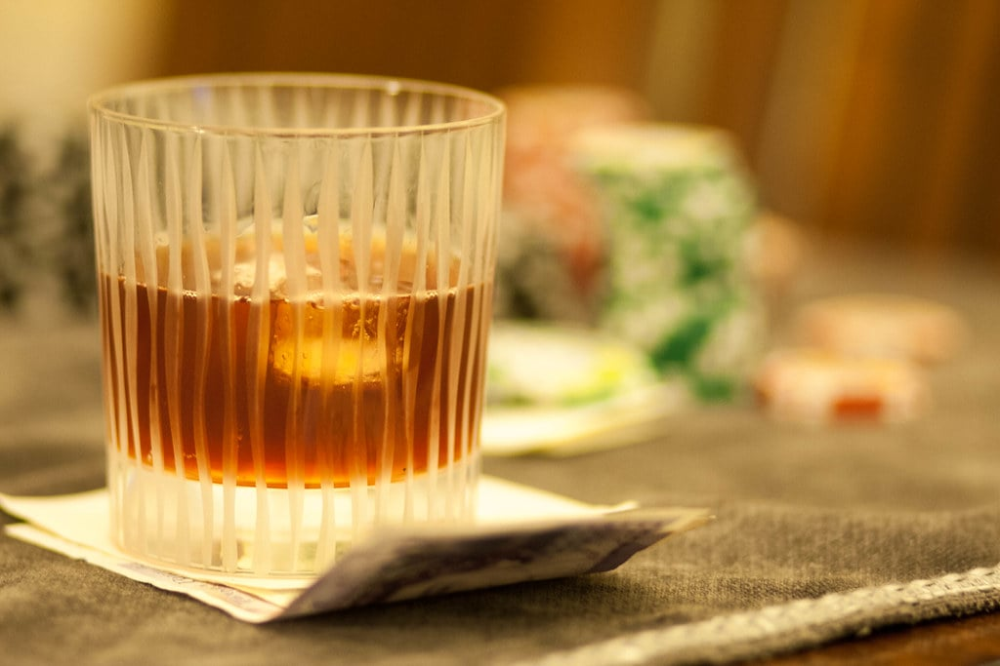

# The Carousel Bar

In the lobby of Hotel Monteleone on Royal Street, a bar actually revolves. The circular counter is built as a carousel, with painted horses, mirrors, light bulbs and gilded scrollwork around the rim, and the bar itself turns around the room very slowly. On first sitting down, you think the other customers are moving; after a few minutes you realise that you are. It is not a themed restaurant set but a drinking machine installed in 1949 and still running.

Figure: The painted carousel bar and canopy at Hotel Monteleone; the bar was installed in 1949, while the present carousel top was added in 1992. Image: Carnaval.com Studios, CC BY 2.0, via Wikimedia Commons ([source page](https://commons.wikimedia.org/wiki/File:Carousel_Bar_at_Hotel_Monteleone,_New_Orleans,_April_2022.jpg)).

## Location and history

Hotel Monteleone was bought by Sicilian immigrant Antonio Monteleone in 1886 and became one of the few family-run old hotels in the French Quarter. The Carousel Bar was installed in 1949 in the former Swan Room nightclub space; at that point it did not have the ornate carousel canopy you see today. A 1992 renovation added the canopy, a fibre-optic "sky" and a shooting star that crosses at intervals. The bar has 25 seats, supported by 2,000 steel rollers and driven by a quarter-horsepower motor, completing a circuit in about 15 minutes. In 1999 the hotel was designated a literary landmark by the Friends of the Library Association; Faulkner, Tennessee Williams and Truman Capote were among its guests. Capote joked that he was born in the hotel, but his mother was staying there when she went into labour and he was actually born in a hospital.

Putting the bar back into the hotel and the city makes it more complete. Hotel Monteleone began in 1886 when Antonio Monteleone bought the 64-room Commercial Hotel, later expanding into one of the French Quarter's few tall hotels. In 1949 the family installed the revolving bar in the former Swan Room nightclub; the present carousel top came later. The 1992 renovation added the canopy and fibre-optic sky, producing today's image. In 1999 the Friends of the Library Association designated the hotel a literary landmark, a distinction held by only a few American hotels; Faulkner, Tennessee Williams, Eudora Welty and Capote stayed or drank there. The Vieux Carré was created in 1938 by Walter Bergeron at the hotel, 11 years before the Carousel, using cognac, rye, sweet vermouth, Bénédictine and two bitters to map the French Quarter's multi-ethnic palate into one glass.

## Space and drinks

The most striking feature is the carousel canopy overhead: painted panels, mirrors, bulbs and gilt scrollwork around a very photogenic circle. Beyond the bar are tables and sofas, with live piano and jazz most evenings. The drinks list is built on New Orleans classics: the Vieux Carré is the hotel's signature, created in 1938 by head bartender Walter Bergeron, with rye, cognac, sweet vermouth, Bénédictine, Angostura and Peychaud's, a mix that maps French, American, Italian and Caribbean influences. The Sazerac is the city's official cocktail, and there are also Pimm's Cup, Fleur de Lis and Monteleone. This is not a craft-beer bar or a serious cocktail laboratory; its strength is drinking a locally historical cocktail in a revolving room.

## How to drink

To sit at the revolving bar, arrive when it opens; 25 seats fill quickly. If you cannot get one, take a table nearby and you can still watch the bar and hear the music. For a first visit, order a Vieux Carré; for something lighter, a Pimm's Cup or Fleur de Lis; the Sazerac suits anyone wanting a stronger drink. When seated on the carousel, keep the glass on the counter and do not hold the stem constantly or get up repeatedly, or you may feel dizzy. Anyone prone to motion sickness should take an outside table, where the bar is still visible. After 9pm the room is livelier; the afternoon is better for quiet conversation.

## Practical information

The address is Hotel Monteleone, 214 Royal Street, New Orleans, LA 70130. The Canal Street streetcar stop is a few minutes' walk, and the French Quarter is walkable. The bar is open daily 11:00–00:00; the hotel notes a 21-and-over period in the evening, so check the official site and door notices. It does not take reservations and is first come, first served; queues are common at weekends and festivals. Dress is smart casual, and hotel guests often dress up. Prices are mid-to-high for cocktails; the revolving bar may have a minimum spend or time limit, so ask before sitting.

## Etiquette and common misconceptions

First, the bar revolves, but that does not mean you can leave a glass unattended at the edge; keep it on the inner side of the counter. Second, the Vieux Carré was created in 1938 by Walter Bergeron at Hotel Monteleone, not by a recent bartender; recipes vary from bar to bar, so do not present one outside version as the only truth. Third, the Carousel was installed in 1949, but the present canopy dates from 1992; do not treat 1949 as the date of the whole installation. Fourth, this is a hotel bar, not an amusement ride: do not stand up repeatedly for rotating photographs or seat a child at the counter. Fifth, Capote's "born in the hotel" line was a joke; his mother stayed there but gave birth in a hospital.

## Surroundings and routes

From the hotel, Royal Street's galleries and antiques run north, while St. Louis Cathedral and Jackson Square are south. The [Old Absinthe House](ref:old-absinthe) on Bourbon Street is a few minutes northwest, and [Napoleon House](ref:napoleon) is northeast. The three make an easy French Quarter bar route: eat a muffuletta at Napoleon House, drink an Absinthe Frappé at the Old Absinthe House, and finish with a Vieux Carré here. For the idea of consuming time in a bar, read [Time in a cup](ref:time-in-cup); the histories of the Vieux Carré and the Sazerac are in [Vieux Carré](ref:vieux-carre) and [Sazerac](ref:sazerac).

## Further reading and see also

- [Time in a cup](ref:time-in-cup)
- [Vieux Carré](ref:vieux-carre)
- [Sazerac](ref:sazerac)
- [Napoleon House](ref:napoleon)
- [The Old Absinthe House](ref:old-absinthe)

**In brief:** A 1949 revolving bar inside Hotel Monteleone in New Orleans, with 25 seats, a rotation of about 15 minutes, and Vieux Carré, Sazerac and live piano as its signatures.

For The Carousel Bar, begin with the address. Then look at the current opening status, and finally ask what the place is known for. The answers point to different choices, not to a single score.

Checked on 2026-11-21 against the official pages of Hotel Monteleone and the Carousel Bar. The bar opens daily 11:00–00:00, does not take reservations, and its 21+ evening rule can change with events; confirm before visiting. The rotating bar was installed in 1949, the canopy added in 1992, and the Vieux Carré created in 1938 by Walter Bergeron. The Capote birth story is qualified in the body. The image shows the painted bar and canopy, not other parts of the hotel.

## Related images

Image: A Vieux Carré over ice in an Old Fashioned glass; the orange peel and cherry garnish are not visible in this photograph.. Credit: ChodHound, CC BY-SA 2.0, via Wikimedia Commons ([source page](https://www.flickr.com/photo.gne?id=8609713590)). Related image for The Carousel Bar.
