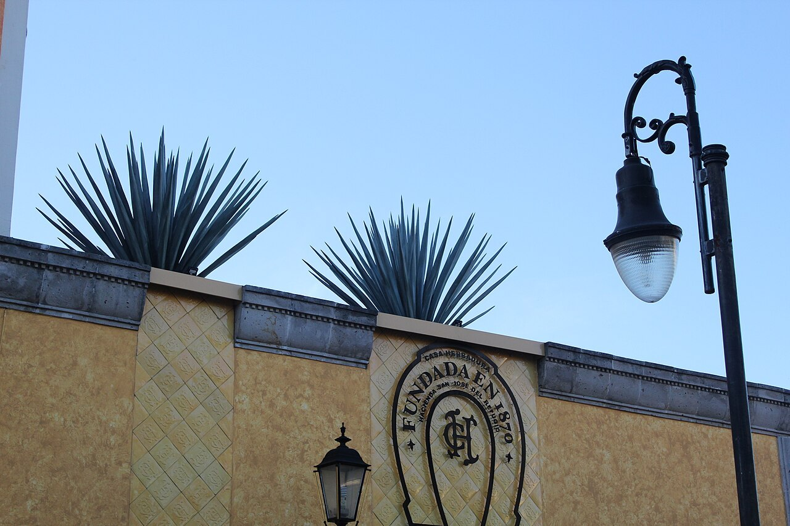

# Casa Herradura: The Horseshoe Hacienda of Amatitán

Casa Herradura occupies the Ex-Hacienda San José del Refugio in Amatitán, Jalisco. It is one of the few old houses in the tequila lowlands that still keeps estate, distillery and bottling line on one piece of land. The story is often reduced to "founded in 1870", but what matters now is how it keeps clay-dome ovens, wild-yeast fermentation and its own American white oak barrels while replacing the donkey-drawn tahona with a modern mill.

Figure: Casa Herradura: The Horseshoe Hacienda of Amatitán. Photograph: Casa Herradura. Credit: Lupita Sarai, CC BY-SA 4.0, via Wikimedia Commons ([source](https://commons.wikimedia.org/w/index.php?curid=84673666)).

## From the volcanic lowlands of Amatitán

Amatitán sits in central Jalisco between Guadalajara and the town of Tequila and is often called a cradle of tequila. The address is the old Hacienda San José del Refugio, Doña Gabriela Peña Lozada 405, postcode 45380; Guadalajara is about an hour by car and Tequila about twenty minutes. Use official channels for exact coordinates. The estate lies in volcanic lowland, and its blue Weber agave, harvested at six to eight years, reads earthy and herbal.

## A nineteenth-century hacienda that still runs

The house dates its beginning to 1870, here in Amatitán. Legend has it that the distiller Aurelio López Rosales saw something glinting in a field, thought it was gold and found a horseshoe, which he took as a sign of good fortune; "herradura" is Spanish for horseshoe, and in 1928 it became the brand name.

It lived through the Mexican Revolution, the Cristero War and land reform, and ownership changed several times, but production did not stop. It belongs today to Brown-Forman, yet still builds its story around estate growing, distillation and bottling. Visitors walk through a working plant, not a museum.

## Clay ovens, wild yeast and copper pots

Casa Herradura did not freeze its method. Piñas are still stacked in hand-built clay-dome ovens and steamed for about 26 hours, drawing out caramel and nut notes. Milling, however, moved to modern equipment, replacing the stone tahona that donkeys once pulled.

Fermentation is the other pivot. Open-top tanks rely on wild yeast carried by more than sixteen species of fruit trees around the estate, and fermentation runs about three days. Wild populations shift with season and weather, so batch variation is wider. Distillation happens twice in copper pots, with heads and tails cut away and only the heart kept. Part of the spirit then goes into charred American white oak. The chain maps onto the entries on [agave](ref:agave), [distillation](ref:distillation) and [oak ageing](ref:oak-ageing).

## From Blanco to Selección Suprema

The range spreads ageing widely. Blanco sees no wood; Silver spends about 45 days in barrel; Reposado ages 11 months and is the category the house helped popularise; Añejo spends at least 25 months in wood; Ultra filters an Añejo to clarity; Selección Suprema, released in 1994, was one of the first Extra Añejos; Legend and Aniversario push further, the latter for 100 months to mark 150 years. In 2001 Teresa Lara López became the first female production leader in tequila. In a [Margarita](ref:margarita), Reposado softens the lime, while Blanco suits a drier, salt-rimmed version.

## Where NOM-006 and the appellation fit

[Tequila](ref:tequila) is governed by NOM-006-SCFI-2012. Only spirit made from blue Weber agave, inside the protected zone and through the prescribed process, may carry the name. A bottle marked "100% de agave" must take all its sugar from blue Weber; an unmarked mixto must take at least 51%. Age statements have floors: Reposado two months, Añejo twelve months and Extra Añejo thirty-six months. Casa Herradura ages beyond those floors as a brand decision, not a legal duty.

The protected zone also covers parts of Guanajuato, Michoacán, Nayarit and Tamaulipas, with Amatitán in the Jalisco core. Traceability, cellar records and label approval show the relationship with the regulator. For a shopper, check the CRT mark and the NOM number.

## Tours, prices and booking

All visits are booked online, and walk-in places are not guaranteed. The Casa Herradura Experience lasts about 2.5 hours, costs 950 Mexican pesos, and covers historic buildings, clay ovens, fermentation and ageing cellars with a guided tasting. The Double Barrel Ritual lasts about 3 hours, costs 2,200 pesos, and concentrates on the second cask stage. Private experiences are quoted by email. Visitors must be at least 18 and may be asked for identification.

Prices, languages and times change, so check the official site before travelling. Weekends and holidays fill up; book several days ahead. Anyone who only wants bottles can use the shop without a tour.

## Visiting notes: leave the tasting at the estate

**Getting there**: about an hour from Guadalajara and twenty minutes from the town of Tequila; organised tours usually include transfers.

**On site**: cooking and distillation areas are hot and floors can be wet, so wear non-slip shoes and bring water. Do not touch equipment or piping, and ask before photographing.

**Tasting**: start with Blanco, then Reposado and Añejo. Small pours and spitting are normal.

**Driving**: country roads are narrow, so do not drive after a tasting. Appoint a non-drinking driver or use a licensed transfer; drink-drive limits vary by state.

Set against the [Fortaleza distillery](ref:fortaleza) on the same route, Casa Herradura shows another kind of tradition: a large hacienda at scale versus a small house relighting old equipment.

For Casa Herradura, begin with the address. Then look at the current opening status, and finally ask what the place is known for. The answers point to different choices, not to a single score.

[Tequila](ref:tequila) and [Agave](ref:agave) are the nearest useful comparisons: one clarifies address and space, the other tests operating status.

The entry on Casa Herradura draws on Tequila Herradura, Consejo Regulador del Tequila. 

A common misreading treats Casa Herradura as a brand or a region. The correction is to ask what it is, then where it belongs, and keep the answers apart.

The Amatitán hacienda is a working distillery with agave fields around it, and the Herradura brand takes its name from the horseshoe mark.

**Key facts.**

| Item | Detail |
| --- | --- |
| In one line | A tequila distillery at the Ex-Hacienda San José del Refugio in Amatitán, Jalisco, with roots in 1870; known for clay-dome ovens, open-air wild-yeast fermentation and its own American white oak barrels, with visits by re… |
| Address | Ex-Hacienda San José del Refugio, Doña Gabriela Peña Lozada 405, 45380 Amatitán, Jalisco, Mexico |
| City and country | Amatitán / Mexico |
| Status | verified open |
| Official site | herradura.com |

**Sources and limits.** The key claims about Casa Herradura: The Horseshoe Hacienda of Amatitán are checked against the following sources: Tequila Herradura (Used to check the tour types, durations, prices, the minimum age of 18 and the online booking route), Consejo Regulador del Tequila. For current products, addresses or opening status, use herradura.com. Prices, batches and status change; the body is project-written and does not reproduce source text.
