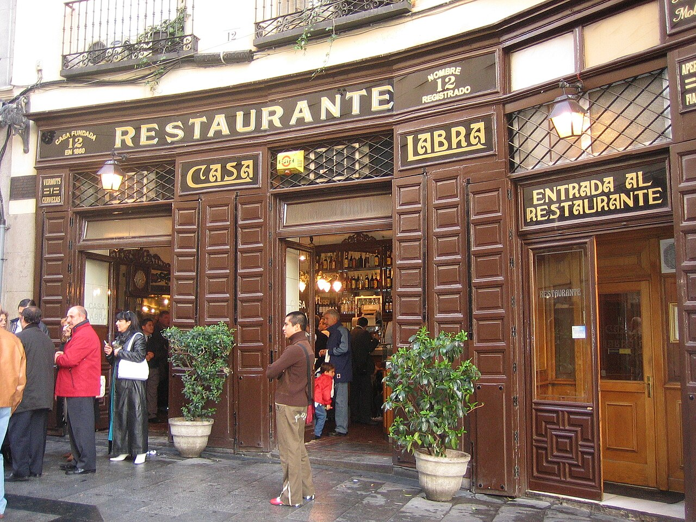
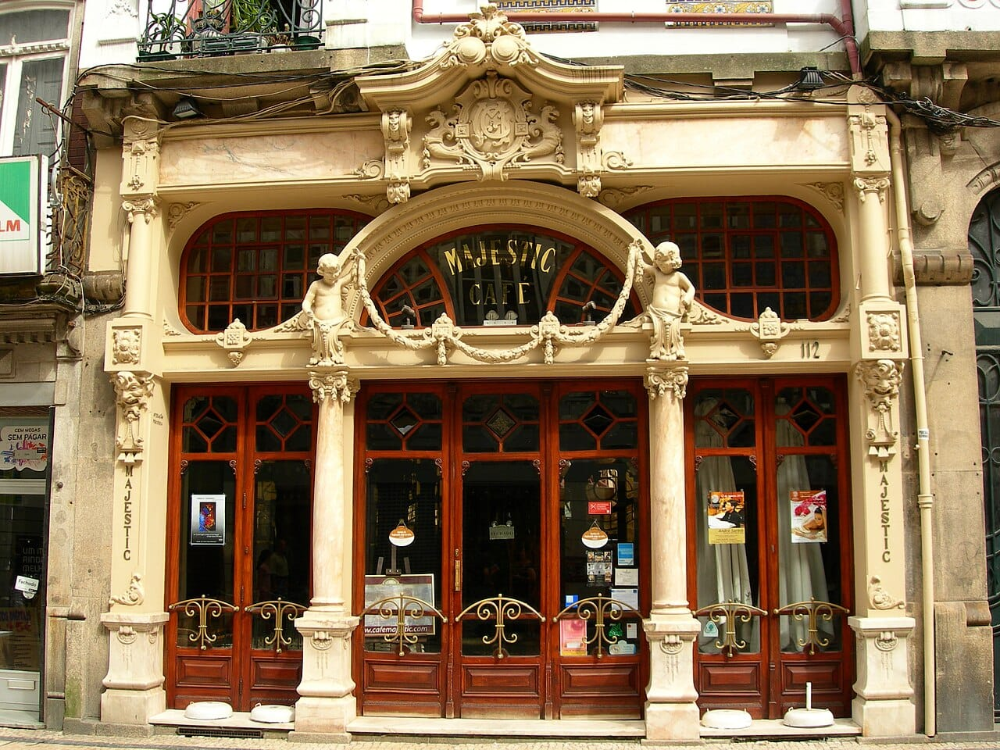

# Casa Labra

From Puerta del Sol, turn north into Calle de Tetuán. A few dozen metres along, an old glass sign and a curved wooden facade appear, with people standing at the door eating fried fish. Casa Labra is not a restaurant with menus, waiters and tablecloths; it is an old tavern where you eat standing up: a zinc counter, small marble tables, sayings and old photographs on the wall, and freshly fried bacalao piled behind the counter. It is a minute from Puerta del Sol, yet keeps the rhythm of a nineteenth-century Madrid taberna.

Figure: The curved wooden facade and "Restaurante" sign of Casa Labra, Calle de Tetuán 12. Image: Midir, CC BY-SA 4.0, via Wikimedia Commons ([source page](https://commons.wikimedia.org/wiki/File:Casa_labra.jpg)).

## Location and history

Casa Labra opened in 1860 as a taberna/fonda — a place that sold drinks and also gave travellers simple food. It sits in the heart of the old city, close to Puerta del Sol, Plaza Mayor and Calle Mayor; in the nineteenth century this area was dense with newspaper offices, cafés, inns and political clubs.

On 2 May 1879 the Spanish Socialist Workers' Party (PSOE) was secretly founded in a back room at Casa Labra. Those present included Pablo Iglesias and Jaime Vera; Spain had no legal workers' party at the time, and meetings had to avoid police and conservative newspapers. The house still records this history on its website and in the shop, and Casa Labra has become part of Madrid's labour-movement memory.

In 1947 the Molina family took over Casa Labra; the house has been family-run since, now by the third generation. In 2010 Casa Labra marked its 150th anniversary, and the city and the Restaurantes Centenarios programme listed it among Madrid's century-old restaurants. It has not been turned into a museum or a smart restaurant; it still concentrates on fried fish, croquettes, oxtail and callos.

Nineteenth-century Madrid tabernas were not only places to drink; they also served breakfast and lunch, exchanged news and offered temporary lodging, and Casa Labra's fonda identity came from that mixture. Today the lodging and full-meal parts have shrunk, but the stand-and-eat, drink-quickly circulation remains, with the counter still the heart of the shop.

## The rooms and the drinks

Casa Labra has two levels: a ground-floor standing area, its zinc counter polished by generations of elbows, and a small upstairs room with tables. The facade is a curved wooden frame with glass, the sign old white-on-black; inside are tiles, old photographs, posters and Spanish sayings. There is no modern open kitchen: the fryer and counter sit behind the bar, and ordering, paying and collecting all happen along the same line.

The signature is bacalao: fried cod strips (tiras de bacalao), cod croquettes (croquetas de bacalao) and fried cod pieces; there are also oxtail (rabo de toro), callos, sardines, ham and cheese. Drinks are Spanish beer, wine, sherry and vermouth; with hot cod strips, a cold beer or white wine is the natural pairing.

## How to drink here

Look at the counter first: if there is room at the bar, order tiras de bacalao and a beer close to the counter; the strips should be eaten hot, crisp outside and tender inside, because they go oily as they cool. For just a taste, a small portion of strips with a beer is enough; you do not need a full table of dishes. For a seat, ask whether the upstairs room has a table; there you can order oxtail, callos and larger dishes. Afternoon and early evening are the peak, when a queue forms at the door, but it moves quickly.

For a rhythm closer to daily life, come at 18:30 when the tavern reopens, start with a beer and croquetas, then add tiras de bacalao if still hungry; at that hour the guests are mostly locals off work, quieter than the midday tourist rush.

Do not expect a fixed visit to the "1879 PSOE founding room"; that back room is not a daily exhibition. To understand the history, read the walls and the website, or treat Casa Labra as one stop on a Madrid labour-movement walk.

## Practical information

- Address: Calle de Tetuán 12, 28013 Madrid.
- Hours: tavern 11:30–15:30 and 18:30–22:30; closed Monday morning; the restaurant section is currently closed (according to Tourism Madrid).
- Transport: metro Lines 1, 2 and 3 to Sol; Renfe Sol/Cercanías nearby.
- Reservations: the tavern does not take dinner reservations; you eat standing. Upstairs tables depend on the day.
- Prices: strips and croquettes are sold by portion, beer and wine are cheap; excellent value around Puerta del Sol.
- Tip: the door and counter are crowded, so wear your backpack in front; the floor can be greasy. Parking around Puerta del Sol is difficult, so come on foot or by metro.

## Etiquette and common mistakes

First, do not treat it as a café where you can sit all afternoon; Casa Labra's rhythm is stand, eat and go, and at peak the counter turns fast. Second, do not hold a counter place after one portion of fish; the counter is public space, so give it up when you finish. Third, do not describe the PSOE founding as a public meeting in the main dining room; it was a secret gathering in a back room, as the house and historical accounts stress. Fourth, do not infer from "1860" that every fixture is original; the wooden facade, zinc counter and interior have been repaired repeatedly, though the type and use continue. Fifth, do not use flash in front of the counter to photograph food and guests; the space is small and the flash disturbs others.

## Around and nearby

From Casa Labra, one minute south is Puerta del Sol and the Oso y el Madroño statue, west are Plaza Mayor and Calle Mayor, east the direction of Paseo del Prado and the Museo del Prado. A route might run: Puerta del Sol, standing cod at Casa Labra, Plaza Mayor, Mercado de San Miguel, the Royal Palace and Plaza de Oriente. For the literary quarter, walk east to Huertas and Calle de Lope de Vega, where Cervantes and Quevedo have memorials.

## Further reading and see also

- The house's website: <https://www.casalabra.es/> for 1860, 2 May 1879, the 1947 Molina family and the signature dishes.
- The English page: <http://www.casalabra.es/en/> to cross-check the same facts.
- The Puerta del Sol entry: <https://www.puertadelsol.com/es/casa-labra/> for the zinc counter, marble tables, curved wooden facade and wall sayings.
- The Restaurantes Centenarios 2015 presentation: <https://www.restaurantescentenarios.es/wp-content/uploads/2015/11/images_pdfs_Presentacion_RCM_2015.pdf> to cross-check the 150th anniversary.
- Elsewhere in this batch, `place:els-quatre-gats` and `place:cafe-majestic` compare different southern European historic café and tavern types.
- Related entries: [Els Quatre Gats](ref:gats)、[Café Majestic](ref:majestic)、[Hemingway Bar at the Ritz, Paris](ref:hemingway)、[Caffè Florian](ref:florian)、[Café de la Paix](ref:paix)

**Short definition:** Casa Labra at Calle de Tetuán 12 beside Madrid's Puerta del Sol opened in 1860 as a taberna/fonda; on 2 May 1879 the Spanish Socialist Workers' Party was secretly founded in a back room; the Molina family took over in 1947 and the house is now known for fried cod strips, cod croquettes and its zinc counter.

For Casa Labra, begin with the address. Then look at the current opening status, and finally ask what the place is known for. The answers point to different choices, not to a single score.

[Els Quatre Gats](ref:gats)'s address and space and [Bar Hemingway](ref:hemingway)'s operating status form a useful pair: the contrast shows where one ends and the other begins.

**Key facts.**

| Item | Detail |
| --- | --- |
| In one line | Casa Labra at Calle de Tetuán 12 beside Madrid's Puerta del Sol opened in 1860 as a taberna/fonda; on 2 May 1879 the Spanish Socialist Workers' Party was secretly founded in a back room |
| Address | Calle de Tetuán 12, 28013 Madrid, Spain |
| City and country | Madrid / Spain |
| Status | verified open |
| Official site | casalabra.es |

**Sources and limits.** The key claims about Casa Labra are checked against the following sources: Casa Labra (Used to cross-check 1860, 1879, the Molina family, bacalao and the hours), Puerta del Sol (Used for the Puerta del Sol location, zinc counter, marble tables, curved wooden facade and wall sayings), Restaurantes Centenarios de Madrid (Used to cross-check the 1860 opening, the 1947 Molina takeover and the 2010 150th anniversary). For current products, addresses or opening status, use casalabra.es. Prices, batches and status change; the body is project-written and does not reproduce source text.

## Related images

Image: The Art Nouveau facade and "MAJESTIC" sign of Café Majestic, Rua de Santa Catarina 112. Credit: Maragato1976, CC BY-SA 3.0, via Wikimedia Commons ([source page](https://commons.wikimedia.org/wiki/File:Caf%C3%A9_Majestic_(Porto).jpg)). Related image for Casa Labra.
