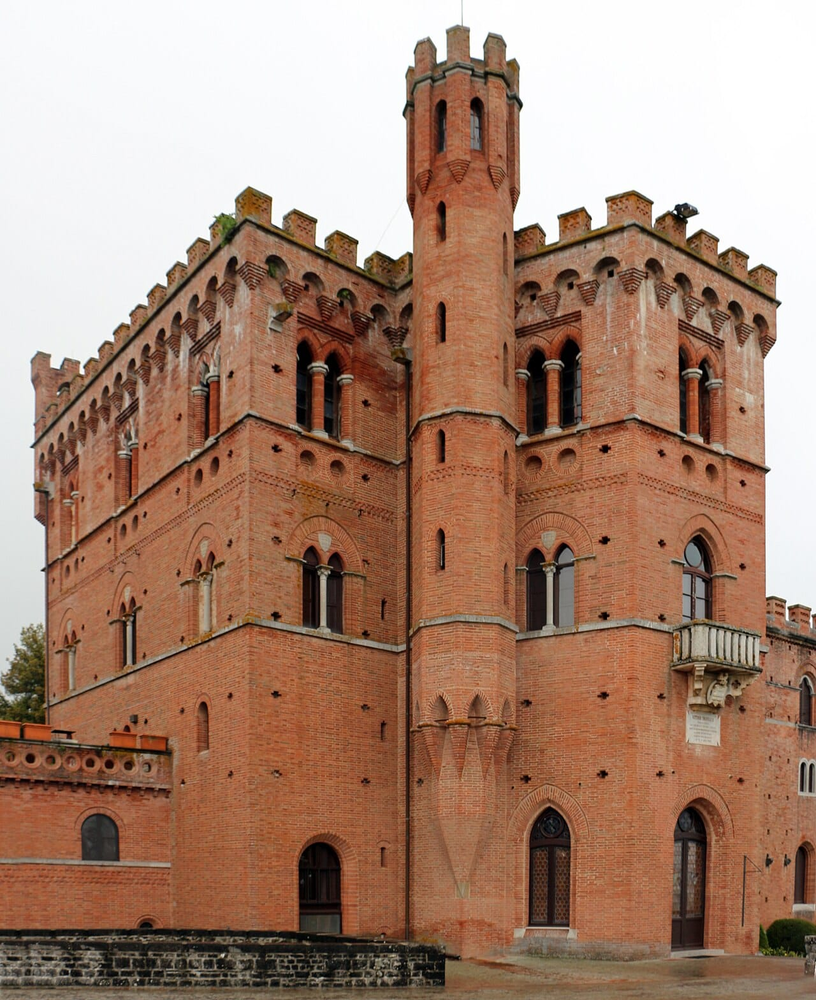
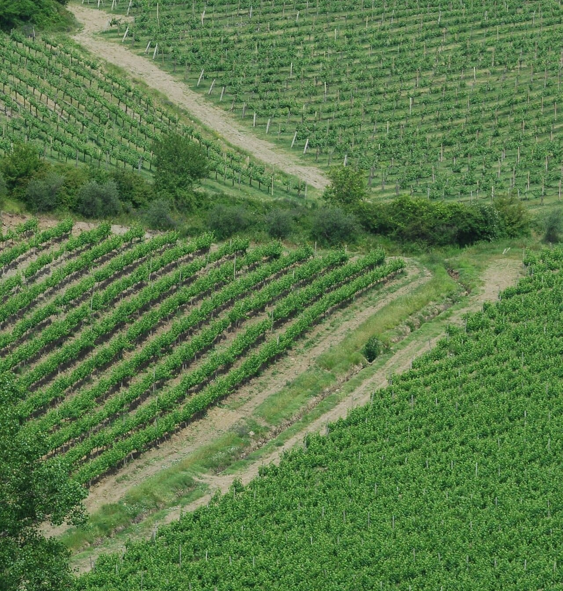

# Castello di Brolio

South of Gaiole in Chianti, the road climbs between ridges and oak woods, and the towers of Castello di Brolio appear before the vineyards. It looks like a classic Tuscan castle, but it is not merely a backdrop for photographs: the Ricasoli family has held land here, run a wine estate, fought in the wars between Florence and Siena and, in the nineteenth century, wrote down the formula for modern Chianti. The ticket takes you into the castle, gardens and family collection; the wine shop at the foot of the hill handles tastings and sales.

Figure: Castello di Brolio. Image: Sailko, CC BY 3.0, via Wikimedia Commons ([source page](https://commons.wikimedia.org/wiki/File:Castello_di_brolio,_edificio_padronale_11.JPG)).

> **Quick verdict**
> **In one line:** This entry helps you decide whether Castello di Brolio deserves a detour, and what to check before visiting.
>
> - **Best for:** Anyone planning a visit to Castello di Brolio who needs to decide whether it deserves a half-day or a full day.
> - **Not for:** If you want only want a must-visit list and will not check booking, transport or opening hours.
> - **Check first:**
>   - The first stones date back to the Middle Ages.
>   - The Brolio range can be read as castle, village, Riserva and flagship.

## A castle still telling a political story

The first stones date back to the Middle Ages. The official account traces the Ricasoli family's acquisition to an exchange of lands, with records as early as 1141. Over the following centuries Brolio was attacked and destroyed repeatedly: Aragonese and Spanish assaults in the fifteenth century, disputes in the seventeenth century, and aerial bombing and artillery fire during the Second World War. What stands today is the result of repeated rebuilding, with medieval defences, Romanesque and neo-Gothic additions and nineteenth-century Tuscan details layered together.

That layered quality is the point of the visit. Walls, towers, courtyards and gardens do not belong to one period; some walls are visibly thicker, some windows and ornaments are later. The official description presents the castle as overlooking the Ricasoli company's land, the largest estate in Chianti Classico, about 1200 hectares, including almost 240 hectares of vineyards and 26 of olive groves, all in the municipality of Gaiole in Chianti.

## The Ricasoli family and the 1141 record

The family multiplied into many branches from the thirteenth century and came together again in the late eighteenth and early nineteenth centuries. The official account links it to wine from 1141, when written evidence shows that it already held Brolio Castle; over the centuries the family defended its lands and was among the first to invest in agriculture and vineyard improvement. A family tree printed in 1584 is considered one of the earliest images of the Chianti area, and documents from the late seventeenth century record exports to Amsterdam and England.

Since 1993 Baron Francesco Ricasoli has run the company. The official account says he reorganised the vineyards, studied soil types, carried out clonal selection of Brolio Sangiovese and mapped the vineyards completely. This shapes the wines: which plots ripen early, which give structure, which clones cope better in dry years. The castle is the public face; vineyard research is the daily work.

## The Iron Baron and the 1872 formula

Bettino Ricasoli (1809–1880) is the figure most often associated with the castle. Known as the "Iron Baron", he served twice as prime minister of the newly united Italy after Cavour and was also a wine entrepreneur. The official account says that in 1872, in a letter to Professor Studiati, he set out the formula for Chianti that later became the basis of Chianti Classico.

In broad terms, the formula gave Sangiovese the aroma and backbone, Canaiolo softness and roundness, and white grapes such as Malvasia to dilute the intensity of the first two. Read it as a nineteenth-century formula, not today's regulation. Chianti Classico was adjusted repeatedly; white grapes were gradually excluded, the rules now require at least 80% Sangiovese with authorised red varieties making up the rest, and since 2006 Chianti Classico may be made entirely from red varieties. Keep the 1872 formula as "tradition" and the current rules as "law".

This history explains Brolio's special place in the Chianti Classico story: it is both a castle and the place where a formula was written. More accurately than the "Iron Baron" nickname, he turned local experience into a blend that could be copied and debated, and the appellation later revised it repeatedly.

## What to see: walls, gardens and the collection

The castle visit usually covers the walls and towers, the courtyards, the gardens and the Ricasoli Collection. On the walls you can read the thickness of the defences and the firing positions, as well as additions from different periods. The gardens reflect nineteenth-century taste and contrast with the castle's military function. The collection brings documents, maps, portraits and objects together to explain how the family moved from feudal nobility to modern wine producers.

The wine shop at the foot of the hill is another entry point. The official description says tastings for small or large groups can be booked there, with staff presenting representative wines of Chianti Classico; the shop also sells wine and local products. Castle tickets and tastings are separate arrangements. If you only want the building and gardens, a castle ticket is enough; if you want a structured tasting, book it or ask at the shop about wines by the glass that day. Do not assume that a castle visit includes a winery tour.

The flagship wine is Castello di Brolio, a Chianti Classico Gran Selezione. The official product page says it uses only estate-grown grapes, is produced only in the best years and is aged in the cellars at Brolio Castle, with an emphasis on concentration and tannic structure. Do not confuse it with the ordinary Brolio village wine.

## What to drink: from Brolio to Gran Selezione

The Brolio range can be read as castle, village, Riserva and flagship. Brolio is the Chianti Classico annata, intended for everyday drinking, with more direct fruit and acidity. Brolio Riserva has longer ageing and a fuller structure, often with dark fruit, spice and tobacco. Castello di Brolio is the Gran Selezione, representing the estate's selection of plots, clones and vintages; production and availability vary by year. Other single-vineyard or special wines appear and disappear with the vintage, so the shop and official site are the reference.

To understand the differences, return to the appellation rules. Chianti Classico annata must age for at least 12 months; Riserva for at least 24 months, including at least three in bottle, with a minimum alcohol of 12.5%; Gran Selezione for at least 30 months, including three in bottle, with at least 90% Sangiovese, estate-grown grapes only and a minimum alcohol of 13%. Riserva is not "a better vineyard" but a longer ageing and ripeness requirement; Gran Selezione is the top tier.

On a first visit, compare the Brolio annata with the Brolio Riserva, then add a glass of Castello di Brolio if the budget allows. The point is not which is more expensive but how ageing changes tannin, acidity and aroma: the annata is brighter, the Riserva rounder, the Gran Selezione more concentrated.

## Practical information and etiquette

The address is Località Brolio, 53013 Gaiole in Chianti (SI), Italy. The winery offices and some reception are at Loc. Madonna a Brolio; the official contact page specifically warns against navigating simply to "Brolio". The castle and the wine shop are at different points on the ridge, so follow on-site signs. The 2026 opening calendar is: 20 March to 8 October daily 10:00–19:00, ticket office closing at 18:00; 9–24 October daily 10:00–18:30; 25 October to 20 December daily 10:00–17:00; closed from 1 January to mid-March 2027.

By car, allow about an hour from Florence, forty minutes from Siena and ten minutes from Gaiole in Chianti; the roads are winding, so follow on-site parking instructions. Public transport is infrequent; without a car, book a taxi or a trip that includes transport. The castle sits on a ridge, with slopes and steps; visitors with limited mobility should ask about the route in advance.

On etiquette: this is private property and a working estate, so do not climb fences, enter vineyards or photograph private residential areas. Tastings at the wine shop should be booked, and groups should state numbers and language in advance. Do not drive after tasting; the Chianti roads are not suited to even mild impairment, and a designated driver or hired car is safer. Do not touch exhibits, furniture or documents, and respect no-flash rules. This entry was verified on 2026-11-08; opening hours, tickets, tastings and restaurant service are subject to official channels, and no map is provided here.

Placed in the context of [Tuscany](ref:tuscany) and [wine](ref:wine), Brolio is most rewarding as a study of how a castle became a wine estate and how a formula became an appellation; for the relationship between place and process, see [Place and process](ref:place-and-process).

Further reading: [Italy](ref:c-extra-1), [Antinori nel Chianti Classico](ref:c-extra-2).

## Related images

Image: Tuscany vineyard. Credit: cova69, CC BY 2.0, via Wikimedia Commons.. Credit: cova69, CC BY 2.0, via Wikimedia Commons ([source page](https://commons.wikimedia.org/w/index.php?curid=1393578)). Related image for Castello di Brolio.
