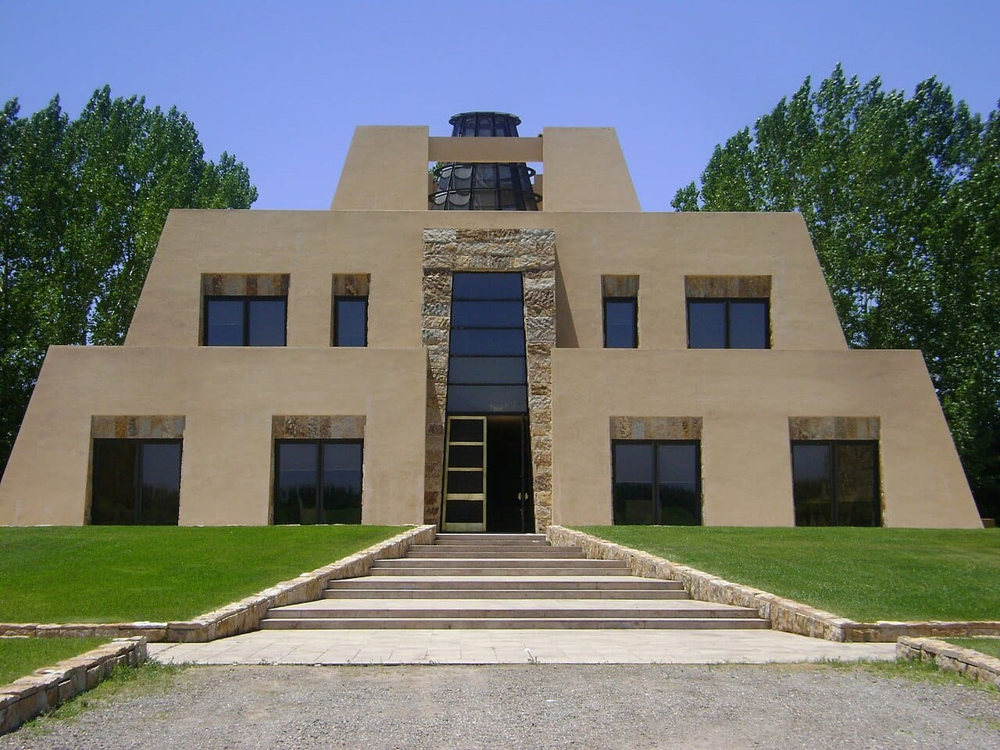

# Catena Zapata

Catena Zapata stands on Cobos road in Luján de Cuyo, its winery marked by a Mayan pyramid and its vineyards running from the valley floor toward the high Andean foothills. The company was founded in 1902, but what brought it to international attention was the late-20th-century redefinition of Malbec and high-altitude terroir. A visit here is not only about seeing the pyramid; it is about understanding how one family turned variety, altitude and winemaking choice into a repeatable narrative.

Figure: Catena Zapata. Image: ArgentinaWineTourism, CC BY-SA 3.0, via Wikimedia Commons ([source page](https://commons.wikimedia.org/wiki/File:ALTURA_Argentina_Wine_Tourism_-_Bodega_Catena_Zapata_-_panoramio.jpg)).

## 1902: from Italian immigrants to Mendoza

The winery was founded by the Catena family in 1902. The official account places the family's Italian immigrant background alongside Mendoza's planting tradition: from Bonarda to Malbec, from local consumption to export markets, the family passed through several transformations. Nicolás Catena Zapata is described officially as the figure who put Argentine wine on the world map; he drove the Malbec revival and brought high-altitude Andean sites into systematic terroir research.

The key word is rediscovery, not invention. Malbec already existed in Mendoza and high-altitude vineyards were not newly cleared land; what changed was the understanding of ripeness, acidity and site difference, and the ability to separate fruit from different altitudes and vinify and age it separately. The 1902 date supplies family continuity; the transformation after the 1990s supplies international visibility. Neither replaces the other.

## The pyramid and Adrianna: two symbols of altitude

The pyramid is the winery's most recognisable building, but it is not the whole story. What supports the narrative is the family's Adrianna vineyard in the Uco Valley: the official description puts it at almost 5,000 feet, or about 1,500 metres, and it has been called the Grand Cru of South America. Altitude brings cooler nights, stronger ultraviolet radiation and a longer ripening period; skins thicken and acidity is retained, so Malbec can reach ripeness while keeping a clear frame.

The visit links pyramid, fermentation areas, cellars and tasting room. Architecture supplies visual memory; Adrianna supplies terroir evidence. See only the building and the estate risks feeling like a theme park. Listen for site names, altitudes and vintages in the guide's explanation; that information explains the wine better than a photograph. For Mendoza's wider altitude structure, see [Mendoza](ref:mendoza).

## Visit programmes and the wines

Official visits are led by specialist guides in small groups; the basic programme runs about 2 hours and includes a winery tour and a five-wine tasting, with blending, musical sensory and restaurant experiences also available. The range runs from Catena to Alta, Adrianna and Malbec Argentino, covering different altitudes and price levels. For a first visit, take the basic tour and connect 1902, Adrianna and Malbec; for returning visitors, focus on comparing sites, especially acidity, tannin and aroma between high and low altitudes.

Do not ask only "which wine is best". A more useful question is: which site, which altitude band, which year? The same variety at different elevations usually says more than a ranking inside one brand. For background on [Malbec](ref:malbec) and [red wine](ref:red-wine), see the related entries; during the tasting, watch how [oak ageing](ref:oak-ageing) shapes structure.

## Booking, prices and getting there

Visits must be booked in advance through the official reservation system. The basic tour and tasting is priced in two 2026 bands: AR$ 184,000 from July to September and AR$ 194,000 from October to December; the blending and musical sensory experiences have separate prices, all subject to the official site on the day. Prices move with exchange rates and season, so do not treat these figures as a long-term quote.

The address is Cobos s/n, Luján de Cuyo (5509), Mendoza, Argentina; the official coordinates are 33°10′4.264″ S, 68°54′14.522″ W, converted here to latitude -33.167851 and longitude -68.904034. It is about 30–40 minutes by car from Mendoza city, and driving or a private car is recommended; park as directed and do not drive between vine rows. After confirming the booking, allow time for navigation and check-in, as lateness can affect entry.

## What Catena's location means in Mendoza

Luján de Cuyo is called the cradle of Argentine Malbec, with vineyards at about 900–1,100 metres, gravel soils that drain well, more than 300 sunny days and a wide day-night temperature range. Catena Zapata connects this traditional zone with the high-altitude sites of the Uco Valley, creating a line from "classic region" to "extreme altitude". Pairing the two stops on one route is not about ranking prestige but about understanding how the same variety changes in ripeness and structure with elevation.

For a traveller, Catena is a coordinate: it shows that Mendoza is not only drought and irrigation but also precise site selection and long-term experiment. Once that is clear, Maipú or the Uco Valley no longer need to be explained by "higher is better".

## Common misconceptions

First, the pyramid is not the whole winery. Architecture is the entrance; terroir and sites are the content. Second, not every Catena wine comes from Adrianna. The range covers several sites and altitudes, and Adrianna is the most symbolic among them. Third, high altitude does not automatically mean high alcohol or concentration. It more often brings tension, acidity and floral notes, not simply "bigger". Fourth, do not ignore booking and price bands. Fifth, 1902 is not the start of the modern style; family history is long, and the modern transformation came much later.

Start with the address. From there, consider the current opening status, then what the place is known for. That is how a practical judgment about Catena Zapata is built.

**Short definition:** A family winery in Luján de Cuyo, Mendoza, founded in 1902 and known for the revival of Malbec and high-altitude terroirs in the Andean foothills; the pyramid building and Adrianna vineyard anchor the visit, which requires booking, and the official coordinates are 33°10′4.264″ S, 68°54′14.522″ W.

**Key facts.**

| Item | Detail |
| --- | --- |
| In one line | A family winery in Luján de Cuyo, Mendoza, founded in 1902 and known for the revival of Malbec and high-altitude terroirs in the Andean foothills; the pyramid building and Adrianna vineyard anchor the visit, which requir… |
| Address | Cobos s/n, Luján de Cuyo (5509), Mendoza, Argentina |
| City and country | Luján de Cuyo / Argentina |
| Status | verified open |
| Official site | catenazapata.com |

**Sources and limits.** The key claims about Catena Zapata are checked against the following sources: Bodega Catena Zapata, Instituto Nacional de Promoción Turística (INPROTUR) (Used to check Luján de Cuyo's altitude range, gravel soils and Malbec background), Wines of Argentina, based on the INV annual surface report (Used to check Mendoza's Malbec area and share as regional background for Catena Zapata). For current products, addresses or opening status, use catenazapata.com. Prices, batches and status change; the body is project-written and does not reproduce source text.

## References

This entry was checked against Catena Zapata's official contact, about and visit pages, Argentina's national tourism promotion material for Mendoza and Wines of Argentina's INV-based data. Page verified 2026-11-09. To place this stop in a day, see the [Mendoza wine trail](ref:route). Opening hours, prices and booking rules are subject to official channels.
