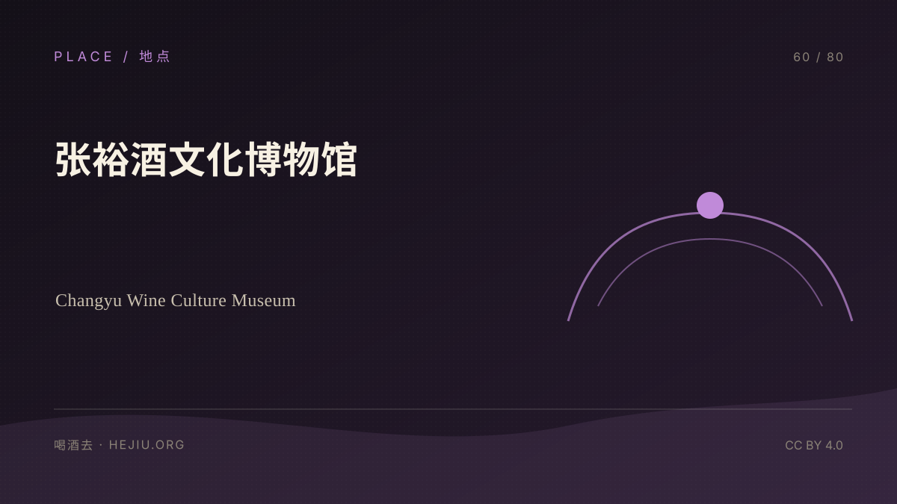

# Changyu Wine Culture Museum

The Changyu Wine Culture Museum stands at 56 Dama Road in Zhifu District, Yantai, on the old Changyu company site. Zhang Bishi founded Changyu in 1892, and the museum opened in 1992, the company's centenary year. Its own introduction calls it China's first specialist wine museum; it is also a national first-class museum, a 4A tourist attraction and one of the first national industrial-tourism demonstration bases. It is not a winery estate but a museum that connects company history, industrial heritage and wine consumption along a single timeline.

> **Visit information**
> - Address: 56 Dama Road, Zhifu District, Yantai, Shandong, China.
> - Opening and booking: check the [official page](https://www.cymuseum.cn/) before travelling; hours, tours and booking rules change by season.
> - Getting there and cost: check the official page before booking; this entry does not promise a fixed price.
> - Status: Verified; sources checked: 2026-11-08.

Figure: Changyu Wine Culture Museum. Project-generated or category illustration used for winery and wine venue context; not a photograph of the subject.

> **Quick verdict**
> **In one line:** This entry helps you decide whether Changyu Wine Culture Museum deserves a detour, and what to check before visiting.
>
> - **Best for:** Anyone planning a visit to Changyu Wine Culture Museum who needs to decide whether it deserves a half-day or a full day.
> - **Not for:** If you want only want a must-visit list and will not check booking, transport or opening hours.
> - **Check first:**
>   - In 1892 Zhang Bishi invested three million taels of silver to establish the Changyu winemaking company on the Zhifu Bay waterfront.
>   - The museum summarises its 4.0 displays in six sections: Century Radiance, the Long Scroll of Wine, Industry and Nation-building, the "Dare to Lead" surround-screen film.

## Place and history

In 1892 Zhang Bishi invested three million taels of silver to establish the Changyu winemaking company on the Zhifu Bay waterfront, opening the way for industrial wine production in China. That starting point shapes the museum's narrative: it explains how a modern wine industry was introduced into China first, and discusses flavour and tasting second. The museum uses both "China's first specialist wine museum" and "China's first world-class wine museum" in its own materials. Both describe its position as a wine-themed museum, not a claim to be the oldest museum of any kind in China.

The museum opened in 1992 and was expanded and rebuilt in 2002 and 2007. For Changyu's 130th anniversary the museum began a "Museum 4.0" upgrade built around interactive and digital displays, adding about 2000 square metres to reach nearly 10,000 square metres of exhibition space. It is therefore not a frozen corporate showroom; it keeps rewriting its own story through film, interaction and immersive tasting.

One easily missed detail is the street number. The Changyu museum is at 56 Dama Road in Yantai; the Tsingtao Beer Museum is at 56 Dengzhou Road in Qingdao; Chateau Changyu Castel is at 56 Beijing North Road in Yantai's development zone. The museum's own guide mentions the coincidence, but it is only a coincidence. The three sites are not one visitor circuit.

## Why Yantai

Yantai was a treaty port with a harbour, a mild coastal climate and access to shipping, all of which suited large-scale grape growing and the movement of equipment. Zhang Bishi also had commercial networks in the city. Building the plant on Zhifu Bay placed it close to both the port and the new urban life of the period. The Dama Road location, between Yantai's old town and the coast, is itself part of the industrial heritage.

This also explains why the exhibition begins with "industry and nation-building" rather than grape varieties. A European winery visit usually centres on vineyards, plots and vintages; Changyu's starting point is the attempt by Chinese investors to build a modern wine factory. A first-time visitor who looks only at bottles and labels will miss the main point: how a modern company took root in a treaty port and gradually built a brand and a consumer market.

## Exhibits and route

The museum summarises its 4.0 displays in six sections: Century Radiance, the Long Scroll of Wine, Industry and Nation-building, the "Dare to Lead" surround-screen film, the "Eye Level with the World" film and "Tasting Time" immersive tasting. The overall narrative follows a timeline tied to Changyu's 130-plus years. A 2.8-metre statue of Zhang Bishi by the sculptor Sui Jianguo stands east of the entrance square and serves as the start of the "56 Dama Road" story.

The century-old cellar is the museum's least replaceable exhibit. The museum says it lies less than 100 metres from the coast and more than a metre below sea level, and that by 2026 it had been in use for 132 years, making it an unusual piece of cellar architecture. It is not a stage set: temperature, humidity and ceiling height all differ from the galleries above. Among the rows of oak casks, the museum lists the giant "King of Asian Casks" among its treasures and it is one of the most photographed spots in the cellar. Allow enough time to walk through it rather than stopping at the entrance for a photograph.

The official visitor route lists the visitor centre, the museum, the courtyard conservatory, the grape corridor, the sculpture square, the fountain, the early bank vault, the qilin screen wall, the 1892 Wine Hall, the barrel stream and the Changyu gate. Follow the map on site, but the logic is roughly threefold: history in the main galleries, the cellar as a space, and the courtyard and 1892 Wine Hall as the experience. The vault, screen wall and gate are physical evidence of company history and are best read alongside the timeline indoors.

The collection works through corporate archives, historical images, wine-related objects and reconstructed scenes; the "King of Asian Casks" then pulls attention back to the physical scale of the cellar. Anyone expecting rows of famous bottles or a cathedral of oak barrels may find it closer to a corporate memorial; anyone interested in modern industry, brand history and urban consumption will find far more density.

## How to visit

Allow two to three hours. Start with the main galleries on the two floors to follow the timeline from 1892; go down to the century-old cellar to experience the space itself; finish in the courtyard, grape corridor and 1892 Wine Hall. With only an hour, prioritise the galleries and the cellar and move quickly through the courtyard.

Follow three threads: Zhang Bishi and the "industry and nation-building" story; the technical line from imported vines and equipment to branded production; and the way wine moved from a foreign product into Chinese urban consumption. The "Dare to Lead" and "Eye Level with the World" film sections pull these threads together, so they work well as a midpoint or a conclusion.

Whether tasting is included depends on the ticket. The museum offers "Tasting Time" and the 1892 Wine Hall, and some packages include tasting while others cover admission only. Check the purchase page; do not assume that a museum ticket automatically includes wine, or the on-site top-up will upset your budget.

The museum suits wine beginners, industrial-heritage enthusiasts and families interested in corporate history. It does not suit visitors who want vineyards, estate scenery or a formal winery lunch. There are no large vineyards here; the focus is buildings, archives and displays. The wider site also has a retro "Changyu Tipsy Train" and the 1892 Art Centre; some experiences cost extra or open only at certain times, so check official notices before planning around them.

## Practical information

Address: 56 Dama Road, Zhifu District, Yantai, Shandong, China, on the old Changyu plant. Hours are 08:00–17:00, with last entry and last ticket sales at 16:30, open all year (museum site and the Yantai digital museum page, rechecked 2026-11-08); holidays and temporary closures follow official notices.

Tickets: adult admission is 80 yuan or 158 yuan (two ticket types, the latter with more experiences); minors, visitors aged 70 and over, disabled visitors and active, retired or disabled military personnel are free with valid ID; a 55 yuan ticket for visitors aged 60–69 appears on some channels and should be confirmed on site. Prices and concessions can change, so check the official smart store or the on-site notice before buying.

Book through the museum's official WeChat account or its official smart store. The visitor centre number is 0535-6633860 and the museum reception is 0535-6632892. Groups, school visits and guided tours should make arrangements in advance. Chinese guiding is 180 yuan for up to ten people; gold-standard and English guiding are 280 yuan for up to ten.

The museum is in Zhifu District's old town, close to Yantai Mountain, Chaoyang Street and the Binhai Square waterfront. A taxi from Yantai railway station takes roughly ten minutes depending on traffic. Buses serve stops near the museum and Yantai Mountain Hospital, but exact routes and stops should be checked on live maps (not verified route by route). Parking is free, with about 30 spaces; the old streets are narrow and fill up in peak season.

Page verified 2026-11-08; opening status, prices and reservations are subject to official channels.

## Etiquette and common misconceptions

The biggest misconception is that this is a Changyu chateau. Changyu also operates Chateau Changyu Castel and an international wine city elsewhere in Yantai; the museum is only the old plant at 56 Dama Road. The Changyu name does not mean any one vineyard.

The second is to read "national first-class museum" as "a museum of antiquities". This is a corporate museum whose core assets are archives, industrial buildings and a cellar; its methods lean on media and reconstructed scenes rather than the painting-and-bronze route of a comprehensive museum.

The third is to ignore the cellar's physical conditions. Underground spaces are cooler than the galleries, so a light jacket is sensible in summer, and wet floors require slower walking. Follow photography notices, do not touch objects and do not enter fenced areas.

Do not taste on an empty stomach, and do not drive afterwards. Wine has less alcohol than baijiu, but several samples still affect judgement. Eat something first, sip slowly and leave enough time before your next stop.

A further misunderstanding is that free admission includes tasting. Free entry usually covers the visit only; tasting and experience programmes may be charged separately. Minors who are admitted free are not thereby allowed to drink. Families with children should focus on the displays and cellar rather than the tasting.

## Neighbourhood and routes

The museum sits in Zhifu District's old town and works well in a half- or full-day route with Yantai Mountain, Chaoyang Street and Binhai Square. See the museum and cellar in the morning for two to three hours, eat around Chaoyang Street, climb Yantai Mountain in the afternoon to see the former consulate buildings, then walk along the waterfront. Suochengli, the old walled quarter, is another option if time allows.

The order can be reversed: browse Chaoyang Street and Yantai Mountain first, then enter the museum in the afternoon to avoid tour groups. Holidays and summer are busier; a weekday morning is usually calmer, though actual crowds depend on bookings.

For a dedicated wine trip, treat the museum and Chateau Changyu Castel in the development zone as separate outings. They are not in the same district and the drive is considerably longer; trying to do both in one day turns into a relay. If you can choose only one, the museum explains the industry's history, while Castel shows vineyards and chateau architecture.

## See also

The Changyu museum is an entry point for understanding how [wine](ref:wine) arrived in China, and it places Yantai within the modern industrial and consumer history of [China](ref:china). It differs from the European winery-visit model: company history and industrial heritage come first, with tasting and sales second.

Further reading: [Yantai Changyu Pioneer Wine Co., Ltd.](ref:c-extra-1), [Changyu Wine](ref:c-extra-2), [A Ginjinha](ref:c-extra-3).
