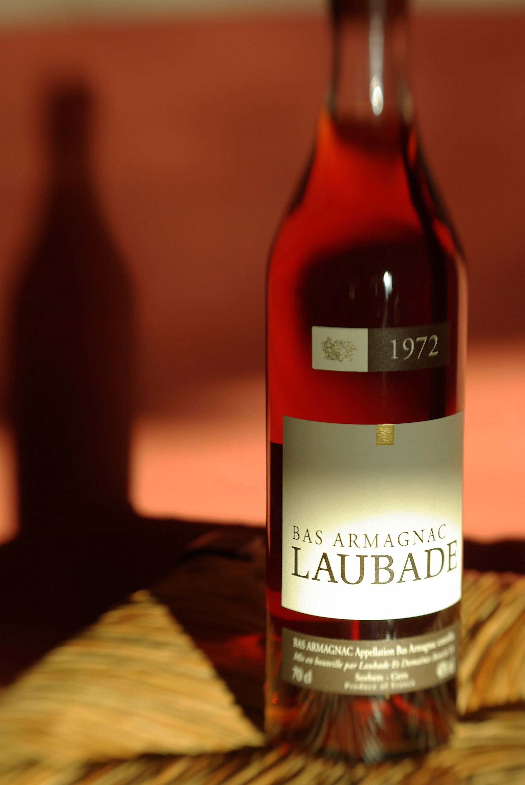

# Château de Laubade

Château de Laubade is a single-estate Armagnac property in Bas-Armagnac, at Sorbets in the Gers, built in 1870, with 80 hectares of vines in one block around the château and three generations of the Lesgourgues family behind it. It is known for the tawny sands of Bas-Armagnac, for estate bottling and for vintage Armagnac: each eau-de-vie is aged separately by grape variety and year, and every bottle carries a bottling date and batch number. Those three points make it a different kind of visit from a large blending house.

Figure: Related photograph of Château de Laubade. Image: Adam Baker, CC BY 2.0, via Wikimedia Commons ([source page](https://commons.wikimedia.org/wiki/File:1972_Chateau_de_Laubade_Bas_Armagnac_Vintage.jpg)).

## 1870: a château and two famous names

The château was built in 1870 by Joseph Noulens, a French statesman, and his wife Jeanne Paquin, a Paris fashion designer. Noulens sat in the Chamber of Deputies and the Senate and served several times as a minister, and the estate was a social and agricultural landmark in the late 19th century. After a period of decline, Maurice Lesgourgues bought the property in 1974, restarted distillation and revived the tradition of vintage bottling; today Denis runs it with his sister Jeanne and his brother Arnaud.

The estate received the Entreprise du Patrimoine Vivant label in 2015, has held ISO 9001 since 2008, and says it has won around 250 awards, including Spirit of the Year 2020 from La Revue des Vins de France. Awards and certifications explain its position in the region, but the style still comes from grapes, distillation and cask ageing rather than from medals.

## The sandy soils of Bas-Armagnac

Armagnac has three subregions, Bas-Armagnac, Ténarèze and Haut-Armagnac, and Laubade sits in the heart of Bas-Armagnac. Its gentle slopes are covered with tawny sand and sandy clay, which drain quickly and warm early in spring, so the grapes ripen more evenly; the resulting spirits are finer and more aromatic, and they age well over decades. The 80 hectares form one block around the château and cellars, keeping harvest and transport distances short, which is what single estate means in the vineyard.

In the field, the estate uses green manure, mechanical weeding under the rows and cereal rotations to support soil life, keeps 600 sheep for organic manure, and maintains 15 hectares of Gascon oak and 10 hectares of poplars. It also makes much of Baco, a disease-resistant variety that is one of Armagnac's raw-material signatures beyond the Ugni Blanc that dominates Cognac. Reading the [Armagnac](ref:armagnac) entry alongside these soils explains why estates in one small region can taste so different.

## A continuous still from 1974

Laubade distils on a single Armagnac-style continuous still, custom-built in 1974, running the six local varieties separately: Baco, Ugni Blanc, Folle Blanche, Colombard and Plant de Graisse among them. The white wines are unsulphited and distilled as soon as fermentation ends to keep their aromatics; the cellar master sets the parameters by vintage and variety, and the strength of the spirit is adjusted by taste.

This is a different road from Cognac's double pot distillation. Continuous distillation is done in one pass, producing a lower-strength spirit that keeps more flavour compounds and a heavier body. Read the general principles of [distillation](ref:distillation) next to Armagnac practice and "distilled once" no longer sounds rough: it is a trade-off, and the heavier spirit needs longer in cask to settle.

## Three thousand casks and a vintage collection

The estate has nine ageing cellars and about 3,000 oak casks of 420 litres, with spirits stored separately by variety and vintage. Staves are selected and seasoned on the estate from Gascon pedunculate oak, then made into bespoke barrels by local coopers; during ageing the casks are aired, rotated between drier and damper cellars and moved between new and older wood. Every bottle and decanter carries a bottling date and batch number, which the house presents as a promise of traceability.

Vintage Armagnac is Laubade's signature. Its Celebration Vintages range covers bottlings aged 15 to 50 years, each cask tended individually, blended where needed and bottled on the estate. A vintage gives the traceable style of one year, not a guarantee of quality: ripeness, acidity and the distillation run all change the result. Treat [oak ageing](ref:oak-ageing) as active management rather than passive waiting, and the numbers begin to mean something.

## Visiting and practical information

The address is Château de Laubade, 32110 Sorbets, France, in the Bas-Armagnac countryside of the Gers, close to Labastide-d'Armagnac in the Landes. Two visits are offered: the introductory Premiers pas tastes three classic Armagnacs; the deeper L'essence de Laubade walks the cellars and vineyards, shows the monumental sculptures in the grounds and ends with five Armagnacs. Book through the Rue des Vignerons platform or on +33 5 62 09 06 02; the office is open Monday to Friday, 8:30–12:00 and 13:30–16:00, and closed at weekends and on public holidays.

The highlights are the 1870 château and old cellars, the continuous still and cooperage, and the sculptures among the vines. The estate is rural and poorly served by public transport, so a car is the practical choice; approach from Mont-de-Marsan, Pau or Agen and follow navigation for the final route. Coordinates should be taken from official channels. Cellars are cool, so a jacket is more useful than short sleeves; vintage bottles can be bought after the tasting, but check luggage and customs limits first.

## What single estate means here

Single estate is not a marketing adjective at Laubade but a chain that can be checked: the grapes come from the estate's 80 hectares, the distillation happens on site, the ageing happens on site, the bottling happens on site, and vintage and batch can be traced. Where a large house blends across estates and years into one house style, Laubade prefers to leave the differences between years in the bottle.

That also sets limits: in a poor vintage, or one whose style does not fit, there is no other estate to fill the gap, and output is far smaller than that of the big Cognac brands. Set the wider category of [brandy](ref:brandy), the French [France](ref:france) appellation system and the Armagnac vintage tradition on one line, and Laubade becomes a clear sample of a small region, a single estate and a vintage-led approach. Ask about the current distillation and ageing before deciding what to buy.

**At a glance:** A single-estate Bas-Armagnac property in Sorbets, Gers, built in 1870 with 80 hectares in one block, known for tawny sand soils, a continuous still built in 1974, some 3,000 casks and estate-bottled vintage Armagnac.

For Château de Laubade, begin with the address. Then look at the current opening status, and finally ask what the place is known for. The answers point to different choices, not to a single score.
