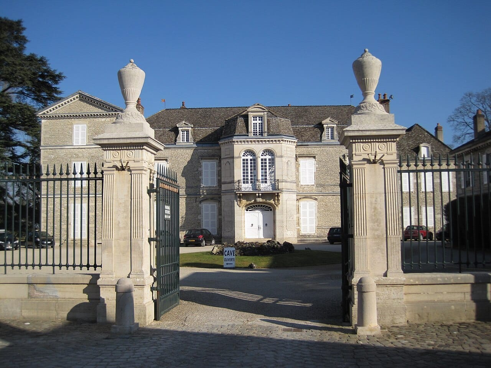

# Château de Meursault

Château de Meursault stands in the village of Meursault, in Burgundy's Côte d'Or, at Rue Charles Giraud. Visitors often shorten the name to "the château," but what they actually enter is a working wine estate: vines, a winery, underground cellars and tasting rooms are linked together, and the château building is the entrance and the reception room rather than the whole story. Treating it as a historic house open to free wandering misses the wine estate; treating it as an ordinary winery misses the buildings and the underground spaces that have been preserved.

Figure: Château de Meursault. Photograph: Château de Meursault 003. Credit: Arnaud 25, CC BY-SA 3.0, via Wikimedia Commons ([source](https://commons.wikimedia.org/w/index.php?curid=18551544)).

> **Quick verdict**
> **In one line:** This entry helps you decide whether Château de Meursault deserves a detour, and what to check before visiting.
>
> - **Best for:** Anyone planning a visit to Château de Meursault who needs to decide whether it deserves a half-day or a full day.
> - **Not for:** If you want only want a must-visit list and will not check booking, transport or opening hours.
> - **Check first:**
>   - The estate traces its history to the 11th century.
>   - Visits fall into two categories: reserved and walk-in.

## Place and history

The estate traces its history to the 11th century. Robert I, Duke of Burgundy of the Capetian line, granted the fief of Moulin Foulot to one of his squires, and the land changed hands repeatedly during the struggles between the Duchy of Burgundy and the French crown. In 1666 Pierre Blancheton, a lawyer at the Parliament of Burgundy, bought the fief and became Lord of Meursault; from this period the estate's vineyard connections become clearer. Over the following three centuries the property was inherited, divided and sold among families until 1973, when André Boisseaux bought the château and restored it completely. Château de Meursault then became one of the important estates of Burgundy under its present name and scale.

At the end of 2012 the Halley family acquired the property and continued to work with the same priorities: respecting the terroirs and expressing the Premier and Grand Cru sites. The vineyard today covers about 67 hectares across more than a hundred parcels, including 6 Grands Crus, 20 Premiers Crus and village and regional sites in Aloxe-Corton, Beaune, Volnay, Pommard and elsewhere. Since the 2022 vintage the estate's own vineyard has been farmed organically. One distinction matters: the 11th century is the beginning of the land and fief history, while 1973 is the beginning of the modern estate name and visitor operation; they are not the same "founding year."

## Spaces and the list

The present château is an 18th-century Italianate building, renovated in 2024 and adapted into rooms for tastings, with a terrace facing the Clos du Château. This walled plot of about 8 hectares is planted with Chardonnay and supplies one of the estate's flagship white wines. The château, conservatory, plots and park together cover about 10 hectares; the grounds include a chestnut path, an orchard, ponds and a cedar said to be three hundred years old. These are part of the estate's ecological and visitor narrative, not a separate botanical garden.

The underground cellars are the part of the visit that deserves the most time. According to the estate, the Cistercian-style cellars were dug and used from the 12th to the 19th century and cover about 3500 square metres beneath the château and its outbuildings. The larger cellar and the historic winery were renovated with bio-sourced materials and are temperature-controlled by 26 geothermal wells in the park. A new winery inspired by Fontenay Abbey is due to take its first harvest in 2026 and is dedicated to Premiers and Grands Crus. What visitors see is not a staged underground corridor but an old working space still serving the wines.

The list centres on Meursault white wines and also covers reds and whites from the Côte d'Or. Whites commonly include Meursault, Meursault Premier Cru Les Charmes-Dessus, Meursault Premier Cru Perrières and Puligny-Montrachet Premier Cru; reds may include Volnay Premier Cru Clos des Chênes, Pommard Premier Cru Clos des Epenots and Corton Grand Cru. For a first encounter with Burgundy, the most useful comparison is a village-level Meursault, then a Premier Cru, then a red to see how the estate handles structure. They belong to the wider traditions of [white wine](ref:white-wine) and [red wine](ref:red-wine), but in Burgundy the point is less the grape variety than the small differences between sites.

## How to visit or order

Visits fall into two categories: reserved and walk-in. The reserved option combines a tour of the château and cellars with a tasting led by a sommelier, covering the estate's history, winemaking and parcels, and usually lasts between 1 hour 15 minutes and 1 hour 30 minutes; groups of 10 to 30 people must contact the estate by email. Walk-in tastings take place in the château's rooms and on the terrace and suit travellers who only want a glass or two, but the wines available and the seating depend on the day. The official pages state the language of each experience, usually French or English, so check before booking.

Château de Meursault is best approached through the address, then the current opening status, and then what the place is known for. One check alone will not settle it.

## Practical information

Address: Rue Charles Giraud, 21190 Meursault, France (coordinates 46.97440, 4.77350). The estate is about 8 kilometres south of Beaune, close to the Paris–Lyon TGV line, and is reached by car from the A6, A31 and A36 motorways. The château entrance is pedestrian, with parking in the "chestnut alley." Telephone +33 3 80 26 22 75, email tourisme@chateau-meursault.com.

Transport: public transport is less convenient than driving. From Beaune station, take a taxi or a local bus for about 15 minutes to Meursault; from Dijon, take a TER train to Beaune and change. Village streets are narrow and the estate has no large car park, so in high season park in the chestnut alley and walk in.

Opening hours (2026): May to September daily 10:00–18:30; October to April daily 10:00–12:00 and 14:00–18:00; in the low season from mid-November to the end of March it closes on Sunday afternoons, Mondays and Tuesdays, with Mondays and Tuesdays finishing at 17:00. Allow enough time before the last entry.

Booking and prices: visits and tastings run by reservation, by telephone or through the official and Beaune tourist office booking pages, with a maximum of 12 people per tour and French or English departures. Grands Terroirs costs €59, including the château and cellar tour and seven wines (about 1 h 15 to 1 h 30); Prestige €105 (eight wines in a private room); Exclusive €175 (Clos vineyard plus eight Premiers and Grands Crus); groups of 10–30 pay €49 per person for 1 h 30 to 2 h. Walk-in tastings take place in the château rooms and on the terrace, with wines and seating subject to the day. The Hospices de Beaune auction weekend in mid-November has separate packages and prices.

Pets are not admitted, and comfortable shoes are better than heels because the cellar floors and village streets are uneven. Page checked on 2026-11-08; operating status, prices and bookings are subject to official channels.

## Etiquette and common mistakes

The first mistake is to read "château" as a historic building open to independent touring. Château de Meursault is first a wine estate; the route, the accessible areas and the tasting schedule are managed by the operator. Without a reservation, do not walk toward the cellars on your own. The second mistake is to treat the 11th century as the founding year of the modern estate. The land record, family inheritance, the 1973 restoration and the 2012 purchase are different timelines, and merging them gives a false picture.

A third mistake is to drink only white. Meursault is famous for white wine, but the estate also makes reds in Volnay, Pommard and Corton; leave one glass for a red to understand its full Côte d'Or range. During a tasting, do not swallow everything at once. Burgundy glasses are usually small and the pours are restrained; look at the colour, smell, then take a small sip to check acidity and length. If you do not want to finish a glass, use the spittoon. This is normal practice at a wine estate, not bad manners.

Another common confusion is to equate organic farming with natural wine. The estate has farmed its own vineyard organically since the 2022 vintage, but vinification and style still follow traditional Burgundy practice; it does not follow that every wine is additive-free or a "natural wine." Keep working staff and other guests out of photographs, do not touch barrels or bottles in the cellar, and avoid flash directly on labels.

## Around and routes

Meursault lies between Beaune and Puligny-Montrachet and works well as part of a day in the area: visit the [Hôtel-Dieu in Beaune](ref:hospices) in the morning, have lunch in Beaune, then come to Château de Meursault in the afternoon for the cellars and vines. With more time, continue south on the D974 to Puligny-Montrachet or Chassagne-Montrachet. The order can be reversed: start at Meursault before the morning groups and return to Beaune for the museum. The drive between the two takes about 15 minutes, depending on village traffic.

Travellers who want to compare estate styles can pair Château de Meursault with [Joseph Drouhin](ref:drouhin) in central Beaune. The former is built around Meursault whites and a château-style visit; the latter is built around a family négociant history and cellars under the town. The contrast is clear. If choosing only one, go to Meursault for vines and château architecture, and to Drouhin for an urban cellar and merchant history. Both belong to [Burgundy](ref:burgundy), but they are not the same kind of visit.

## See also

- [Burgundy](ref:burgundy): the basic geography of the Côte d'Or, the Côte de Nuits and Chablis.
- [White wine](ref:white-wine): Chardonnay, acidity, structure and ageing in Burgundy.
- [Red wine](ref:red-wine): how Pinot Noir is expressed in Burgundy.
- [Joseph Drouhin](ref:drouhin): a family merchant house and its cellars in Beaune.
- [Hôtel-Dieu in Beaune](ref:hospices): an entry point to Beaune's wine and charity-auction history.
