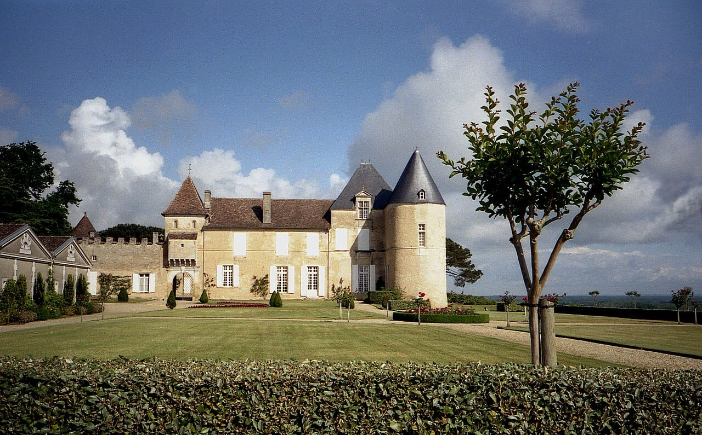

# Château d’Yquem

Drive south from Bordeaux through the pine woods and gravel of Graves; as you enter Sauternes the land begins to rise and fall. Yquem sits on the highest hill outside the village: pale stone, dark grey roofs, two round towers and a stretch of wall, with clipped lawns and a gravel drive. From the slope you look down over vines that run into the fog line. The morning mist and afternoon sun are among the estate’s most important working conditions.

Figure: Château d’Yquem and its vineyard. Image: Benjamin Zingg, Switzerland, CC BY-SA 2.5, via Wikimedia Commons ([source page](https://commons.wikimedia.org/wiki/File:Ch%C3%A2teau_d%27Yquem.jpg)).

## Location and history

Yquem’s history begins in 1593, when Jacques Sauvage bought the high ground at Sauternes. Marriage and inheritance carried the estate to the Lur-Saluces family; in 1785 Françoise Joséphine de Sauvage married Louis-Amédée de Lur-Saluces, and Yquem became the family’s core property. In 1855 the Bordeaux classification named Yquem the sole Premier Cru Supérieur—not one first growth among several, but a separate tier for sweet wine.

The 20th century brought war, depression and family division. In 1999 LVMH bought Yquem; in 2004 Pierre Lurton took over management. Lurton also manages Cheval Blanc, a completely different estate: one is Cabernet Franc/Merlot on the Right Bank, the other botrytised sweet wine in Sauternes. Yquem’s team added a new fermentation room, cellars and reception space in the 2010s, but the house and vineyard remain.

Yquem’s rarity is not marketing. Official and trade sources say a vine’s annual crop makes roughly one glass of Yquem; the estate makes the grand vin only when noble rot develops well, and ten vintages since 1910 were not bottled. It makes no second sweet wine. Ygrec (Y) is a separate dry white from fruit unaffected by noble rot on the same vineyard.

## Architecture and site

The main house is a 16th–17th-century stone building with two round towers, dark roofs, walls and a courtyard. It is not a Versailles-like palace but a working agricultural house on a hill. The most beautiful thing is not the facade but the relationship with the land: walking up from the vines, the house is a lighthouse; looking down, the vineyard, village and pine woods open in layers.

The cellars are underground, cool and humid, with rows of oak barrels; the fermentation room moves between stainless steel and oak. The vineyard is about 100 hectares on gravel, sand and clay with good drainage. Sauternes’s microclimate depends on the temperature difference between the Ciron and Garonne rivers: morning mist lets Botrytis cinerea grow, afternoon sun dries the grapes and concentrates sugar and flavour.

Harvest is the most labour-intensive part. The same plot is picked 5–10 times, with workers selecting “botrytised but not rotten” bunches; some days only a few baskets are filled. Pressing is gentle, fermentation slow, and the proportion of new oak and the length of ageing change by vintage. A visit that sees only “golden wine” and a castle misses this labour.

## Wines and palate

The grand vin is Château d’Yquem, sweet; Ygrec (Y) is a dry white in small quantity. The grand vin is mainly Sémillon (usually 75–80%) with Sauvignon Blanc (20–25%). Botrytis brings honey, apricot, orange marmalade, ginger, beeswax, saffron and mineral; acidity holds the sweetness in check. Young Yquem has citrus, white flowers and vanilla; with age it turns to dried fruit, fig, caramel, coffee and leather.

The sweetness is not added sugar but concentration on the vine: Botrytis pierces the skin, water evaporates, sugar, acid and flavour compounds concentrate. Alcohol is usually only 13–14% because not all sugar is fermented; residual sugar is high, but so is acidity, so it does not taste cloying. Great vintages last 50 years or more; average years still 20–30.

Ygrec is dry, with citrus, white flowers, beeswax and mineral; it suits seafood, white meat and Asian dishes. It is not a “second wine” of Yquem but a different wine with different fruit and process.

## How to drink

Yquem should be cool but not cold: 8–10°C. Too cold and the aroma closes; too warm and the sweetness turns cloying. Use a small tulip or sweet-wine glass, not a large Bordeaux glass; pour 60–80 ml and take your time. Pair with foie gras, blue cheese, almond or fruit tarts, roast chicken and Asian spiced dishes; avoid heavy chilli, vinegar or very sweet chocolate.

Young Yquem can be opened 30 minutes ahead; old bottles should not be decanted for long—pour a glass and taste first. Sediment is normal; leave the last ounce in the bottle and do not shake it. In a restaurant, confirm the bottle condition and vintage; sweet wines age differently from reds, and older is not automatically better.

## Practical information

- Address: Château d’Yquem, 33210 Sauternes, France.
- Coordinates: 44.5319, -0.3286.
- Telephone: +33 5 57 98 07 07.
- Visits: by appointment only; in 2026 the Initiation is €100, Correspondances €200 and Anthologie €350, with a maximum of six people. Regular tours are usually on weekday afternoons; check the official booking page.
- Transport: about 45 minutes by car from Bordeaux; about 20 minutes by taxi from Langon station; 10–15 minutes on foot from Sauternes village, but the road is narrow and uphill.
- Parking: enter according to your booking; do not park between vines or in front of village houses.
- Accessibility: the house and cellars have steps and uneven floors; wheelchair users should call ahead.
- Language: state English or French when booking; the tour language depends on arrangements.

## Etiquette and common misunderstandings

First, Yquem is not an ordinary sweet wine. It is the only 1855 Premier Cru Supérieur, but that rank is a historical classification, not a guarantee that every bottle suits you. Second, do not reduce it to “liquid gold”; noble rot, acidity and age are the keys, not colour. Third, do not assume sweet wine only goes with dessert; foie gras, blue cheese and Asian spiced dishes work. Fourth, do not add ice or soda; it destroys the acidity and perfume. Fifth, do not touch barrels or exhibits in the cellar; production is live.

There is another layer: Yquem’s harvest depends on repeated passes through the same plot, and workers walk many kilometres. When you see “100 hectares” and “one glass per vine”, think about the labour and risk behind it; noble rot does not obey a schedule.

## Around and routes

Yquem is on the hill at Sauternes: Barsac, Graves and [Haut-Brion](ref:hautbrion) to the north, [Cheval Blanc](ref:cheval) and [Pétrus](ref:petrus) to the east, and [Margaux](ref:margaux), [Latour](ref:latour) and [Lafite](ref:lafite) to the west. Putting Yquem into the [Bordeaux left-bank château trail](ref:route) is not entirely logical; it works better as a “sweet-wine half-day” or a Right Bank–Sauternes route.

With half a day, Yquem plus Sauternes village is a sensible pairing. To add the Left Bank, allow at least two days. Sauternes’s roads are narrow and the villages small; leave enough driving time between bookings and do not schedule five estates in one day.

## Further reading and see also

- Yquem official site: <https://www.yquem.fr/en/>, for the address, noble rot, microclimate, four centuries of history and booking entry.
- La Gironde du Sud: <https://www.lagirondedusud.com/degustation/chateau-dyquem/>, for the 2026 three tour prices, six-person cap and booking information.
- LVMH house page: <https://www.lvmh.com/our-maisons/wines-spirits/chateau-dyquem>, for 1453, Jacques Sauvage, the 1855 ranking and the 1999 acquisition.
- Cazebonne profile: <https://cazebonne.fr/en/bordeaux-wine-estates/chateau-d-yquem>, for cross-checking the sole 1855 Premier Cru Supérieur, about 100 hectares, one glass per vine and ten unbottled vintages.
- Right Bank and Left Bank comparisons: [Cheval Blanc](ref:cheval), [Pétrus](ref:petrus), [Margaux](ref:margaux), [Latour](ref:latour), [Haut-Brion](ref:hautbrion), [Lafite](ref:lafite).
- Routes and region: [Bordeaux left-bank château trail](ref:route), [Bordeaux region](ref:bordeaux).

**At a glance:** A sweet-wine estate on the highest hill in Sauternes, the only Premier Cru Supérieur in the 1855 classification. About 100 hectares are planted mainly to Sémillon with Sauvignon Blanc; Botrytis cinerea concentrates sugar and flavour, and picking usually passes 5–10 times through the vineyard. Jacques Sauvage established the estate in 1593, the Lur-Saluces family held it from 1785, LVMH acquired it in 1999 and Pierre Lurton took over management in 2004.

## Related images

Image: The old main house at Château Cheval Blanc. Credit: Benjamin Zingg, Switzerland, CC BY-SA 2.5, via Wikimedia Commons ([source page](https://commons.wikimedia.org/wiki/File:Ch%C3%A2teau_Cheval-Blanc.jpg)). Related image for Château d’Yquem.
