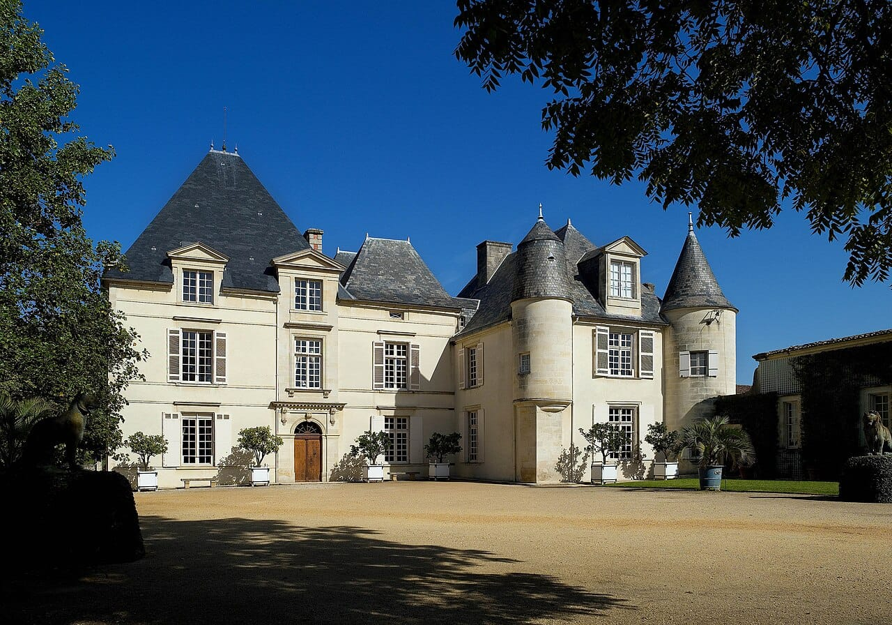
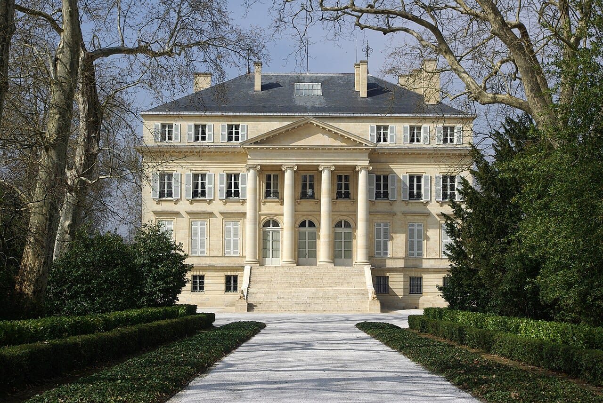

# Château Haut-Brion

Haut-Brion is not in the Médoc vineyards. It sits in Pessac, on the southern edge of Bordeaux. A fifteen-minute drive from the city centre passes housing, schools and offices before a gravel rise and a 16th-century house appear: streets outside the wall, vines inside. It is the only 1855 first growth outside the Médoc, and one of the earliest Bordeaux wines known to the English, Dutch and Paris markets.

Figure: The exterior of Château Haut-Brion at the edge of Pessac. Image: BillBl, CC BY 2.0, via Wikimedia Commons ([source page](https://commons.wikimedia.org/wiki/File:Haut_Brion_exterior.jpg)).

## Location and history

Vines have been grown here since the 1st century, according to the estate. In 1521 a document first used the name “Haut-Brion” for this rise; in 1533 the Pontac family bought the property and built the house in 1549. In the 17th century the Pontacs sold the wine in London; Samuel Pepys’s diary mentions “Ho-Bryan” in 1663, often cited as the first evidence of Haut-Brion entering fashionable English tables.

In 1855 Haut-Brion was ranked a first growth alongside Lafite, Latour and Margaux; it was the only first growth from Graves. In 1935 the American financier Clarence Dillon bought the estate; in 2008 his great-grandson Prince Robert of Luxembourg took over. Today it is owned by the Dillon family through Domaine Clarence Dillon, which also includes Château La Mission Haut-Brion, Château Quintus and Clarendelle.

The building is not a castle but a group of house, cellars and outbuildings around the vineyard. The main house took shape in the 16th century and was altered later; its facade is less symmetrical than Margaux, with older stone, narrower windows and a location closer to the city. At the gate you see both vines and apartment blocks across the street; this “estate at the city’s edge” is unique in Bordeaux.

## Architecture and site

The vineyard covers around 50 hectares on the Pessac gravel rise. The soil is deep gravel, clay and sand, free-draining and deep enough for roots to go down; the gravel warms by day and releases heat at night, helping ripening. The vines are surrounded by the city, split into plots between roads and houses. This is not a pastoral idyll but a historical landholding left behind by urban growth.

The cellars are the heart of a visit: underground rooms, oak barrels, a fermentation room and a tasting room linked together. Compared with a new large winery, Haut-Brion’s cellars are older and narrower, with a one-person passage between barrels; the walls show old brick and lime, and the air smells of oak, alcohol and wet stone. It does not aim for “future” aesthetics; it puts 16th-century walls and 20th-century temperature control in the same space.

Haut-Brion’s white wine also comes from Pessac gravel plots, mainly Sauvignon Blanc and Sémillon; the white vineyard is small and the production limited. The red is based on Merlot, Cabernet Sauvignon and Cabernet Franc, with proportions changing by vintage. Unlike the Cabernet-dominated Left Bank estates, Merlot gives Haut-Brion its earlier softness and perfume.

## Wines and palate

The grand vin is Château Haut-Brion; the second wine is Le Clarence de Haut-Brion (renamed in 2007 from Château Bahans Haut-Brion); the whites are Château Haut-Brion Blanc and La Clarté de Haut-Brion. The grand vin usually shows blackcurrant, plum, cigar box, smoke, mineral and truffle. When young the tannins are fine and dense—not the weight of Latour, nor the florals of Margaux, but a “smoky mineral plus velvet” combination.

The style follows soil, city location and ageing. Pessac gravel is finer than Pauillac’s, with more clay; Merlot brings plum and cocoa, Cabernet brings blackcurrant and cedar, and age turns them into cigar box, leather, wet stone and truffle. It does not always need 20 years; in good vintages 8–15 years can be enough, while the greatest years last much longer.

The white is the other line. Château Haut-Brion Blanc uses Sauvignon Blanc and Sémillon, with citrus, white flowers, beeswax, hazelnut and mineral; it is dry, rich and suited to seafood and poultry, not a sweet wine like Yquem. Production is small and prices high; do not treat it as an easy white.

## How to drink

For the red grand vin, open younger vintages 1–2 hours ahead and taste old bottles first; serve at 16–18°C in a Bordeaux glass. Pair with roast beef, lamb, mushrooms, truffles and hard cheese; avoid heavy chilli or sweet sauces. Le Clarence drinks earlier, with roast chicken, beef stew or sausages. The white should be 10–12°C, not ice-cold; pair with oysters, pan-fried fish, white meat or goat cheese.

Haut-Brion does not need aggressive decanting. Its perfume emerges slowly; over-swirling can break up the smoke and mineral notes, especially in old bottles. In a restaurant, check the fill level and cork for leakage; do not let the server dump the whole bottle into a decanter—keep a glass in the bottle for comparison.

## Practical information

- Address: Château Haut-Brion, 135 avenue Jean Jaurès, 33600 Pessac, France.
- Coordinates: 44.8089, -0.6128.
- Telephone: +33 5 56 00 29 30.
- Visits: request through the official contact form; there is no walk-in ticket office, and public slots are limited.
- Transport: about 15–20 minutes by car from central Bordeaux; about 15 minutes on foot from Pessac station; buses and trams stop nearby, but the last stretch is awkward on foot.
- Parking: enter according to your booking; the surrounding area is residential, so do not block residents’ doors.
- Accessibility: cellar floors are uneven and passages narrow; wheelchair users should call ahead.
- Language: state English or French when booking; the visit language depends on arrangements.

## Etiquette and common misunderstandings

First, Haut-Brion is not a Médoc first growth. It is in Graves/Pessac-Léognan, the only non-Médoc estate in the 1855 first-growth list. Second, do not confuse Haut-Brion with La Mission Haut-Brion; they are neighbours under the same Dillon family but have different histories, buildings and wines. Third, do not assume Haut-Brion only makes red wine; its white is equally important and much rarer. Fourth, do not walk into the vines at the city edge; this is private land and a working farm. Fifth, do not touch barrels or exhibits in the cellar.

There is another layer: Haut-Brion is a “city estate”, with land values, traffic and noise different from a rural château. When you see the houses and roads beyond the wall, consider how this vineyard survived urban expansion, and who maintains it.

## Around and routes

Haut-Brion is in Pessac: Bordeaux centre to the north, [Margaux](ref:margaux), [Latour](ref:latour), [Lafite](ref:lafite) and [Mouton](ref:mouton) to the northwest, [Cheval Blanc](ref:cheval) and [Pétrus](ref:petrus) across the river to the east, and [Yquem](ref:yquem) and Sauternes to the south. It forms part of the [Bordeaux left-bank château trail](ref:route), but because it is closest to the city it suits the first or last day.

With one day, Haut-Brion plus Cité du Vin in central Bordeaux is a relaxed pairing. To cover the Left Bank, allow at least two days. Its city location makes it easier to reach than rural estates, but also means visit times are constrained by bookings and traffic.

## Further reading and see also

- Official history: <https://www.haut-brion.com/en/history/>, for the 1st century, 1521, 1533 Pontac, 1549 house, 1855 first growth, 1935 Dillon and 2008 Prince Robert.
- Official terroir: <https://www.haut-brion.com/en/terroir/>, for the Pessac gravel, vineyard area and varieties.
- Legal notices: <https://www.haut-brion.com/en/legal-mentions/>, for the 135 avenue Jean Jaurès, 33600 Pessac address.
- Domaine Clarence Dillon: <https://www.domaineclarencedillon.com/en/>, for Dillon family ownership and Prince Robert’s role.
- Left Bank comparisons: [Margaux](ref:margaux), [Latour](ref:latour), [Lafite](ref:lafite), [Mouton](ref:mouton), [left-bank trail](ref:route).
- Right Bank and sweet wine: [Cheval Blanc](ref:cheval), [Pétrus](ref:petrus), [Yquem](ref:yquem), [Bordeaux region](ref:bordeaux).

Château Haut-Brion is best read by starting with the address, moving to the current opening status, and ending with what the place is known for.

## Related images

Image: The main house of Château Margaux. Credit: David Perez, CC BY 3.0, via Wikimedia Commons ([source page](https://commons.wikimedia.org/wiki/File:Chateau_Margaux_01_by-dpc.jpg)). Related image for Château Haut-Brion.
