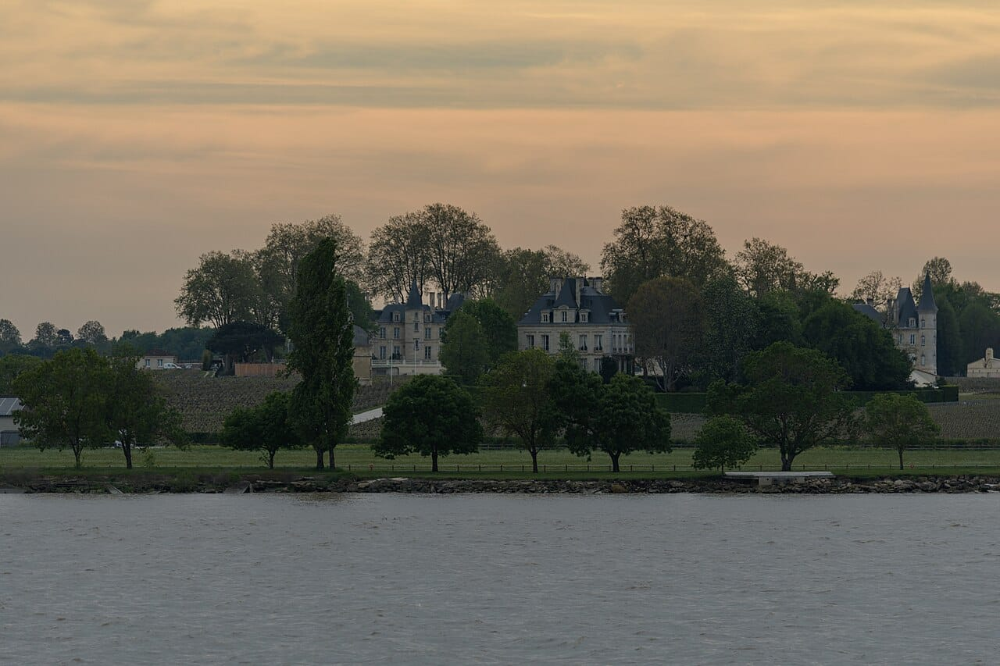

# Château Latour

Drive south from Pauillac on the D2 and the vineyards open on the left while the Gironde estuary runs along the right. Latour’s tower is not the most obvious thing from the road; a narrow lane leads through trees and grass to a round tower and a 19th-century house. The estate is only about 300 metres from the estuary. The water acts as a vast mirror, moderating temperature and bringing ships and sea air. Latour’s sense of power begins on this gravel rise beside the river.

Figure: Château Latour seen from the vineyard and the estuary side. Image: Gilles Messian from Paris, France, CC BY 2.0, via Wikimedia Commons ([source page](https://commons.wikimedia.org/wiki/File:Vue_sur_Ch%C3%A2teau_Latour_en_fin_de_journ%C3%A9e,_Pauillac,_France_(48030411248).jpg)).

## Location and history

Latour’s documented history starts in 1331, when Gaucelme de Castillon received permission from Lord Pons to build a fortified tower in the parish of Saint-Maubert. In 1378 Jean Froissart’s Chronicles described the “Tour de Saint-Maubert” being besieged for three days and taken by the Anglo-Gascon army during the Hundred Years’ War. It was not a vineyard estate from the beginning, but a fortress guarding the estuary; the vines grew around the tower later.

At the end of the 17th century, marriage and inheritance brought Latour into the Ségur family. Alexandre de Ségur had acquired Lafite shortly before his death in 1716; his son Nicolas-Alexandre, dubbed “Prince of the Vines” by Louis XV, expanded the family holdings to Mouton and Calon. In the 18th century Latour already sold at a large premium: in 1714 a barrel was worth four to five times an ordinary Bordeaux barrel; by 1729 the ratio was thirteen, and by 1767 twenty. The vineyard had 38 hectares in 1759 and 47 by 1794. In 1855 Latour was ranked a first growth alongside Lafite, Margaux and Haut-Brion.

In the 20th century the Ségur inheritance fragmented. In 1963 the English Pearson group became majority shareholder, with Harveys of Bristol holding 25%; in 1989 Allied Lyons bought Pearson’s stake for 93%; in 1993 François Pinault’s Artémis bought Allied Lyons’ stake. Frédéric Engerer was appointed manager in 1998. From November 1999 to September 2003 the winery, vat room and storage were rebuilt; in 2012 Latour decided to stop selling its wine en primeur and release it when the estate considers it ready.

## Architecture and site

The visual core is the round tower and the 19th-century house, but the real architecture is the vineyard and the cellar. The Enclos is the 47 hectares around the château; the whole vineyard is 96.5 hectares. The Enclos sits on a gravel hill 12–16 metres above the estuary, with streams to the north and south and marshland to the east. The topsoil is gravel over clay and marl, free-draining but able to hold some water in dry years. In the 19th century the estate installed drainage under the Enclos so that water could leave quickly before harvest.

The vineyard has about 900,000 vines: 76% Cabernet Sauvignon, 22% Merlot and 2% Petit Verdot. The old vines average around 60 years; the Grand Vin comes mainly from old vines in the Enclos, while younger vines and outside plots go into Les Forts de Latour and the Pauillac. In 2001 the vat room was rebuilt with more than 80 stainless-steel vats of different sizes, allowing separate fermentation by plot, variety and vine age. Horses returned to plough in 2008; from 2015 the whole vineyard has been managed organically, with Ecocert certification in 2018 and biodynamic preparations on parts of the property.

Latour does not build for prettiness. The tower is history, the house is status, the cellar is engineering; what determines the wine is the Enclos gravel, the old roots, plot-by-plot fermentation and long ageing. Do not only photograph the tower. Look at the proportion of new to old barrels, the size and arrangement of the vats; those details explain the estate better than the facade.

## Wines and palate

The Grand Vin comes only from old vines in the Enclos, averaging around 60 years; the official site says Cabernet Sauvignon usually accounts for more than 90% of the blend. When young it is deep in colour, thick in tannin, with blackcurrant and cedar; it often needs a decade or more to open, and great vintages can last decades. Les Forts de Latour is the second wine, from younger vines and plots outside the Enclos, and drinks earlier. The third wine, Pauillac, is lighter still.

Latour’s style is usually described as power, structure and longevity. Compared with Margaux’s floral elegance or Haut-Brion’s smoky mineral character, Latour is like a stone building: firm tannin, concentrated body, long finish, and sometimes closed when young. It is not undrinkable early, but early drinking wastes it. If you have only one bottle, check the vintage’s drinking window rather than betting on “older is better”.

Since 2012 Latour has not sold en primeur. You are therefore unlikely to buy “futures” before the wine is bottled; the estate releases stock when it chooses. For consumers this reduces the uncertainty of paying years before delivery, but it also means market prices follow the estate’s release rhythm.

## How to drink

Young Latour needs air: open 2–3 hours ahead, or decant for 1–2 hours. Old bottles need more care: taste first and avoid over-oxidation. Serve at 16–18°C in a large glass; pair with roast beef, lamb, game, hard cheese and mushrooms, not heavy chilli or sweet sauces. Les Forts de Latour can be drunk 3–5 years earlier, with roast chicken, beef or stews.

Do not judge wine by the “legs” on the glass, and do not treat sediment as a fault; old Latour throws sediment naturally. Pour carefully and leave the last ounce in the bottle. If you order an old bottle in a restaurant, confirm bottle condition and the return policy; long transport and bad storage can turn a great vintage into vinegar.

## Practical information

- Address: Château Latour, Saint-Lambert, 33250 Pauillac, France.
- Coordinates: 45.1765, -0.744925.
- Telephone: +33 5 56 73 19 80.
- Office hours: Monday–Friday 08:30–12:30 and 14:00–17:00, closed on public holidays.
- Visits: primarily for professionals (merchants, retailers, sommeliers, press) and by appointment only; there is no regular ticketed public tour.
- Transport: about 10 minutes by car from Pauillac, about 1 hour from Bordeaux; the nearest station is Pauillac, then a taxi.
- Parking: enter according to your booking; do not park between the Enclos vines.
- Accessibility: the cellars and vineyard floors are uneven; visitors with limited mobility should call ahead.

## Etiquette and common misunderstandings

First, Latour is not a drop-in sight. The official site says visits are primarily professional and by appointment; do not turn up at the gate. Second, do not treat “first growth” as “every vintage is perfect”; Latour has weaker years too. Third, do not assume Latour still sells en primeur; it stopped in 2012. Fourth, do not touch casks or pipes in the cellar; production is live. Fifth, do not wear thin soles in the vineyard; gravel and mud, especially after rain, are treacherous.

There is another layer: Latour’s longevity comes from structure, not from alcohol or oak. Over-decanting, serving too warm and heavy sauces can flatten that structure; with old wine, simpler is better.

## Around and routes

Latour is at the southern end of Pauillac: north are [Lafite](ref:lafite) and [Mouton](ref:mouton), south are Saint-Julien and [Margaux](ref:margaux), and southwest across the river is [Haut-Brion](ref:hautbrion) in Pessac. Together they form the spine of the [Bordeaux left-bank château trail](ref:route); three estates in one day is already full, so do not force five.

To switch sides, go to [Cheval Blanc](ref:cheval) and [Pétrus](ref:petrus) for the Right Bank’s Cabernet Franc and Merlot. The [Bordeaux region](ref:bordeaux) is not one thing: the Left and Right Banks differ in soil, varieties and architecture. Latour belongs to a “Left Bank power” day, not a “collect stamps” day.

## Further reading and see also

- Official history “Since 1331”: <http://www.chateau-latour.com/en/in-the-beginning/since-1331>, for the 1331 tower, 1378 siege, Ségur family, 1855 first growth and the 1963/1989/1993/1998/2012 timeline.
- Official land page: <http://www.chateau-latour.com/en/in-the-beginning/the-land-of-pauillac>, for the 300 metres, 47-hectare Enclos, 96.5 hectares, 900,000 vines and variety ratios.
- Official generation page: <http://www.chateau-latour.com/en/in-the-beginning/from-generation-to-generation>, for the 2001 vat room, 2008 horses, 2015 organics and 2018 certification.
- Official contact: <http://www.chateau-latour.com/en/contact>, for address, telephone, office hours and the professional booking policy.
- Left Bank comparisons: [Margaux](ref:margaux), [Lafite](ref:lafite), [Mouton](ref:mouton), [Haut-Brion](ref:hautbrion), [left-bank trail](ref:route).
- Right Bank comparisons: [Cheval Blanc](ref:cheval), [Pétrus](ref:petrus), [Bordeaux region](ref:bordeaux).

**In brief:** A Médoc first growth in Pauillac, documented from 1331 as a fortified tower at Saint-Maubert. The 96.5-hectare vineyard includes the 47-hectare Enclos around the château, only about 300 metres from the Gironde estuary; old-vine Cabernet Sauvignon on gravel over clay gives the wine its structural, long-lived style. François Pinault’s Artémis acquired the estate in 1993, and since 2012 Latour has not sold its wine en primeur.

## Related images

Image: Château Lafite Rothschild. Credit: PA, CC BY-SA 4.0, via Wikimedia Commons ([source page](https://commons.wikimedia.org/wiki/File:Ch%C3%A2teau_Lafite-Rothschild.jpg)). Related image for Château Latour.
