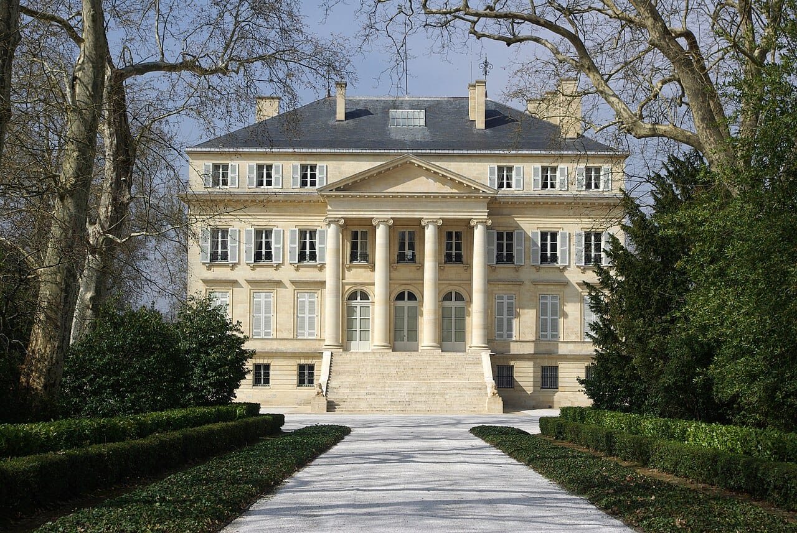
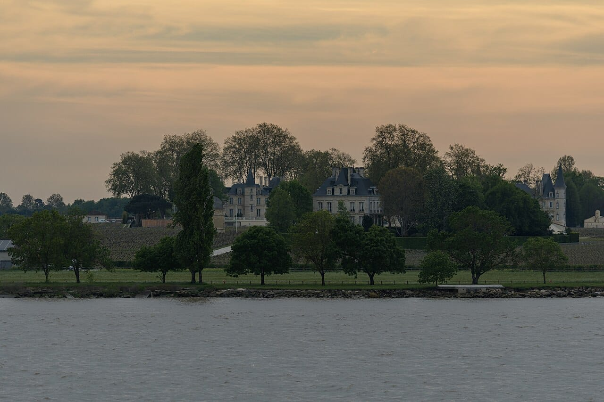

# Château Margaux

Drive north from Bordeaux on the D2, through vineyards and villages, and the houses shrink as you enter the Margaux appellation. The château is not on the road. A tree-lined drive leads past lawns, trees and low outbuildings to a neo-Palladian facade: four Ionic columns, a triangular pediment, stone steps and a wide pale gravel forecourt. It looks like a country house rather than a winery, yet behind that facade is one of Bordeaux’s most expensive red wines.

Figure: The main house of Château Margaux. Image: David Perez, CC BY 3.0, via Wikimedia Commons ([source page](https://commons.wikimedia.org/wiki/File:Chateau_Margaux_01_by-dpc.jpg)).

## Location and history

Vines have been grown at Margaux since at least the 12th century, when the land was known as La Mothe de Margaux and belonged to a local lord. In 1572 the Lestonnac family consolidated the vineyard and estate into something close to its modern form; by the 18th century the wine was sold under the Margaux name. Between 1810 and 1815, Louis Combes designed the neo-Palladian château for the owner, the Marquis de La Colonilla; its Ionic columns and pediment became the estate’s most recognisable image. In 1855 Margaux was ranked a first growth alongside Lafite, Latour and Haut-Brion; Mouton did not join that rank until 1973.

The 20th century brought war, depression and changes of ownership. In 1977 the Greek-French businessman André Mentzelopoulos bought the estate and invested heavily in the vineyard, cellars and buildings. He died in 1980, and his 27-year-old daughter Corinne took over. She later bought back the Agnelli family’s shares to become sole owner, and in 2015 commissioned Norman Foster to design a new winery and production building. In 2023 she handed day-to-day management to her son Alexis Leven-Mentzelopoulos, while her daughter Alexandra became president of the holding company’s supervisory board.

The important point is not “family continuity” but the post-1977 restoration of quality. Margaux was never a bad wine, but its drainage, equipment and vineyard management had fallen behind. The Mentzelopoulos investment made it a benchmark on the Left Bank again from the 1980s.

## Architecture and site

The château is a textbook of French neo-Palladianism: a symmetrical facade, a central portico, four Ionic columns, a pediment, stone steps and recessed wings. It is not a medieval castle or a Renaissance manor, but a 19th-century French aristocrat’s idea of Greek and Roman proportion. Stand on the steps and you see the columns cast shadows on pale stone; that restrained grandeur is more expensive than any gilding.

In 2015 Norman Foster’s new winery opened beside the château. The building does not copy the classical facade; it uses glass, steel and timber to make a light production space, with a roof that meets the land and interiors for fermentation, tasting and reception. The argument is whether modern architecture belongs on a historic estate, but it at least does not hide the old building: the view from the château across the vineyard remains intact.

The estate covers 265 hectares, with about 87 hectares of red vines and 12 of white; the rest is meadow, woodland, roads and buildings. The soils are deep gravels with good drainage, allowing roots to go down; plots near the château have permanent grass cover, while others are managed according to soil and variety. The estate says it is converting to organic farming, not as a slogan but through cover crops, compost and disease management.

## Wines and palate

The range is simple: Grand Vin de Château Margaux, Pavillon Rouge and Pavillon Blanc. In 2009 the estate added a third red wine, intended for younger vines and earlier drinking; it is a separate brand rather than a “second second wine”. The Grand Vin is usually Cabernet Sauvignon-dominant with some Merlot, Cabernet Franc and Petit Verdot; Pavillon Blanc is 100% Sauvignon Blanc from the estate’s oldest white-vine plots.

Margaux’s style is often summarised as “elegant, floral, velvety”. Compared with Latour’s power or Haut-Brion’s smoky mineral character, Margaux emphasises perfume, blackcurrant, violet, cedar and fine tannins. It is not an explosive wine; it often needs 10–20 years to reach its drinking window, and great vintages can last much longer. Pavillon Rouge drinks earlier; Pavillon Blanc is best within 5–10 years, before the white flowers and citrus fade.

Do not confuse “Margaux” with the Margaux appellation. The AOC contains dozens of estates; Château Margaux is one of them. “Château Margaux” and “Margaux” on a label are different levels of meaning. Nor should you assume every Margaux wine resembles the château; the appellation ranges from first growth to small holdings, with very different styles and prices.

## How to drink

The Grand Vin is not a pop-and-pour wine. For younger vintages, open or decant 1–2 hours ahead; for old bottles, taste first and avoid over-decanting, which can erase the perfume. Serve at 16–18°C, not chilled, in a large Bordeaux glass. Red meat, roast lamb, mushrooms and truffles work well; avoid heavy chilli, vinegar or soy-heavy dishes that overwhelm the florals.

Pavillon Rouge is the practical choice: 30–60 minutes in the glass for a young vintage, with roast chicken, beef, hard cheese. Pavillon Blanc should be cooler, 8–10°C, with seafood, white meat, goat cheese or simple buttered fish; do not add ice or use a heavily oaked glass.

At the estate, tastings are normally for professionals only; ordinary visitors may see the buildings, cellars and vineyard but will not necessarily taste the Grand Vin. If you want to drink Margaux, the reliable route is a Bordeaux cellar, restaurant or specialist merchant, not a walk-in at the gate. Vintages vary enormously; check the drinking window rather than buying on “first growth” alone.

## Practical information

- Address: Château Margaux, 33460 Margaux, France.
- Coordinates: 45.0423, -0.6747.
- Telephone: +33 (0)5 57 88 83 83.
- Visits: by appointment only, Monday–Friday; closed weekends, public holidays, August and harvest. Tastings are for professionals only.
- Transport: about 40 minutes by car from central Bordeaux; about 20–25 minutes on foot from Margaux station, but the drive has no pavement, so take a taxi.
- Parking: visitor parking is in front of the château, according to the booking; do not park between vine rows or in front of village houses.
- Accessibility: the stone steps and some cellar floors are uneven; wheelchair users should call ahead. The new winery reception is flatter.
- Booking: state names, group size, language, purpose and the areas you hope to see; do not arrive without an appointment.

## Etiquette and common misunderstandings

First, Margaux is not a sight open to everyone. It is a private estate with strict professional/booking rules; do not push the gate. Second, “first growth” is not a synonym for “the best wine every year”; the 1855 classification is a historical and price framework, not an annual taste ranking. Third, do not touch casks, pipes or exhibits in the cellar; production is live. Fourth, do not wear heels or thin soles into the vineyard; gravel and mud will swallow them. Fifth, do not ask the estate to sell the Grand Vin or open a bottle on the spot; stock and allocations are not handled at a tourist desk.

There is another layer: the building, vines and price together make the brand, but the social relations are not only owner and guest. Pickers, cellar workers, coopers, hauliers and sales networks are part of it. The tidy stone steps and rows of vines are the product of many people’s labour.

## Around and routes

Margaux sits beside the D2, north of Cantenac and Arsac and south of Saint-Julien and Pauillac. Put it into the [Bordeaux left-bank château trail](ref:route), then continue to [Latour](ref:latour), [Lafite](ref:lafite) and [Mouton](ref:mouton); further south is [Haut-Brion](ref:hautbrion). The four first growths are spread across the Médoc and Pessac, so one day is not realistic; allow at least two.

With half a day, Margaux plus the village is a relaxed pairing. To switch to the Right Bank’s Merlot style, cross the river to [Cheval Blanc](ref:cheval) or [Pétrus](ref:petrus); for sweet wine, continue south to [Yquem](ref:yquem). The [Bordeaux region](ref:bordeaux) is large; the Left and Right Banks differ in soil, varieties and architecture, and “Bordeaux” is not one style.

## Further reading and see also

- Official history: <https://chateau-margaux.com/en/le-domaine/histoire>, for the 12th-century origin, 1572 Lestonnac, 1810–1815 château, 1855 first growth and the 1977/1980/2015/2023 timeline.
- Official terroir: <https://chateau-margaux.com/en/le-domaine/le-terroir>, for 265 hectares, 87 of red vines, 12 of white, gravel soils and organic conversion.
- Official visits and contact: <https://chateau-margaux.com/en/contact>, for booking rules, closure periods, address and telephone.
- Official home: <https://www.chateau-margaux.com/en/>, for the Grand Vin, Pavillon Rouge and Pavillon Blanc range.
- Left Bank comparisons: [Latour](ref:latour), [Lafite](ref:lafite), [Mouton](ref:mouton), [Haut-Brion](ref:hautbrion), [left-bank trail](ref:route).
- Right Bank and sweet wine: [Cheval Blanc](ref:cheval), [Pétrus](ref:petrus), [Yquem](ref:yquem), [Bordeaux region](ref:bordeaux).

## Related images

Image: Château Latour seen from the vineyard and the estuary side. Credit: Gilles Messian from Paris, France, CC BY 2.0, via Wikimedia Commons ([source page](https://commons.wikimedia.org/wiki/File:Vue_sur_Ch%C3%A2teau_Latour_en_fin_de_journ%C3%A9e,_Pauillac,_France_(48030411248).jpg)). Related image for Château Margaux.
