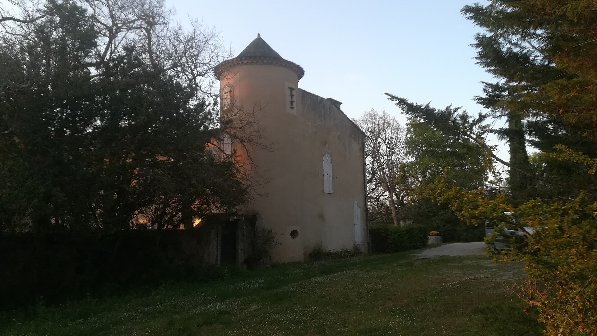

# Château Miraval

Château Miraval sits in Correns, in the Var, on a private property surrounded by pine woods, olive trees and vineyards. It is also one of the most recognisable names in Provençal rosé on the international market. In practice it behaves more like a label than a destination: the official FAQ states plainly that the estate is not open to the public, and the wines are sold through Famille Perrin's tasting room and selected channels. Treating it as a cellar you can book will send you in the wrong direction; treating it as a bottle whose place and method deserve attention fits the way it now works.

Figure: Related photograph of Château Miraval. Image: Hernandlucas, CC BY-SA 4.0, via Wikimedia Commons ([source page](https://commons.wikimedia.org/wiki/File:Ch%C3%A2teau_de_Miraval_3.jpg)).

## A private estate in the Correns valley

Correns lies north of Brignoles, an inland village in the Var. Miraval's vineyards occupy a private valley, and the official description stresses dry-stone terraces: slopes held by narrow stone walls that break the wind, retain soil and even out drainage. The vineyards sit at an average altitude of about 350 metres, with strong daytime sun and cool nights. That day-to-night range helps the fruit keep acidity while building aroma. The property covers more than 600 hectares, but only part is vineyard; the rest is woodland, olive groves and buildings.

This terrain limits mechanisation. The terraces are narrow and steep, so much work is done by hand, and at harvest the fruit has to be carried down the slope before it is taken to the press. The story of [Provence](ref:provence) is often told through light, but at Miraval light is only one condition; stone, exposure and cool nights shape the structure of the wine.

## Organic vineyards and Famille Perrin

The official FAQ says the vineyards have been farmed organically for many years and are certified organic. The wines, however, are not all labelled organic: from the 2012 vintage the estate chose not to claim organic status, in order to keep the freedom to blend with high-quality fruit from other vineyards and to use a stabilisation method not yet approved as organic in Europe. The distinction matters: how a vineyard is farmed and what the final label claims are two different things.

Bottling also happens off the estate. The official answer says the wines are bottled at Famille Perrin's winery, where a modern bottling line allows close control of dissolved oxygen, a key parameter for rosé. Miraval, in other words, provides the fruit and the terroir; Famille Perrin provides the winemaking and the precision of the bottling plant. Understanding that division stops the word "estate" from conjuring a single building where picking, fermentation and labelling all happen under one roof.

## Why it is closed to the public

The official answer is direct: the estate is not open to the public, though the wines can be bought in Famille Perrin's tasting room in Châteauneuf-du-Pape. This is not a temporary notice but the current arrangement. A private property, a residence and working vineyards share the same land, so opening large parts of it would be impractical and would disturb daily operations. Any third-party tour that promises direct entry to the estate should therefore be checked carefully.

For travellers this means two things. First, do not put it on the list of cellars to visit that day; second, if you want to taste it, look for Famille Perrin's tasting room, authorised retailers or restaurants rather than driving to Correns and knocking on a door. The address Miraval, 83570 Correns, France serves as a geographical reference and postal address, not a visitor entrance. Latitude and longitude have not been taken from an official page, so coordinates should be confirmed through official channels.

## The rosé style and the label details

Miraval's rosé is a Côtes de Provence [appellation](ref:appellation) wine, pale and dry, with white flowers, citrus, redcurrant and a little white peach, fresh but with mid-palate weight. Not all the fruit comes from the estate: the official FAQ admits that top-quality grapes from other vineyards may be blended in to keep flexibility. That differs from the common "100% estate-grown" claim and is easy to miss when reading a label.

There is also an anti-counterfeiting detail beyond the label: from the 2014 vintage the rosé bottle has been engraved, to reduce the risk of imitation. Bottles from that year onward should carry a recognisable engraving. The estate also makes two whites, a Côtes de Provence and a Côteaux Varois en Provence, and a Vin de France red, so the range is not locked into a single category even though rosé dominates its reputation.

## Where to find the wine

The safest channel is Famille Perrin's tasting room. The official FAQ points to the Châteauneuf-du-Pape room as the buying entry, where other Famille Perrin wines are also on show; that makes it easy to place Miraval beside southern Rhône and other Provence wines. Authorised retailers and restaurants come next; Provençal wine merchants, fine-food shops and some hotels stock it, though availability varies by vintage and batch.

If the trip is mainly about visiting cellars, replace this stop with one that genuinely opens, such as [Domaines Ott](ref:ott) in Taradeau. If you still want to see Correns, view the valley and terraces from the public road and taste elsewhere. Do not drive into private tracks without confirmation; property boundaries in the French countryside are clear, and wandering in is both rude and potentially unsafe.

## Placing it on a Provence route

From Les Baux-de-Provence or Aix, Correns is a little over an hour by car; from Taradeau it is about an hour. It works as a stop for understanding the rosé market rather than for entering a production site. Pairing Miraval with Ott in one day sets two Provençal paths side by side: one is a three-estate group that receives visitors and runs cellar experiences; the other is a private estate that stays closed and reaches consumers through brand and channel.

For anyone new to [rosé](ref:rose), that contrast is more useful than one more fermentation tank. In the same region, with the same pale style, the ownership, land organisation and sales model are completely different. Opening policy, tasting channels and address are subject to official channels; this entry was verified on 2026-11-09.

Begin with the address, move on to the current opening status, and finish with what the place is known for. That order keeps the reading of Château Miraval practical.

## References

- [Miraval — official FAQ](https://www.miraval.com/en/faq-2/): organic certification, bottling, bottle engraving and the statement that the estate is closed to the public.
- [Miraval — A Land](https://www.miraval.com/en/a-land/): dry-stone terraces, average altitude of about 350 metres and vineyard terrain.
- [Miraval — Famille Perrin](https://m.familleperrin.com/1777D1DDK6/fr): Famille Perrin's winemaking, bottling and tasting channel.
- [Côtes de Provence — Vins de Provence](https://www.vinsdeprovence.com/les-appellations/cotes-de-provence): the 1977 AOP, geographical denominations and soil divisions.

Further reading: [Wine](ref:c-extra-1).
