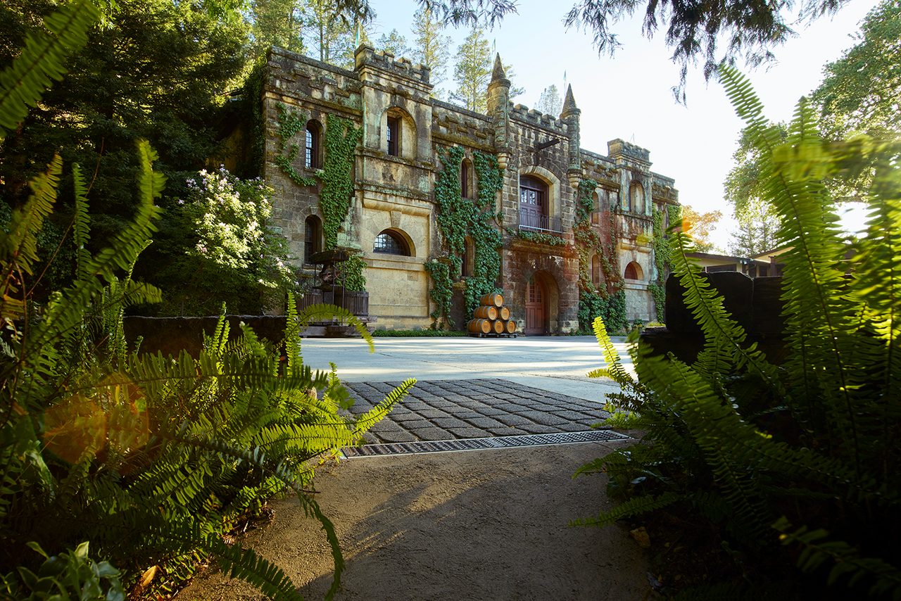

# Chateau Montelena

Calistoga sits at Napa’s northern end, below Mount St. Helena, where evening fog clears earlier than on the valley floor. Tubbs Lane runs west from town to a grey stone “chateau” with a lawn and pond in front and vineyards behind. Montelena feels less like a winery than a nineteenth-century country estate: stone walls, a tower, arches and clipped trees. Its fame also comes from the 1976 Judgment of Paris, but in the white category: the 1973 Chardonnay placed first. Together with Stag’s Leap’s red wine result, these two outcomes turned Napa from an emerging region into a name on the world wine map.

Figure: The stone chateau and courtyard at Chateau Montelena. Image: Unknown author Unknown author, CC0, via Wikimedia Commons ([source page](https://commons.wikimedia.org/wiki/File:Chateau_Montelena_Exterior.png)).

## Location and history

In 1882 Alfred L. Tubbs, who had made a fortune in rope during the Gold Rush, bought 254 acres north of Calistoga, planted more than 100 acres of vines and built A.L. Tubbs Winery. By 1896 it was Napa’s seventh-largest winery, producing about 60,000 cases a year. Prohibition stopped winemaking and the vineyards were replanted to prunes and pears. In 1958 Yort Wing Frank, an electrical engineer, and his wife Jeanie bought the property as a retirement home, dug Jade Lake and created a Chinese-style garden. In 1968 Lee and Helen Paschich bought the estate and brought in lawyer James L. Barrett and developer Ernest Hahn; the winery restarted in 1972 with Mike Grgich as winemaker and took the name Chateau Montelena. In 1976 the 1973 Chardonnay placed first among the whites at the Paris tasting. Michel Reybier bought the estate from the Barrett family in 2008; it was listed on the National Register of Historic Places in 2013.

## Architecture and spaces

The main building is an 1882 stone chateau, built of local volcanic rock and tuff, with a tower, arches and dark wooden windows. It is not a copy of a French château but an American entrepreneur’s European fantasy in the California countryside. In front are a lawn and fountain; to the side are the Chinese garden and Jade Lake, with a stone bridge, winding paths, bamboo and water lilies set against oaks and palms. The working winery lies behind the chateau, with fermentation, barrels and bottling not open to casual visitors; the tasting room and courtyard are the public parts. The most interesting detail is the pairing of building and water: in dry Napa, Jade Lake is not only scenery but part of the microclimate, moderating temperature and humidity near the ground.

## The wines and palate

The core wines are Estate Cabernet Sauvignon and Napa Valley Chardonnay. Estate Cabernet is mainly Cabernet Sauvignon with a little Cabernet Franc from the Calistoga estate; it is full-bodied, with fine dense tannin, black cherry, cassis, cedar, tobacco and mineral, aged 20 months in French oak with about 28% new wood, and built to last. Chardonnay is the other signature, aged about 10 months in French oak, with yellow peach, lemon, hazelnut, cream and toast, while keeping reasonable acidity. The estate also makes Sauvignon Blanc, Zinfandel and Riesling in small quantities; Riesling in Calistoga is often overlooked but shows that the winery does more than heavy reds. Taste Estate Cabernet and Chardonnay separately: one is structure, the other texture, and the same “intensity” scale does not fit both.

## How to drink

Serve Estate Cabernet at 16–18°C, one to two hours ahead when young and 30–60 minutes when older; pair with roast beef, lamb, braised beef, mushrooms and hard cheese. Serve Chardonnay at 10–12°C, not over-chilled, with lobster, roast chicken, creamy pasta, crab or soft cheese. Sauvignon Blanc at 8–10°C with oysters, salads and goat cheese. Riesling at 8–10°C with Asian spiced dishes, pork and spicy food; its acidity and residual sugar balance heat. Do not pair Chardonnay with very spicy or vinegar-heavy dishes, and do not pair high-tannin Cabernet with sweet sauces, which amplify bitterness.

## Practical information

The address is 1429 Tubbs Lane, Calistoga, CA 94515; telephone 707.942.5105. Tastings are mainly by reservation, with limited walk-in space, and peak season usually requires advance booking; check current slots and prices on the official site. From Napa city, drive north on CA-29 for about 25–30 minutes to Calistoga, then west on Tubbs Lane; from Santa Rosa via CA-128 it is about 45 minutes. Parking is inside the entrance, the tasting room and courtyard are largely wheelchair accessible, but parts of the old building have steps. Calistoga can exceed 35°C in summer, so morning slots are more comfortable; during harvest, farm vehicles slow the roads.

## Etiquette and common misreadings

First, the white-wine winner in 1976 was the 1973 Montelena Chardonnay, not “every year”; do not treat it as a permanent title. Second, Jade Lake and the Chinese garden are part of a private estate, and picnic access is limited to members or specific experiences; do not climb fences or enter the water. Third, the chateau is a historic building, not a film set: do not touch the stone, climb the tower or fly a drone. Fourth, do not reduce Montelena to the film Bottle Shock; the film dramatises events, and the real history is in the estate and archives. Fifth, do not rush between tastings; Calistoga to the Stags Leap District takes at least 30 minutes. Sixth, Riesling and Zinfandel are small productions; do not ignore them because Cabernet is the headline.

## Around and routes

Around Calistoga there are hot springs, Old Faithful Geyser, the Sharpsteen Museum and trails on Mount St. Helena; south are St. Helena and Rutherford in [Napa Valley](ref:napa). Half a day is enough for the estate and a town lunch; a full day can add the Schramsberg sparkling caves or a [United States](ref:usa) wine library. Read [Chardonnay](ref:chardonnay) and [white wine](ref:white) together to understand the 1976 white category, and [oak ageing](ref:oak) to explain Estate Cabernet’s structure. Do not put Montelena and Stag’s Leap in the same morning: both need reservations, and Calistoga is at the far north end.

## Further reading and see also

- Comparisons: [napa-valley](ref:napa), [usa](ref:usa), [chardonnay](ref:chardonnay), [white-wine](ref:white), [oak-ageing](ref:oak).
- Background: [napa-valley](ref:napa), [usa](ref:usa).
- This page provides no map; visits, vintages and prices should be checked with official channels.

**Short definition:** A historic Napa Valley estate in Calistoga, founded in 1882 by Alfred L. Tubbs. Its 1973 Chardonnay placed first among whites at the 1976 Judgment of Paris; the property is known for its stone chateau, the Chinese garden and Jade Lake, and age-worthy Estate Cabernet Sauvignon, and has been owned by Michel Reybier since 2008.

Read Chateau Montelena through the address, then the current opening status, and finally what the place is known for. The sequence matters.

[Napa Valley](ref:napa) and [Chardonnay](ref:chardonnay) are the two useful reference points for Chateau Montelena. [Napa Valley](ref:napa) sets out address and space; [Chardonnay](ref:chardonnay) brings in operating status. Read them together.

**Key facts.**

| Item | Detail |
| --- | --- |
| In one line | A historic Napa Valley estate in Calistoga, founded in 1882 by Alfred L. Tubbs. Its 1973 Chardonnay placed first among whites at the 1976 Judgment of Paris; the property is known for its stone chateau, the Chinese garden… |
| Address | 1429 Tubbs Lane, Calistoga, CA 94515, United States |
| City and country | Calistoga / United States |
| Status | verified open |
| Official site | montelena.com |

**Sources and limits.** The key claims about Chateau Montelena are checked against the following sources: Chateau Montelena Winery (the winery Chardonnay's vinification, French-oak ageing and style description; the Estate Cabernet blend proportions, 20 months in French oak, 28% new oak and ageing style). For current products, addresses or opening status, use montelena.com. Prices, batches and status change; the body is project-written and does not reproduce source text.
