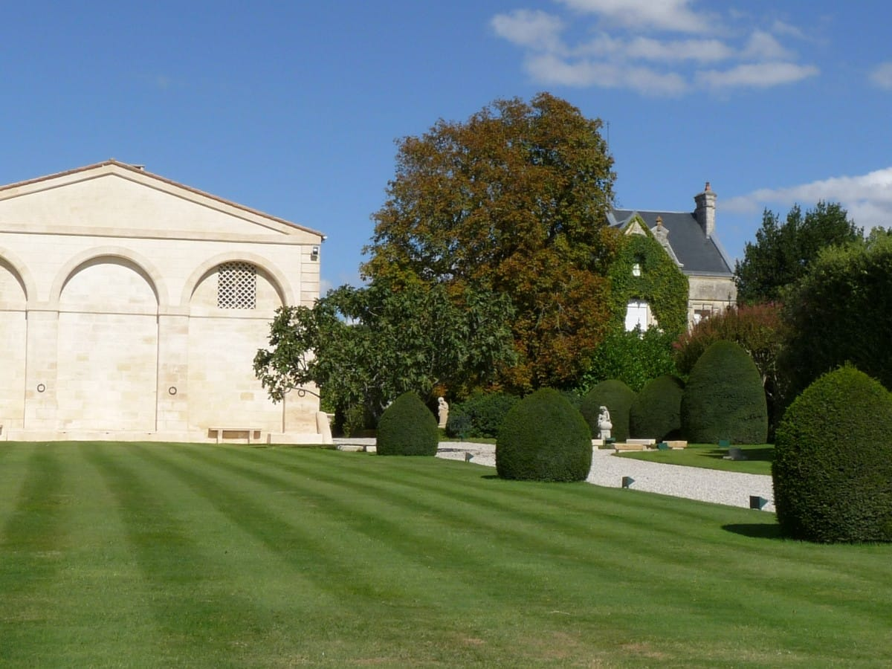

# Château Mouton Rothschild

Château Mouton Rothschild stands in Pauillac, in the heart of the Médoc on Bordeaux's left bank. Its name, its rank and its labels amount to a compact history of modern Bordeaux: bought by the English branch of the Rothschild family in 1853, classified a second growth in 1855, promoted to first growth in 1973, and from 1945 onwards given a new artist-designed label with every vintage. It is still a working estate as well as a place to visit, and visiting means booking far ahead rather than buying a ticket at the gate.

Figure: Château Mouton Rothschild. Image: Jack ma, CC BY-SA 3.0, via Wikimedia Commons ([source page](https://commons.wikimedia.org/wiki/File:Jardin_de_Ch%C3%A2teau_de_Mouton-Rothschild,_Pauillac._2012.jpg)).

> **Quick verdict**
> **In one line:** This entry helps you decide whether Château Mouton Rothschild deserves a detour, and what to check before visiting.
>
> - **Best for:** Anyone planning a visit to Château Mouton Rothschild who needs to decide whether it deserves a half-day or a full day.
> - **Not for:** If you want only want a must-visit list and will not check booking, transport or opening hours.
> - **Check first:**
>   - In 1853 Baron Nathaniel de Rothschild bought Château Brane-Mouton at auction so that he could serve his own wine to his guests.
>   - Mouton is open by appointment only.

## Place and history

In 1853 Baron Nathaniel de Rothschild bought Château Brane-Mouton at auction so that he could serve his own wine to his guests. The estate took his name and became Château Mouton Rothschild. The Bordeaux classification prepared for the 1855 Paris Exposition placed Mouton among the second growths (deuxième cru). For more than a century its commercial reputation was often compared with the first growths, but the official rank remained one step below.

In 1922 Baron Philippe de Rothschild, then twenty years old, took over. He shaped the modern character of the estate: he pushed for bottling at the château, and from the 1924 vintage the bottles carried "mis en bouteille au château", reducing dependence on merchants. He also turned a farming property into a brand with cultural ambition. In 1945, to celebrate the Allied victory and his return to the estate, he asked the artist Philippe Jullian to design the label; the "V" for Victory appeared on the bottles. Since then Mouton has commissioned a contemporary artist to create an original work for each vintage's label, a practice that continues today.

In 1962 Baron Philippe and his second wife, Baroness Pauline, turned part of the estate into the Museum of Wine in Art (Musée de l'Art du Vin), a collection of objects from many periods connected with the vine and wine. In 1973, after a long campaign, Mouton was promoted from second to first growth, the only château to be elevated in the 1855 classification; the decree was signed by Jacques Chirac, then Minister of Agriculture. The estate motto changed accordingly to "Premier je suis, second je fus, Mouton ne change" — first I am, second I was, Mouton does not change.

After Baron Philippe's death in 1988, his daughter Baroness Philippine de Rothschild took over; she died in 2014, and the estate is now run by Philippe Sereys de Rothschild, Camille Sereys de Rothschild and Julien de Beaumarchais de Rothschild. In 1979 Mouton also formed a joint venture in California with Robert Mondavi, Opus One, an important episode in Bordeaux capital's move into the New World.

## The estate and the wines

Mouton's vineyards lie just north of Pauillac, about 90 hectares planted mainly to Cabernet Sauvignon with Merlot, Cabernet Franc and Petit Verdot. The left-bank gravel drains well and reflects heat during ripening, which suits Cabernet Sauvignon. The grand vin is usually firm and tannic in youth and needs decanting; with age it develops cedar, graphite and blackcurrant. Style varies by vintage: cooler years are more linear, ripe years fuller, which is the clearest illustration of what "vintage" means in Bordeaux.

Three groups of buildings matter. The Grand Chai is the great barrel hall where the grand vin is aged. The new vat room, inaugurated in June 2013, was designed by the stage designer Richard Peduzzi with the architect Bernard Mazières: 64 vats of different sizes correspond to different parcels, and the oak frame, steel columns and suspended lighting give the space an almost encyclopaedic order. The third is the Museum of Wine in Art together with the "Paintings for the Labels" gallery, which displays the original works commissioned for the labels since 1945, from Picasso and Braque to Dalí, Francis Bacon and Jeff Koons. Read by vintage, it is a short history of modern and contemporary art.

The range is relatively clear. Château Mouton Rothschild is the grand vin; Le Petit Mouton de Mouton Rothschild, first released with the 1993 vintage, is the second wine and drinks earlier; Aile d'Argent is the white wine, made since 1991. Mouton Cadet is different: Baron Philippe created it in 1930 as a négociant brand for a wider market, not as the estate's first or second wine. Treating Mouton Cadet as "cheap Mouton" is one of the most common mistakes made by visitors and buyers.

## How to visit

Mouton is open by appointment only. The estate asks for bookings at least two months in advance, subject to availability, and visits are suspended during the harvest. Book through the official channel and arrive at the time confirmed. A full tour normally covers the vat room, the cellars, the Museum of Wine in Art and the "Paintings for the Labels" gallery; some formats include a tasting. Whether tasting is included, and which wines are poured, must be confirmed when booking; do not assume that admission automatically comes with a glass of the grand vin.

Allow one to three hours depending on the format. On a first visit, focus on three things: the vat room, to see how parcels are handled separately; the cellars, to understand ageing; and the museum and label gallery, to connect the brand's history. If tasting is included, start with the second wine or the white and finish with the grand vin; the other order makes the first wines taste thin.

Mouton is not a place to drop in for photographs. There is no open visitor centre, and visitors cannot wander into the vineyards or cellars. Families with children should mention this when booking; minors will not be served alcohol. Tours are mainly in French and English, other languages on request. Harvest, usually September to October, closes visits and brings farm traffic onto local roads, so leave extra time.

## Practical information

Address: Château Mouton Rothschild, 33250 Pauillac, France (coordinates 45.21530, -0.76860). The official address gives only the town and postcode, with no street number; navigate to the estate name. Telephone +33 (0)5 56 73 21 29.

Transport: Mouton is north of Pauillac, roughly an hour by car from Bordeaux along the D2. Alternatively take a TER regional train from Bordeaux Saint-Jean to Pauillac, then a taxi or bicycle; check SNCF and local maps for times and connections.

Opening hours and booking: there are no fixed public opening hours; everything runs by appointment, and the official contact page requires booking at least two months ahead, subject to availability. Visits are suspended during the harvest, usually September to October. Winter and spring are easier to book, while summer and the weeks before harvest are the busiest. Requests go through the booking facility on the official contact page or by email; arrive at the allotted time, as late arrival may shorten or cancel the visit.

Tickets and cost: the official site publishes no fixed ticket price. The cost varies with the format — whether tasting is included, which wines are poured, the length and the language — and is confirmed in the booking email; this entry gives no figure so that a changing quote is not mistaken for a fixed rate. Tours are normally in French and English, with other languages to be requested when booking, and a grand-vin tasting should never be assumed unless confirmed.

There is no strict dress code, but cellars are cool and floors are stone or gravel, so comfortable flat shoes are more practical than heels. The vat room and cellars have steps and narrow passages; visitors with limited mobility should say so when booking so the estate can adapt. Avoid strong perfume before a tasting, and do not touch barrels, bottles or exhibits.

Page checked on 2026-11-08; operating status, prices and bookings are subject to official channels.

## Etiquette and common mistakes

The first mistake is to confuse "second growth in 1855" with "first growth today". Mouton was indeed a second growth in 1855 and was promoted only in 1973; it is the only château elevated in that classification. Second, the artist label is not a different wine but the same grand vin in different packaging; the original artworks are shown in the label gallery, while the bottle carries a reproduction. Third, Mouton Cadet is not the grand vin; it is a separate négociant brand.

Punctuality is the main etiquette. Tours are organised by time slot, and late arrivals may be refused or given a shortened visit. In a tasting, spitting into the spittoon is normal, especially if you are driving; do not drain every glass because the visit is rare. Do not touch barrel heads or bottles in the cellar, and do not use flash directly on artworks; photograph only where the guide allows. Do not leave the group to walk into vineyards or production areas: this is a working estate, not a park.

One more detail is easy to miss: places are limited and priority goes to visitors who booked long ago. Adding Mouton at the last minute to the end of a Bordeaux trip usually fails. If your companions care more about art history than winemaking, Mouton can actually suit them better than a purely technical winery, because the museum and label gallery offer a second narrative.

## Around and routes

Mouton is north of Pauillac, in the densest cluster of famous estates in the Médoc. To the south lie Château Latour and the Pichon baron and comtesse estates; to the north are Château Lafite Rothschild and Saint-Estèphe. Most of these also require appointments, so a day cannot be spent knocking on doors. A realistic plan is Mouton in the morning, lunch in Pauillac, one or two booked estates along the D2 in the afternoon, and a return to Bordeaux in the evening.

With half a day, choose Mouton alone and give the time to the vat room, cellars and museum. If the classification interests you, read up on 1855 in Bordeaux first and then see the Medoc in person. The Cité du Vin in Bordeaux works well as an opening stop, because it sets out the wider framework of world wine; Mouton then becomes a concrete case study.

Without a car, the regional train from Bordeaux to Pauillac is the most reliable public transport, but local travel between estates still requires taxis or bicycles. Médoc taxis can be scarce in high season, so book the return trip in advance. Combining Mouton with Saint-Estèphe or Margaux is possible, but driving time rises and the quality of each visit falls.

## See also

Mouton is a concrete entry point for understanding the [Bordeaux](ref:bordeaux) classification and the grand-cru system, and a case study of how [wine](ref:wine) ties agriculture, capital and art together. For the wider system, read [wine grading systems](ref:grading); for the wine itself, see [Château Mouton Rothschild](ref:mouton-wine).

Further reading: [A Ginjinha](ref:c-extra-1).
