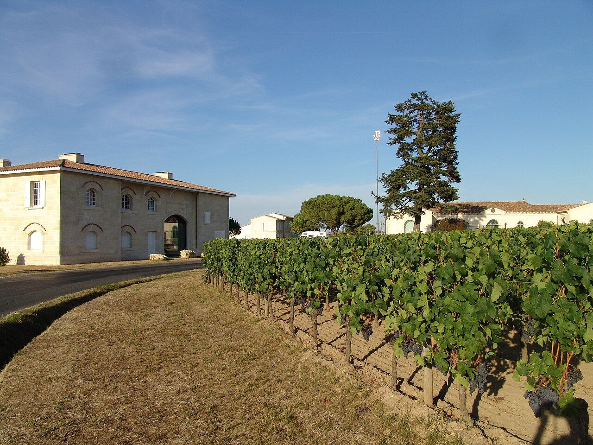

# Château Pétrus

Petrus has no castle to photograph. It sits at the edge of the Pomerol plateau at 3 route de Lussac: a low wall, a few farm buildings, a small domed tower and a sign reading “PETRVS”. The vineyard runs from the wall to the horizon, and the dark clay reflects the rain. It looks like an ordinary farm, yet it produces one of the world’s scarcest and most expensive Merlots.

Figure: The Petrus vineyard and its marked farm buildings. Image: Giogo, CC BY-SA 4.0, via Wikimedia Commons ([source page](https://commons.wikimedia.org/wiki/File:P%C3%A9trus_(ch%C3%A2teau)_02.jpg)).

## Location and history

The name comes from the Greek “Petros”, Saint Peter; it is not a family surname, and the estate is not a château in the architectural sense. Pomerol had no official classification in 1855, so Petrus has never held a “first growth” title. Its status comes from the market, critics and scarcity, not a government list. The vineyard is about 11.4 hectares, production about 30,000 bottles a year, one grand vin and no second wine.

In the 18th century the land belonged to the Arnaud family; by the 19th century the wine was known in Pomerol. In 1925 Madame Edmond Loubat, owner of the Hôtel Loubat in Libourne, began buying shares; by 1945 she owned the estate outright and promoted it in top Paris restaurants, putting it on fashionable wine lists in the 1940s and 1950s. She died in 1961 and the estate passed to her niece and nephew. Jean-Pierre Moueix had become exclusive distributor in 1943; in 1969 he bought a majority and acquired 4.5 hectares from neighbouring Château Gazin, expanding the vineyard from about 7 to more than 11 hectares.

Today Petrus is owned by the Jean-François Moueix family; in 2018 Alejandro Santo Domingo bought a 20% stake. Olivier Berrouet succeeded his father Jean-Claude as winemaker in 2008; a new winery opened beside the vineyard in 2014. The “myth” is not one person’s work: Loubat’s market sense, Moueix’s winemaking and distribution, and Pomerol’s blue clay all contributed.

## Architecture and site

Petrus is an anti-château. There is no 19th-century tower, no symmetrical facade, no garden; only a low farmhouse, a domed fermentation/office building, warehouses and walls. The 2014 winery does not try to be a landmark; it hugs the vineyard and uses concrete, metal and glass to make a quiet working space. A visitor expecting “Bordeaux first-growth” grandeur will think they have come to the wrong place. That is part of the point: the wine matters more than the building.

The vineyard sits at the highest point of the Pomerol plateau, about 40 metres above sea level. The soil is deep blue clay (smectite), rich in iron, with 60–80 cm of dark topsoil over very dense blue clay. The surrounding plateau has younger gravel; Petrus’s 11.4 hectares sit almost entirely on the blue clay. This clay holds water in dry years and drains slowly in wet ones, forcing roots down. Average vine age is about 40 years, with 6,000–7,000 vines per hectare. After the 2010 harvest the last 0.5 hectare of Cabernet Franc was uprooted, so the vineyard is now 100% Merlot.

## Wines and palate

Petrus makes one wine: Petrus. No second wine, no white, no entry-level bottling. When young it shows black cherry, blueberry, plum, violet, truffle, chocolate and wet clay; the tannins are fine and dense, the body full, the finish long. Compared with Cabernet-led Left Bank wines, Merlot is softer earlier, but great vintages can last 30–50 years.

The style follows the blue clay: clay retains water, so the vines do not suffer excessive drought in hot summers; iron in the clay contributes colour and structure; the plateau drains slowly, so the grapes ripen later and retain acidity. Winemaking is hand-picked, concrete-vat fermented, aged in 50% new French oak for 18–24 months, with gentle extraction for velvety tannins. Optical sorting, plot-by-plot fermentation and precise temperature control have arrived, but the “one wine” logic has not changed.

Do not confuse Petrus with [Cheval Blanc](ref:cheval). Both are Right Bank, but Cheval Blanc is Cabernet Franc-led on a gravel/clay mosaic, while Petrus is 100% Merlot on blue clay: one is flowers, graphite and red fruit; the other black fruit, truffle and chocolate. Nor should you compare it with Left Bank [Margaux](ref:margaux) or [Latour](ref:latour) as “which is better”; they are different varieties, soils and styles.

## How to drink

Young Petrus needs air: open 1–2 hours ahead, or decant for an hour. Old bottles should be tasted first to avoid over-oxidation. Serve at 16–18°C in a large glass; pair with roast beef, lamb, game, truffles, mushrooms and hard cheese, not heavy chilli, sweet sauces or lots of vinegar. Its tannins are fine, so rare tough meat is not ideal; fat and umami support the body.

Vintages vary enormously. 1947, 1961, 1982, 1989, 1990, 2000, 2005, 2009, 2010 and 2016 are often cited; even average years are expensive but may not be worth opening. If you have only one bottle, check the drinking window; Petrus is not a wine to open early for status, or you will taste mostly oak and tannin.

## Practical information

- Address: 3 route de Lussac, 33500 Pomerol, France.
- Coordinates: 44.9309, -0.1934.
- Visits: no public visits or tastings, no cellar door, no restaurant and no accommodation. Private/professional access is arranged through long-standing clients, merchants or the Moueix family.
- Transport: about 10 minutes by car from Libourne, 45 minutes from Bordeaux and 15 minutes from Saint-Émilion; the nearest station is Libourne, then a taxi.
- Parking: do not park at the gate or block the road to take photos; this is a private farm, not a sight.
- Buying: through Bordeaux merchants, auction houses or specialist retailers; the estate does not sell directly to consumers.
- Accessibility: not applicable; there are no public visitor facilities.

## Etiquette and common misunderstandings

First, Petrus has no “first growth” title. Pomerol had no 1855 classification; do not call it “Premier Grand Cru Classé”. Second, it is not a castle; do not expect a tour. Looking at the vines from the road is fine, but do not push open the gate. Third, “no second wine” does not mean “one wine, therefore cheap”; scarcity is part of the price. Fourth, do not buy “estate-direct” from unauthorised channels; Petrus does not sell directly. Fifth, do not walk between the vines or pick grapes; this is farmland, not a park.

There is another layer: Petrus’s price and scarcity make it an investment object, but the wine begins as agriculture. When you see the blue clay, old vines and plain farm buildings, put the “myth” aside and think about how a bottle grows out of 11 hectares.

## Around and routes

Petrus is on the Pomerol plateau: [Cheval Blanc](ref:cheval) and Saint-Émilion to the east, Libourne to the south, [Margaux](ref:margaux), [Latour](ref:latour), [Haut-Brion](ref:hautbrion) and [Lafite](ref:lafite) to the west, and [Yquem](ref:yquem) to the southeast. Putting Petrus into the [Bordeaux left-bank château trail](ref:route) is not logical; it belongs with Pomerol and Saint-Émilion.

With half a day, the Pomerol plateau plus Saint-Émilion village is a sensible pairing. Looking at the vines from the road is enough; do not treat “no visit” as a failed itinerary. To drink Petrus, the reliable route is a Bordeaux cellar, restaurant or auction, not a gamble at the gate.

## Further reading and see also

- Moueix family site: <https://www.jeanpierremoueix.com/>, for Petrus’s relationship with the Moueix family and the Right Bank merchant system.
- Bordeaux wine route: <https://routeviticole.fr/domaines/petrus/>, for the address, about 11.3 hectares, about 30,000 bottles, 40-year vines and the “no visits” policy.
- Christie’s Petrus archive: <https://www.christies.com/en/artists/chateau-petrus>, for the Arnaud family, Loubat, Moueix, the 1969 purchase and the 11.4 hectares of blue clay.
- Cazebonne profile: <https://cazebonne.fr/en/bordeaux-wine-estates/petrus>, for cross-checking no cellar door, the 2018 20% stake, Olivier Berrouet from 2008 and the 2014 winery.
- Right Bank comparisons: [Cheval Blanc](ref:cheval), [Yquem](ref:yquem), [Bordeaux region](ref:bordeaux).
- Left Bank comparisons: [Margaux](ref:margaux), [Latour](ref:latour), [Haut-Brion](ref:hautbrion), [Lafite](ref:lafite), [left-bank trail](ref:route).

**In brief:** Petrus in Pomerol is an 11.4-hectare vineyard on the appellation’s highest blue-clay plateau, planted 100% Merlot since 2010. It makes one grand vin, no second wine, and about 30,000 bottles a year. There is no château-style mansion and no 1855 classification, because Pomerol has no official classification. Madame Loubat began buying shares in 1925; the Moueix family acquired a majority in 1969 and bought 4.5 hectares from Gazin. The estate offers no public visits or tastings.
