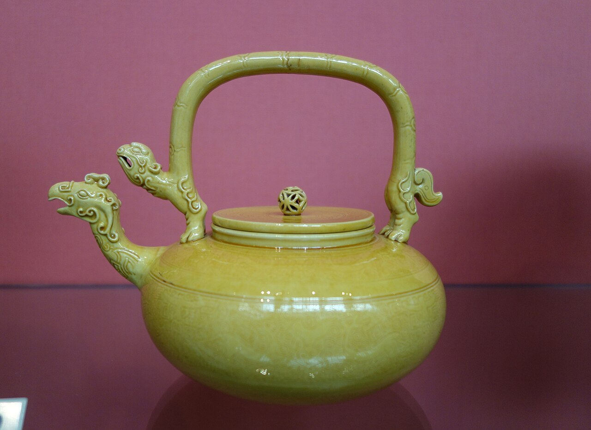

# China Yellow Wine Museum

The China Yellow Wine Museum stands beside Guangxiang Bridge in the northern part of Shaoxing's old city, at 557 Xia Da Road in Yuecheng District. Zhejiang Guyuelongshan Shaoxing Wine Co. invested in it, and it opened in 2007. The site covers about 30,000 square metres and the building about 16,000; it is the country's large specialist museum devoted to the history and culture of Chinese yellow wine. It is not a room of bottles in glass cases, but a sequence that connects wine history, local custom, brewing technique, Huadiao decoration and an underground cellar.

Figure: China Yellow Wine Museum. Photograph: Wine pot with bird head spout, Jingdezhen, China, Kangxi period, Qing dynasty, 1680-1720, porcelain with yellow glaze - Victoria and Albert Museum - London, England - DSC04925. Credit: Daderot, CC0, via Wikimedia Commons ([source](https://commons.wikimedia.org/w/index.php?curid=152459715)).

## Place and history

In 2007 Guyuelongshan opened the museum after two years of construction and an investment of 420 million yuan. The museum describes itself as the only large specialist institution in China presenting the history and culture of yellow wine, and it also holds designations as a national social-science education base, a provincial patriotic-education base and a provincial transmission base for Shaoxing yellow-wine intangible heritage. That positioning shapes its narrative: it is not a single brand's showroom, but an attempt to place yellow wine within the rice farming, waterways, seasons and rituals of Jiangnan.

Shaoxing is the core production area of Chinese yellow wine, and its brewing tradition is often traced to the Yue state in the Spring and Autumn period. Local stories tell of King Goujian of Yue pouring wine into the river to encourage his troops, linking wine with war and morale. By the Ming and Qing dynasties Shaoxing wine travelled along the Grand Canal and trade routes and became one of the most recognisable types of yellow wine. The museum compresses this long history into three themes — origins, people and transmission — and uses objects, film and reconstructed scenes to present a narrative stretching back as far as nine thousand years. That figure refers to Chinese yellow wine as a whole, not to an unbroken Shaoxing company history; the distinction matters.

The technical base of Shaoxing yellow wine is glutinous rice, wheat qu and the water of Jian Lake. The traditional process includes steeping the rice, steaming, spreading it to cool, putting it into vats, opening the mash for temperature control, pressing, boiling the wine and ageing it in clay jars. "Opening the mash" is the critical step, controlled by the experience of the winemaker rather than a dial. Shaoxing yellow-wine brewing technique is on China's national intangible cultural heritage list, and the second-floor technique and Huadiao halls turn this invisible craft into tools, steps and objects. The operator, Guyuelongshan, is a leading Shaoxing producer, so the museum has a corporate flavour, but it also performs a public educational role.

## The building and the displays

The main building is in a traditional style around a square, and the visit runs through a prologue hall, wine-history hall, wine-custom hall, wine-technique hall, wine-industry hall, cellar, hand-worked brewing workshop and Huadiao hall. The ground floor centres on history, leadership visits, custom, industry and collections; the second floor on technique and Huadiao decoration; below ground is the cellar. The Guyuelongshan hand-brewing workshop and the yellow-wine experience centre complete five functional zones.

Several objects anchor the displays. A stone carving of the character pin (to taste, but also to judge character) near the entrance sets up the idea of tasting as discernment. The wall of wine jars and a red-wood press show the physical scale of traditional brewing and storage. The century-old Huadiao and the Huadiao workshop turn painted jars from everyday containers into craft objects. The "wine proclamation" stele brings ancient edicts and ritual texts into the room. The underground cellar is the most physical part of the museum: cooler than the galleries, smelling of clay and wine, with rows of jars whose scale is far more convincing than a photograph. The museum also stages wine-ceremony performances; times depend on the day.

The custom hall deserves time. In Shaoxing, wine marks the stages of a life: a daughter's jar buried at birth and opened at marriage, a "top scholar" jar for examination success, wedding cups, and the seasonal wines of Qingming, the Dragon Boat Festival, Mid-Autumn and Double Ninth. Seen together, yellow wine is not just a drink but a way of marking time and relationships. The Huadiao hall explains that Huadiao is not a grape or grain variety but the combination of aged Shaoxing wine and painted jar decoration; the operatic scenes, flowers and auspicious motifs on the jars are a separate body of folk art.

## How to visit

Allow one and a half to two and a half hours. A sensible route is prologue, wine history, custom, industry, technique, Huadiao, cellar, brewing workshop and experience centre. Take history and custom first, then technique, then the cellar and tasting, so the information moves from story to object to flavour. If a ceremony or Huadiao workshop is scheduled that day, check the time first and work backwards.

Guided tours and groups should contact the museum in advance; individual visitors can use the displays or ask about audio guides. Tastings usually take place in the experience centre, and whether they are included in the ticket or charged separately depends on the ticket and the day; do not assume that museum admission includes wine. Minors are not served alcohol, and families with children will get more from the custom, Huadiao and brewing displays than from the tasting.

The hand-brewing workshop is where transmission becomes visible. Depending on the day, staff demonstrate or explain steeping, steaming, cooling and mash-opening; on holidays there are sometimes Huadiao painting or jar-colouring workshops, with opening and fees announced separately. The cellar floor can be wet and the air cool, so bring a light layer in summer; do not touch jars or displays and follow photography notices.

This is not a winery or a vineyard. The museum sits in Shaoxing's old city, surrounded by canals, lanes and homes; there are no vineyards and no estate lunch. It suits visitors interested in brewing, Jiangnan custom, Huadiao art and urban history. Anyone looking only for a drink and a photo may find the displays dense; anyone willing to read will get far more context than a single glass provides.

## Practical information

The address is 557 Xia Da Road, Yuecheng District, Shaoxing, Zhejiang, China, beside Guangxiang Bridge. Hours are 09:00–17:00, open all year (Shaoxing culture and tourism bureau page, 2026; Baidu Baike gives 08:30 opening, a minor discrepancy, and one notice adds that last entry is after 16:30); holidays, temporary closures and events follow official notices. The telephone number is 0575-85397288.

Tickets: adult admission is about 25 yuan, senior tickets about 15 yuan and a two-adult-one-child family ticket about 50 yuan (third-party listings in 2026; some tickets include two yellow-wine tastings). Historic prices and combo tickets vary, so the ticket window and official channels are the guide. If you buy a Shaoxing old-town combo or an online package, check whether it includes this museum and whether it covers a tasting or workshop.

Booking and guides: no mandatory uniform booking requirement was found, but groups, school visits and guided tours should call 0575-85397288 in advance; whether the hand-brewing workshop and Huadiao painting are open, and whether they cost extra, follows museum notices.

The museum is in the northern old city, close to Xia Da Road and Guangxiang Bridge. Buses 5, 39, 51, 108 and 168 serve the "Xiao Cheng Bei Qiao" and "Guoji Mo'er Cheng" stops, from which it is a short walk. Shaoxing North is the high-speed rail station, about half an hour by taxi from the old city; Shaoxing station is closer. The old lanes are narrow, so park in a nearby public car park rather than driving to the gate.

Page verified 2026-11-08; opening status, prices and reservations are subject to official channels.

## Etiquette and common mistakes

The first mistake is to confuse the China Yellow Wine Museum with the Shaoxing Yellow Wine Town or the "China Yellow Wine City". The museum is at 557 Xia Da Road; the wine town is around 37 Xilin Road in Yuecheng District. They are different sites with different operators and contents, despite sharing the words "yellow wine". Second, yellow wine is not cooking wine. Drinking yellow wine and cooking wine differ in standards, age and flavour, and the price of supermarket cooking wine says nothing about an aged Huadiao.

The third mistake is to assume all yellow wine must be heated with ginger or plum. Warm serving is a traditional option, especially in winter and for aged wine, but good yellow wine can also be drunk at room temperature; additions mask the aroma. The fourth is to treat "Huadiao", "Nu'er Hong" and "Zhuangyuan Hong" as different raw materials or varieties. They are names tied to ageing, packaging and life rituals; the base is Shaoxing yellow wine.

Do not touch jars, utensils or displays, and do not hurry through the cellar; parents should keep children from running near the jar wall. In a tasting, sip slowly: yellow wine is usually 14%–20% alcohol and catches up with you. Do not drink on an empty stomach or drive afterwards. Keep other visitors out of photographs, and ask the museum in advance about commercial shoots and group activities.

## Around and routes

The museum works well in a day with Lu Xun's Former Residence, Shen Garden, Cangqiao Straight Street and the Former Residence of the Sage of Calligraphy. See the museum and cellar in the morning for about two hours, eat around Cangqiao or Lu Xun's old neighbourhood, then visit the Lu Xun sites and Shen Garden in the afternoon, and walk along Cangqiao or the city moat in the evening. Add the calligraphy sites and Bazi Bridge if script and old bridges interest you.

Yellow-wine enthusiasts can give Dongpu Yellow Wine Town a separate half-day. Dongpu is one of the important birthplaces of Shaoxing yellow wine, with a wine-culture hall, workshops and a wine-shop street; it complements the museum's indoor displays, but it is in a different part of the city, so a taxi or car is more practical. Anchang ancient town, East Lake and Lanting are farther and deserve another day.

In the old city, walking and short taxi rides work best; bus and metro connections should be checked on live maps. Lu Xun's neighbourhood is extremely busy on holidays while the museum is calmer, so the order can be reversed. With only half a day, prioritise the museum and Cangqiao Street rather than forcing Dongpu and Lanting into the same afternoon.

## See also

The China Yellow Wine Museum is an entry point for understanding [yellow wine](ref:yellow-wine) and places [Shaoxing](ref:shaoxing) within the rice farming, ritual and urban history of [China](ref:china). For the longer history, read [the history of yellow wine](ref:yellow-history).

Further reading: [A Ginjinha](ref:c-extra-1).
