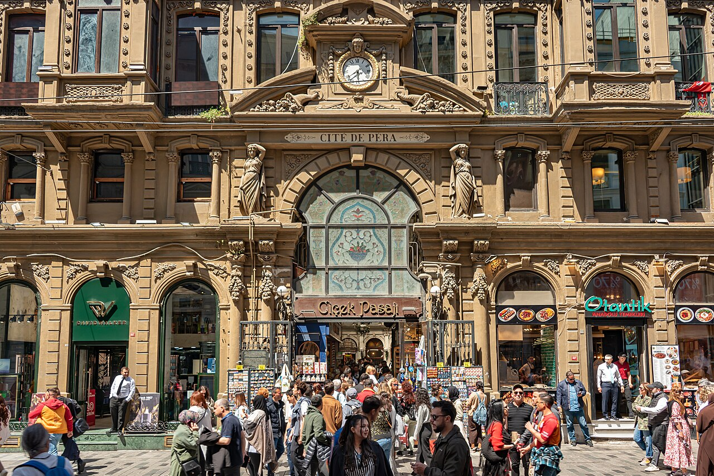
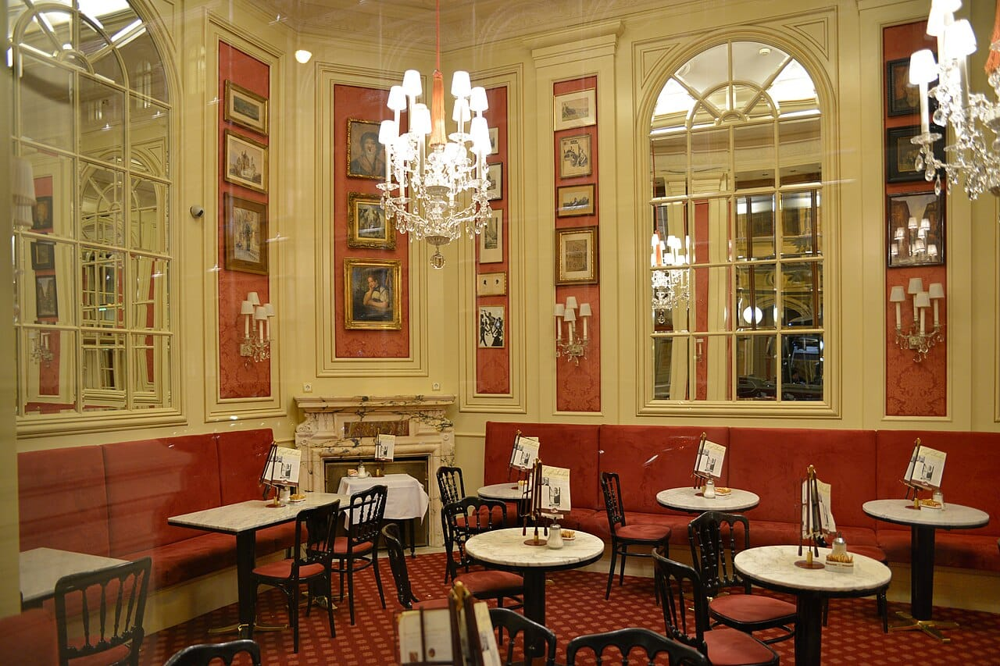

# Çiçek Pasajı

Step off the crowd of İstiklal Avenue through a stone arch and the sound thickens: plates, bottle caps, Turkish, English, Arabic and Russian voices, grilled fish and spice coming out of the shops on both sides. This is not one bar but a historic arcade called Çiçek Pasajı—“Flower Passage.” It has been a commercial apartment block from 1876, a ruin after 1978, and today the densest cluster of meyhanes and restaurants in Beyoğlu.

Figure: The arcade facade and entrance of Çiçek Pasajı on İstiklal Avenue in Beyoğlu, Istanbul. Image: Jorge Franganillo, CC BY 4.0, via Wikimedia Commons ([source page](https://commons.wikimedia.org/wiki/File:Istanbul_-_%C3%87i%C3%A7ek_Pasaj%C4%B1.jpg)).

## Location and history

Start with what stood here. The official history says the plot was occupied by the Naum Theatre, destroyed in the 1870 Pera fire. The Ottoman Greek banker Hristaki Zografos Efendi bought the land and commissioned the architect Kleanthis Zannos to design a new building with shops and apartments, completed in 1876. The shop arcade was called Hristaki Pasajı, the apartments Cité de Péra; early on there were 24 shops and 18 apartments, mixing florists, furriers, tailors, tobacconists, binders and confectioners.

In 1908 the building passed to Grand Vizier Küçük Sait Paşa, adding another name: Sait Paşa Pasajı or Sait Paşa Geçidi. After the 1917 Russian Revolution, exiled Russian noblewomen—including a baroness—opened flower shops here to earn a living; by the 1940s the florists had concentrated enough that “Çiçek Pasajı” (Flower Passage) replaced the older names. Restaurants, beer halls and meyhanes also gathered here, making it a Beyoğlu meeting point at night.

On 10 May 1978 part of the neglected building collapsed, killing 12 people. Portreler’s long article gives the detail: upper apartments were empty, load-bearing walls had been cut, water leaks had corroded the stone; after the collapse the arcade was boarded up and remained a ruin until 1988. In 1988 the Beyoğlu municipality and the association to preserve and beautify Çiçek Pasajı restored it, reopening as an arcade of restaurants and beer halls. December 2005 brought another façade and lighting renovation, and 2022 another repair. The stone arch, shopfronts and signs you see today are layers of repeated restoration, not the 1876 original.

## Architecture and space

Çiçek Pasajı is an arcade connecting İstiklal Avenue with Sahne Street and the Balık Pazarı. The entrance is a stone arch; inside is a narrow, long passage with continuous shopfronts on both sides and apartment windows above. There is no large atrium or glass dome; the spatial effect comes from narrowness and depth—you are pulled from the wide avenue into a corridor lined with tables, and light, cooking smoke and voices bounce between stone walls.

Today most units are meyhanes, fish restaurants, beer halls and snack shops. Tablecloths, rattan chairs, copper pans, hanging lamps, old photographs and beer advertising crowd together; some shops display fish and vegetables at the door, others turn a wall into a wine rack. By day the arcade is relatively quiet and the stonework and lintels are visible; after 19:00 tables reach the edge of the passage and waiters carry plates through the crowd. It is not for a quiet date; it is for a group eating, drinking and talking.

## The drinks and the food

The key word is meyhane culture, not a “bar list.” A meyhane is Istanbul’s Ottoman-era tavern tradition: a table orders many small meze dishes with rakı, wine or beer, and eats and drinks slowly. Rakı is an anise-flavoured grape distillate, usually diluted with water until it turns white (“lion’s milk”), served with ice and accompanied by seafood, sheep’s cheese, watermelon, fried aubergine, hummus, stuffed vine leaves, octopus, fried small fish and grilled fish. Beer is mostly Turkish brands with some imports; wine lists are usually short.

The ordering pattern is not “one main course per person” but “a table of meze first, then fish or meat.” The usual rhythm: cold meze (yoghurt aubergine, beetroot, bean purée, olive-oil vegetables), hot meze (fried squid, fried cheese, stuffed vegetables), then grilled fish or meat. Add water to rakı slowly; do not down it. One glass usually comes with a glass of water and a plate of meze. Dessert can wait until the end; baklava and cheese desserts are common.

## How to eat

The best times are 19:00–22:00 or 12:00–14:00. Evening has the fullest atmosphere but also the biggest crowd; midday suits architecture and photos. Weekends and holidays are very busy, and prams or small children are difficult. Walk once around the arcade to compare menus and prices before sitting; touts greet in several languages, so confirm price and portion first.

Order “bir meze tabağı” (a meze plate) or point at the small dishes; fish is sold by weight, so confirm the unit price and total before ordering. Rakı is sold by glass or bottle—ask the brand and quantity. Do not turn every dish into a “main course”; the pleasure of a meyhane is variety and small portions. Check the bill, especially fish and drinks; Turkish restaurants sometimes charge separately for bread, water or seating.

## Practical information

- Address: Hüseyinağa Mah. İstiklal Cad. Saitpaşa Geçidi No:176, 34435 Beyoğlu, Istanbul.
- Coordinates: 41.033944, 28.977917.
- Transport: metro to Tünel or Şişhane, then walk to İstiklal; about five minutes from Galatasaray High School.
- Hours: the arcade itself is passable all day; individual restaurants and bars differ, usually midday to late night, later on weekends. Check each door.
- Reservations: popular restaurants are worth booking for dinner; small tables can wait. Groups should call ahead.
- Payment: cash and credit cards are both common; some small shops are cash only—look for signs.
- Accessibility: a threshold at the stone arch, a narrow passage often blocked by tables, and difficult wheelchair access.
- Nearby: Balık Pazarı, Galatasaray, Tünel and Galata Tower are within walking distance; at night it is crowded, so watch your belongings.

## Etiquette and common misconceptions

First, do not treat Çiçek Pasajı as “one shop.” It is an arcade with several meyhanes and restaurants; you choose a particular menu, not “the Çiçek Pasajı menu.” Second, do not treat it as a flower market. The floral memory remains, but food dominates; for flowers, look around the Balık Pazarı stalls. Third, do not just stand with a bottle of beer; the meyhane rhythm is sitting down, ordering meze and talking. Fourth, do not order fish without asking the price; weight-based pricing can exceed the budget. Fifth, do not be rude to the touts; a simple “teşekkürler” (thank you) is enough, and keep walking if you are not interested. Sixth, do not use a flash on waiters and diners; the passage is narrow and a flash disturbs whole tables.

## Nearby and routes

Leave the arcade and head north for Galatasaray High School and the busy stretch of İstiklal, south for Tünel and Galata Tower, west for Balık Pazarı. The stop fits a “Beyoğlu historic dining” half-day: start at Galatasaray in the afternoon, browse the old embassy buildings and cafés of İstiklal, enter Çiçek Pasajı for meze and fish in the evening, then walk to Galata Tower for the night view. Cross-city comparisons include Vienna’s [Café Central](ref:central) and [Café Sacher](ref:sacher), Budapest’s [New York Café](ref:newyork), Lisbon’s [A Brasileira](ref:brasileira) and [A Ginjinha](ref:ginjinha): all turn “historic space” into everyday dining, but their layers of history and degrees of tourism differ.

Istanbul is not car-friendly into Beyoğlu; metro plus walking is easiest. For the return at night, take a taxi or ride-hail, but İstiklal is closed to cars on weekends, so walk to a main road first.

## Further reading and see also

- Official homepage: <https://tarihicicekpasaji.com/>, for the address, the arcade’s current state and the restaurant mix.
- Official history: <https://tarihicicekpasaji.com/tarihce/>, for the Naum Theatre, the 1870 fire, Hristaki Zografos, Kleanthis Zannos, the 1876 completion, the 1908 Sait Paşa transfer, the 1917 Russian flower shops and the 1940s name.
- Portreler long-form article: <https://www.portreler.com.tr/peranin-solmayan-hafizasi-cicek-pasaji/>, for the 10 May 1978 collapse, 12 deaths, the 1978–1988 ruin and the 1988 restoration.
- Wow Cappadocia guide: <https://wowcappadocia.com/cicek-pasaji-istanbul.html>, to cross-check the 24 shops, 18 apartments, 1908 transfer, florists’ concentration and the 1978/1988/2005 restorations.
- Cross-city entries: [Café Central](ref:central), [Café Sacher](ref:sacher), [New York Café](ref:newyork), [A Brasileira](ref:brasileira), [A Ginjinha](ref:ginjinha).

**Short definition:** A historic arcade at 176 İstiklal Avenue in Beyoğlu, Istanbul, completed in 1876 as Cité de Péra/Hristaki Pasajı on the Naum Theatre site, destroyed in the 1870 Pera fire. It passed to Grand Vizier Sait Paşa in 1908 and became Sait Paşa Pasajı; after the 1917 Russian Revolution exiled noblewomen opened flower shops here, and by the 1940s it was known as the “Flower Passage.” Part of the building collapsed on 10 May 1978, killing 12 people; it reopened after restoration in 1988 and was repaired in 2005 and 2022. Today it is an arcade of meyhanes, restaurants and beer halls, not a single bar.

## Related images

Image: Inside Café Sacher at Hotel Sacher, with red velvet seating and chandeliers. Credit: Feel free to use my photos, but please mention me as the author and if you want send me a message . or ( rufre@lenz-nenning.at ), CC BY-SA 3.0 at, via Wikimedia Commons ([source page](https://commons.wikimedia.org/wiki/File:Cafe_Sacher,_Hotel_Sacher,_Wien.JPG)). Related image for Çiçek Pasajı.
