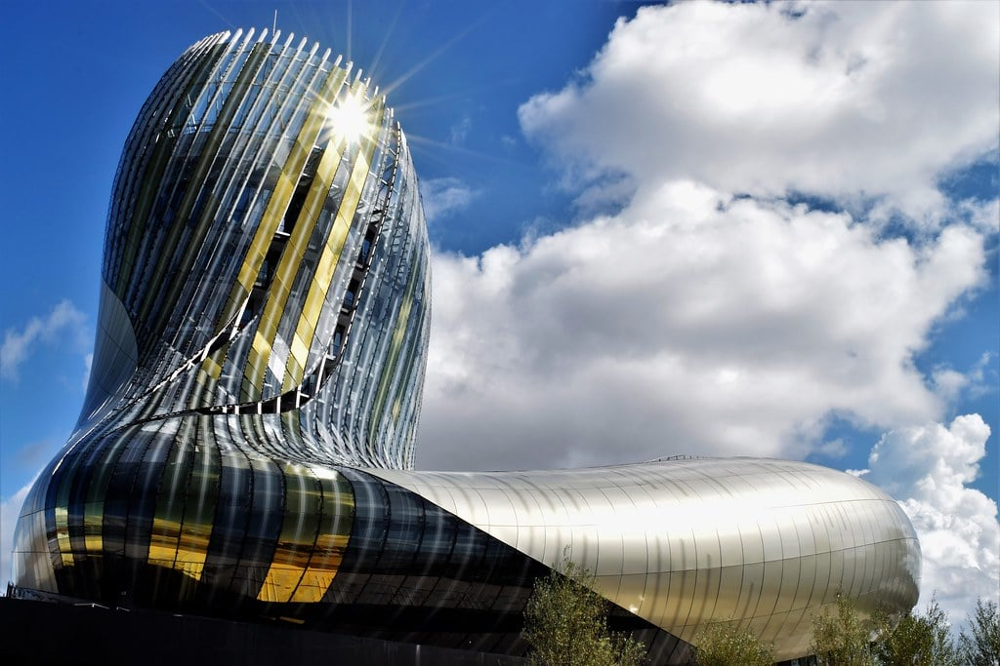

# La Cité du Vin

La Cité du Vin stands at 134 Quai de Bacalan on the left bank of the Garonne, in Bordeaux's Bassins à Flot district. It is not a winery and not a regional trade pavilion, but a civic museum of wine civilisation. It opened in 2016, designed by the Paris-based XTU architects Anouk Legendre and Nicolas Desmazieres. The official reading of the form combines a gnarled vine stock, wine swirling in a glass and the eddies of the Garonne; the facade is made of silk-screened glass and perforated aluminium that shifts with the light. That brief explains the visit: wine is presented through geography, history, craft, consumption and art, not as a wall of famous château labels.

Figure: Looking up at the Cité du Vin in Bordeaux, its tower wrapped in reflective glass and metal panels. Image: olilynch, CC0 1.0, via [source page](https://www.flickr.com/photo.gne?id=37500642606).

## Setting and history

The museum belongs to the redevelopment of the Bacalan quays, a former port and warehouse area turned into a mixed district of housing, culture and restaurants. It was promoted by the City of Bordeaux as a wine culture centre rather than an advertising arm for any appellation, which is why the building sits in a public landscape rather than inside a vineyard. When it opened in 2016 it quickly became one of the city's most recognisable contemporary buildings, and it turned wine from a subject of estates and merchants into something a city could use as everyday public culture.

This context matters when reading the exhibition. The first question is how people grow, make, trade and drink wine; the second is where Bordeaux sits within that larger story. For a first-time visitor, the framework is easier to grasp than a single estate tour. For someone who already knows the regions, the value is comparison across countries and periods, not another ranking of labels.

## Space and displays

The permanent exhibition covers about 3,000 m² and is divided into six universes and 18 modules, from antiquity to the present and across five continents. The six themes are Vineyards of the World, Know-how, Through the Ages, Art of Living, Wine Around the World and Bordeaux. Displays rely on film, smell, touch and interactive stations. The official average visit is two to three hours, with up to six hours of content for anyone who wants to see everything. The route is not a forced one-way sequence; visitors can jump between themes and come back later if a section is crowded.

The Belvédère on the eighth floor is the emotional close of the visit. The ticket includes a glass of wine selected by a sommelier, or grape juice, with a panoramic view over Bordeaux and the river. It is not an unlimited tasting bar, and treating it as one misses the point. The building also holds temporary exhibitions, tasting workshops, the restaurant Le 7, the Latitude20 brasserie and snack bar, and a shop. There are two entrances, one facing the city and one facing the river, and the route is designed as a flow from darkness to light and back out into the city.

## Visiting and tasting

Take a map on the ground floor and choose a route by interest rather than trying to walk all 18 modules in order. On a first visit, the sequence of Vineyards of the World, Know-how and Through the Ages gives a solid frame before going up to the Belvédère; if Bordeaux is the main interest, leave the two Bordeaux modules for the end. Tasting workshops are ticketed separately from the permanent exhibition, and some sessions are in English or French, so check the language and length when booking. The Junior route is more practical for families than pushing children through the full exhibition.

In November 2026 the official adult ticket for the permanent exhibition was €23, with a reduced rate of €18.40, children aged 6–17 at €9 and under-sixes free, including one glass at the Belvédère. Prices and session times change; confirm on the official site before buying. If a workshop is part of the plan, allow half a day and do not schedule it in the same hour as the exhibition.

## Practical information

Address: 134 Quai de Bacalan, 33300 Bordeaux, France (coordinates 44.86250, -0.55030).

Transport: the nearest stop is La Cité du Vin on tram line B, about a two-minute walk away, with buses also serving the Bacalan district. From Bordeaux Saint-Jean station, tram line C connecting to line B takes about 30 minutes; from the centre it is a 30–40 minute walk or a shorter cycle along the Garonne. Drivers can use the paid Hangar 19 car park on Quai de Bacalan.

Opening hours, from the official 2026–2027 schedule: 3 April to 31 October 2026 daily 10:00–19:00; 1 November 2026 to 3 January 2027 10:00–18:00 on weekdays and Sundays and 10:00–19:00 on Saturdays and school holidays, closing at 16:00 on 24 December and all day on 25 December; 3 January to 2 April 2027 daily 10:00–18:00, closed for the week of 25–31 January, with Saturdays in March until 19:00. Last entry is announced on the day.

Tickets and booking: the permanent exhibition plus one glass at the Belvédère costs €23 for adults, €18.40 reduced, €9 for ages 6–17 (€7.20 reduced), free under six, and €56 for a family pack of two adults and two children aged 6–17. Online tickets use the fast-track entrance; tasting workshops, Via Sensoria and the restaurants are priced and booked separately, with language and session times to check. Booking a day or two ahead is sensible at weekends and in high season.

The building is accessible, pushchairs can enter, and large luggage must be left in storage. Page checked on 2026-11-08; operating status, prices and bookings are subject to official channels.

## Etiquette and misconceptions

The most common mistake is treating La Cité du Vin as a substitute for a Bordeaux château visit. There are no vineyards here, and no single estate is the focus; the subject is global wine culture, with Bordeaux as one strand. The second mistake is assuming the ticket includes unlimited tasting. It includes one glass at the Belvédère, while workshops and extra glasses are charged separately. Third, the displays use touchscreens, scent devices and sound, so families should keep an eye on children and not bang on the exhibits; keep voices low in the tasting area and do not carry glasses into the galleries. The legal drinking age in France is 18, and minors are served grape juice.

It also helps to leave time for the Belvédère instead of treating it as a photo stop. The glass there is part of the argument about how wine is narrated, and drinking it slowly is more rewarding than photographing it and leaving.

## Surroundings and itineraries

The museum sits in Bassins à Flot, well combined with the river bank, the Chaban-Delmas bridge and the Halles de Bacalan food market for a half-day. See the exhibition in the morning, eat at the market at midday, then walk along the river to the old Chartrons wine-merchant district or take tram line B into the old town. The Médoc and Saint-Émilion vineyards each need a separate half-day or full day and cannot be reached on foot from the museum. Use La Cité du Vin as the first stop that builds a framework, then go to the vineyards; the reverse order is usually less rewarding.

## See also

La Cité du Vin puts [wine](ref:wine) back on a world map and places [Bordeaux](ref:bordeaux) inside a larger [history of world wine](ref:world-wine). It also offers a contrast with the Changyu Wine Culture Museum: one tells global wine through a civic institution, the other tells Chinese industrial wine through a company's history.

Further reading: [Changyu Wine Culture Museum](ref:c-extra-1), [A Ginjinha](ref:c-extra-2).
