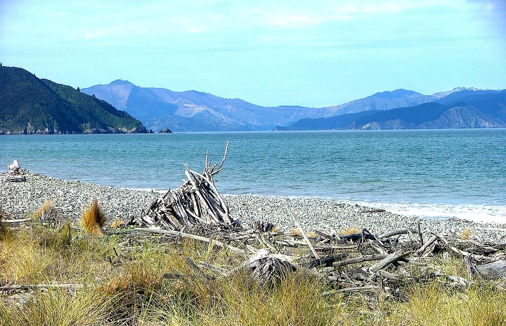

# Cloudy Bay

Cloudy Bay stands on Jacksons Road in Blenheim, its vines laid over the gravel riverbed of the Wairau Valley and the ridges of the Richmond Ranges behind. It is not an estate that hangs its story on great age: the first vintage was only 1985, relatively young in Marlborough's modern wine history. What it did do was combine Sauvignon Blanc aroma, acidity and a sea-wind narrative clearly enough to become the first stop for many drinkers discovering New Zealand white wine.

Figure: Cloudy Bay. Image: Crackerbuzz at English Wikipedia, CC BY-SA 3.0, via Wikimedia Commons ([source page](https://commons.wikimedia.org/wiki/File:Rarangi_Beach.jpg)).

## 1985: how one vintage defines an estate

1985 was Cloudy Bay's first vintage and the starting point of its public story. That date is not early in Marlborough's industry history: in 1973 Montana planted the first large-scale vines in the Wairau Valley, in 1979 Marlborough's first Sauvignon Blanc was released, and Cloudy Bay only bottled its own first wine in 1985. Arriving later did not cost it a place; it allowed the estate to adopt already-tested varieties and sites and concentrate resources on style and export markets.

The official account stresses that quality came first from day one, which can sound like a slogan. Against the timeline, it reads more like a strategic choice: rather than the widest possible range, make Sauvignon Blanc a recognisable baseline, then extend into Chardonnay, Pinot Noir and sparkling wine. Since 2010 the estate has also operated in Central Otago, separating Marlborough's maritime style from the cooler far south of the South Island.

## The vineyard setting in the Wairau Valley

[Marlborough](ref:marlborough)'s Wairau Valley is dominated by old riverbed gravels that drain quickly and warm early, so grapes can ripen while keeping acidity. The valley contains different aspects and rainfall zones: coastal sites are moderated by sea breeze, inland sites are drier and earlier; the Southern Valleys have heavier, clay-rich soils and become cooler to the south; the Awatere Valley is drier, windier and further south. Cloudy Bay's Blenheim location sits in the core of the Wairau, and although its grapes are not all from the immediate surroundings, the landscape, roads and ridges seen at the cellar door shape the first impression it presents.

Treating "Wairau" as one precise plot would be wrong. It is a valley containing several meso-climates; different wines from one estate can come from nearby blocks with quite different soils and ripening speeds. A regional name on a label gives direction, but vintage and wine still decide the flavour.

## Reading the range: core wines and Te Koko

The core range is the clearest entry point. Sauvignon Blanc is the baseline, usually with lime, passionfruit, herbaceous notes and mineral tension, high in acidity and open in aroma; Chardonnay ranges from fresh to more textured; Pinot Noir offers red cherry, plum and spice in a medium body. Above that sit Te Koko and Te Wāhi, the former another expression of Sauvignon Blanc and the latter more focused on site and winemaking choice; Pelorus is the sparkling line. Ripeness changes the aroma balance from year to year, so one bottle should not define the whole brand.

If you plan to drink only one glass, start with the core Sauvignon Blanc as a reference. If you want to understand how one variety can speak in different voices, choose a tasting that includes Te Koko and compare the texture that fermentation and ageing bring. Availability and tasting-list inclusion change; this entry does not turn the range into a fixed inventory.

## Cellar door and Saku: planning the visit

The cellar door opens seven days, 10:00–17:00, closed on Christmas Day and Good Friday, and the official advice is to book, especially at weekends and in summer. Saku serves lunch daily from 11:00 to 15:00 and adds dinner on Thursday and Friday from 16:00 to 20:00; restaurant and tasting are separate bookings, so confirm both if you want both. The cellar door sits among vines and ridges, and a walk before or after the tasting is worthwhile, but stay out of closed vineyard blocks.

A sensible rhythm is a morning tasting to establish a reference for Sauvignon Blanc and Chardonnay, lunch at Saku, then a return to the cellar door for a bottle or a final glass. The reverse also works, but taste becomes dull after lunch and detail is lost. Families should ask about age rules for the restaurant and tastings; New Zealand's legal drinking age is 18, and alcohol-inclusive experiences check identification.

## Booking, hours and getting there

The address is 230 Jacksons Road, Blenheim, New Zealand. It is close to Blenheim airport and town, and driving is easiest; no reliable public transport reaches the cellar door, and ride-hailing is uncertain on the return. Follow on-site parking instructions and do not stop between vine rows or in working lanes. Coordinates should be taken from official channels; for navigation, use the address.

Book through the official reservation entry, choosing date, time and party size; cancellation rules vary by experience. High season is the southern summer and around holidays, when both cellar door and restaurant fill; spring and autumn are quieter but windier, so bring a windproof jacket. Opening hours, restaurant times and booking rules change, so check the official page again before you go.

## Common misconceptions

First, Cloudy Bay is not Marlborough's oldest estate. Its first vintage was 1985, while modern planting began in 1973 and the first Sauvignon Blanc arrived in 1979. Second, the cellar door is not a full production-line tour; the focus is tasting, food and vineyard views. Third, Te Koko is not a different variety; it is still Sauvignon Blanc with a different fermentation and ageing path. Fourth, Marlborough Sauvignon Blanc is not one flavour: Wairau, Southern Valleys and Awatere differences, vintage and estate choices all change the result. Fifth, do not ignore bookings; an unannounced visit may only allow a bottle purchase, not a tasting.

Cloudy Bay is best approached through the address, then the current opening status, and then what the place is known for. One check alone will not settle it.

Start with [Marlborough](ref:marlborough) for address and space, then read [White wine](ref:white-wine) for operating status. Seeing both keeps Cloudy Bay from being confused with a neighbouring idea.

**Key facts.**

| Item | Detail |
| --- | --- |
| In one line | A Marlborough Sauvignon Blanc estate on Jacksons Road in Blenheim, first vintage 1985; its cellar door opens seven days 10:00–17:00, with the Saku restaurant and booked tastings, and it remains a clear entry point to Wai… |
| Address | 230 Jacksons Road, Blenheim, New Zealand |
| City and country | Blenheim / New Zealand |
| Status | verified open |
| Official site | cloudybay.co.nz |

## References

This entry was checked against Cloudy Bay's official visit page, New Zealand Winegrowers' Cloudy Bay entry and Marlborough region page, and Brancott's official brand page. Page verified 2026-11-09. To place this stop in a day, see the [Marlborough wine trail](ref:route); for variety background, see [Sauvignon Blanc](ref:sauvignon) and [white wine](ref:white-wine). Opening hours, bookings and wines are subject to official channels.

Further reading: [A Ginjinha](ref:c-extra-1).
