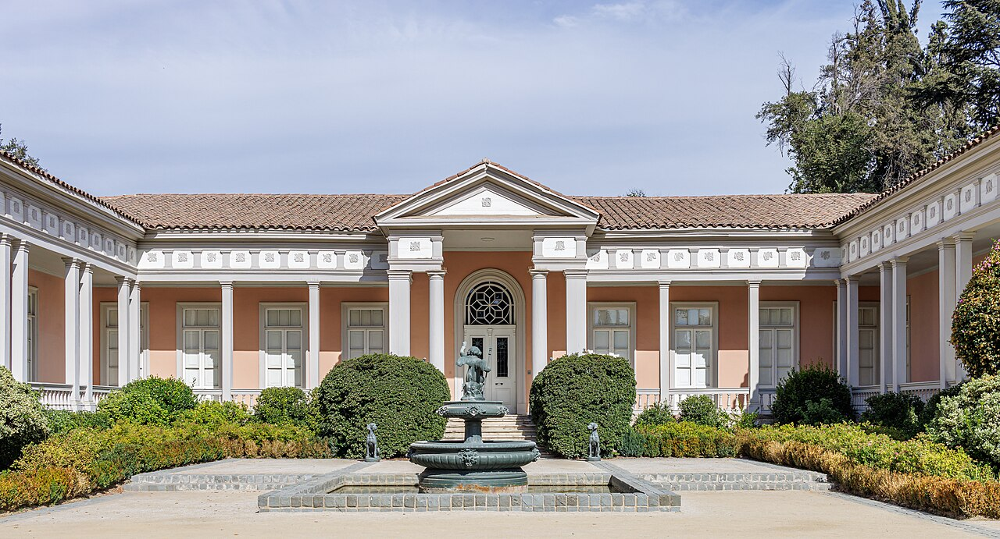

# Viña Concha y Toro

South of Santiago, the road takes about 45 minutes to Pirque, where poplars, irrigation channels and vineyards replace the city. Concha y Toro’s yard sits on the alluvial floor of the Maipo Valley. The entrance is modest, but inside are the old 1883 wine warehouse, Casa Don Melchor and the newer Centro del Vino. This is not a small family estate but a compact history of Chilean wine’s industrialisation, export trade and brand building. It helps to separate brand from land: one side is a global commodity such as Casillero del Diablo, the other a flagship such as Don Melchor from a specific plot in Puente Alto.

Figure: The front of Casa Patronal and the entrance garden at Concha y Toro’s Pirque estate. Image: Rjcastillo, CC BY-SA 4.0, via Wikimedia Commons ([source page](https://commons.wikimedia.org/wiki/File:Frente_Casa_Patronal_Concha_y_Toro.jpg)).

## Location and history

In 1883 Melchor Concha y Toro, a lawyer, politician and businessman, bought land in Pirque, brought vines from Bordeaux and built an underground cellar. In 1933 the company made its first export to the Netherlands and listed its shares in Santiago, an unusually corporate move for Chilean wine at the time. The Casillero del Diablo story took shape in 1966: the best wines were kept in a locked cellar, and the legend that the Devil lived there helped stop theft. The brand later became one of Chile’s largest exports. Don Melchor’s first vintage was released in 1987, described as Chile’s first icon wine, from old Cabernet Sauvignon in Puente Alto. In 1994 Concha y Toro became the first winery to list on the New York Stock Exchange. It marked 140 years in 2023, and in 2024 Don Melchor 2021 was ranked No. 1 in Wine Spectator’s Top 100.

## Architecture and spaces

The Pirque property has three layers. The oldest is the nineteenth-century cellar and Casa Don Melchor, with brick vaults, stone walls and low entrances, still used for ageing and hospitality. The middle layer is Bodega 1883 and the working winery, with fermentation, bottling and logistics. The newest is the Centro del Vino, opened for the 140th anniversary in 2023: more than 12,000 square metres, six thematic zones and a 22-hectare century-old park outside. The park has tall eucalyptus, palms, ponds and European-style axes, a strong contrast to the dry Central Valley. The visit moves from vineyard and historic buildings to the Casillero del Diablo cellar, then to tasting and dining. This is not a museum that freezes history but a composite site where production, brand and tourism share the same ground.

## The wines and palate

The range can be read in three lines. The first is the everyday export line: Casillero del Diablo Cabernet Sauvignon, Carmenere, Chardonnay and Sauvignon Blanc, with direct fruit and accessible prices, the gateway for Chilean wine into global supermarkets and restaurants. The second is the regional line: Marques de Casa Concha stresses the character of individual valleys, with Cabernet from Puente Alto, Carmenere from Peumo and Chardonnay from Limarí. The third is the flagship: Don Melchor comes from gravel and alluvial soils in Puente Alto, mainly Cabernet Sauvignon with small amounts of Cabernet Franc, Merlot and Petit Verdot. New oak is high, but the aim is structure, length and ageing capacity rather than pure barrel flavour. Concha y Toro also makes sparkling and sweet wines, but the most revealing comparison is between brand wine and flagship wine: same company, different fruit sources, yields and ageing standards.

## How to drink

Everyday reds such as Casillero del Diablo are best at 15–17°C, ready on opening and needing no long decant; pair with grilled meat, pizza, burgers or Chinese braised pork. Marques de Casa Concha can be opened 30–60 minutes ahead and paired with steak, lamb or hard cheese. Don Melchor is best at 16–18°C, one to two hours ahead when young and 30–60 minutes when older, with aged beef, game or truffle. Serve whites at 10–12°C and sparkling at 6–8°C. In a restaurant, look at alcohol and residual sugar before region; Chilean fruit is ripe, so heavier sauces work better than delicate steamed seafood.

## Practical information

The address is Av. Virginia Subercaseaux 210, Pirque. Centro del Vino is open daily 10:00–18:00, with the last guided tour at 16:30; book at least 48 hours ahead on +56 2 2476 5000 or visitas@conchaytoro.cl. From central Santiago, drive 45–55 minutes via Acceso Sur and Av. Concha y Toro. Alternatively take Metro Line 4 to Plaza de Puente Alto and a short taxi. Parking is free, the main route is wheelchair accessible, but some historic areas have steps. Under-18s may enter the grounds but not tasting rooms; pets are not allowed.

## Etiquette and common misreadings

First, do not equate Concha y Toro with a single winery. It is a group with several valleys, brands and subsidiaries, so confirm whether you booked Centro del Vino or a production visit. Second, Casillero del Diablo is a brand story, not a devil in the cellar; do not press staff for legend details or access to closed cellars. Third, Don Melchor is not identical every year; style changes with vintage, plot and blend, so check the year and provenance. Fourth, do not drive after tasting; Chilean alcohol levels are high and easy to underestimate in the afternoon. Fifth, the estate is a working site: do not enter fermentation rooms, bottling lines or vine rows, and follow photography signs. Sixth, do not judge Concha y Toro by the idea that all Chilean wine is cheap; its top wines overlap in price with Old World names.

## Around and routes

Around Pirque, link other Maipo Valley estates, the Puente Alto vineyards and old Santiago. Half a day is enough for the Centro del Vino tour and tasting; a full day can add the [Maipo Valley](ref:maipo) country roads and a [Chile](ref:chile) wine museum. Comparing [Cabernet Sauvignon](ref:cabernet) with Carmenere is the fastest way into Chilean reds: one gives the frame, the other the herbal berry note. Do not put Concha y Toro and Mendoza in one day; both require crossing the Andes and the drive is too long. For background, see [red wine](ref:red) and [oak ageing](ref:oak).

## Further reading and see also

- Comparisons: [maipo](ref:maipo), [chile](ref:chile), [cabernet-sauvignon](ref:cabernet), [carmenere](ref:carmenere), [red-wine](ref:red), [oak-ageing](ref:oak).
- Background: [maipo](ref:maipo), [chile](ref:chile).
- This entry provides no map; visits, vintages and prices should be checked with official channels.

**At a glance:** A historic Chilean winery in Pirque, Maipo Valley, founded in 1883 by Melchor Concha y Toro and one of the country’s best-known wine names abroad. Its core labels include Casillero del Diablo, Marques de Casa Concha and Don Melchor; the Centro del Vino opened for the 140th anniversary, with a 22-hectare century-old park, Bodega 1883 and the Casillero del Diablo experience.

Viña Concha y Toro is best approached through the address, then the current opening status, and then what the place is known for. One check alone will not settle it.

**Key facts.**

| Item | Detail |
| --- | --- |
| In one line | A historic Chilean winery in Pirque, Maipo Valley, founded in 1883 by Melchor Concha y Toro and one of the country’s best-known wine names abroad. Its core labels include Casillero del Diablo, Marques de Casa Concha and … |
| Address | Av. Virginia Subercaseaux 210, Pirque, Región Metropolitana, Chile |
| City and country | Pirque / Chile |
| Status | verified open |
| Official site | conchaytoro.com |

**Sources and limits.** The key claims about Viña Concha y Toro are checked against the following sources: Concha y Toro, Centro del Vino Concha y Toro, Viña Concha y Toro. For current products, addresses or opening status, use conchaytoro.com. Prices, batches and status change; the body is project-written and does not reproduce source text.

For Viña Concha y Toro, this entry was last checked in 2026; prices, batches and availability change, so confirm them against the sources below.
