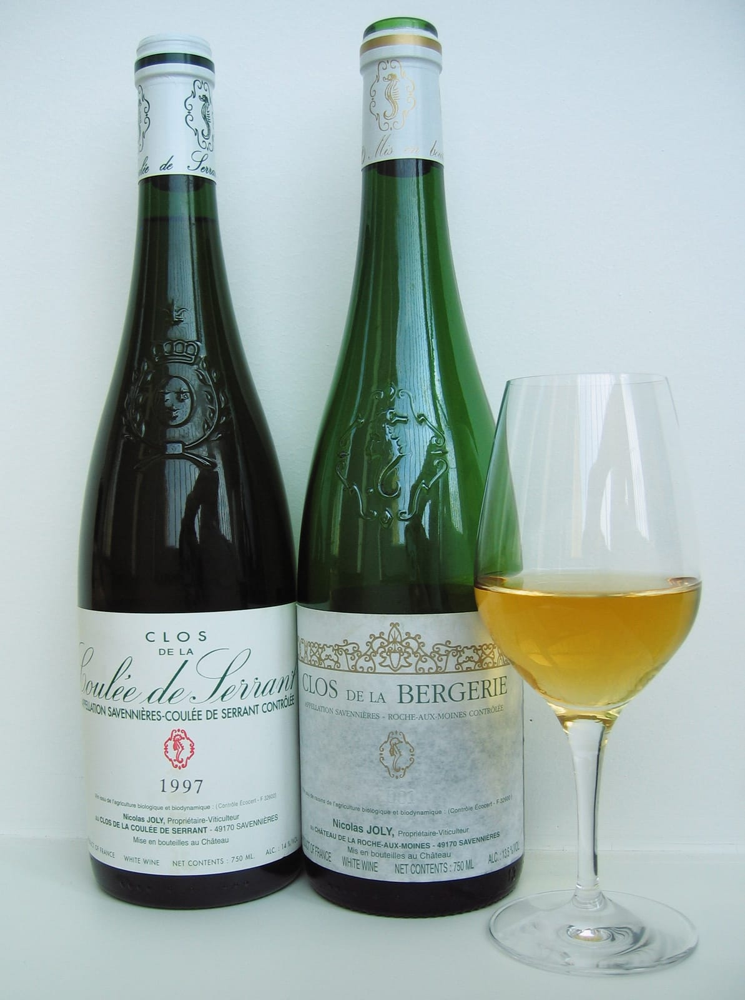

# La Coulée de Serrant

La Coulée de Serrant stands at Château de la Roche aux Moines in Savennières, in France's Loire Valley. It covers only 7 hectares yet is an appellation in its own right, Coulée de Serrant, a monopole of the Joly family. The vineyard sits on a steep slope above the Loire, was planted by Cistercian monks in 1130 and is now run by the family of Nicolas Joly; it is one of the landmark biodynamic estates in France.

Figure: Related photograph of La Coulée de Serrant. Image: Tomas er, CC BY-SA 3.0, via Wikimedia Commons ([source page](https://commons.wikimedia.org/wiki/File:Coul%C3%A9e_de_Serrant_and_Clos_de_la_Bergerie.jpg)).

## Savennières: a slope on the north bank of the Loire

Savennières lies south-west of Angers on the north bank of the Loire, with slopes facing south or south-east and soils of schist, sandstone and a little volcanic rock. Its Chenin is mainly dry, high in acidity and mineral, tight when young and showing honey, nuts and wet stone with age. Compared with Vouvray, Savennières is narrower: sweet wines are not the mainstream, and estates stress slope and patience.

La Coulée de Serrant sits on this slope, closer to the river than the village centre. The gradient is steep and the soil thin, so machinery struggles to work; from the foot you can see the rows following the contours. The landscape is not scenery but the source of the style: drainage, sunlight and root depth all come from the slope.

## 1130: the vineyard planted by Cistercian monks

The official account dates the vineyard to 1130, planted by Cistercian monks. The old monastery still stands, and a few hundred metres away stood the Château de la Roche aux Moines, dismantled during the wars of religion. That starting point makes La Coulée de Serrant one of the oldest vineyards in the Loire and gives the monastery-vineyard-wine story something physical to point to.

History is not there to decorate a label. The Cistercians chose this slope because it faces south, sits near the river and drains well; those conditions still hold. A visit that remembers only "ancient" misses the more important point: this is a slope selected by natural conditions, not a parcel remembered by historical accident.

Keep the monastery and the château apart as well: the old monastery survives, while the Château de la Roche aux Moines was built later and dismantled in the wars of religion. The estate's reception and office operate under the château name, but the vineyard and the monastery ruins are different points; ask for "Château de la Roche aux Moines" rather than "the monastery" when directions matter.

## A 7-hectare monopole AOC

Coulée de Serrant is an AOC covering only 7 hectares, all owned by the Joly family. France has few appellations this small, which means "Coulée de Serrant" on a label is a legal place name, not an estate brand; the other two wines from the property belong to Savennières-Roche aux Moines and Savennières.

The monopole has a clear advantage: the boundary is fixed, and the estate cannot expand output with fruit from elsewhere or enlarge the area at will. The disadvantage is tiny production, which magnifies vintage variation. For a buyer, a bottle of Coulée de Serrant is the whole expression of these 7 hectares in one year, not one part of a brand portfolio.

## The Joly family and biodynamics since 1984

After the Joly family took over, Nicolas Joly turned his attention to biodynamics in the 1980s; the official page states that the whole estate has been farmed biodynamically since 1984. That is earlier than most French estates and makes the property a showcase for biodynamics in the Loire. Joly's books and talks have been influential, but the estate itself remains centred on vineyard and cellar.

Biodynamics here is not a synonym for "no sulphur" or "natural wine" but a system of farming and observation: preparations, compost, phenology and lunar rhythms all enter decisions. Visitors may doubt the explanations, but the effect on vineyard ecology is hard to deny; looking at soil, vegetation and vines is more useful than arguing theory.

## Three wines: Coulée, Clos de la Bergerie and Les Vieux Clos

The estate makes three Chenin wines under three legal labels. Coulée de Serrant comes from the steepest parcel closest to the river, the tightest and most mineral, with the longest ageing potential; Clos de la Bergerie belongs to Savennières-Roche aux Moines and is rounder and opens earlier; Les Vieux Clos belongs to Savennières, comes from higher or differently soiled parcels, and is the most accessible in price.

The differences are legal as well as geographical. Tasted side by side, they show the layered relationship inside one estate: the 7-hectare monopole at the centre, Roche aux Moines outside it, and Savennières outside that. Check the label before discussing vintage and price, or the three will be confused.

## Horse ploughing and hand work on the slope

The official page notes that, because the slope is steep, some work can only be done by hand or with horses. Steepness keeps machines from working steadily and raises the cost of picking, pruning and carrying; that is one reason 7 hectares can sustain low yields and high prices. The vines are mostly 35 to 80 years old, and old vines plus a steep slope naturally hold production down.

The farming method shapes the wine too: deep roots, low yields and slow ripening give concentration and clear acidity. If you see a horse or hand tools on the slope, do not read only romance; that is cost, and it is why the estate chooses not to expand.

## Visiting and tasting

The address is Château de la Roche aux Moines, 49170 Savennières, France; the official page states that tasting is open Monday to Saturday, 09:00–12:00 and 14:00–17:30, without an appointment, and suggests emailing info@coulee-de-serrant.com. Phone lines are occasionally interrupted, so check the site or send an email before travelling.

From Angers it is about a twenty-minute drive; the road below the slope is narrow and parking is limited, so walking from the village is easier. At the tasting, ask whether all three wines can be tried, whether there is a fee and whether children may come; drivers should spit. Chenin is sensitive to heat and light, so consider transport and storage when buying.

## See also

- [Loire](ref:loire): Savennières, Vouvray and the spread of Chenin.
- [Chenin Blanc](ref:chenin): dry styles, ageing and biodynamics.
- [White wine](ref:white-wine) and [oak-ageing](ref:oak-ageing): understanding vessels and style.

Opening hours, bookings and transport are subject to official channels; page verified on 2026-11-09.

Further reading: [Wine](ref:c-extra-1).

**At a glance:** A 7-hectare monopole AOC in Savennières, France, planted by Cistercian monks in 1130 and now run by the Joly family, biodynamic since 1984; it produces Coulée de Serrant, Clos de la Bergerie and Les Vieux Clos from Chenin Blanc. 

Start with the address. From there, consider the current opening status, then what the place is known for. That is how a practical judgment about La Coulée de Serrant is built.

Start with [Loire Valley](ref:loire) for address and space, then read [White wine](ref:white-wine) for operating status. Seeing both keeps La Coulée de Serrant from being confused with a neighbouring idea.
