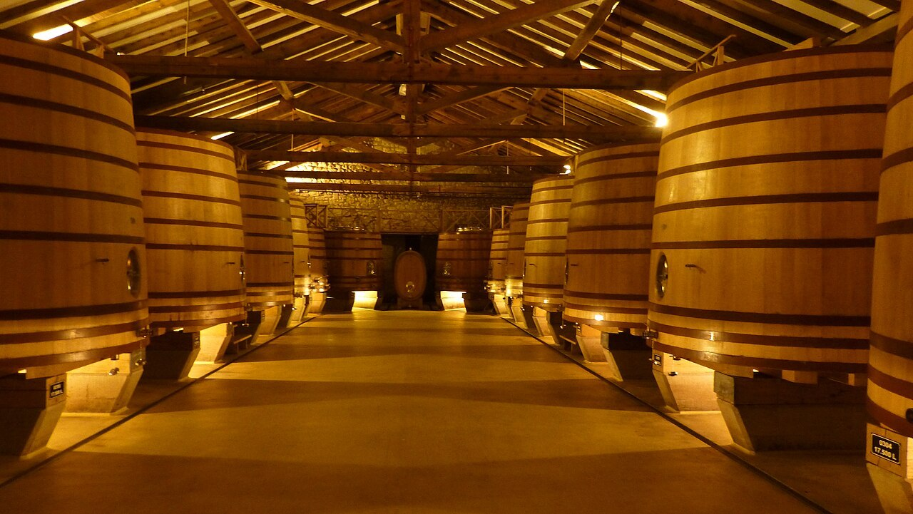

# CVNE

Leave Haro station and walk a few minutes along Barrio de la Estación: a walled old winery appears behind iron gates, marked CVNE. The full name is Compañía Vinícola del Norte de España, the Northern Spanish Wine Company, though most people say "Cune". In 1879 the Real de Asúa brothers came to Haro and built here beside the railway; more than a century later the winery is still run by the founders' descendants and still works on the original site. It is not a museum shell but a place where old buildings continue to make wine.

Figure: CVNE. Photograph: CVNE bodega Imperial 2. Credit: Txo, CC BY-SA 4.0, via Wikimedia Commons ([source](https://commons.wikimedia.org/w/index.php?curid=83638963)).

> **Quick verdict**
> **In one line:** This entry helps you decide whether CVNE deserves a detour, and what to check before visiting.
>
> - **Best for:** Anyone planning a visit to CVNE who needs to decide whether it deserves a half-day or a full day.
> - **Not for:** If you want only want a must-visit list and will not check booking, transport or opening hours.
> - **Check first:**
>   - In 1879 Eusebio and Raimundo Real de Asúa founded CVNE in Haro's station district.
>   - A visit usually starts in the Aldea del Vino and passes through the old halls, fermentation, the barrel cellar and the bottle cellar before ending in a tasting room.

## Place and history

In 1879 Eusebio and Raimundo Real de Asúa founded CVNE in Haro's station district. The official history tells the origin concretely: the brothers had come to Haro for health reasons and decided to stay and make wine. That detail matters because modern Rioja was not built only by local growers; outside capital, the railway and French demand all played a part. In the second half of the nineteenth century, French vineyards were hit first by oidium and then by phylloxera, and merchants crossed the Pyrenees to buy Rioja wine. Haro's station allowed barrels to move quickly to France and the Atlantic ports, so wineries clustered beside the tracks.

CVNE is one of the oldest houses in that district, alongside López de Heredia (1877) and La Rioja Alta (1890). The company name was shortened to CVNE, and the brand Cune came from a simplified pronunciation. Today the group includes Cune, Viña Real and Imperial, covering different Rioja sub-zones and styles; the winery still stresses the continuity of one family across five generations. Keep the names apart, or Cune becomes the winery and CVNE becomes a single bottle.

The site repays a slow look. Inside the entrance, the Aldea del Vino, or wine village, is a courtyard enclosed by stone buildings with ceramic tile roofs; fermentation, maturation, bottling and offices are arranged around it. The oldest production hall is often called Nave Eiffel, and tours and local material link it to the Eiffel workshop. That attribution carries a degree of storytelling, so treat the exact designer and date as a point to confirm with the winery. These late-nineteenth-century industrial buildings still function; they are not scenery.

## The site and the visit

A visit usually starts in the Aldea del Vino and passes through the old halls, fermentation, the barrel cellar and the bottle cellar before ending in a tasting room. The old buildings keep their timber beams, brick walls and ironwork, and walking through them gives a sense of nineteenth-century industrial scale: tall, narrow, with rows of casks running into the dark. Cellars are cold and damp and floors can be slippery; wear flat shoes with grip and bring a thin jacket. Check signs before photographing, since some areas do not allow flash or tripods.

Barrel ageing is the core of the stop. CVNE's tradition is built mainly on American oak, and Crianza, Reserva and Gran Reserva follow the legal minimum ageing levels, though the house often ages longer. American oak gives vanilla, coconut, dill and sweet spice; long maturation folds those notes into fruit and acidity, producing dried fruit, leather and tobacco. Look at cask size, toast level and the way the rows are stacked, and at the vintage markings on the walls; those details explain the house style better than the phrase "traditional method".

Visits are by appointment, usually on weekdays, and the harvest reduces or suspends reception. Packages differ in length, whether a tasting is included, which wines are poured and the language, so confirm each point when booking; trade and group arrangements may follow a separate route. Do not treat it as a winery where you buy a ticket at the door, and do not expect to taste without a booking. Non-drinkers can take the history and cellar part, or spend the time in Haro's old town.

## The range and tasting

Cune is the best-known brand, running from Crianza and Reserva to Gran Reserva in a classic Rioja style: red fruit, vanilla, leather and tobacco, medium structure, good with roast lamb, ham and stews. Imperial is another line, with Reserva and Gran Reserva focused on ageing and complexity and often treated as the house flagship. Viña Real comes from Rioja Alavesa and is usually fresher and more fruit-forward; Monopole is the classic white, mostly Viura, fermented and aged in oak, with nuts, honey and citrus. Availability changes by vintage and market, so read the back label.

On a first visit, the most useful comparison is Cune Reserva against Imperial Reserva: same region and similar varieties, different fruit sources, oak time and structure. If a Gran Reserva is available, notice the dried fruit and leather that bottle age has added. Do not serve the white too cold or the aromas disappear; Monopole can be served a little warmer than a simple dry white. Smell before tasting, sip slowly and spit what you do not want, especially if you are driving or catching a train.

The shop sells bottles, but hours are irregular and some periods are open only to booked visitors; check luggage and shipping rules before buying. Older and limited wines vary widely in price, so do not chase a trophy bottle without knowing whether you like the style. To compare the three houses, drink small pours and spit more; focus on cask type, ageing length and fruit source.

## Practical information

The address is Calle Barrio de la Estación 2, 26200 Haro, La Rioja, Spain, at the entrance to the station district. From Haro station it is a three- to five-minute walk. Logroño is about forty minutes to an hour by train or bus, and Bilbao about two hours by train, but services are infrequent, so check the day's timetable. By car, Logroño is about 45 km, Vitoria about 50 km and Bilbao about 120 km; parking in the town centre is limited, so use a hotel or edge-of-town car park.

Book ahead through the visit entry on the official site, or by phone or email, and confirm date, time, language, group size, whether a tasting is included and the price. The harvest closes or reduces visits, and Sundays and public holidays are usually unavailable. A visit usually lasts one to two hours depending on the package; cellars are cold and damp, so wear shoes with grip and a light jacket. Visitors with mobility needs should say so in advance, since thresholds and stairs in a historic building are not always suitable for wheelchairs.

Opening hours, prices and wines change. This entry was checked on 2026-11-08; confirm with the winery and the official site before travelling. If this is the third stop on the Haro station-district route, book early afternoon, leaving time for lunch and the first two wineries. Do not crowd three tastings together; palate fatigue turns the third visit into an exercise in not tasting the difference.

## Etiquette and around

A winery is a production site, not a bar. Arrive at the booked time; lateness may shorten the visit or lead to refusal. Do not touch casks, pipes, old photographs or displays, and do not enter closed branches of the cellar. Check with the guide before photographing. Avoid strong perfume and loud conversation, and use the spittoon without embarrassment; it is normal practice.

For CVNE, anyone driving should not drink. The wineries of Rioja are close together, but rural roads bend, and driving after tasting is risky. The safest options are train plus walking, a chauffeur or a designated driver. If you come by train, note that return services are infrequent; do not put the last tasting half an hour before departure.

The station district supplies the next stops: López de Heredia, La Rioja Alta, Muga and Gómez Cruzado are all within walking distance, though each needs a booking. Haro's old town around Plaza de la Paz has bars and small restaurants for lunch. The Haro Wine Festival on 29 June makes the town extremely busy, so avoid that date for a quiet visit. East lies the Vivanco wine museum at Briones; north are Laguardia and Rioja Alavesa. For how cellars shape flavour, read [Cellar and storage](ref:cellar); for the wider region, start with [Rioja](ref:rioja) and [Wine](ref:wine).

Further reading: [A Ginjinha](ref:c-extra-1), [À la Mort Subite](ref:c-extra-2).
