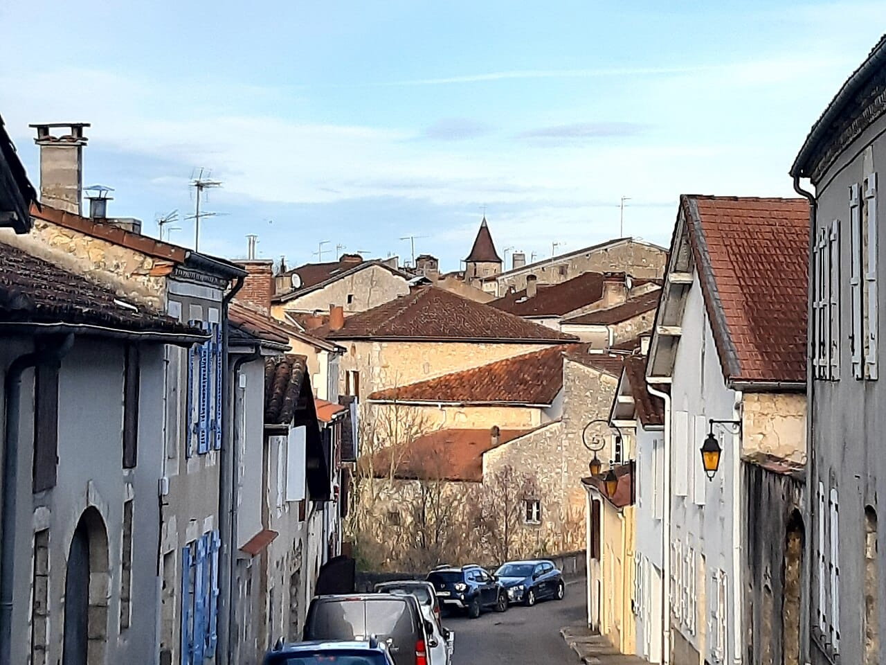
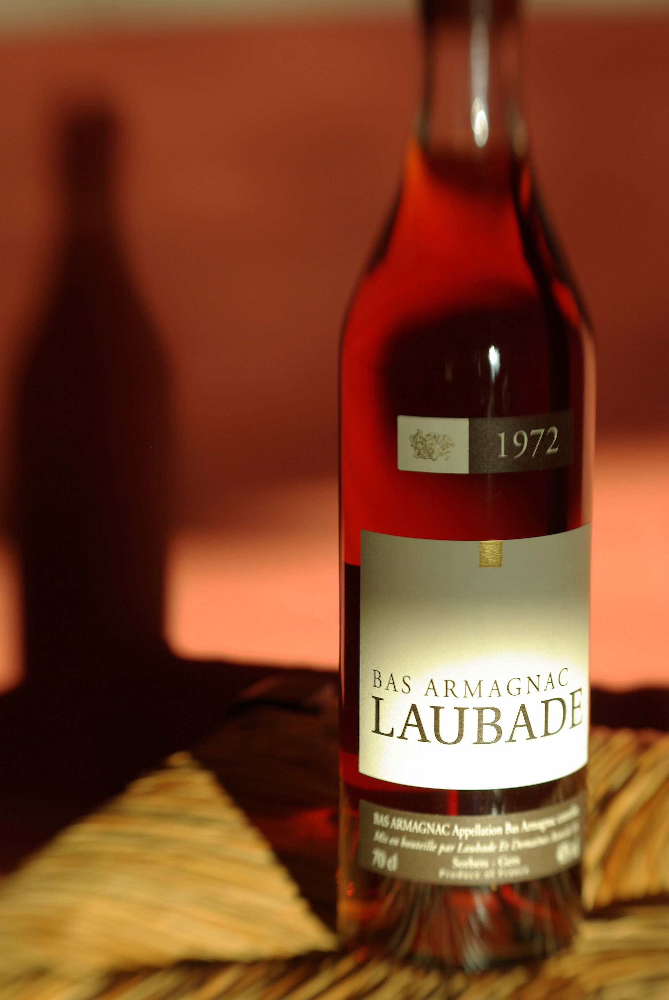

# Darroze

Roquefort is a small town in the eastern Landes, its main road lined with low houses, a bakery, a pharmacy and shops selling foie gras and Armagnac. Darroze’s reception and cellars are at 277 avenue de l’Armagnac. There is no château gateway, only a family merchant’s warehouse, a tasting room and shelves of bottles. It feels less like a estate built for photographs than a place that has collected the whole of Bas-Armagnac into one cellar.

Figure: A street in central Roquefort; Darroze’s cellars and reception are at 277 avenue de l’Armagnac. Image: Jibi44, CC BY-SA 4.0, via Wikimedia Commons ([source page](https://commons.wikimedia.org/wiki/File:Roquefort_(Landes)_vue_rue.jpg)).

> **Quick verdict**
> **In one line:** This entry helps you decide whether Darroze deserves a detour, and what to check before visiting.
>
> - **Best for:** Anyone planning a visit to Darroze who needs to decide whether it deserves a half-day or a full day.
> - **Not for:** If you want only want a must-visit list and will not check booking, transport or opening hours.
> - **Check first:**
>   - The Darroze story begins in a restaurant.
>   - The standard visit has three stages: a short slide presentation on the family and Armagnac, a walk through the cellar, and a guided tasting.

## Location and history

The Darroze story begins in a restaurant. Jean Darroze ran a restaurant in Villeneuve-de-Marsan, and in the late 1960s his son Francis began finding Armagnac for guests. He soon became convinced that Armagnac could be treated like wine: by estate, by vintage and by batch, rather than blended into one large brand. The official 50th-anniversary timeline dates the foundation of Maison Darroze to 1974. In 1982 Francis opened his first cellar in Saint-Aubin; in 1985 he bought the old cellars in Roquefort; Marc, his son, joined in 1994; the Roquefort reception and visit space was completed in 2002; and the Labastide-d’Armagnac cellars opened in 2011.

That timeline explains what Darroze is: not a château with a large vineyard, but a family business that began with a restaurant and moved into selection. It works with around 30 estates in Bas-Armagnac, about 15 of which distil for Darroze. Every year Francis and Marc taste at the estates and decide which batches go into the Collection Unique and which go into the blended ranges. The spirits then continue to age in Roquefort and Labastide-d’Armagnac; at bottling there is no added water, no caramel colour and no cross-estate blending for the Collection Unique.

The official 50-year history says the house holds about 20 years of stock, exports to more than 50 markets, works with around 30 estates and distils in about 15 of them. Those numbers do not prove quality by themselves, but they show where the value sits: not in a building, but in casks marked with estate, vintage and distillation date.

## Architecture and site

The Roquefort cellars are working buildings: stone, concrete, metal doors, rows of oak casks and glass demijohns. A visit begins in a small exhibition room with family photographs, old labels and a map of the region, continues into the cellar where the air is sweet with alcohol, oak and aged spirit, and ends in a tasting room with a line of glasses. There is no immersive theatre and no attempt to turn the cellar into a social-media set. The space is defined by quantity and time: the same wall may hold spirits from the 1960s and the 2010s.

The Labastide-d’Armagnac cellars are more of a second warehouse on the edge of the town, handling part of the ageing and bottling and receiving booked groups. Neither site is a large visitor centre; visits are by arrangement. If you want a castle, gardens and photo spots, this will disappoint. If you want to see how one family keeps different estates separate, it is unusually direct.

## Spirits and flavour

The most important Darroze line is Collection Unique: single estate, single vintage, unblended, unwatered and uncoloured. The label usually gives the estate, harvest year, distillation year, bottling date and alcohol strength. The same estate in 1985 and 1995 can taste like two different drinks. The “tawny sands” of Bas-Armagnac give a relatively light structure with dried fruit, spice, leather and tobacco; long ageing in oak adds vanilla, coconut, orange peel and cedar.

The other line is Grands Assemblages, which blends estates and vintages into stable 12-, 20-, 30- and 50-year styles. It is the easier entry point and the practical choice for bars and restaurants selling by the glass. Blanche d’Armagnac is the clear, unaged or lightly aged spirit; in recent years Darroze has experimented with egg-shaped stoneware to give the texture a different profile. It works well with tonic, lemon or ice.

Do not read a vintage Armagnac like a wine vintage. The year normally refers to the harvest and distillation, and bottling can happen decades later; a 1974 label may have been bottled in 2024. Nor should “no caramel” be read as “always pale”: long oak ageing darkens the spirit naturally, and Darroze simply does not add colour on top.

## How to drink

The standard visit has three stages: a short slide presentation on the family and Armagnac, a walk through the cellar, and a guided tasting. The official and Gers tourism descriptions both mention a collection of around 200 Armagnacs; you will not taste them all. Tell the host what you normally drink and let them build a line from young to old, light to rich.

Start with Blanche or a young Bas-Armagnac, then move to 10-, 20- and older vintages. Young spirits are sharper, with pear, grape, white flowers and a little heat; older ones are rounder, with dried fruit, cocoa, leather, cigar box and spice. Use a tulip glass or a small tasting glass, not a wide rocks glass; the warmth of your hand opens the aroma, but ice will shut it down. A drop or two of water is acceptable, especially in a high-strength old vintage; do not dilute an expensive vintage with soda.

If you are buying one bottle, decide the use first: Blanche or young VSOP for cocktails; 12-year-plus Grands Assemblages for sipping and gifts; a specific estate and vintage from Collection Unique for collecting. Darroze has many vintages and a wide price range. Ask to see the estate, year, bottling date and strength on the label rather than buying on the name alone.

## Practical information

- Address: 277 avenue de l’Armagnac, 40120 Roquefort, Landes, France.
- Coordinates: 44.0336, -0.4347.
- Telephone: +33 5 58 45 51 22.
- Opening: weekdays around 08:00–12:00 and 13:30–17:00; weekends and holidays usually by appointment. Confirm by phone or the official site.
- Visits: exhibition, cellar and tasting, about 1–1.5 hours; book ahead and state language (French/English) and group size.
- Transport: about 25 minutes by car from Mont-de-Marsan, 1 hour 40 minutes from Bordeaux and 1 hour from Agen. Parking in town is limited; do not block shop entrances.
- Shopping: bottles can be bought on site and shipping can be arranged; vintage stock changes quickly, so ask about a specific year before travelling.
- Accessibility: the cellar floor is uneven, with thresholds and low temperatures; wheelchair users and visitors with limited mobility should call ahead.

## Etiquette and common misunderstandings

First, Armagnac is not Cognac. Both are French grape spirits, but the regions, distillation, ageing and rules differ; do not treat Darroze as a Cognac brand. Second, do not assume all Armagnac is sweet. It is a spirit; the sweetness comes from ageing and glycerin, not added sugar. Third, do not judge age by colour alone; cask char, wood and storage all affect colour. Fourth, do not ask the house to “smooth out” a vintage blend; the point of Collection Unique is that it is not homogenised. Fifth, do not touch bungs or bottles or bang on casks in the cellar; it is still a working space.

One more point: many Darroze spirits come from partner estates. A “Château” or “Domaine” on the label is the source of that batch, not an asset of Darroze. Understanding that relationship is the key to the prices and the differences in flavour.

## Around and routes

Roquefort sits at the eastern edge of the Landes: Mont-de-Marsan to the west, Nérac and Lot-et-Garonne to the east, and the Gers towns of Eauze and Montréal-du-Gers to the south. Put Darroze into the [Armagnac trail](ref:armagnacroute), then continue to [Château de Laubade](ref:laubade) and [Domaine d’Ognoas](ref:ognoas): the first is a single-estate, continuous-still model, the second a publicly owned estate. Together they show three different models—merchant selection, single estate and public estate.

From Bordeaux, keep Darroze and the [Cognac trail](ref:cognacroute) on separate days: Armagnac lies in the inland southwest, Cognac further north, and the two do not fit into one day. To compare the two great French grape spirits, taste Bas-Armagnac at Darroze first, then visit [Hennessy](ref:hennessy) and [Rémy Martin](ref:remy) for the Cognac blending and ageing system.

## Further reading and see also

- Official history: <https://darroze-armagnacs.com/en/notre-histoire/>, for the family origins, 1974 foundation, Roquefort/Labastide cellars and single-estate philosophy.
- Official 50th-anniversary timeline: <https://darroze-armagnacs.com/en/carafe-unique-assemblage/>, for the key dates from 1974 to 2011.
- Official 50th-anniversary news: <https://darroze-armagnacs.com/en/actualites/armagnacs-darroze-celebrates-its-50th-anniversary/>, for around 30 partner estates, 15 estate-distilled wines, 20 years of stock and 50 markets.
- Official home: <https://darroze-armagnacs.com/en/>, for Collection Unique, the Blanche stoneware experiments and the visit invitation.
- Interprofessional Armagnac bureau: <https://www.armagnac.fr/>, for Bas-Armagnac, continuous distillation and vintage Armagnac AOC rules.
- Regional comparisons: [Armagnac trail](ref:armagnacroute), [Château de Laubade](ref:laubade), [Domaine d’Ognoas](ref:ognoas), [Armagnac region](ref:armagnacregion).
- Cognac comparisons: [Cognac trail](ref:cognacroute), [Hennessy](ref:hennessy), [Rémy Martin](ref:remy).

[Château de Laubade](ref:laubade) and [Armagnac trail: single estates of Bas-Armagnac](ref:armagnacroute) are the nearest useful comparisons: one clarifies address and space, the other tests operating status.

## Related images

Image: Related photograph of Château de Laubade. Credit: Adam Baker, CC BY 2.0, via Wikimedia Commons ([source page](https://commons.wikimedia.org/wiki/File:1972_Chateau_de_Laubade_Bas_Armagnac_Vintage.jpg)). Related image for Darroze.
