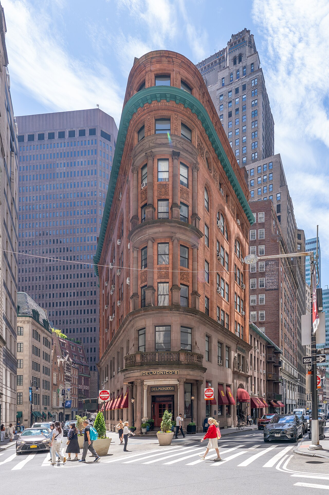
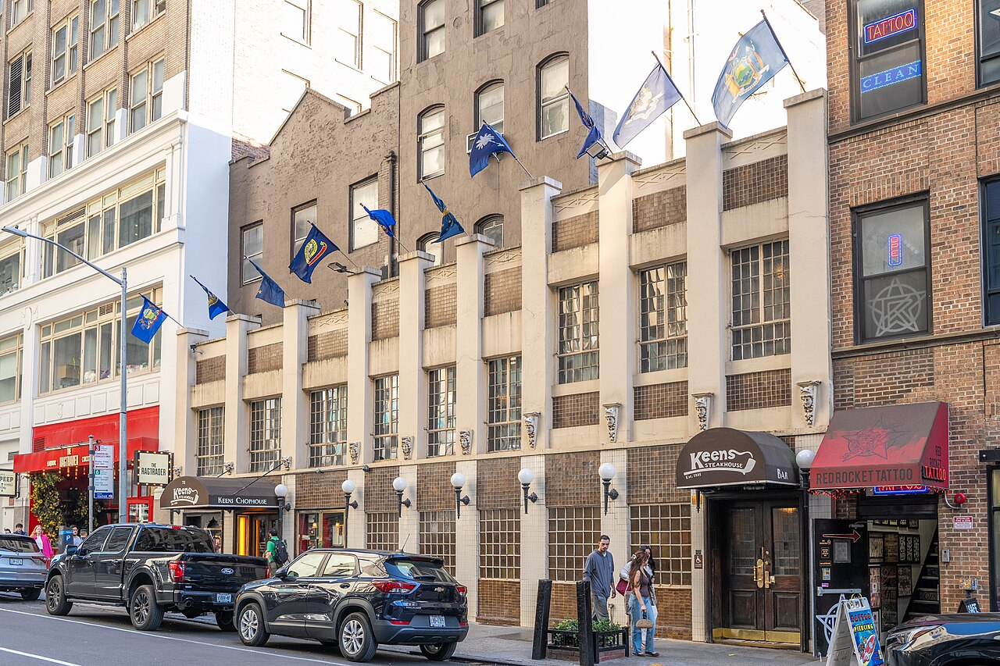

# Delmonico's

In Manhattan's financial district, Beaver, South William and William streets meet at a sharp triangle, and Delmonico's curved portico sits on the point. By day the neighbourhood is full of bankers and exchange workers crossing with briefcases; by evening the streets empty quickly and warm light comes through the colonnade. The building is not the 1837 original but an eight-storey structure rebuilt in 1890–91. The story of "America's fine dining house," however, really did grow from this address.

Figure: The curved corner portico of Delmonico's at 56 Beaver Street; the present building was designed by James Brown Lord and built in 1890–91, not in 1837. Image: Ajay Suresh, CC BY 4.0, via Wikimedia Commons ([source page](https://commons.wikimedia.org/wiki/File:Delmonico%27s_-_56_Beaver_Street_(55312935822).jpg)).

## Location and history

The Delmonico brothers opened a pastry shop on William Street in 1827 and a restaurant at the Beaver and William triangle in 1837, usually described as America's first fine-dining restaurant. It offered private dining rooms, separate menus and a large wine cellar, turning a meal into a social event that could be arranged and displayed. In 1862 Charles Ranhofer became head chef and later became associated with Eggs Benedict, Baked Alaska, Lobster Newburg and Chicken à la Keene; the origins and attributions of these dishes are disputed in culinary history, but Delmonico's was an important gateway for them into American menus. In 1890–91 the family replaced the old building with the present eight-storey Renaissance Revival block designed by James Brown Lord. In 1923 the original family business ended under Prohibition and financial pressure; in 1926 Oscar Tucci reopened at 56 Beaver Street. In 1996 the New York City Landmarks Preservation Commission designated the building, calling it the only surviving structure directly associated with Delmonico's.

Keeping 1837 and 1891 apart is the key to understanding the building. The 1837 restaurant stood in a four-storey building on the Beaver/William triangle; in 1890 the Delmonico family commissioned James Brown Lord to design an eight-storey replacement, which opened in 1891. The new building combined restaurant, offices and apartments, and its curved corner and Pompeian columns became its signature. In 1923 the founding family's business ended; in 1926 Oscar Tucci took over 56 Beaver and rebuilt it as Delmonico's, after which the property changed hands, closed and reopened several times. The 1996 landmark designation rested not on the "first restaurant" slogan but on two things: the building is the only surviving Delmonico's-linked structure, and it is an early commercial work by James Brown Lord.

## Space and drinks

The present building is best known for its curved stone portico at the corner, with "DELMONICO'S" above the entrance and 19th-century commercial detailing on the capitals and balconies. Inside are several dining rooms and private rooms, with wood panelling, mirrors and old paintings that create the formality of an old financial-district restaurant. A wine cellar remains downstairs, but it now serves storage and events rather than the public display of a 19th-century private cellar. The menu centres on Delmonico Steak, which the restaurant says was codified in the Delmonico kitchen in 1850 as a rib-eye cut and is served today to its "original specification"; there are also Lobster Newburg, lamb chops, porterhouse and classic American sides. The bar serves classic cocktails and wine, a good place for a drink before dinner.

## How to drink

Treat the meal as the main event: book ahead, order a Delmonico Steak or Lobster Newburg, and add a crisp salad or vegetable rather than filling the table with heavy dishes. For a drink, start with a classic cocktail or a white Burgundy at the bar before moving to the dining room; do not occupy a dining table with one glass. Lunch is business-heavy because of the nearby offices; dinner is more formal and suits anniversaries or out-of-town guests. If you only want to see the architecture, the portico and corner are visible from the street, and there is no need to book a table for that.

## Practical information

The address is 56 Beaver Street, New York, NY 10004. Bowling Green (4/5) and Broad Street (J/Z) are the nearest subway stations, with Wall Street (2/3) also walkable; Fulton Center is a few minutes away. In the financial district, lunch and dinner bookings are advisable on weekdays; weekends are easier but still worth checking. Dress is business casual to formal: a jacket is not compulsory, but shorts, tank tops and athletic shoes are out of place. Prices are high, especially the wine list, so confirm market prices and whether sides are included before ordering.

## Etiquette and common misconceptions

First, 1837 is the restaurant's founding year, not the building's date; the present block was built in 1890–91 and designated a landmark in 1996. Second, "America's first fine-dining restaurant" is the official and common historical claim, but scholars debate what "first" means; keep the qualifier "usually described as." Third, the stories behind Eggs Benedict, Baked Alaska and other dishes have many versions, and the "guest asked for it one night" anecdote should not be presented as archival fact. Fourth, Delmonico Steak is a specific cut and historical name, not any rib-eye; do not turn it into an unverifiable "best steak in New York" ranking. Fifth, this is a working restaurant, not a free museum: photograph the exterior if you like, but do not enter private rooms or treat the cellar as a sight.

## Surroundings and routes

Outside the restaurant, Stone Street's historic blocks lie east, the New York Stock Exchange and Federal Hall are north, and Battery Park and the ferry terminals are south. In [the New York historic pub route](ref:ny-route), Delmonico's works as the financial-district meal stop; to compare two historic New York dining spaces, read [Keens Steakhouse](ref:keens). For how Prohibition changed high-end restaurant economics, see [Prohibition](ref:prohibition); for the difference between tavern and restaurant space, see [A history of taverns](ref:taverns); for the idea of consuming time in a restaurant, see [Time in a cup](ref:time-in-cup).

## Further reading and see also

- [The New York historic pub route](ref:ny-route)
- [A history of taverns: from alehouses and inns to bars](ref:taverns)
- [Prohibition: banning supply does not abolish demand](ref:prohibition)
- [Keens Steakhouse](ref:keens)
- [Time in a cup](ref:time-in-cup)

Read Delmonico's through the address, then the current opening status, and finally what the place is known for. The sequence matters.

[New York historic pubs: East Village to Gramercy](ref:ny-route) and [Prohibition: bans change supply, not demand](ref:prohibition) answer different questions about Delmonico's: address and space and operating status. Read them as a pair, not as alternatives.

**At a glance:** A legendary restaurant at 56 Beaver Street in Lower Manhattan, opened as an early American fine-dining house in 1837, rebuilt on its present site in 1890–91, and known for Delmonico Steak and several classic dishes.

Checked on 2026-11-21 against Delmonico's official pages. The restaurant sits in the Financial District; weekday lunch and dinner are best booked ahead, and menu prices and market dishes change, so confirm on the official site. 1837 is the founding year, the present building dates to 1890–91 and was listed as a landmark in 1996. The claim to be the first American fine restaurant, and the Eggs Benedict story, are qualified in the body rather than treated as archival fact. The image shows the curved corner portico, not a dish or the interior.

The Delmonico's site dates to 1835.

## Related images

Image: The street facade and entrance of Keens Steakhouse on West 36th Street, New York; the building merges three former townhouses, with the pipe collection inside.. Credit: ajay_suresh, CC BY 4.0, via Wikimedia Commons ([source page](https://commons.wikimedia.org/wiki/File:Keens_Steakhouse_(54821833498).jpg)). Related image for Delmonico's.
