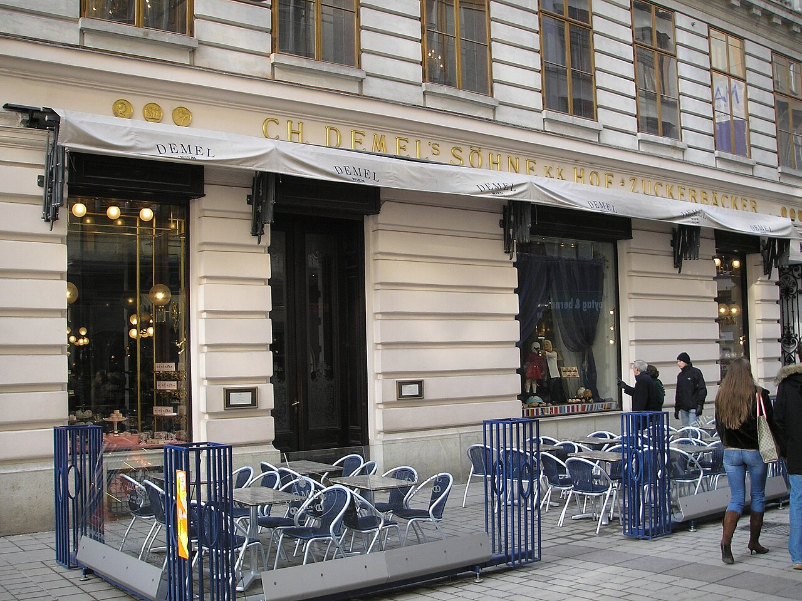

# Demel

Kohlmarkt is Vienna’s most expensive pedestrian street, its windows full of jewellery, watches, and porcelain. At number 14, Demel pulls the street’s attention back to sugar, cream, and coffee. The wooden display windows are a small stage on which cakes, confectionery, and seasonal decorations are stacked almost to the glass. Inside, white-and-gold Rococo ornament, mirrors, chandeliers, and a dark wooden counter shut out the brightness of the street. This is not a café for a quick stop; it is the live version of Vienna’s royal confectionery tradition.

Figure: The Demel storefront and display windows on Kohlmarkt 14. Image: No machine-readable author provided. Gryffindor assumed (based on copyright claims)., Public domain, via Wikimedia Commons ([source page](https://commons.wikimedia.org/wiki/File:Caf%C3%A9_Demel,_Vienna.jpg)).

## Location and history

Demel’s official history begins in 1786, when Ludwig Dehne opened a confectionery at Michaelerplatz, beside the entrance to the Hofburg. In 1857, Christoph Demel took over and moved the shop to Kohlmarkt 18. In 1888, urban redevelopment forced another move, to today’s Kohlmarkt 14. The new interior was designed by Portois & Fix in a Rococo Revival style: white and gold woodwork, mirrors, curves, chandeliers, and tiered display cases. That interior became Demel’s stage set and its main point of difference from an ordinary pastry shop.

The twentieth century was not smooth. Maria Demel took over in 1911. In 1918, after the collapse of the Austro-Hungarian Empire, Anna Demel insisted on keeping the “K. u. K.” (Imperial and Royal) title—a bold brand statement in a republic. In 1952, Anna received the title of Councillor of Commerce. In 1956, Klara Demel and Baron Federico Berzeviczy-Pallavicini took over. In 1972, the business was sold to a Swiss company, later passing through the Udo Proksch scandal and further changes; it changed hands again in 1992 and was taken over by DO & CO in 2002. Today Demel is a combination of imperial-confectionery brand and modern catering group, with history as its most valuable asset.

## Architecture and space

The Kohlmarkt 14 shop has two zones. The front is the retail counter and windows, where cakes, chocolates, confectionery, and gift boxes are arranged like a theatre display. The rear is the café seating: mirrored walls, white woodwork, red and green velvet banquettes, and small marble tables. The room is deeper than the street front suggests; a mezzanine or upper area adds more seating on busy days, though the ground floor is the main daily space. The lighting is warm even at midday, designed to make glazes and sugar work gleam.

Demel is not a place for quiet work. It is a constantly moving sweet theatre: visitors photograph the windows, locals buy gift boxes, and waiters carry coffee and cakes through narrow aisles. To sit down, queue at the door and wait to be seated; to skip the queue, buy from the retail counter and take away. The window displays are part of the brand—do not tap the glass or put a phone inside the display. The cakes and sugar pieces are goods for sale, not props.

## The drinks

Demel’s signatures include Sachertorte, Kaiserschmarrn, violet ice cream (the Sisi legend), chocolate, marzipan, and a range of Viennese pastries. Its Sachertorte and Hotel Sacher’s “Original Sacher-Torte” are two different brand narratives: the Demel version is usually sold as “Demel’s Sachertorte,” with a different crumb and jam proportion. If you order “Sachertorte” here, you get Demel’s version; for the Original, go to Café Sacher. Both are worth trying, but do not spend the week arguing which is authentic—the argument is more than a century old.

For Demel, begin with the address. Then look at the current opening status, and finally ask what the place is known for. The answers point to different choices, not to a single score.

## How to drink

The best times are from the 10:00 opening until noon, or after 15:00. The morning queue is shorter, the windows are freshly stocked, and café seats are easier to find; by afternoon, the queue often reaches the street. Because Demel does not take reservations, the strategy is to arrive early or come another day. If you only want cake and confectionery, go straight to the retail counter; if you want Kaiserschmarrn at a table, allow at least forty minutes.

Order by looking at the display first, then telling the waiter the name; many desserts are in German, so a screenshot or written note helps. A Sachertorte slice can be shared; Kaiserschmarrn is large enough for two. Hot water for tea may be refilled, but do not expect free coffee refills. Service is usually included; a small tip is still appropriate.

## Practical information

- Address: Kohlmarkt 14, 1010 Vienna.
- Hours: daily 10:00–19:00 (WienTourismus; the official Contact page does not list hours, and holidays may differ).
- Transport: U3 Stephansplatz, 3 minutes on foot; U1/U2/U4 Karlsplatz, 10 minutes; step out of the Hofburg’s Michaelertor and you are there.
- Reservations: not accepted; queue on site. Groups should split or come off-peak.
- Prices: cakes, coffee, and gift boxes are upper-mid-range; Kaiserschmarrn and afternoon tea are higher.
- Accessibility: there is a threshold at the main entrance and narrow aisles; call ahead about wheelchair routes.
- Shopping: cakes and chocolates can be packed, but cream-based desserts do not tolerate long journeys; choose sealed gift boxes for travel.

## Etiquette and common misconceptions

First, do not confuse Demel’s Sachertorte with Hotel Sacher’s Original Sacher-Torte; they are different brands with different recipe narratives. Second, “K. u. K. Hofzuckerbäckerei” is not decorative fluff; it refers to the imperial and royal court-supplier identity. Third, do not call a waitress “Fräulein”; the Demelinerinnen use the third-person plural (“Haben schon gewählt?”), and “Sie” is safer. Fourth, do not block the windows for a long photo session; Kohlmarkt’s passage is narrow. Fifth, do not expect a quiet old café; Demel is high-frequency retail plus café seating, and noise is part of it. Sixth, do not date the present building to 1786; 1786 is the brand’s origin, and 1888 is the move to Kohlmarkt 14.

## Nearby and routes

Step out of Demel and Michaelerplatz and the Hofburg’s Michaelertor are to the west; Stephansplatz and the old town are east; Café Sacher and the Opera are five minutes south. A good sequence is: Hofburg, Demel’s windows and coffee, Kohlmarkt, Stephansdom, and Café Sacher for afternoon tea. For a Vienna café route, start at [Café Central](ref:central) for the dome and literary crowd, then [Café Hawelka](ref:hawelka) for the postwar intimate tables, and [Café Sperl](ref:sperl) for Otto Wagner’s interior; Demel is the “royal confectionery plus retail theatre” type. To compare Sachertorte, put [Café Sacher](ref:sacher) and Demel on the same day, order one slice at each, and add unsweetened cream or coffee—the difference is clearer than the legend. For an evening route, see the [Vienna coffee-house evening route](ref:vienna-route).

## Further reading and see also

- Demel’s official history: <https://www.demel.com/en/pages/demels-history>, for the 1786/1857/1888/1918/1952/1972/1992/2002 timeline.
- Demel’s Our Story: <https://www.demel.com/en/pages/our-story>, for the royal-confectionery positioning and dessert narrative.
- Demel’s Contact page: <https://www.demel.com/en/pages/contact>, for the address and the no-reservation policy.
- WienTourismus’s Demel page: <https://www.wien.info/de/essen-trinken/cafes/demel-344266>, for hours, all-female service, and the Demelinerinnen tradition.
- The nearby `place:cafe-sacher` is the other Sachertorte narrative; `place:cafe-central`, `place:cafe-hawelka`, and `place:cafe-sperl` are different Vienna café types.
- Related entries: [Café Sacher](ref:sacher), [Café Central](ref:central), [Café Hawelka](ref:hawelka), [Café Sperl](ref:sperl), [Vienna coffee-house evening route](ref:vienna-route)

**Short definition:** Demel at Kohlmarkt 14 is Vienna’s great surviving royal confectionery. Ludwig Dehne founded the business at Michaelerplatz in 1786; Christoph Demel took over in 1857; the shop moved to Kohlmarkt 14 in 1888, where Portois & Fix created the Rococo interior. Sachertorte, Kaiserschmarrn, violet ice cream, and the all-female Demelinerinnen keep the theatre of the imperial confectionery alive.
