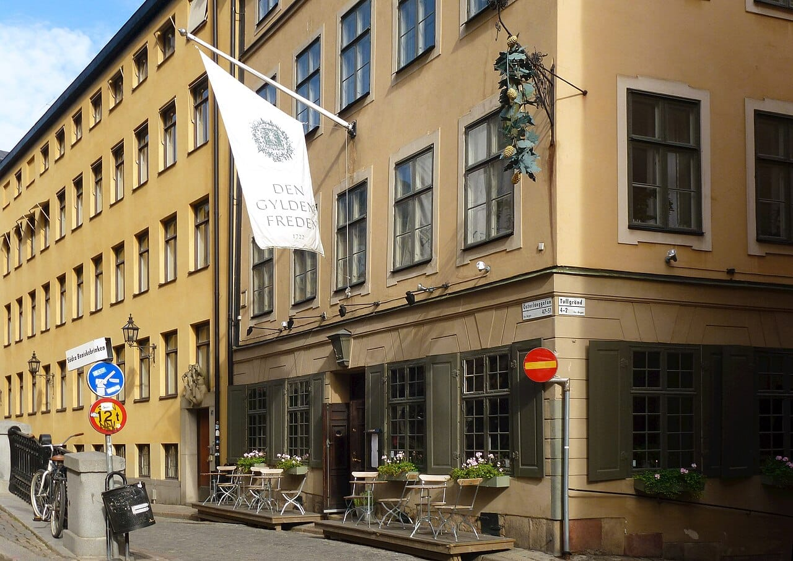
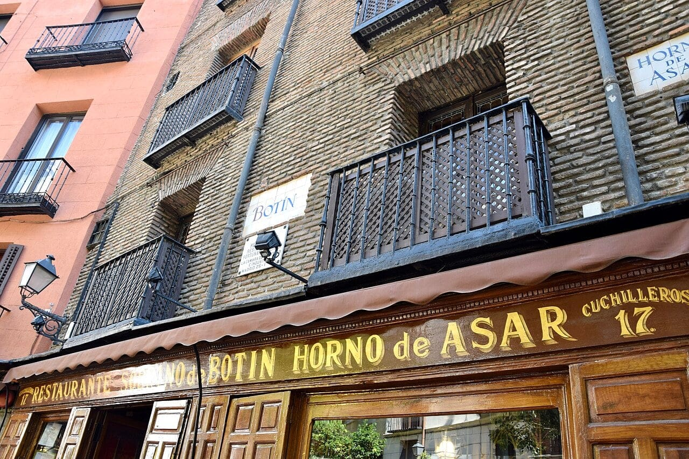

# Den Gyldene Freden

Österlånggatan in Stockholm's Old Town is a narrow cobbled street lined with seventeenth- and eighteenth-century houses. Number 51 carries a sign reading "Den Gyldene Freden 1722", usually translated as "The Golden Peace". It is not a restaurant that turns history into a set; it is a working Swedish restaurant with timber beams, limewashed walls, old chandeliers, a long menu and an upstairs room connected to the Swedish Academy.

Figure: Den Gyldene Freden in Stockholm's Old Town. Image: Holger.Ellgaard, CC BY-SA 3.0, via Wikimedia Commons ([source page](https://commons.wikimedia.org/wiki/File:Den_Gyldene_Freden_2013a.jpg)).

> **Quick verdict**
> **In one line:** This entry helps you decide whether Den Gyldene Freden deserves a detour, and what to check before visiting.
>
> - **Best for:** Anyone planning a visit to Den Gyldene Freden who needs to decide whether it deserves a half-day or a full day.
> - **Not for:** If you want only want a must-visit list and will not check booking, transport or opening hours.
> - **Check first:**
>   - The official history starts early.
>   - Lunch and dinner both operate, but the menus differ: lunch is shorter, dinner has the full and seasonal menu.

## Setting and history

The official history starts early. In 1485 the wine merchant Simon Fränsell leased the plot where the restaurant now stands and opened a wine tavern selling the sweet wines and German beers of the period. In 1719 the wine server Petter Hellberg bought the old stone houses at the corner of Österlånggatan and Solgränd. In 1722, by tradition, Den Gyldene Freden opened at this address. The official account also admits that scholars dispute both the 1722 date and the name: it may refer to the Peace of Stettin in 1570, to the Peace of Nystad in 1721, or simply to two pleasant words, "golden" and "peace", placed together. It is safer to treat 1722 as the traditional date rather than an archival certainty.

The restaurant has come close to disappearing several times. In 1891 it closed and the premises were rented to the widow Johanna Carolina Ericsson, who used the building for a temperance movement; in 1895 order was restored and the tavern reopened. In 1919 the painter Anders Zorn learned, over a plate of meatballs, that the restaurant was to close for good. He bought it himself, commissioned the architect Torsten Stubelius to redesign the interiors, cutlery and tableware, and visited in 1920 shortly before his death to check the colour of the facade. The restaurant reopened on 11 December 1922, which Zorn did not live to see. He later left it to the Swedish Academy, which still owns it; the conditions of the bequest include that the property may not be sold, the house must remain unchanged and it must continue to operate as a restaurant.

This history explains why Den Gyldene Freden is both a restaurant and a cultural institution. Members of the Swedish Academy dine upstairs in the Bellman room on Thursdays, and pea soup is a regular dish. The Academy's work includes selecting the Nobel laureates in literature, but it is inaccurate to say "the prize is decided here": the Academy dines here, which is not the same as holding its prize meetings at the table. The restaurant also has a statue and memorial place for Evert Taube, one of Sweden's most important twentieth-century ballad poets and a regular.

On New Year's Eve 1985 the restaurant suddenly closed; the staff put down what they were holding, turned off the lights and locked up. After four years and a SEK 30 million restoration, it reopened around 1989. In 2019 the current operators took over when the lilacs were in bloom. Today's Freden is the result of repeated closures, rebuilding, restoration and changes of operator, not an untouched 1722 interior.

## The rooms and the menu

The space has several levels. The ground-floor Stormen and Valvet rooms are the main restaurants; below are vaulted cellars used for groups and private dinners; upstairs are the Bellman and Zorn rooms, which belong to the Academy's activities and are not normally open to ordinary diners. The ground floor keeps the old restaurant texture of wooden floors, limewashed walls, old mirrors and chandeliers. The cellar is lower and darker, with candles in winter, and suits meat and beer. It is not a showcase of minimalist Nordic design; it is an old house plus Swedish tradition.

The menu is a contemporary version of Swedish husmanskost: meatballs with mashed potato, lingonberry and pickled cucumber; pea soup with mustard; roast salmon or pickled herring; reindeer, game, roast pork and cabbage rolls; crayfish, asparagus and strawberries in summer; mushrooms, apples and goose in autumn; a Christmas buffet in December. The menu changes by season and week, so use the official site's seasonal calendar rather than an old guidebook.

Drinks are mostly Swedish and European. Swedes usually order a local light beer or an international brand; the wine list has Old and New World options; spirits include Swedish vodka, aquavit and bitters. For meatballs, a light beer or a medium-bodied red works; for herring, a dry white or light beer; for a Swedish tradition, a small glass of aquavit before the meal, with a snapsvisa if the table is already singing. Do not start a singalong at a table of strangers.

## What to order on a first visit

Lunch and dinner both operate, but the menus differ: lunch is shorter, dinner has the full and seasonal menu. For a first visit, one main and one dessert is enough. For Swedish flavour, order meatballs or pea soup. For fish, pickled herring or roast salmon. For meat, reindeer or roast pork. Two people can balance one rich and one light dish: meatballs with mash are substantial and easy to share; herring is strong, with potato and sour cream; reindeer is lean and gamey, with lingonberry and potato.

Reservations: parties of up to 8 can book online; the ground-floor Stormen takes up to 6, and the cellar Valvet up to 8. For more than 8, email the restaurant. There is no strict dress code, but evening and weekend guests dress more formally; do not wear sports shorts and flip-flops to dinner. Children are welcome, but the cellar is not suitable for pushchairs.

Prices: lunch mains around SEK 200–300, dinner mains around SEK 300–450, desserts around SEK 100–150, subject to the menu. Swedish restaurants usually add a tip of 5%–10% to the menu price; cards are widely accepted. The lunch menu is often better value; ask for "dagens".

## Practical information

**Address**: Österlånggatan 51, 111 31 Stockholm, Sweden. In the Old Town, near Solgränd and Järntorget; about 5 minutes on foot from the Royal Palace and 3 minutes from the cathedral.

**Transport**: Metro green or red line to Gamla Stan, then 5–8 minutes on foot; buses to Slussen or Riddarholmen, then walk. The Old Town is all cobbles and narrow lanes, so taxis cannot stop at the door; the nearest drop-off is at either end of Österlånggatan or on Skeppsbron. High heels and thin soles are risky.

**Opening hours**: Monday to Thursday 12:00–23:00, Friday and Saturday 12:00–01:00. Sundays are usually closed, but some Sundays open in the 2026 Christmas season; check the official calendar. `operating_status` is `verified`, meaning the official site still showed the restaurant as trading on 20 November 2026; this does not guarantee that it opens every day.

**Reservations**: Up to 8 people online; more than 8 by email to info@gyldenefreden.se; telephone +46 8-24 97 60. There is no minimum spend, but large groups may be asked for a set menu or deposit. Availability in the cellar and Bellman room depends on Academy events; do not assume ordinary diners can book them.

**Prices**: Mid-to-upper range for the Old Town, around SEK 500–800 per person for dinner, more with drinks; lunch is cheaper. Tip 5%–10%, cards accepted. The Christmas buffet and New Year's dinner require advance booking and are priced separately.

Page verified 20 November 2026; opening hours, prices and menus are subject to official channels.

## Etiquette and common mistakes

First, do not treat 1722 as an undisputed archival fact. The official account itself says scholars disagree, and the name may refer to the 1570 or 1721 peace. Second, do not turn "owned by the Swedish Academy" into "the Nobel Prize is decided here". Academy members dine here; the prize procedure is separate. Third, do not assume the upstairs Bellman room is open to visitors. It belongs to the Academy's activities; ordinary guests dine on the ground floor and in the cellar.

Three more mistakes are common. One is assuming continuous operation since 1722; the restaurant closed in 1891, reopened in 1895, and closed again for four years from 1985. Another is treating Zorn as a mere patron; he bought the restaurant, commissioned the interior and left it to the Academy, so he was an owner and designer as well. The third is assuming the menu is fixed all year; pea soup, crayfish and the Christmas buffet are seasonal, so check the calendar.

The restaurant is not right for someone who wants a quick lunch without booking, someone uninterested in Swedish home cooking and only looking for a selfie, or a large tour group demanding a quick visit. It suits a proper sit-down meal of Swedish tradition, and anyone interested in Nordic literature and Old Town history.

## Nearby and routes

The restaurant is on Österlånggatan. North are the Royal Palace and the cathedral; south are Järntorget and Slussen; west are the German Church and the Old Town square. Put it on a "Royal Palace–cathedral–Österlånggatan–Järntorget" walk: palace and cathedral in the morning, lunch at Freden, Old Town shops in the afternoon, Skeppsbron for the water at night. About 30 minutes on foot, with no transport needed.

For an "old restaurant" theme, compare Botín in Madrid or Zur letzten Instanz in Berlin. All three tell a "city's oldest" story, but their rooms, cuisines and ownership models differ. Stockholm's Old Town has other old cafés and bars; do not put all the "history" on one restaurant.

The narrow lanes are crowded in summer and at Christmas, so allow space when photographing. Tourists often stop at the door, so do not block it. If an Academy event or private booking closes the ground floor, book another day or another time.

## See also

- [Pubs and the city](ref:pub-and-city): how old restaurants use space, menus and opening hours to organise city life.
- [Botín](ref:botin): Madrid's restaurant of 1725, a counterpart to Stockholm's "1722".
- [Zur letzten Instanz](ref:instanz): Berlin's restaurant with a gastronomic tradition from 1621, another "oldest in the city" narrative.
- [Café Central](ref:cafe-central): a Viennese literary café, a reminder that "old" takes more than one form.
- [Café Hawelka](ref:hawelka): a Viennese family café and another version of the "writers and artists" tradition.

## Related images

Image: The façade of Botín at Calle de Cuchilleros 17 in Madrid, its awning lettered “Restaurante Sobrino de Botín” and “Horno de Asar”.. Credit: Ank Kumar, CC BY-SA 4.0, via Wikimedia Commons ([source page](https://commons.wikimedia.org/wiki/File:2014_-_Sobrino_de_Bot%C3%ADn_%28Casa_Bot%C3%ADn%29_Restaurant%2C_Madrid%2C_Spain_%28_Ank_Kumar_%29_01.jpg)). Related image for Den Gyldene Freden.
