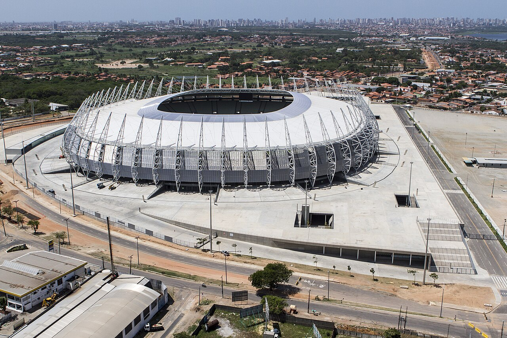

# Fortaleza: Relighting the 1873 Workshop

Fortaleza stands at Calle Tabasco 153 in the town of Tequila, Jalisco, on the high side of town. It is often called a time capsule: the brick oven, tahona, wooden vats and two original copper pots still work, while output is small enough to require booking. The point is not age but a plant that stopped, was repaired and started again, tying family history to [tequila](ref:tequila).

Figure: Fortaleza: Relighting the 1873 Workshop. Photograph: Fortaleza Arena. Credit: Fábio Lima/Portal da Copa/Março de 2013, CC BY 3.0, via Wikimedia Commons ([source](https://commons.wikimedia.org/w/index.php?curid=25894204)).

## An old plant on the high side of Tequila

The town of Tequila lies in western Jalisco, some sixty kilometres from Guadalajara, a little over an hour by car. The distillery is at Calle Tabasco 153, Centro, postcode 46400, between Atizcua, Galeana and Héroes de Nacozari; the centre is ten minutes on foot, so drivers park outside and walk in. Use official channels for exact coordinates. The site is an old house and workshops on a slope, the high position once a boast over a rival's chimney.

## From La Perseverancia to La Fortaleza

The story begins with Don Cenobio Sauza. In 1873 he founded La Perseverancia in the town, exported "mezcal de tequila" to the United States, shortened the name to tequila, and argued for blue Weber agave and steam cooking. Eladio took over in 1909; after his death in 1946, Francisco Javier ran the business and in 1973 led the appellation application, recognised in 1996.

Francisco Javier built La Fortaleza on the town's highest point with a brick oven, tahona pit, wooden vats and two copper pots. It ran until 1968, when it was judged too inefficient and became a museum. The family sold the company in 1976 but kept the site; Guillermo began restoring it in 1999, and the brand returned in 2005. It is still family-run, and the old equipment still works.

## Brick oven, tahona and two copper pots

The process follows the old sequence: blue Weber agave is cooked in the brick oven, crushed in the tahona pit, fermented in wooden vats with ambient yeast and distilled twice in the two copper pots. The house says the water comes from its own spring and no sugar or flavouring is added.

This runs against efficiency. A tahona moves less agave than a roller mill, wooden vats follow the air temperature, and copper-pot batches are never identical. The cost is low volume; the return is thick agave fibre, slow fermentation aromas and a mineral finish. The worn pit edge and repaired copper explain [fermentation](ref:fermentation) and the [pot still](ref:potstill).

## The bottles: texture in Reposado, limits in Añejo

The range is short. Blanco sees no wood and keeps roasted agave, pepper and citrus peel; Reposado rounds out in cask while keeping an agave frame; Añejo shows vanilla, caramel and toasted nuts. Occasional cask-strength or seasonal blends appear in tiny quantities. The style does not court sweetness; agave herb and mineral come before oak.

Beside [Casa Herradura](ref:herradura), the difference is plain: one replaced the tahona with a modern mill, the other kept it; one runs at scale, the other feels like a family workshop. Two Blancos side by side show what different [agave](ref:agave) handling does, cleaner in one glass and more fibrous in the other.

## Where NOM-006 puts "the 1873 method"

Under NOM-006-SCFI-2012, Fortaleza is a 100% blue Weber tequila: all sugar comes from blue Weber, and cooking, fermentation, distillation and ageing happen inside the protected zone. Bottles carry a NOM number and the regulator's certification. Reposado needs two months, Añejo twelve and Extra Añejo thirty-six; Fortaleza does not compete on extreme age.

The phrase "the 1873 method" needs unpacking. 1873 marks the family's first distillery, not this building; today's equipment was rebuilt and kept in use. What survives is the method, not one machine never replaced. That is how the site is both living history and a small export distillery.

## Two tours and how to book

Visits are booked only online. Vive Abuelo lasts about 90 minutes from 750 Mexican pesos and covers the tahona, fermentation and distillation before a cellar tasting. Vive Bisabuelo lasts about 150 minutes from 950 pesos and adds a climb to a valley viewpoint before a fuller tasting. Both explain the process; they differ in length, walking and wines.

Prices, languages and times change, so check the site. Weekends and holidays fill up; book days ahead. Bottle buyers can use the shop without a tour, and the centre's other distilleries make Fortaleza half a day.

## Visitor notes and the drinking boundary

**Getting there**: about an hour by car from Guadalajara and fifteen minutes on foot from the centre; the town is hilly, so wear comfortable shoes.

**On site**: the cooking area is hot and floors can be wet, and the tahona pit edge should not be crossed. Do not touch the copper pots or wooden vats, and ask before photographing.

**Tasting**: start with Blanco, then Reposado and Añejo. Small pours and spitting are normal, and the cellars are cool.

**Driving**: the town suits a car, but do not drive after a tasting. Appoint a non-drinking driver or use a licensed transfer; drink-drive limits vary by state.

For a wider frame, read [place and process](ref:place-process), which separates the distillery as a production site from the distillery as a story.

**At a glance:** A family tequila distillery at Calle Tabasco 153 in the town of Tequila, Jalisco, still using the old brick oven, tahona, wooden fermentation vats and two original copper pots; relaunched in 2005 and open by reservation with a tasting in the underground cellars. 

Start with the address. From there, consider the current opening status, then what the place is known for. That is how a practical judgment about Fortaleza is built.

[Tequila](ref:tequila) and [Agave](ref:agave) are the two useful reference points for Fortaleza. [Tequila](ref:tequila) sets out address and space; [Agave](ref:agave) brings in operating status. Read them together.

Fortaleza is a small tequila distillery in Tequila, Jalisco, known for its tahona-crushed agave and copper pot stills.

**Key facts.**

| Item | Detail |
| --- | --- |
| In one line | A family tequila distillery at Calle Tabasco 153 in the town of Tequila, Jalisco, still using the old brick oven, tahona, wooden fermentation vats and two original copper pots; relaunched in 2005 and open by reservation … |
| Address | Calle Tabasco 153, Centro, 46400 Tequila, Jalisco, Mexico |
| City and country | Tequila / Mexico |
| Status | verified open |
| Official site | tequilafortaleza.com |

**Sources and limits.** The key claims about Fortaleza: Relighting the 1873 Workshop are checked against the following sources: Tequila Fortaleza, Consejo Regulador del Tequila (Used to check NOM-006-SCFI-2012, the 100% blue Weber rule and the ageing categories). For current products, addresses or opening status, use tequilafortaleza.com. Prices, batches and status change; the body is project-written and does not reproduce source text.
