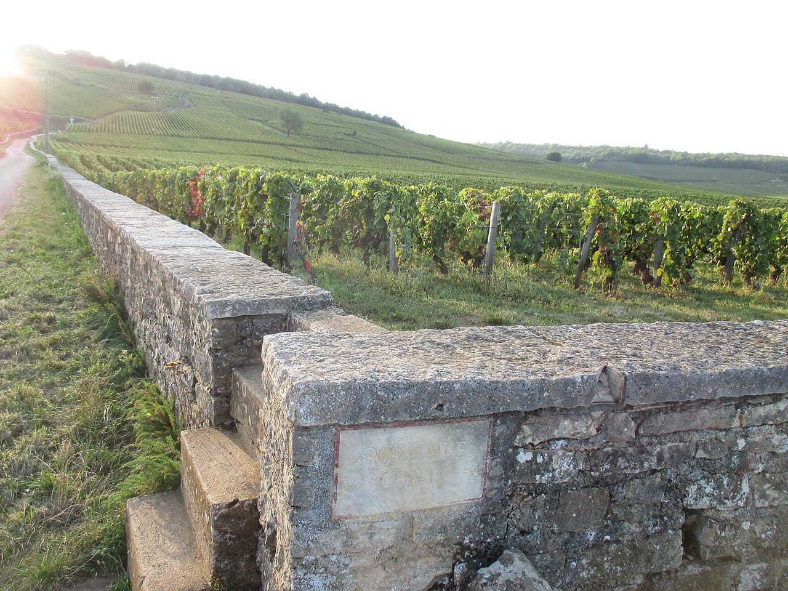

# Domaine de la Romanée-Conti

North of the village centre of Vosne-Romanée, the D974 cuts through vineyards divided by low stone walls. Romanée-Conti is only 1.81 hectares, facing east-southeast, and from the road it looks almost indistinguishable from its neighbours. Its fame is wildly out of proportion to its size. The domaine has no visitor centre and no cellar door, only a gate that is usually closed. To understand DRC, it helps to set the myth aside and begin with land, family and very low yields.

Figure: The stone wall and slope of the Romanée-Conti vineyard in Vosne-Romanée. Image: Arnaud 25, CC BY-SA 4.0, via Wikimedia Commons ([source page](https://commons.wikimedia.org/wiki/File:Domaine_de_la_Roman%C3%A9e-Conti_02.JPG)).

## Location and history

The slope first belonged to the Priory of Saint-Vivant. From the thirteenth century, monks farmed vines here, then known as Cros des Cloux. In 1760 Louis-François de Bourbon, Prince de Conti, bought the plot and added his name; Romanée-Conti was born. The estate was confiscated during the French Revolution and sold at auction in 1794. In 1869 Jacques-Marie Duvault-Blochet, then 79, bought it back and gradually assembled La Tâche, Richebourg, Grands-Échézeaux and Échézeaux.

On 31 July 1942 the Société Civile du Domaine de la Romanée-Conti was formed. Henri Leroy bought Jacques Chambon’s shares, while the Gaudin de Villaine family kept the other half. In 1974 Aubert de Villaine and Lalou Bize-Leroy became co-managers. Lalou left in 1991 and Charles Roch took over; after Charles died in 1992, Henry-Frédéric Roch replaced him. Perrine Fenal was appointed co-manager in 2019, and in 2021 Bertrand de Villaine succeeded his uncle Aubert. The estate is still owned half by the de Villaine family and half by the Leroy/Roch family, a structure that explains much about how DRC makes decisions.

The domaine has farmed organically since 1985, began biodynamic trials in the 1990s, converted fully in 2007 and obtained Biodyvin certification in 2017. It holds eight historic grands crus; in 2018 it also took on Bonneau du Martray’s Corton-Charlemagne vines, with a first harvest in 2019, so today people often speak of nine grands crus. The holdings total about 28.6 hectares, all grand cru, including Romanée-Conti at 1.81 hectares and La Tâche at 6.06.

## Architecture and spaces

DRC has no flagship building designed for visitors. Its spaces are a fourteenth-century press house, an eighteenth-century house, underground cellars and small vineyard buildings. In December 2014 the administration moved into the old monks’ vendangeoir of Saint-Vivant. It was a quiet return: daily business went back to the historic starting point of the vineyard rather than into a new visitor centre.

The real architecture is the slope. Romanée-Conti sits mid-slope, with thin topsoil over limestone and marl; La Tâche lies immediately above, with slightly deeper soil and a different balance of drainage and water retention. Horses are used to avoid compaction. Harvest is divided by plot, sometimes by row, and each parcel ferments separately. Fermentation takes place in open wooden vats, with maceration and whole-bunch proportions adjusted by vintage. The grand vin ages in a high proportion of new oak, not to create a “barrel flavour” but to give delicate Pinot Noir a slow, protected space to breathe.

The cellar is not a showpiece. Rows of barrels, temperature, humidity and tasting records are the main landscape. If a professional visit is granted, look at the parcel markings on the barrels: DRC’s style is not one uniform taste but the preservation of each climat’s difference before the final blend.

## The wines and palate

The range can be read in three groups. At the centre are the two monopoles: Romanée-Conti and La Tâche. Romanée-Conti, 1.81 hectares, usually produces 5,000–6,000 bottles. Its perfume is rose, violet, red cherry, spice and wet stone; the palate is extremely fine, with tannins like thread and a long finish. La Tâche, 6.06 hectares, yields around 20,000 bottles, with broader structure and more outward power; it is often the entry point into the DRC style.

The second group is Richebourg, Romanée-Saint-Vivant, Grands-Échézeaux and Échézeaux. Richebourg, about 3.51 hectares, is the most muscular and needs time; Romanée-Saint-Vivant, about 5.29 hectares, is more floral and ethereal; Grands-Échézeaux, about 3.53 hectares, sits between power and finesse; Échézeaux, about 4.67 hectares, is fragmented and varies most. The third group is white: Montrachet at about 0.68 hectares, Corton at about 2.28, and Corton-Charlemagne at about 2.9 since 2019. White production is even smaller; Montrachet tends to show white flowers, hazelnut, mineral and beeswax, gaining honey and dried fruit with age.

Do not judge these wines by price alone. Production is tiny, and prices are set by allocation, auction and the secondary market. Vintage variation is often greater than the difference between parcels. Taste slowly: look at colour and aroma, then take a small sip and let the wine cover the palate. Romanée-Conti is not for large gulps; La Tâche can move a little faster; Richebourg needs more time.

## How to drink

Serve reds at 15–16°C, not below 14°C or above 18°C. Young DRC can be opened one to two hours ahead, but violent decanting is not necessary. Older bottles are fragile: open 30 minutes ahead and, if needed, decant only briefly. Use a wide Burgundy glass and fill no higher than the widest part of the bowl.

Keep food in the background. Roast pigeon, duck breast, mushrooms, truffle, Comté or a mature soft cheese work better than heavy sauces. Avoid black pepper sauce, barbecue glaze and strong chilli. Serve whites at 12–14°C with lobster, white meat, creamy mushrooms or aged Comté. If opening both colours, start white and light, finish red and deep; save Romanée-Conti for the end rather than using it to “rescue” the table.

## Practical information

The address is 1 Place de l'Église, 21700 Vosne-Romanée. The domaine is not open to the public: there are no tickets, no tasting room and no estate shop, so do not ring the bell asking for a visit. The vineyards can be seen from public roads in the village and beside the D974, but do not cross the walls, enter the rows or pick grapes. The nearest rail stations are Dijon and Beaune; TGV from Paris to Dijon takes about 1 hour 40 minutes, then a 30-minute drive. From Beaune it is about 25 minutes by car.

Parking in the village is limited; use the public area at the entrance and walk in. There are few large restaurants nearby; lunch in Vosne or back in Beaune is easier. Half a day is enough to see the vineyards; allow a full day to link the Côte de Nuits grands crus, and keep driving and tasting separate.

## Etiquette and common misreadings

First, DRC is not a tourist attraction. Do not enter without an appointment, and do not ask staff for tours, autographs or selfies; professional visits should be arranged through official channels. Second, allocation is not a queue. DRC wines mainly move through long-term allocations, auction and specialist channels; there is no estate retail window. Third, do not replace tasting with the absolute claim of “the best Pinot Noir”. DRC’s style comes from low yields, whole clusters, long ageing and parcel difference, not from fame alone.

Fourth, beware of fakes and stories. Romanée-Conti is one of the most contrefeited wines in the world; check labels, bottle numbers, provenance and paperwork. Do not trust a verbal promise of “direct from the domaine”. Fifth, the vineyard is farmland, not a park: no drones, no walking between rows, no picnic against the wall. Sixth, vintage matters. The same wine can behave completely differently in a cool and a hot year; one bottle cannot define the estate.

## Around and routes

Place DRC on the [Burgundy grands crus drive](ref:route): Vosne-Romanée, Flagey-Échézeaux, Vougeot and Chambolle-Musigny show different slopes and walls. South to [Beaune](ref:hospices) brings the Hôtel-Dieu and the old town; north to [Château de Meursault](ref:meursault) shows another kind of wine estate with a more open visit system. To compare estate and négociant, pair the morning with [Louis Jadot](ref:jadot).

For a half day, look at Romanée-Conti and La Tâche, stop at the outside of Château de Vougeot, then return to Beaune for lunch. Do not put DRC on the same “checklist” as Bordeaux or Champagne: its value lies in the quiet vineyard, not in visitor facilities.

## Further reading and see also

- Regional comparisons: [Louis Jadot](ref:jadot), [Château de Meursault](ref:meursault), [Hospices de Beaune](ref:hospices), [Burgundy grands crus drive](ref:route).
- Background: [Burgundy](ref:burgundy).
- For the wider method of how land enters wine, see the project’s place-and-process entry. This entry provides no map and does not encourage unauthorised filming inside the estate.
