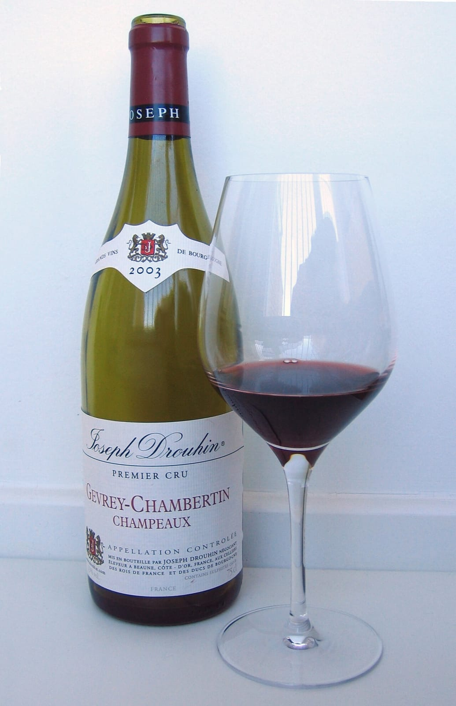

# Maison Joseph Drouhin

Maison Joseph Drouhin stands at 7 Rue d'Enfer in the old centre of Beaune, where a family house, a merchant's office, underground cellars and tasting rooms are stacked into one address. Joseph Drouhin founded the house in 1880, and it is still run by the Drouhin family, with fourth-generation members Philippe, Véronique, Laurent and Frédéric involved in management. Unlike a château-style estate outside town, the visit begins on a town street, goes down into the cellars and returns to Beaune's paving stones and market. The rhythm is that of an urban merchant rather than a country estate.

Figure: Maison Joseph Drouhin. Image: Tomas er, CC BY-SA 3.0, via Wikimedia Commons ([source page](https://commons.wikimedia.org/wiki/File:Drouhin_Gevrey-Chambertin_in_glass.jpg)).

> **Quick verdict**
> **In one line:** This entry helps you decide whether Maison Joseph Drouhin deserves a detour, and what to check before visiting.
>
> - **Best for:** Anyone planning a visit to Maison Joseph Drouhin who needs to decide whether it deserves a half-day or a full day.
> - **Not for:** If you want only want a must-visit list and will not check booking, transport or opening hours.
> - **Check first:**
>   - In 1880 Joseph Drouhin founded a wine merchant business in Beaune.
>   - The house offers daily cellar tours and tastings, booked by time slot through its official pages.

## Place and history

In 1880 Joseph Drouhin founded a wine merchant business in Beaune. Burgundy already had a mature négociant system: merchants bought wine from growers and handled ageing, blending and sales. Drouhin quickly combined that role with vineyard ownership, gradually becoming a merchant, producer and landowner at once. The house today describes its vineyard as about 100 hectares spread across well-known Burgundy climats, from Chablis to the Mâconnais.

The key figures of the twentieth century were Maurice Drouhin and Robert Drouhin. In the 1920s Maurice bought the 41 parcels of Beaune Premier Cru Clos des Mouches from 8 different owners; the plot was planted half to red and half to white grapes and became one of the house's signature sites. In the 1960s Robert entered Chablis when much of the vineyard had been abandoned, replanting and helping to revive the region. He was also among the first Burgundy houses to invest in Oregon, where Domaine Drouhin Oregon still operates. Family history and regional history are intertwined here, not a single line.

## Spaces and the list

The buildings at 7 Rue d'Enfer do not have the scale of a grand château; their value is underground. According to the house, the cellar walls reach back fifteen centuries to the foundations of a Roman castrum, and some spaces preserve traces of a medieval church and its college of canons. The buildings acquired by Joseph Drouhin also include the Maison du Diénat, which historians have suggested was the residence of the dean of the collegiate chapter. More dramatically, part of the cellars lies beneath the former Parliament of Burgundy, where dukes from Philip the Bold to Charles the Bold presided; one cellar also served as the cellars of the Kings of France. These layers explain Beaune's role as a merchant centre better than any label.

The list covers Burgundy's main white and red categories. Whites include Chablis, Meursault, Puligny-Montrachet and white Beaune Clos des Mouches; reds include Beaune Premier Cru Clos des Mouches, Gevrey-Chambertin, Chambolle-Musigny and Vosne-Romanée. They belong to the wider traditions of [white wine](ref:white-wine) and [red wine](ref:red-wine), but Drouhin's emphasis is on the merchant's selection and blending: one wine may come from several parcels, and the style must remain recognisable across vintages. For a first tasting, start with the red and white Clos des Mouches, then compare a Côte de Nuits wine with a Chablis to hear how the house handles different regions.

## How to visit or order

The house offers daily cellar tours and tastings, booked by time slot through its official pages. The tour usually starts in the historic building at 7 Rue d'Enfer, descends into the cellars and explains Beaune's Roman foundations, the medieval canons, the former parliament and the family's history before returning to a tasting. There are also "Events & Unique Experiences" whose content and price change with the season, suited to visitors who have already been once. Tours are usually in French or English; check the language of each session when booking, and contact the house directly for groups or special needs.

If you only want to buy wine and skip the tour, go to the Oenothèque Joseph Drouhin at 1 Place du Général Leclerc. The shop is open Monday to Saturday from 9:30 to 18:00 and closes between Christmas and the New Year. It works more like a wine shop than a tasting room: you can choose by region, vintage and budget, and ask staff for advice. On a first visit, separate the two functions: the tour provides understanding, the shop provides bottles. Do not treat the shop as a place to camp for a long tasting, and do not assume it offers the same wines as the cellar tour.

## Practical information

Address: headquarters, Maison Joseph Drouhin, 7 Rue d'Enfer, 21200 Beaune, France (tel. +33 3 80 24 68 88); retail shop, Oenothèque Joseph Drouhin, 1 Place du Général Leclerc, 21200 Beaune (tel. +33 3 80 24 84 05). The coordinates on this entry, 47.02380, 4.83583, come from the GPS published on the house's official shop page and refer to the shop and reception point; the headquarters is in the same old-town block, a few minutes' walk away.

Getting there: from Beaune railway station (Gare de Beaune), walk into the old town — about ten minutes to the shop area. By car, use a public car park on the edge of the old centre (for example Louis Véry) rather than trying to drive into narrow streets such as Rue d'Enfer. Old Beaune is made for walking, and the house, the Hôtel-Dieu, the Collégiale Notre-Dame and the market are all in the same district.

Opening hours: the shop is open year-round Monday to Saturday, 9:30–18:00 (official page re-checked 2026-11-08), and closes over the Christmas and New Year weeks; Sunday and public-holiday arrangements follow the official page. Cellar tours run by booked time slot with no fixed walk-in sessions, so book a few days ahead at weekends and in high season.

Booking and tickets: cellar tours, tastings and themed events must be booked, via visite@drouhin.com, oenotheque@drouhin.com or tel. +33 3 80 24 84 05; sessions are usually guided in French or English. The official pages do not publish a single standard tour price, so the package and amount are confirmed at booking (not verified); this profile does not reproduce specific amounts. The cellars are cooler than street level, so bring a light layer even in summer, and wear comfortable shoes because the floors are uneven. If you are driving afterwards, use the spittoon rather than relying on "just a little."

Page verified 2026-11-08; opening status, prices and bookings are subject to official channels.

## Etiquette and common mistakes

The first mistake is to treat Maison Joseph Drouhin as a single estate that only farms its own vines. It is at once a négociant, a producer and a landowner; a wine may come from estate parcels, long-term growers or purchased wine. That is not a defect but the normal working of the Burgundy merchant system. The second mistake is to confuse the shop with the cellar entrance. 7 Rue d'Enfer is the headquarters and historic cellars; 1 Place du Général Leclerc is the retail shop. Booking a tour and buying wine are two different things.

The third mistake is to imagine the cellars as a polished underground palace. Their value lies in the walls, vaults and layers of history, not in lighting and stage design. Some spaces are narrow and dim; do not use a flash, and do not cross barriers. During a tasting, avoid perfume or cologne, which interferes with other people's judgement. Smell first, sip slowly, and use the spittoon if you do not want to finish. Families should check whether a session suits children; the cellars are not a play space.

Another common confusion is to equate family ownership with a closed, old-fashioned business. The Drouhin family does control the house, but the business covers several regions and international markets, and the Oenothèque serves ordinary consumers. Do not assume that a "family house" can only be bought through restaurants or auctions. To compare the urban merchant with the country château, drive to Meursault in the afternoon; the difference in atmosphere is clearer than any description.

## Around and routes

The house is in old Beaune, within walking distance of the [Hôtel-Dieu](ref:hospices), the Collégiale Notre-Dame, Place de la Halle and the Marché aux Vins. A sensible order is to see the Hôtel-Dieu in the morning, have lunch near the market, take the Drouhin cellar tour in the afternoon and buy wine at the shop before dinner. With more time, drive about 15 minutes to [Château de Meursault](ref:meursault) and compare a town merchant's visit with a château estate.

For a one-day visit, Drouhin works best as the core of a "Beaune city day" rather than as a whole day underground. Old Beaune is compact, but cellars and museums both involve standing and walking, and two in a row can be tiring; a lunch and a street walk in between help. If you are travelling specifically for Burgundy reds, separate Drouhin from a Côte de Nuits estate rather than trying to drive from Beaune to Gevrey-Chambertin and back in one day, which leaves too little time for tasting.

## See also

- [Burgundy](ref:burgundy): Beaune, the Côte d'Or, Chablis and the merchant system.
- [Red wine](ref:red-wine): Pinot Noir structure and ageing in Burgundy.
- [White wine](ref:white-wine): Chardonnay, acidity and texture in Burgundy.
- [Hôtel-Dieu](ref:hospices): an entry point to Beaune's city history and wine auction.
- [Château de Meursault](ref:meursault): Meursault whites and a château-style visit.

**In brief:** A family-owned Burgundy house founded in Beaune by Joseph Drouhin in 1880. Its headquarters at 7 Rue d'Enfer sit above cellars with Roman castrum foundations and medieval remains; the estate farms about 100 hectares and offers daily cellar tours and tastings, with a retail Oenothèque at Place du Général Leclerc.
