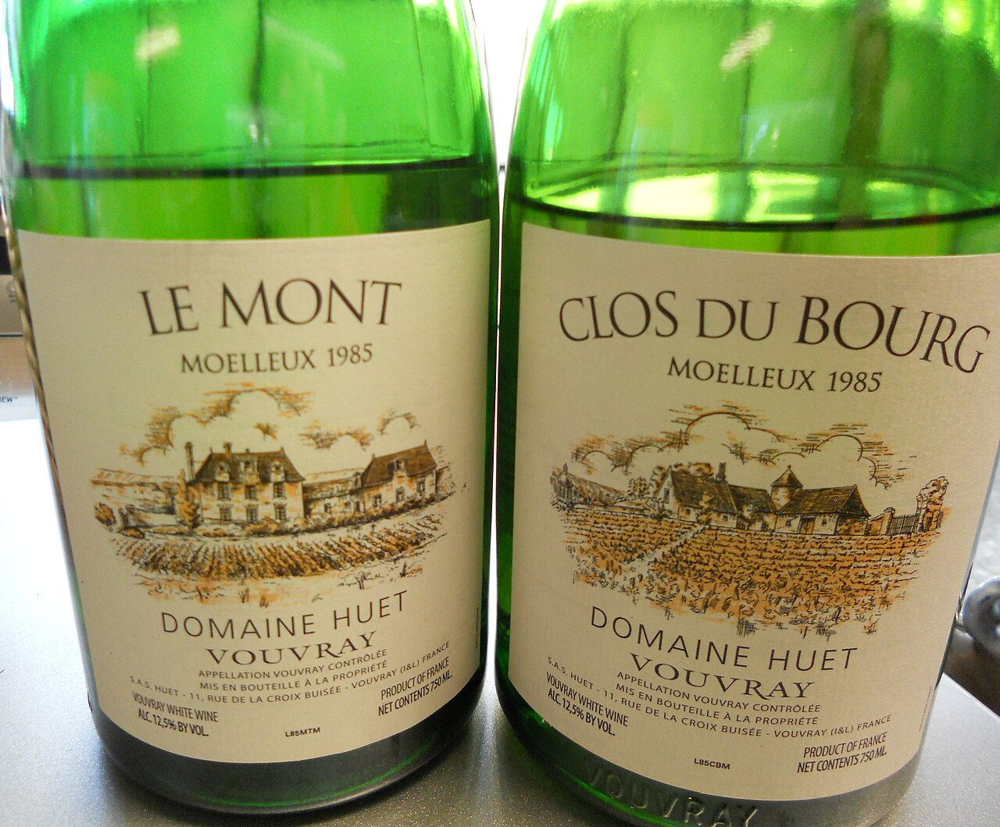

# Domaine Huet

Domaine Huet stands at 11 rue de la Croix Buisée in Vouvray, in France's Loire Valley. It is known for Chenin Blanc, with thirty hectares split into three core parcels: Haut-Lieu, Le Mont and Clos du Bourg. Huet is not an estate designed around a visitor route; cellar, office and reception share the same site, so confirming whether a visit is possible is more sensible than simply turning up at the address.

Figure: Domaine Huet. Image: jamesonf, CC BY 2.0, via Wikimedia Commons ([source page](https://commons.wikimedia.org/wiki/File:Vouvray_AOC_moelleux_Domaine_Huet_1985.jpg)).

## Vouvray: a Chenin town on the north bank of the Loire

Vouvray sits on the north bank of the middle Loire, with the town spreading over slopes and tuffeau caves. Its Chenin can be made dry, off-dry, sweet or sparkling, which makes it one of the Loire's most versatile white appellations. Clay, limestone and flint give different textures; the tuffeau caves provide steady temperature and humidity, and many estates still age wine underground.

For visitors Vouvray is small: the village can be walked, and estates are close together, but public transport is thin and most people drive or take a taxi from Tours. Give Vouvray one day, with estates in the morning and a walk along the river in the afternoon, rather than trying to cover the whole Loire. Coordinates should be taken from official channels.

## The Huet family since 1928

Victor Huet and his son Gaston Huet founded the estate in 1928. Gaston Huet later helped build the Vouvray appellation and made Huet one of its most representative estates; today the property belongs to the Hwang family, with Stefan Hwang named as legal representative in the official notice. Changes of family and ownership did not alter the core: Chenin and three parcels.

That history explains the estate's somewhat old-fashioned character: labels do not chase fashion, the cellar still uses old casks and caves, and age-worthy Chenin takes a large share. It is neither a natural-wine pioneer nor a large group brand, but a family property that layers tradition with biodynamics.

## Three parcels: Haut-Lieu, Le Mont and Clos du Bourg

Haut-Lieu is the historic holding, bought in 1928 with five hectares and now about fifteen, with deep brown clay and a fruitier, fresher profile suited to earlier drinking. Clos du Bourg was bought in 1953, about six hectares above the Vouvray church, enclosed by an old ninth-century stone wall, with thin clay and limestone over tuffeau, giving a denser wine built for ageing.

Le Mont joined in 1957, facing south, its flint and green clay giving a sharper mineral edge and acidity, with the cellars below the slope. The three parcels are Huet's skeleton: one variety, one village, three textures. If you taste only one flight, compare the three dry wines from the same vintage; the difference is clearest there.

## Chenin: dry, off-dry, sweet and sparkling

Chenin's high acidity lets it cover the whole sweetness spectrum. Vouvray sec is fresh, with citrus and wet stone; demi-sec is rounder and suits food; moelleux and liquoreux depend on botrytis or overripe fruit, showing honey, dried apricot and beeswax; pétillant and mousseux use traditional or tank methods, with acidity carrying the bubbles. Huet's range covers almost every type, which makes it a good teaching estate.

Do not read only "Vouvray": the same estate's Vouvray can be dry or off-dry. Read the back label for residual sugar, or ask; Chenin's acidity lowers the perception of sweetness, so the wine often tastes drier than the number. To understand [Chenin](ref:chenin), order a dry, a sweet and a [sparkling wine](ref:sparkling), then compare acidity and body.

## Biodynamics from 1988

The estate moved to biodynamics in 1988 and was one of the first in France to do so. Its official account stresses letting the vines find balance in their environment, through closer phenological observation, fewer chemical inputs and management adjusted to each parcel. The three sites differ in soil and gradient, so a single recipe would not work.

At Huet biodynamics is a decision framework rather than a badge: it shapes cultivation, picking decisions and cellar rhythm. Visitors need neither mythologise it nor treat it as a guarantee of better wine; look at the cover crop and soil, then taste the three parcels, and the discussion becomes concrete.

## The range and vintages

Huet's core is still and sparkling Chenin, split by parcel and sweetness. Haut-Lieu dry is more open in fruit, Le Mont more mineral and tight, Clos du Bourg denser and more age-worthy; sweet wines depend on the year and botrytis. The estate also makes a little red and rosé, but in small proportion.

Vintage matters in the Loire: cool years give high acidity and a light body, ripe years more fruit and easier sweet wines. Check vintage and sweetness before parcel, then price; old Chenin can show honey, nuts and wet stone, or oxidation if stored badly. Do not buy on the estate name alone.

Watch bottle and closure as well: older Huet bottles appear in different shapes and corks, and transport and storage decide a bottle's condition more than the name. In a restaurant, check the fill level and colour first, then smell for oxidation; that is more practical than a vintage chart.

## Visiting and confirming a booking

The address is 11 rue de la Croix Buisée, 37210 Vouvray, France; the official site is mostly about the estate and sales, with no fixed visiting hours, and the legal notice gives only the address, phone and email. This page therefore marks operating status as unknown: the estate is working, but whether and when a visitor can taste must be confirmed by email or phone.

If received, ask whether there is a fee, whether the three parcels are included and whether children may come; drivers should spit. Vouvray is about twenty minutes from Tours, and village parking is limited, so park outside and walk in. Avoid the evening rush, as the riverside roads have poor visibility at dusk.

## See also

- [Loire](ref:loire): Vouvray, Savennières and the spread of Chenin.
- [Chenin Blanc](ref:chenin): high acidity, sweetness range and ageing.
- [White wine](ref:white-wine) and [sparkling wine](ref:sparkling): reading and matching the two styles.

Opening hours, bookings and transport are subject to official channels; page verified on 2026-11-09.

**At a glance:** A family estate in Vouvray, France, founded in 1928 by Victor Huet and Gaston Huet, known for 30 hectares of Chenin Blanc on the Haut-Lieu, Le Mont and Clos du Bourg parcels and for biodynamics since 1988; visits and tastings must be confirmed first.

**Key facts.**

| Item | Detail |
| --- | --- |
| In one line | A family estate in Vouvray, France, founded in 1928 by Victor Huet and Gaston Huet, known for 30 hectares of Chenin Blanc on the Haut-Lieu, Le Mont and Clos du Bourg parcels and for biodynamics since 1988; visits and tas… |
| Address | 11 rue de la Croix Buisée, 37210 Vouvray, France |
| City and country | Vouvray / France |
| Status | to verify |
| Official site | domainehuet.com |
