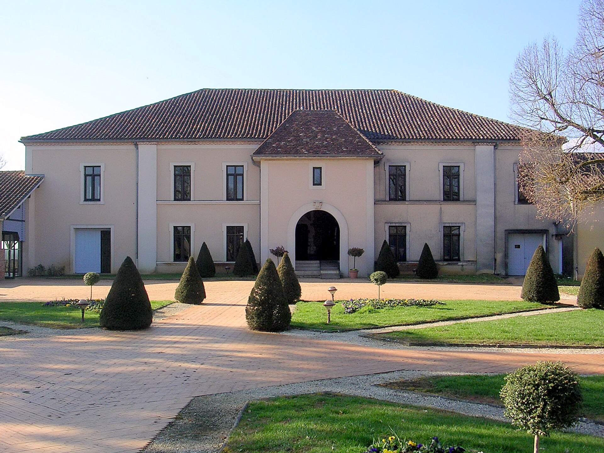

# Domaine d'Ognoas

Domaine d'Ognoas is a departmental estate at Arthez-d'Armagnac in the Landes, on the western edge of Bas-Armagnac, with a seigneurie that goes back to the late 11th or early 12th century. It is not a family house but public property taken over by the Landes after the separation of church and state in 1905: some 650 hectares, a continuous still, rows of cellars and a shop open all year make it an unusually public estate for the appellation.

Figure: Related photograph of Domaine d'Ognoas. Image: Jibi44, CC BY-SA 3.0, via Wikimedia Commons ([source page](https://commons.wikimedia.org/wiki/File:Arthez_domaine_Ognoas.jpg)).

## A public estate in the Landes

The entrance is a country road with pine forest, maize and vines on either side. The decisive difference from a private estate is ownership: Ognoas belongs to the Landes department and is run by the departmental council as a showcase of Landes terroir and Armagnac craft. Farming and visitor reception therefore sit side by side; the estate sells wine and also carries a duty to explain the place.

That position has two consequences. First, the threshold is low: cellars keep long hours, tasting is free, the shop is open all year, and the estate works well as a first stop in the appellation. Second, style is carried by the whole production chain rather than by one flagship bottle: where the grapes come from, which still is used, what kind of cask ages the spirit, how vintages are stored. For a visitor, that is often easier to read than a brand story.

## From medieval seigneurie to 1905

The land is older than the drink. The seigneurie belonged first to the viscounty of Marsan; in 1240 the marriage of Matha de Mastas to Gaston VII Moncade brought it into the Béarn inheritance until 1607. In 1274 Arnaud Bosquet was the only man entitled to call himself seigneur d'Ognoas. Etienne Lormand bought the seigneurie in 1770, and in 1775 his son added Tampouy, extending the estate towards its present shape.

In 1847 the last Lormand died without an heir and left the estate to the Church, which was administered by the bishopric of Aire-sur-l'Adour. In 1905 the French separation law transferred diocesan property to the department, and Ognoas became a Landes possession. It continued as a working farm, and the main buildings were restored before the site opened to the public. Seigneurie, Church and department are stacked on the same cellars, which is what separates it most clearly from other single estates.

## Sand, Baco and continuous distillation

Ognoas sits on the western side of Bas-Armagnac, on tawny sands and sandy clay with iron deposits, which drain quickly and warm early in spring. The grapes ripen evenly, the spirit is finer and more clearly fruity, and it ages well. Armagnac allows a wider set of varieties than Cognac, and Baco matters here: it resists disease, suits the sands and gives roundness and ripe-fruit aroma. Ugni Blanc supplies acidity and structure, Folle Blanche brings flowers, and Colombard adds aroma.

Distillation uses the Armagnac-style continuous still. About 95% of Armagnac goes through this route; the apparatus is all copper, standardised in 1818 by Sieur Tuillière, a stove maker in Auch under Louis XVIII, and then adapted by local distillers. Wine feeds continuously from the bottom of the cooler, vapour rises through the plates and meets the wine, and the spirit is condensed in the serpentine. It leaves at 52%–72%, traditionally 52%–60%, and distillation must finish by 31 March of the year after harvest. Compared with Cognac's double pot distillation, one continuous pass keeps more flavour compounds and a heavier body, which needs longer in cask to settle.

## Time in the cellars and Floc de Gascogne

The new spirit goes into 400-litre pièces, mostly of Gascon or Limousin oak. New wood extracts tannin and aroma; once extraction is right the spirit moves to older barrels to avoid too much wood. Temperature and humidity set the rate of evaporation, and strength falls by about 0.5 degrees a year, the angel's share. When the cellar master judges a spirit to be at its peak, part of it moves into glass bonbonnes to stop changing, kept in the "paradis" as a reserve of old vintages. Treat [oak ageing](ref:oak-ageing) as a run of decisions rather than simple waiting, and the vintages begin to make sense.

The estate's other line is Floc de Gascogne, an aperitif made by blending fresh grape juice with Armagnac: fruit sweetness on one side, spirit structure on the other. It shares the same grapes and cellars but aims at a completely different occasion. Taste the two together: one side shows nuts, leather and spice from ageing, the other is young, direct and fruity. That contrast builds a palate reference faster than memorising dates.

## Visiting: still, cellars and free tasting

The address is 1043 Route d'Ognoas, 40190 Arthez-d'Armagnac, France. Cellars are open all year, Monday to Friday 9:00–12:00 and 14:00–17:30; Saturday afternoon is by reservation; from 2 May to 30 September, weekends and public holidays are also open 14:00–17:30. Groups of up to 50 are accepted, tours are offered in English and Spanish, the site has disabled access, tasting is free, and the shop sells bottles on the spot. The telephone number is +33 5 58 45 44 23, and the estate website lists further contact details.

There are three layers to see: the buildings and land, which show how a medieval seigneurie became departmental property; the still house, with the copper plates and serpentine of the continuous still; and the cellars, where vintage, variety and cask type are kept apart. Come in winter and the still may be running; at other times the cellars and tasting carry the visit. Hours, sessions and group arrangements change, so check official channels before setting out.

## Where Ognoas sits on the Armagnac map

Ognoas lies in the northeast of the Landes, close to Labastide-d'Armagnac, Nogaro and Eauze, and not far from Sorbets in the Gers. It pairs naturally with Château de Laubade as a two-stop route: first the family estate and its vintage bottling at Sorbets, then northwest to Ognoas for the full production chain of a public estate. Between them are pine forest, maize and small towns, with no practical public transport, so a car is required.

Zoom out and Armagnac is a grape [brandy](ref:brandy) within the [French](ref:france) appellation system, with the sands of Bas-Armagnac, Baco and continuous [distillation](ref:distillation) as its base logic. Ognoas is neither the oldest house nor the most expensive brand, but it explains most clearly how an estate was preserved by institutions. If you stop only once in the region and want the lowest-cost introduction to [Armagnac](ref:armagnac), it is often a better fit than private estates that need weeks of booking. Page verified 2026-11-09.

For Domaine d'Ognoas, begin with the address. Then look at the current opening status, and finally ask what the place is known for. The answers point to different choices, not to a single score.

[Armagnac](ref:armagnac) and [Distillation](ref:distillation) answer different questions about Domaine d'Ognoas: address and space and operating status. Read them as a pair, not as alternatives.
