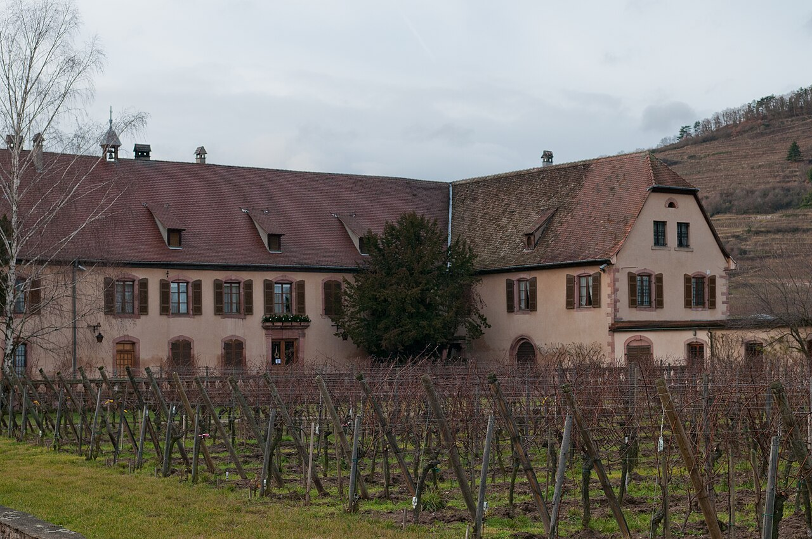

# Domaine Weinbach

Domaine Weinbach stands at 25 Route du Vin in Kaysersberg, Alsace. The estate was built in 1612 by Capuchin monks at the foot of the Schlossberg and later passed to the Faller family. Its name comes from the stream that crosses the property — the "wine stream". It is both a family home and a working cellar and tasting space, the kind of estate where you step into the courtyard and see vines immediately.

Figure: Domaine Weinbach. Photograph: Domaine Weinbach (6710808155). Credit: Michal Osmenda from Brussels, Belgium, CC BY-SA 2.0, via Wikimedia Commons ([source](https://commons.wikimedia.org/w/index.php?curid=24415979)).

## The Kaysersberg valley and the monastery of 1612

Kaysersberg sits on the central stretch of the Alsace wine route, in a narrow valley with east- and south-east-facing slopes, good light and low rainfall. In 1612 the Capuchins built a monastery here, planted vines and made wine for the Mass and for guests; the buildings, walls and some parcels survive today. After the French Revolution the property passed into private hands, and the Faller family rebuilt it into a complete estate in the twentieth century.

That history matters: this is not a winery built later around a brand, but a monastery and vineyard that later acquired a family. The old walls, arches and courtyard are not a set but working infrastructure. Connect them with the Clos des Capucins on the label and the name stops being decorative.

## The Faller family and the Clos des Capucins

After taking over, the Faller family expanded the vineyards, with Théo Faller focusing on old vines and parcel selection; Eddy Leiber-Faller now represents the estate. The core holding is the Clos des Capucins around the monastery, literally the "Capuchin enclosure", the oldest ring of vines on the property. Its soils and aspects are not uniform, so the estate uses different cuvées to express the differences.

The Clos des Capucins wines include Cuvée Théo and Cuvée Sainte Catherine, made from Riesling as well as Pinot Gris and other varieties. They are not anniversary bottles but stylistic choices from different parts of one enclosure. Taste them against the Schlossberg Grand Cru: one is a composite within the walls, the other a single site inside a legal boundary.

## The Schlossberg Grand Cru

The Schlossberg is one of Alsace's earliest-recognised Grand Cru sites and the most visible slope above Kaysersberg. Its soil is mainly granite, with gneiss and sandstone in places, free-draining and quick to warm, which suits Riesling; aspect and altitude keep acidity in autumn while allowing ripeness. Weinbach owns parcels there, and the label names both "Alsace Grand Cru Schlossberg" and the variety.

Grand Cru rules require the site and the variety to be named, and only permitted varieties may be used, which makes the label longer and more specific than a plain Alsace. Within one Grand Cru, top and foot can give different wines; Weinbach's Schlossberg Riesling is typically more mineral and tighter, showing beeswax and wet stone with age. Set it beside the Clos des Capucins Riesling to see the difference between a legal Grand Cru and a historic enclosure.

## The noble varieties on the list

The estate covers Alsace's main noble varieties: Riesling, Pinot Gris, Gewurztraminer and Muscat, plus Pinot Blanc and Sylvaner. Riesling provides the acid and mineral skeleton and is the core white; [Pinot Gris](ref:pinot-gris) gives pear, honey and a smoky note with a broader body; Gewurztraminer gives lychee and rose; Muscat gives the floweriness of the grape. The same slope treats each variety differently, which is part of Alsace's appeal.

The estate also makes non-Grand Cru cuvées at more approachable prices. "No Grand Cru" does not mean second class: it may come from younger vines, a specific parcel or a blend for a given vintage, and be designed for earlier drinking. To build a reference, taste an entry Riesling, then the Clos des Capucins, then the Schlossberg Grand Cru; the three layers become clear.

## Vendanges Tardives and Sélection de Grains Nobles

Alsace's Vendanges Tardives (VT) and Sélection de Grains Nobles (SGN) are late-harvest labels: VT requires a minimum sugar level, SGN requires berry-by-berry selection of botrytised or overripe fruit. Both must use noble varieties and neither may be chaptalised. Weinbach has long experience with these labels, keeping concentration and acidity rather than simple sweetness.

The difference is not only sugar: VT is about ripe fruit and honey from late picking, SGN about concentration and complexity from botrytis, with very low yields. Look at colour and aroma first, then check whether acidity holds the sweetness; judging by "sweet or not" misses the structure.

Vintage matters too: Alsace autumns are not always dry, and botrytis needs particular humidity and day-night temperature swings. Not every year can make SGN, and the estate will not force one for the sake of a product line; a year without SGN is a climate result, not a failure. Asking "how were botrytis conditions this year" is more useful than asking which wine is most expensive.

## Visiting and tasting by appointment

The estate is at 25 Route du Vin, 68240 Kaysersberg. The official page states "sur rendez-vous", meaning appointments are required: Monday to Friday 9:30–11:30 and 13:30–17:30, Saturday 9:30–11:30 and 13:30–17:00, closed Sunday. The content, length and fee of a visit change with the season, so rely on the email reply rather than walking in at the hours on the door.

From Kaysersberg village the estate can be reached on foot; if driving, park outside the village and walk along the wine route. Ask whether there is a fee, whether Grand Cru wines are included and whether children may come; drivers should spit. With limited time, focus on the Clos des Capucins and Schlossberg wines rather than trying the whole list.

## See also

- [Alsace](ref:alsace): the Vosges rain shadow, Grand Cru and noble varieties.
- [Riesling](ref:riesling) and [Pinot Gris](ref:pinot-gris): two core varieties and their styles.
- [White wine](ref:white-wine): reading Alsace labels and matching food.

Opening hours, bookings and transport are subject to official channels; no coordinates are given here, so use official channels for those as well. Page verified on 2026-11-09.

[Alsace](ref:alsace) and [Pinot Gris](ref:pinot-gris) answer different questions about Domaine Weinbach: address and space and operating status. Read them as a pair, not as alternatives.

**At a glance:** A family estate in Kaysersberg, Alsace, founded on a Capuchin monastery site in 1612 at the foot of the Schlossberg Grand Cru, known for the Clos des Capucins, biodynamic farming and Riesling and Pinot Gris; visits are by appointment.

**Key facts.**

| Item | Detail |
| --- | --- |
| In one line | A family estate in Kaysersberg, Alsace, founded on a Capuchin monastery site in 1612 at the foot of the Schlossberg Grand Cru, known for the Clos des Capucins, biodynamic farming and Riesling and Pinot Gris; visits are b… |
| Address | 25 Route du Vin, 68240 Kaysersberg, France |
| City and country | Kaysersberg / France |
| Status | verified open |
| Official site | domaineweinbach.com |
