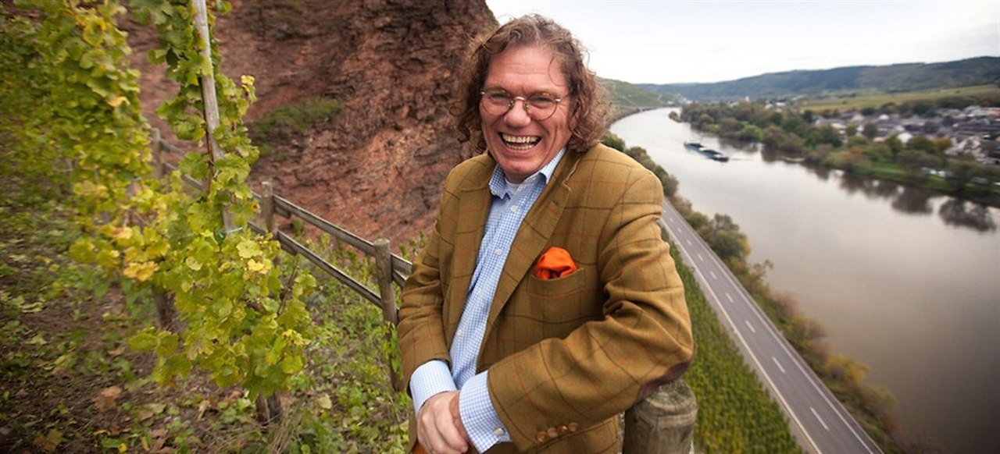

# Dr. Loosen

Dr. Loosen sits at St. Johannishof in Bernkastel-Kues, in the middle Mosel. It is not a visitor centre open all day but a working family estate: cellar, house and steep vineyards belong together, and there is no large welcome building at the gate. Think of it as a place to taste a set of slate Rieslings rather than a sight to tick off; the address and contact details can be checked on the official page, and coordinates should be taken from official channels.

Figure: Dr. Loosen. Image: Weingut Dr Loosen, CC BY-SA 4.0, via Wikimedia Commons ([source page](https://commons.wikimedia.org/wiki/File:Ernst_Loosen.jpg)).

## St. Johannishof: an old estate at the foot of Bernkastel's slope

The name St. Johannishof comes from the nearby Bernkasteler Johannisbrünnchen spring, and the estate's older name is linked to it. The property stands inside Bernkastel-Kues, with the Mittelmosel's steep slopes behind it; it can be reached on foot from the centre, but the vineyards above are not a place for casual wandering. For a visitor the advantage is concentration: reception, tasting and cellar share one courtyard, with no hunt for house numbers across the village.

The official contact page lists only St. Johannishof, 54470 Bernkastel/Mosel, a phone number and an email, with no fixed visiting hours; regional tourism material adds that visits need booking. This entry therefore marks operating status as unknown: the estate is certainly working, but when and how a visitor may enter has not been confirmed officially, so an email must come before any itinerary is fixed.

## Two centuries of family and the turn after 1988

The estate has been in one family for more than two hundred years, with family links to the Prüm dynasty as well. Ernst F. Loosen took over in 1988 and moved it from a stable, larger producer towards a sharper focus on old vines and named sites; in 1993 the estate joined the VDP. The official account frames this as a return to Mosel tradition, but the point is not nostalgia: ungrafted old vines and historic vineyards were put back at the centre of the label.

The background is the twentieth-century German wine market, where volume and sweetness once mattered more than site. Dr. Loosen chose the opposite path: lower yields, clearer parcels, and dry and sweet styles expressed separately. The entry wines remain easy to drink, but the reputation rests on the GG and RÉSERVE wines: one stresses site, the other long ageing. Only with that history does the word "tradition" make sense.

## Three slates: blue, red and grey

The estate uses slate colour for its entry range, common on the Mosel but made into a clear contrast here. Blue slate (Blauschiefer) usually gives tighter acidity, mineral notes and lime; red slate (Rotschiefer) leans towards spice, red fruit and a broader texture; grey slate (Grauschiefer) is rounder and softer, often bottled as feinherb. The three are not ranks but directions of taste.

Slate works beyond colour. Weathering, soil depth and aspect change how water is held and how quickly the slope warms; on the same hill, deep-rooted old vines stabilise yield better than young ones. If a visit includes the foot of the slope, look at the broken stone and the gradient, then compare the three wines in the tasting room; the difference will stick better than any label.

One caution: the three slates are not three fixed parcels under an official hierarchy, but a set built to give drinkers a taste reference. Proportions and sources can change with the vintage, and this year's "blue slate" may not match last year's exactly. Treat it as a style doorway, not an appellation name, and it will not mislead.

## From entry level to Großes Gewächs

The range runs roughly in three layers: entry wines, including the three slates; village and named-site wines; and Großes Gewächs (GG). The GG wines come from historic sites such as Erdener Treppchen and Bernkasteler Lay, with stricter yield and picking standards and a mostly dry style. RÉSERVE is a separate line, trading longer ageing for a drier, less sweet texture; the official account mentions a wait of 48 months.

Prices and vintages follow the market, and the estate's online shop lists current releases. To build a reference, buy one bottle of each slate and then a GG; taste the parcel difference and the hierarchy difference separately, so price does not become the only clue. Aged GG often shows honey and wet stone, while young bottles are more citrusy and sharp.

## Residual sugar and how to read "dry"

Dr. Loosen uses two vocabularies at once: the traditional Prädikat scale (Kabinett, Spätlese, Auslese and so on), based on ripeness at harvest, and dry-style labels (trocken, feinherb). One wine can carry both a Prädikat name and a dry label; that is not a contradiction, but two different facts, ripeness of the fruit and residual sugar in the finished wine.

Read the label in this order: variety and site first, then Prädikat, then the dry designation. Kabinett trocken and Kabinett feinherb differ in residual sugar, not in picking difficulty; Auslese trocken is unusual in Germany and should be confirmed as truly fermented dry. The common beginner's error is to read "Kabinett" as "always sweet", when it is only the lightest ripeness level.

## Booking, visiting and buying

The address is St. Johannishof, 54470 Bernkastel-Kues, Germany; the official page gives +49 (0) 6531-3426 and info@drloosen.de. Because no fixed visiting hours are listed, write ahead with the number of guests, dates, wines of interest and whether you are driving, then wait for a reply. Do not plan to "ask at the door", especially at harvest or on weekends.

For buying only, the online shop is easier than a visit; for tasting, confirm whether there is a fee, whether the cellar is included and whether children may come. Drivers should spit; the country roads between Bernkastel and Wiltingen are narrow and winding. Check shipping and duty, and consider temperature when mixing dry and sweet bottles.

## See also

- [Mosel](ref:mosel): the Mittelmosel's parcels, slate and river bends.
- [Riesling](ref:riesling): high acidity, variety aroma and ageing potential.
- [White wine](ref:white-wine) and [oak-ageing](ref:oak-ageing): how fermentation vessel and ageing shape style.

Opening hours, bookings and prices are subject to official channels; page verified on 2026-11-09.

Further reading: [Wine](ref:c-extra-1).

**In brief:** A family estate at St. Johannishof in Bernkastel-Kues on the German Mosel, built around ungrafted old vines, blue, red and grey slate and Großes Gewächs Riesling; visits and tastings must be confirmed through official channels first.

Start with the address. From there, consider the current opening status, then what the place is known for. That is how a practical judgment about Dr. Loosen is built.

[Mosel](ref:mosel) and [White wine](ref:white-wine) are the two useful reference points for Dr. Loosen. [Mosel](ref:mosel) sets out address and space; [White wine](ref:white-wine) brings in operating status. Read them together.
