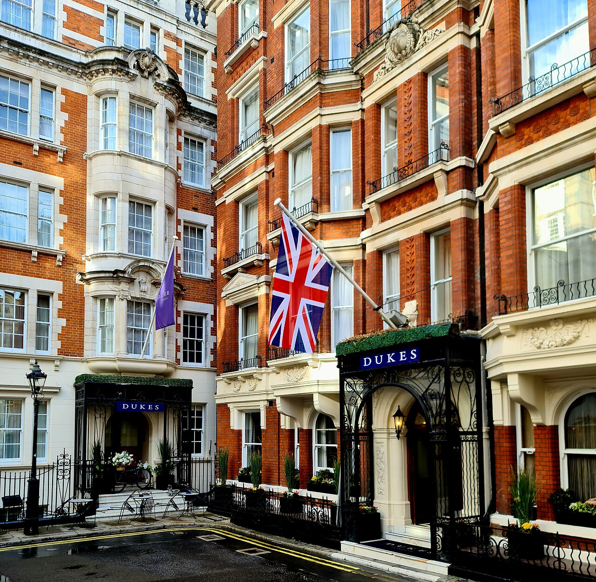

# Dukes Bar

Dukes Bar sits inside Dukes Hotel at 35 St James's Place in London, a small hotel bar that has turned doing one thing well into a signature. The service revolves around a trolley: a frozen glass, frozen spirits and a strip of lemon peel. First-time visitors often arrive looking for a Bond souvenir; the bar is more interested in temperature, dilution and pace.

Figure: Dukes Bar. Image: Ricardalovesmonuments, CC BY-SA 4.0, via Wikimedia Commons ([source page](https://commons.wikimedia.org/wiki/File:Hotel_Dukes_London.jpg)).

## Place and history

Dukes Hotel stands on St James's Place, and the bar's address is 35 St James's Place, London SW1A 1NY. The official page dates the bar's presence in St James's to 1908, which is why this page records 1908 as the founding year; the room and the way it operates have been adjusted many times since, and what you see today is a small, old-fashioned hotel bar built around tableside service rather than a preserved 1908 interior.

Ian Fleming drank in St James's in the 1950s, and the bar's association with the line "shaken, not stirred" is a story told by the house and repeated by the press. The hotel itself uses the phrase "legend has it" — the connection explains why the bar is famous, but it is not evidence that Fleming wrote the line there. Alessandro has long led the bar, and the official page describes "Alessandro and his team" carrying on the tradition; staff and schedules change, so do not treat a particular bartender as a guaranteed sighting.

## The room and the list

The bar occupies a small room inside the hotel, with armchairs and sofas, carpets, dark blue upholstery and portraits on the walls; the effect is closer to a private club than a hotel lobby. There is no dance floor and no loud soundtrack. A server wheels a small trolley to your table and completes the mixing and pouring in front of you. The room suits two people talking, not a celebration of fifteen.

The Dukes Martini is the centre of the list. Gin or vodka is kept in the freezer, the glass is frozen too, and the drink is poured without ice or water, so there is no ordinary shaking dilution; the finish is a lemon peel. The official page says every drink is served with frozen glasses, colder spirits and, famously, no ice. The Infatuation describes a glass containing roughly five shots of gin, which gives a sense of the strength. Beyond the Martini the bar makes classic cocktails, with the exact list set on the day; do not expect a long menu of experimental drinks.

## How to drink

On a first visit, one Dukes Martini is enough. Choose gin or vodka, then say whether you want lemon peel or an olive; if you are sensitive to vermouth, ask for "very dry" or "just a rinse". The frozen spirit tastes tighter and hotter than a room-temperature Martini, so sip slowly and do not rush into a second.

To compare, two people can order one gin and one vodka version and swap a taste; that reveals more than ordering four drinks at once. The bar also makes classic cocktails, so if a Martini is not what you want, ask what is possible that day, but do not treat the place as a laboratory. There are no reservations; all seating is on arrival. The bar opens at 3pm, and early evening is usually easier than late evening. Solo guests can ask for a magazine, a small habit that tells you how the room is run.

## Practical information

The address is 35 St James's Place, London SW1A 1NY, United Kingdom, in St James's between Green Park and Piccadilly. Green Park (Jubilee, Piccadilly and Victoria lines) is the nearest Underground station, five to seven minutes on foot; Piccadilly Circus is about eight to ten minutes, and Charing Cross about twelve minutes.

The official pages disagree on hours: the bar page lists Monday to Saturday 15:00–22:00, with last orders at 22:00 and closing at 22:30, while the "Dukes Bar" page lists Monday to Saturday 15:00–23:00 with last orders 45 minutes before closing. Neither lists Sunday service, and the bar took a short pause from 29 July to 16 August 2026, so check the day's official notice before travelling. The bar is walk-in only, and a short wait is possible when busy. The dress code is smart casual: sportswear, shorts and T-shirts are not permitted, except short-sleeved collared shirts such as polo shirts. Guests must be 18 or over, and only assistance dogs are allowed.

The hotel itself is temporarily closed for a staged refurbishment, but Dukes Bar remains open; during the works the hotel entrance is not wheelchair accessible, so guests with limited mobility should contact the hotel in advance. Prices are in the top tier of London hotel bars, and The Infatuation gives the bar its highest price band; check the menu for actual prices. Opening status, prices and bookings are subject to official confirmation. This page was verified on 2026-11-08.

## Etiquette and common mistakes

The most common mistake is assuming "shaken, not stirred" describes the house technique. The Dukes Martini is poured without ice or dilution, with frozen spirit going straight into a frozen glass; it is closer to a pour than a shake. The Bond line is cultural legend, not an instruction. The second mistake is treating the bar as a place for a loud party: the room is small, most guests speak quietly, and a group of fifteen changes the volume immediately.

Third, do not dress as if you are out shopping. Smart casual is enforced here, and shorts, sportswear and flip-flops may be refused. Fourth, do not order a long run of drinks: the Martini is strong, one is enough, and a second should be slow; the bar is not built for speed. Fifth, do not turn the trolley into a photo backdrop. Keep your distance and do not reach for the glass while the server is working. Finally, check the bill for service; London hotel bars often add it, and an extra tip is not compulsory.

## Around and routes

From the bar, walk along St James's Place towards St James's Palace and Spencer House, then south into Green Park and on to Buckingham Palace; north through Piccadilly brings you to Jermyn Street and Fortnum & Mason. To put two hotel bars into one walk, continue about fifteen minutes to the Connaught Bar in Mayfair, or a little further to the American Bar at The Savoy. All three are central, but the rhythms differ: Dukes is the smallest and quietest, the Connaught is the most design-led, and the Savoy leans hardest on history. St James's is full of club buildings and grows quiet at night; take a loop of the streets before calling a car.

## See also

Dukes Bar is best read against the Connaught Bar: one compresses the ritual into a single Martini, the other expands it into an evening. For the question of how a hotel bar becomes a city landmark, read American Bar at The Savoy. All three make the same point: in London, the hotel-bar price buys time, a seat and service, not volume.

## See also

- [London classic bar walk: three hotel bars and a Fleet Street pub](ref:london-classic-bar-walk)
- [American Bar at The Savoy](ref:american-bar-savoy)
- [Dry Martini](ref:dry-martini)

Further reading: [A Ginjinha](ref:c-extra-1), [À la Mort Subite](ref:c-extra-2).
