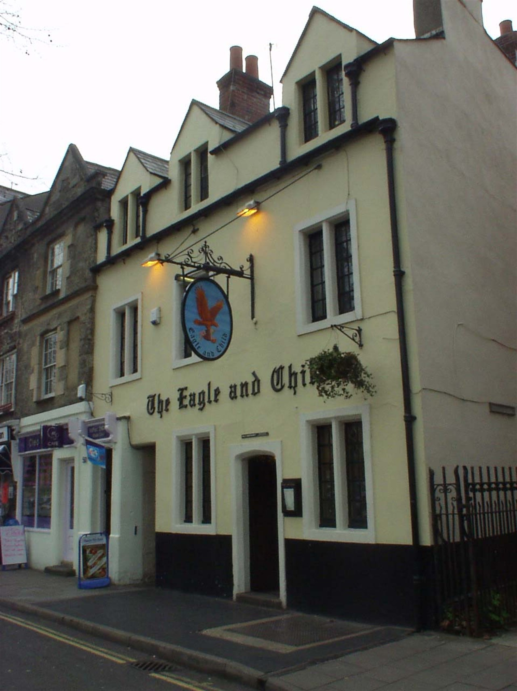
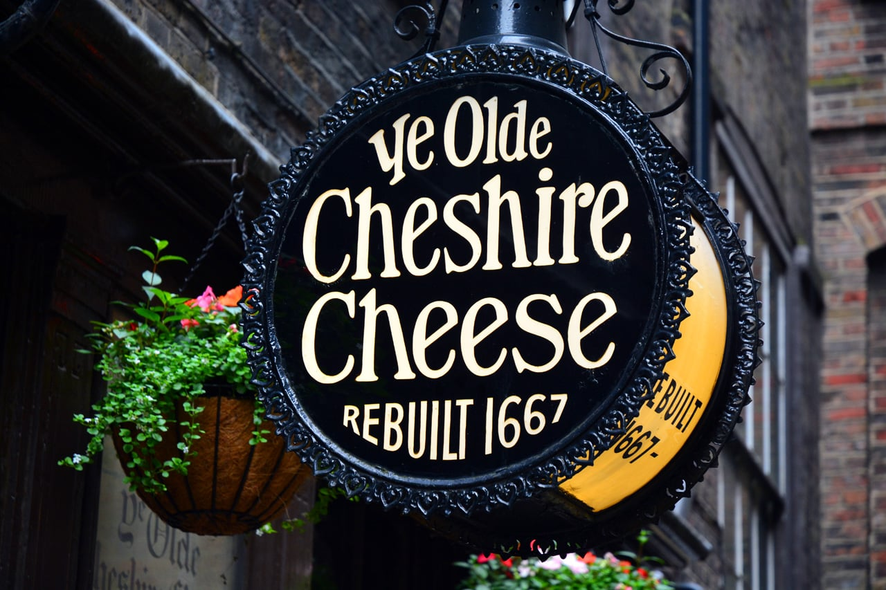

# The Eagle and Child

Number 49 St Giles' now feels like a building you read rather than a pub you enter. There is no queue at the door and no bartender polishing glasses. The Eagle and Child has been closed since March 2020; the Ellison Institute of Technology (EIT) bought it in 2023, and in 2025 planning and listed-building consent were granted for a restoration. It remains one of the most frequently pointed-out stops on Oxford's literary map, but "literary landmark" and "working pub" are no longer the same thing here.

Figure: The Eagle and Child. Image: MPerel at English Wikipedia, Public domain, via Wikimedia Commons ([source page](https://commons.wikimedia.org/wiki/File:The_Eagle_and_Child.jpg)).

## Place and history

St Giles' is a wide, tree-lined street that runs from St John's College at the north end towards the Ashmolean Museum and the city centre. The Eagle and Child building is Grade II listed. In an October 2023 press release, St John's College said the pub first opened in 1684. CAMRA also dates the first beerhouse record to 1684 and notes that the two small front snugs may preserve something of that period. EIT's 2025 restoration brief describes the listed building as "built around 1840," which most likely refers to the surviving street frontage or main fabric rather than denying the 1684 trading record. Keeping "first record," "current building date" and "literary period" separate prevents three timelines from collapsing into one sentence.

In the twentieth century, J. R. R. Tolkien, C. S. Lewis, Hugo Dyson and other members of the Inklings met in the back room known as the Rabbit Room; regulars called the pub "the Bird and Baby." Their meetings usually took place at Tuesday lunchtime from the 1930s into the early 1960s. The gatherings are historical fact, but claims that a particular book was written at a particular table are usually amplified later. The pub's importance lies in providing a regular space for argument and revision, not in a relic.

The pub closed in March 2020 because of the pandemic and then stood empty. In October 2023 St John's College sold the building to EIT, which announced plans to refurbish and reopen it as a pub. In October 2025 planning permission and listed-building consent were granted; EIT appointed Foster + Partners to lead the restoration, with Donald Insall Associates as heritage architects. That change of ownership explains why this entry has to describe both history and construction status: the former college-owned pub is now part of an institute's neighbourhood plan.

## The rooms and the list

The current answer is simple: there is no drinks list and no public bar service. The building contains two historic parlours and the famous Rabbit Room. The restoration plan proposes keeping the warmth of those spaces, reinstating a third parlour, adding a dining room at the rear that reconnects the pub to its garden, and converting neighbouring 50–51 St Giles' into a café serving coffee and baked goods. The upper floors are planned as meeting and study space for EIT scholars, staff and fellows. The future Eagle and Child is therefore not just a traditional pub; it is a hybrid of pub, café, garden and institutional social space.

This also means that old menus, old prices and old opening hours found online are obsolete. Treating the restoration images as the present, or reading "the Rabbit Room will be retained" as "you can sit in it now," will lead to a wasted trip. The value of the building is in its street elevation, its interior compartments and its literary memory; a drinks list will exist only once the pub reopens.

## How to drink

During the closure there is no correct way to drink here. The practical alternative is to combine a look at the building with a drink somewhere else: walk south along St Giles' to the Lamb & Flag, or head into Jericho, where several pubs still operate and can provide a normal Oxford pub experience. If you came specifically for the Inklings, treat the Eagle and Child as a pause on a walking route — read the plaque, look at the frontage, then continue — rather than as the day's drinking destination.

When the pub reopens, the ordering logic will probably change. If an institution operates it, the menu may serve tourists, students and EIT staff at once, and hours and prices may resemble an all-day destination rather than a traditional pub. On a first visit then, check the official announcement and menu rather than relying on a 2019 guide.

## Practical information

The address is 49 St Giles', Oxford OX1 3LU, United Kingdom. Oxford station is about 900 metres away, a 12- to 15-minute walk, and buses run along St Giles'; St John's College, the Ashmolean Museum and Oxford University Press are all nearby. Oxford is the nearest railway station (Great Western Railway and CrossCountry); from the forecourt, walk through Castle Street and Broad Street to reach St Giles'.

There is no opening time, menu, price, booking channel or dress code to report: the building has been closed since March 2020, and CAMRA's record, updated in November 2025, still lists it as long-term closed. In September 2026 the Oxford Clarion quoted the owner saying that the full restoration behind the hoardings was under way, with reopening targeted for 2027 but no fixed date. Tickets and bookings: as a building under restoration it sells no tickets and takes no pub reservations; you can look at the exterior from the public pavement but cannot enter the hoardings. Transport: buses 2, 2A and S3 stop along St Giles' and Magdalen Street. This entry was verified on 2026-11-08; opening status, prices and bookings are subject to official confirmation, so check EIT announcements, the CAMRA record or on-site signage before travelling.

If you need somewhere to drink today, this entry is not a suitable main stop. If you are interested in architecture and literary history, the exterior is still worth a look, but keep the visit to about ten minutes and stay clear of construction fencing.

## Etiquette and common mistakes

Do not knock, try side doors or cross the fencing for photographs. The building is a listed property under restoration, not an open monument. The second mistake is treating the details of the Inklings' meetings as a scene that can be reconstructed exactly: they did meet in the Rabbit Room, but the precise seats, drinks and conversations were not comprehensively recorded. The third is equating "closed" with "abandoned": the building has a clear owner and an approved restoration plan, and it may return as a pub.

Remember also that this is college and institutional property in a residential area. Long gatherings, loud guided commentary or livestreaming at the door will disturb neighbours. If you are leading a group, check whether standing on the public pavement is acceptable. Finally, do not navigate using the nickname "the Bird and Baby"; on maps the building is still The Eagle and Child.

## Around and routes

From the north end of St Giles', look at St John's College, then walk south to the Ashmolean Museum (free and useful in rain), and continue to Broad Street and Oxford University Press. For a drink, the Lamb & Flag further south on St Giles' is the more practical choice; heading west into Jericho reveals more pubs and restaurants. Placing the Eagle and Child at the start or middle of that walk, rather than at the end, makes the route work.

## See also

The beer once served here belongs to the wider family of [beer](ref:beer) styles; [Pub and city](ref:pub-and-city) explains how such spaces receive guests.

Further reading: [Ye Olde Cheshire Cheese](ref:c-extra-1), [A Ginjinha](ref:c-extra-2), [À la Mort Subite](ref:c-extra-3).

**In brief:** A historic pub on St Giles' in Oxford, famous as a meeting place of the Inklings; closed since 2020, with restoration approved in 2025 and no current pub service.

## Related images

Image: The hanging sign of Ye Olde Cheshire Cheese on Fleet Street, lettered with the pub’s name and “Rebuilt 1667”.. Credit: Images George Rex, CC BY-SA 2.0, via Wikimedia Commons ([source page](https://commons.wikimedia.org/wiki/File:Ye_Olde_Cheshire_Cheese_rebuilt_1667_(14276567866).jpg)). Related image for The Eagle and Child.
