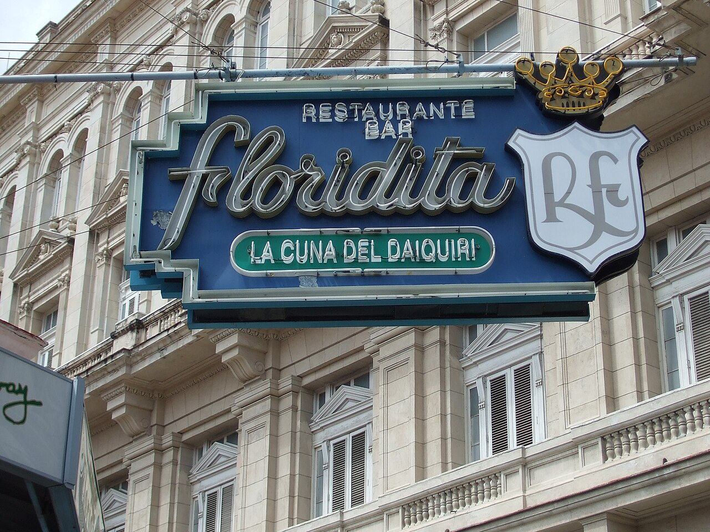

# El Floridita

El Floridita (Xiǎo Fóluólǐdá Jiǔguǎn) occupies the corner of Obispo and Monserrate streets in Old Havana, at Calle Obispo 557. It opened in 1817 as “La Piña de Plata” (The Silver Pineapple). It is known as the “cradle of the daiquiri”: Constantino Ribalaigua Vert, a Catalan bartender known as Constante, began working there in 1914 and created a frozen daiquiri in 1931, turning the house into a school for rum cocktails. Ernest Hemingway became a regular in 1932, and the bar still keeps his place at the end of the counter, marked by a life-size bronze statue.

Figure: El Floridita. Image: Haydn Blackey, CC BY-SA 2.0, via Wikimedia Commons ([source page](https://commons.wikimedia.org/wiki/File:Floridita_Bar-Restaurant,_Havana.jpg)).

## Place and history

The bar opened in 1817 and has stayed at the same address. In the nineteenth century it was a neighbourhood tavern where Havana residents gathered around a drink. The name history has more than one version: the Havana city government page says it was renamed “La Florida” around 1898–1902, with “Floridita” becoming the popular form; the bar’s own website says the name “El Floridita” has been used since 1914. There is no need to force the two accounts into one; what matters is that this has been a corner bar for a long time, not a theme venue created for tourism. Constante started as a waiter in 1914 and bought the business in 1918. He built the frozen daiquiri from fresh juice, rum and ice, and turned “cantinero” into a recognised craft tradition. In the 1950s Esquire listed the bar among the world’s most famous; it was restored in 1991, and in 2003 the sculptor José Villa Soberón made the life-size Hemingway statue that stands at his old spot.

## The room and the drinks

The interior has an English club feel: a long bar, mirrors, red tones, paintings and photographs covering the walls, with live music. It is both a bar and a seafood restaurant: the counter is for cocktails, the dining area for Cuban seafood and simple dishes. The signature is the frozen daiquiri, cold, tart and sweet. Hemingway’s usual version was the “Papa Doble,” also called the Hemingway Special—double rum, grapefruit juice, little or no sugar—drier and stronger than a standard daiquiri. The bar also serves other rum cocktails, but do not expect a modern tasting-menu drinks list; its value lies in the historic technique and a fixed style.

## How to order on a first visit

Start with a standard frozen daiquiri to feel the texture and the sweet-tart balance. If you like a drier, stronger drink, move to the Papa Doble. If you dislike sweetness, ask the bartender to reduce the syrup, but do not demand “no sugar at all while keeping the original recipe”; that changes the balance and the glass. For food, move to the dining area and order seafood or Cuban home-style dishes rather than standing in the middle of the bar waiting. Just after opening and before the evening rush are the easier times; meal hours and tour groups are crowded. Do not turn “how many daiquiris Hemingway drank” into a challenge, and do not ask staff to reproduce a recipe from a biography.

## Practical information

Address: Calle Obispo 557, corner of Monserrate, La Habana Vieja, Havana 10100, Cuba; coordinates 23.13734, -82.35733. It is reachable on foot from Plaza de Armas, the Havana Cathedral and the Obispo pedestrian street; a taxi from the central parks or Vedado takes about 5–10 minutes. The official site lists daily hours of 12:00–01:00 and the phone number +53 7 867 1300; this page was checked on 2026-11-08. There is no entrance ticket; you pay for drinks and food. Public information is limited, so menu prices, any minimum charge and whether reservations are accepted were not verified; holiday and temporary changes should be confirmed through official channels. The bar and dining area are separate, and meal hours and tour groups are crowded, so arrive shortly after opening or before the evening rush. Dress is casual; no formal wear is needed. Live music usually expects a tip. Payment methods—cash, foreign currency, cards—change quickly, so confirm before you go and do not assume a card will work. Page checked 2026-11-08; opening status, prices and reservations are subject to official channels.

## Etiquette and common mistakes

The Hemingway statue is a memorial, not a photo prop: do not climb over the bar, sit on the statue, or block the passage for a picture. Ask before photographing the band, and tip after the set. When ordering, do not use “Hemingway” instead of a drink name; if you want a Papa Doble, say so, or ask for double rum and little sugar. The biggest mistake is treating the “Hemingway drink” as the only authentic recipe: the Papa Doble is one version, and the frozen daiquiri has been adjusted many times. Brand storytelling is not the same as a single historical recipe. Another mistake is expecting a quiet local bar; this has long been a meeting place for visitors and celebrities, and music and crowds are part of the experience.

## When not to come

El Floridita is the wrong choice if you want a quiet conversation, a low budget, no live music or no tour groups, or an experimental modern cocktail menu. The room is crowded at peak times; visitors with limited mobility should confirm the entrance and seating layout first. Anyone sensitive to alcohol strength should be careful with the Papa Doble, which doubles the rum rather than lightening the drink. If you only want an everyday local rum bar, there are smaller and quieter places elsewhere in and around Old Havana.

## Nearby and around

The door opens onto the Obispo pedestrian street. North are Plaza de Armas and the Castillo de la Real Fuerza; south are the Havana Cathedral and Cathedral Square. The Museum of the Revolution and the Malecón are within walking distance or a short taxi ride. [La Bodeguita del Medio](ref:bodeguita) is about ten minutes on foot, and the two make a natural “daiquiri and mojito” half-day: first the long bar and bronze statue at Floridita, then the narrow signed walls at La Bodeguita. If you have time for only one, choose Floridita for daiquiris and Hemingway relics, or La Bodeguita for mojitos and home-style food.

## See also

To understand where such bars sit in the city, read [Pub and city](ref:pub-and-city), which also compares cafés, pubs and beer halls. For the drink itself, read [Daiquiri](ref:daiquiri); for the base spirit, read [Rum](ref:rum); for Havana’s other famous old house, read [La Bodeguita del Medio](ref:bodeguita).

Begin with the address, move on to the current opening status, and finish with what the place is known for. That order keeps the reading of El Floridita practical.

**At a glance:** A legendary bar in Old Havana, founded in 1817 and known for Hemingway, the frozen daiquiri and its seafood bar.
