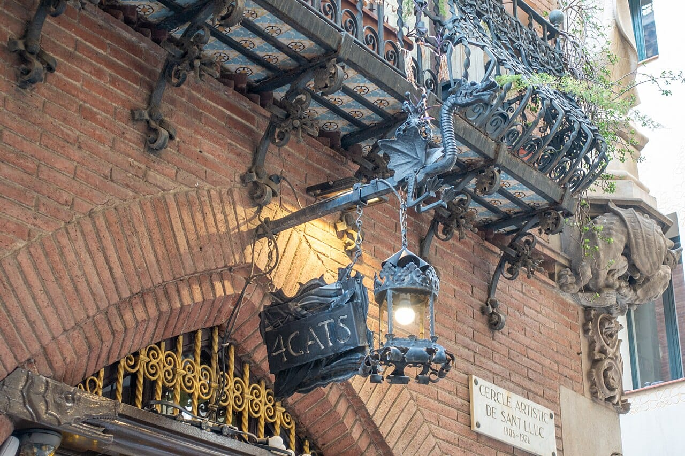
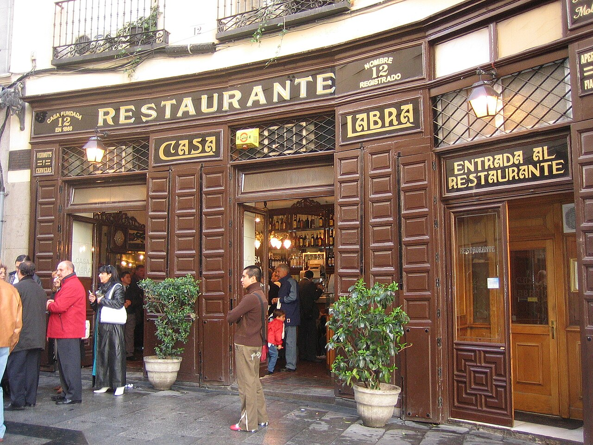

# Els Quatre Gats

From the lanes beside Barcelona Cathedral, turn into Carrer de Montsió and a narrow building with a pointed roof, brick-and-stone facade and Modernista ironwork appears; Els Quatre Gats occupies its ground floor. A "4 GATS" sign hangs at the door, and inside are dark wood, mirrors, posters and brass lamps. It is not the noisy tourist café of Las Ramblas but a tavern from 1900 with the pause button pressed: the menu, wall decorations and furniture all remind you that this was a stronghold of Catalan Modernisme.

Figure: The brick facade, iron lanterns and "4 GATS" sign of Els Quatre Gats, Carrer de Montsió 3. Image: Kent Wang from Barcelona, Spain, CC BY-SA 2.0, via Wikimedia Commons ([source page](https://commons.wikimedia.org/wiki/File:Els_Quatre_Gats_(52057359477).jpg)).

## Location and history

Els Quatre Gats opened on 12 June 1897. Its founders were Miquel Utrillo, Ramon Casas and Santiago Rusiñol; Manuel Girona provided the money and Pere Romeu ran it day to day. It occupies the ground floor of Casa Martí, designed by the architect Puig i Cadafalch; the building itself is a landmark of Catalan Modernisme, with its pointed roof, brick, ironwork and stained glass in the style of the years around 1900.

The name comes from the Catalan saying "¡Seréis cuatro gatos!" — literally "you will be four cats", meaning "there are only a few of you / you will never amount to much". The line is said to have been aimed at a group of regulars by Casas or Rusiñol, and was then turned inside out as the house's name. It imitated Le Chat Noir in Montmartre: there were songs, exhibitions, magazines and late-night literary arguments.

The café was more than a place to drink. It hosted concerts, Chinese shadow theatre, puppet theatre, literary evenings and art exhibitions; it published Quatre Gats, Pèl & Ploma and Forma. Picasso began to frequent it in 1899 and in February 1900 held his first public exhibition there (the house chronology records his first solo show in 1899, and the sources differ); he also drew a menu cover. In 1903 the café closed under its debts and the premises became a textile warehouse; in the late 1980s it reopened as a restaurant, and from 1989 Josep Maria Ferré has run it. In 2008 Woody Allen filmed Vicky Cristina Barcelona here.

Begin with the address, move on to the current opening status, and finish with what the place is known for. That order keeps the reading of Els Quatre Gats practical.

## The rooms and the drinks

Today's Els Quatre Gats keeps a double identity as tavern and restaurant. The ground floor has a bar, wooden tables, mirrors, old posters and a piano; reproductions and photographs from the Casas and Rusiñol era hang on the walls; upstairs and in the corners are quieter tables. The space is small, the ceiling low and the light warm, suited to a slow meal, piano music or watching the old-town lane outside.

The menu mixes Catalan tradition with "Modernista" styling: roasted vegetables, tomato bread, seafood, grilled meat, stews, crema catalana and chocolate; the drinks list has local wine, cava, beer and cocktails. This is not a coffee-only café; at meal times the emphasis is on food, while in the afternoon you can order coffee, cava or dessert.

## How to drink here

At midday or in the evening, order Catalan stew, grilled meat or seafood with a Penedès white or cava; tomato bread and roasted vegetables suit a light white. In the afternoon, coffee, cava or dessert at the bar or by the window, watching the old town. For drinks only, avoid the meal peaks and ask whether a bar place is free.

Do not expect a "Picasso seat" or a fixed commentary; the house has not labelled every table as a relic. To understand the history, read the posters and the website, or treat it as one stop on a Picasso and Modernisme walk.

## Practical information

- Address: Carrer de Montsió 3, 08002 Barcelona.
- Hours: Tuesday to Saturday 11:00–24:00; Sunday 12:00–17:00; closed Monday.
- Transport: metro Line 3 to Liceu or Line 1 to Catalunya; Urquinaona is also close.
- Reservations: book for a full meal; afternoon coffee and the bar usually accept walk-ins.
- Prices: full meals are medium to high; coffee and dessert are lighter.
- Tip: the old-town lanes are narrow and people often photograph the door; do not block neighbouring tables or the passage while eating. Enter from the Via Laietana side and avoid dragging luggage over the cobbles.

## Etiquette and common mistakes

First, do not read "four cats" as a cat-themed café; the name is a saying, not an animal. Second, do not treat it as a branch of the Picasso Museum; this is a working restaurant, and the Picasso connection is historical and decorative, not an exhibition. Third, do not assume that every event between the 1897 opening and the 1903 closure happened daily; concerts, exhibitions and magazines belonged to that period, and today's programme follows the house's announcements. Fourth, do not use "Modernisme" to cover every fixture; the present interior has been restored and remade, with originals and reproductions mixed. Fifth, do not talk loudly while the piano is being played; if someone is playing, lower your voice.

## Around and nearby

From Els Quatre Gats, two minutes south are Barcelona Cathedral and the old-town lanes, east are Via Laietana and the Mercat de Santa Caterina, west are Passeig de Gràcia and Casa Batlló. A route might run: the cathedral, lunch at Els Quatre Gats, the Picasso Museum on Carrer Montcada, Santa Maria del Mar and the sea. For Modernisme, head north to Casa Batlló, La Pedrera and Casa Vicens.

## Further reading and see also

- The house's history page: <https://4gats.com/es/historia/> for 12 June 1897, the founders, Pere Romeu, the name's saying, the events, publications, Picasso and the 1903 closure.
- The contact page: <https://4gats.com/contacte/> for the address and hours.
- The Picasso Museum entry: <https://museupicassobcn.cat/en/whats-on/discover-online/drawings-picasso-portraits-quatre-gats> for Picasso's relationship with the house.
- Ruta del Modernisme's Casa Martí entry: <https://rutadelmodernisme.com/ficha/casa-marti-els-quatre-gats-es/> for Puig i Cadafalch and the architectural context.
- Elsewhere in this batch, `place:casa-labra` and `place:cafe-majestic` compare different southern European historic café and tavern types.
- Related entries: [Casa Labra](ref:labra)、[Café Majestic](ref:majestic)、[Hemingway Bar at the Ritz, Paris](ref:hemingway)、[Caffè Florian](ref:florian)、[Café de la Paix](ref:paix)

**At a glance:** Els Quatre Gats at Carrer de Montsió 3 in Barcelona opened on 12 June 1897, founded by Ramon Casas, Santiago Rusiñol and Miquel Utrillo, financed by Manuel Girona and run by Pere Romeu; its name comes from the Catalan saying "you are only four cats", and it became a key site of Catalan Modernisme and Picasso's early career. 

Read [Casa Labra](ref:labra) for the address and space side of Els Quatre Gats, and [Bar Hemingway](ref:hemingway) for the operating status side. Together they locate it.

**Key facts.**

| Item | Detail |
| --- | --- |
| In one line | Els Quatre Gats at Carrer de Montsió 3 in Barcelona opened on 12 June 1897, founded by Ramon Casas, Santiago Rusiñol and Miquel Utrillo, financed by Manuel Girona and run by Pere Romeu; its name comes from the Catalan sa… |
| Address | Carrer de Montsió 3, 08002 Barcelona, Spain |
| City and country | Barcelona / Spain |
| Status | verified open |
| Official site | 4gats.com |

**Sources and limits.** The key claims about Els Quatre Gats are checked against the following sources: Els Quatre Gats (Used for the Carrer de Montsió 3 address and the Tuesday-to-Sunday hours), Museu Picasso de Barcelona (Used for Picasso's relationship with Els Quatre Gats, his presence in 1899–1900 and his exhibition there), Ruta del Modernisme (Used for Puig i Cadafalch's Casa Martí, the Modernisme context and the 1897 opening). For current products, addresses or opening status, use 4gats.com. Prices, batches and status change; the body is project-written and does not reproduce source text.

## Related images

Image: The curved wooden facade and "Restaurante" sign of Casa Labra, Calle de Tetuán 12. Credit: Midir, CC BY-SA 4.0, via Wikimedia Commons ([source page](https://commons.wikimedia.org/wiki/File:Casa_labra.jpg)). Related image for Els Quatre Gats.
