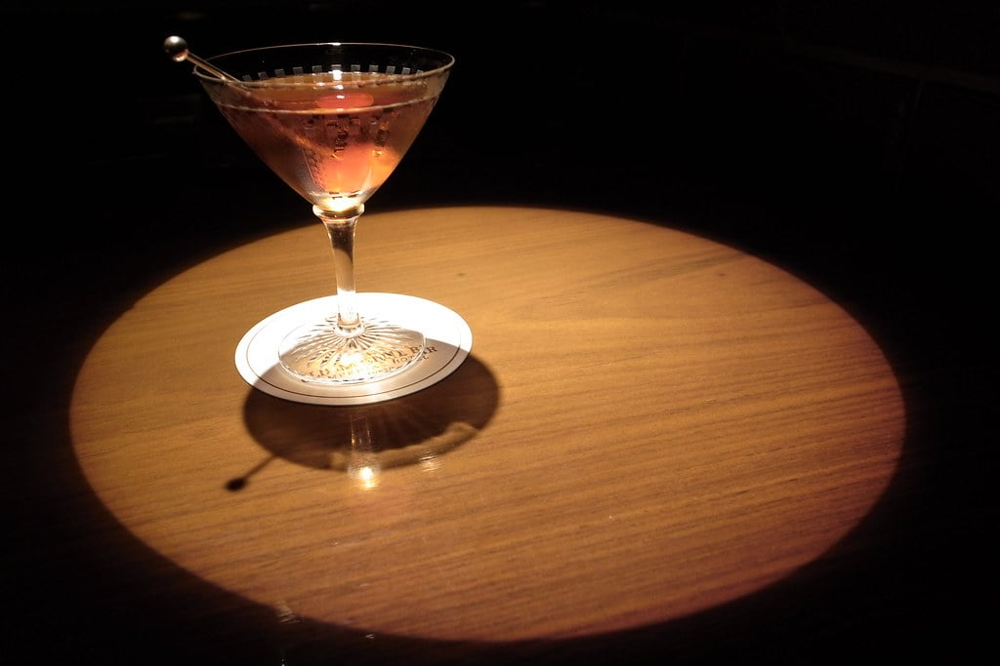

# Employees Only

Employees Only stands at 510 Hudson Street in the West Village, between Christopher Street and West 10th Street. It opened in 2004 and became one of the defining bars of New York's cocktail revival: the frontage borrows the look of a fortune-teller's shop, while the room behind it is a high-energy bar known for classic cocktails and food served late. The name means "staff only," but the bar welcomes everyone; the sign is a joke, not a door policy.

Image: A Manhattan in a coupe with a cherry on a pick. Credit: naotakem, CC BY 2.0, via Wikimedia Commons ([source page](https://www.flickr.com/photo.gne?id=6992048786)). This cocktail photograph illustrates the New York bar context; it is not an on-site photograph of Employees Only.

## Place and history

The bar opened in 2004. The 50's profile calls it a classic from the day it opened and credits it with redefining the speakeasy by injecting a raucous, lively character into the hidden bar rather than making secrecy exclusive. That reading explains why it held its place among New York's speakeasies: the concealment is a setup for the contrast inside, not a filter at the door.

Two decades later it is still on lists: No. 95 in The World's 50 Best Bars 2025 and No. 45 in North America's 50 Best Bars 2026; The 50 also notes a ten-year consecutive run on the world list. The frontage is usually described as a "Psychic" neon sign or a fortune teller in the front window. Time Out describes a fortune teller greeting patrons: the street gives you a reading parlour, and the bar begins behind it. It is decor and storytelling, not an actual fortune-telling service.

## The room and the list

The interior is Art Deco, with a curved bar and a busier front section leading to a dining area at the back. Bartenders wear white jackets and work high behind the bar, often free-pouring rather than measuring; the result is fast service and a sense that a performance is under way. This is not a room for quiet conversation; music, laughter and bar work happen at the same time.

The list is built on classics. The 50 says the team stirs hundreds of "signature martinis and Manhattans" every day; there is also the West Side, made with Meyer lemon-infused vodka, fresh lemon juice, mint and Perrier, a longer and fresher option. Spirit-forward drinkers can explore a rare whisky list. Food is not an afterthought: hand-cut steak tartare, spicy sausage cavatelli, burrata with roasted pears and a ribeye appear in The 50's profile, while Time Out mentions a free bowl of chicken soup for anyone who stays until closing; The 50 calls it the off-menu "Sober Up Soup."

The 50 lists an average of about $17 per cocktail; Time Out gives the bar the second of four price bands and an average main course of about $22. That is mid-to-upper in New York, but not out of reach.

## How to drink

On a first visit, order a Manhattan or a Martini to test the fundamentals; if you want something less fierce, the West Side is easier to drink, with citrus and mint. Sit at the back or at a table if you plan to eat, and near the bar if you want the pace of the room; both experiences exist in the same building, with different volume and duration.

You do not need to recite recipes. Tell the bartender the direction: drier, sweeter, more bitter, or "fresh and not too strong." The house is strongest on classics, not on elaborate experiments; at peak hours it is also the wrong moment to ask for a drink that needs ten minutes of garnish. The food portions are substantial, and the steak tartare is good for two; if you only want a drink, order one snack rather than the whole menu. The closing-time soup is an Easter egg, not a reason to force yourself to stay until 4am.

## Practical information

The address is 510 Hudson Street, New York, NY 10014, USA, in the West Village between Christopher Street and West 10th Street; the coordinates are 40.73343, -74.00615, taken from the official Location page's embedded Directions link. The 1 train stops at Christopher Street–Sheridan Square, about a 3-minute walk; the A, C, E, B, D, F and M trains stop at West 4th Street–Washington Square, about a 6–8 minute walk; NJ PATH also reaches Christopher Street, as the official location page sets out. Time Out lists daily hours of 18:00 to 04:00, unusually late for New York; the official site does not publish a full schedule, and holidays or private events change it, so confirm on official channels before travelling. `operating_status` is `verified`, meaning the official site and location page were live on 2026-11-08 with no closure or change-of-ownership notice; it does not mean every slot is available without waiting.

There is no cover charge; you pay for what you order. Table and bar rules shift by time of day: book a table in advance, while bar seats are usually first-come, with a queue at the door when full. The 50 gives an average cocktail price of about $17 before tax and tip; Time Out puts it in the second of four price bands and gives an average main course of about $22. There is no published hard dress code; smart casual works, but the queue outside can be cold late at night, so a jacket matters more than formality. Page verified 2026-11-08; opening status, prices and reservations are subject to official channels.

## Etiquette and common mistakes

First, this is not a quiet hidden bar. Its appeal includes noise: music, bar work and crowd volume are part of the experience, and anyone who wants a low conversation should take a table at the back or choose another venue. Second, the psychic frontage is a set. Do not knock and ask for a reading, and do not treat the fortune teller as the host.

Third, do not assume "Employees Only" means staff only; it is the name, not a membership rule. Fourth, the bar is for people ordering drinks, so do not hold a spot for a long photo session of the "secret" entrance. Fifth, dining and drinking follow different rules: book a table for the steak tartare or ribeye, but queue for a single drink. Finally, tip according to New York custom and check whether a large-party service charge is already on the bill; leave quietly at night, because the West Village is residential.

## Around and routes

A few minutes east are Christopher Park and the Stonewall Inn; further south is Washington Square Park; west leads to Hudson River Park, and about fifteen minutes north brings you to the High Line and the Meatpacking District. The 1 train and West 4th Street are both within walking distance. A workable route is an afternoon around Washington Square and Bleecker Street, an early dinner at Employees Only, then Stonewall or a stretch of the Hudson at night. To compare New York's old taverns with its new speakeasies, visit the White Horse Tavern by day and return here at night; they are about ten minutes apart on foot but feel like different centuries.

## See also

Employees Only is best read against the White Horse Tavern: one turned the 2000s classic-cocktail revival into a high-energy room, the other kept a twentieth-century literary tavern's memory at an old bar. To see another approach to the "hidden" bar, read McSorley's Old Ale House, which hides nothing yet creates a similar sense of ritual through an extremely narrow drinks list.

## See also

- [Pete's Tavern](ref:petes-tavern)
- [Old Fashioned](ref:old-fashioned)
- [Reading a city through its bars](ref:pub-and-city)

Further reading: [A Ginjinha](ref:c-extra-1), [À la Mort Subite](ref:c-extra-2).

Begin with the address, move on to the current opening status, and finish with what the place is known for. That order keeps the reading of Employees Only practical.

[Pete's Tavern](ref:petes-tavern) and [Reading a city through its bars](ref:pub-and-city) are the nearest useful comparisons: one clarifies address and space, the other tests operating status.

## Related images

