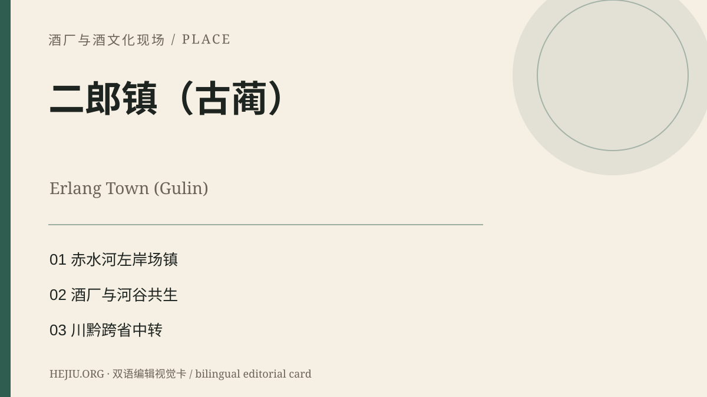

# Erlang Town (Gulin)

Erlang is often treated merely as “the town where Langjiu Estate sits”, but the town itself matters: the Chishui River separates Sichuan from Guizhou, factories and market streets climb the slopes, and transport and cross-province routes follow the water. There is no complete fake antique tourist street; lodging, meals and buses revolve around the plant and local life. Treating Erlang as a stop rather than an attraction makes planning easier: stay a night, eat a meal, understand the valley and plant, then decide whether to head to Xishui or back to Luzhou.

Figure: Erlang Town (Gulin) bilingual editorial card. Project-created bilingual editorial card for topic identification, not a documentary photograph.

> **Quick verdict**
> **Best for:** travellers on a Sichuan–Guizhou liquor route who need an overnight stop; pairs with Langjiu Estate, Xijiu and Tucheng.
> **Not for:** visitors expecting a complete old-town street of shops; Erlang is a liquor-industry market town, not a scenic area.
> **One line:** use it as a stop for sleep, food and the valley, and do not mistake the town for the estate.

## The town is not the estate

Erlang is an administrative and living market town; Langjiu Estate is the liquor-industry reception and visitor space within it. The town has schools, a clinic, a wet market, small restaurants and homes, plus plant dormitories, shuttles and freight; the estate has its own gates, booking and lodging system. Visitors often read “going to Erlang” as “going to Langjiu Estate”, then book a town room they cannot use for the estate, or buy an estate package with no time for the town. Confirm which side you sleep on, which gate you need and whether a shuttle is required, then fit town meals and walks into the gaps.

## The two banks of the Chishui

The Chishui cuts a narrow valley at Erlang. The Sichuan slope is steeper; the Guizhou side toward Xishui also has plants and market towns. Read three things: the height difference between river and road, how the plant is laid out up the slope, and where the cross-province bridge sits. Sauce-aroma production needs water, starter rooms, pits and storage; valley humidity and wind affect starter culture and grain stacking, but do not make “valley climate” the only explanation. In the evening, view the river and plant lights from permitted public roads; do not go down to the riverbed or into closed wharves. The river rises fast in the rainy season, so stay away from slopes and construction.

## Getting there and moving around

Erlang is usually approached from Luzhou, Xuyong or Xishui in Guizhou. Roads are winding, fog is common in rain, and self-driving needs buffer time; buses are sparse, so check live information before leaving. From Luzhou, enter the mountains in daylight rather than late at night; from Xishui, check whether the bridge and navigation require a detour. The town is walkable but sloping, and suitcases are awkward. Use Erlang as a stop: arrive in the afternoon, sleep one night, then enter the estate or cross to Xishui the next morning, which is far safer than a same-day return to Luzhou.

## Sleeping and eating

Town lodging is mostly local guesthouses and small hotels; estate lodging is a separate booking system. Peak weekends and plant reception days tighten supply, so confirm room type, hot water, parking and cancellation. For food, try Gulin spicy chicken, Chishui River fish, tofu pudding, cured meat and mountain vegetables; flavours are strong, so state your heat level. Small restaurants follow local hours, so do not look for dinner too late. Do not accept “internal channel” liquor by the road; use official or authorised shops. When carrying bottles, watch vibration and boot temperature, and never leave liquor in a sun-baked car in summer.

## Pairing with Xishui and Gulin

Erlang works best in a Sichuan–Guizhou loop of Gulin, Erlang, Xishui and Tucheng: Langjiu Estate and Gulin county town on the Sichuan side, then Xijiu and Tucheng after crossing into Guizhou, returning to Zunyi or Luzhou. Two days and one night is the minimum; three days is more comfortable. Check bridges, buses and navigation for the cross-province leg, and watch for closures in the rainy season. With only half a day, eat in town and view the valley and plant exterior; do not squeeze in the estate, Xijiu and Tucheng, because mountain roads reduce each stop to ten minutes.

## Treat Erlang as a pause on the mountain road

Do not rush to tick off sights. Drop your bags and walk the town: the wet market, school, plant shuttle and river access explain why the town grew around the factory. At dusk, view the valley from permitted public roads, not the riverbed; the next morning, enter the estate or cross the river. With only one meal, choose a local restaurant with controllable heat, ask about signature dishes and portions, and do not treat “influencer picks” as the only standard. When checking in, confirm early checkout, breakfast and taxi access for the next morning; these details shape a Sichuan–Guizhou liquor trip more than one extra photo. If crossing the river the next day, put ID, luggage and bus times together the night before; cash and pharmacies are limited in town, so stock water and basic medicine. Do not walk mountain roads at night, and stay away from construction slopes after rain. Leave large cases at the hotel and cross light. Ask the earliest bus for the next day on arrival; keep the lodging receipt until checkout and save the front desk number. Do not stand on road bends for photos, and ask at booking whether the estate shuttle reaches the town centre.

## Check before you go

- Confirm whether you sleep in town or at the estate
- Enter the mountains in daylight, not late at night
- Stay off riverbeds and slopes in the rainy season
- Ask about heat and opening hours before eating
- Check the bridge and buses before crossing the river
- Keep luggage light for the sloping streets
- Confirm hot water and parking when booking
- Do not go onto riverbeds or closed wharves

## Limits and next steps

Erlang town is more than Langjiu Estate. It sits in the Chishui valley, where the town, the old ferry, the old street and the distilleries together form a place that grew on wine and the salt route; seeing only the estate misses daily life. The walkable centre is small but steep, slippery after rain, so allow time with luggage.

Approaches from Gulin, Xishui or Maotai are winding mountain roads with limited buses and variable taxi prices. Without a car, arrange the return ride in advance and do not leave the trip until dark. Food is mostly small local restaurants, and capacity is tight on holidays.

This page does not present Erlang as a must-tick attraction. It works as a stop on a Chishui route with Xishui, Tucheng or Maotai; if time is short, confirm the estate booking first and then decide how long to stay in town.

## References

- gulin.gov.cn — official source — https://www.gulin.gov.cn/mlgl/zjgl/hzqhyrk (checked 2026-11-25)
- luzhou.gov.cn — official source — https://www.luzhou.gov.cn/ (checked 2026-11-25)
- langjiu.cn — official source — https://www.langjiu.cn/ (checked 2026-11-25)
- Official source — official source —  (checked 2026-11-25)

Related entries: [Langjiu Estate](ref:estate), [Gulin Langjiu route](ref:route), [Guizhou](ref:region), [China](ref:regioncn), [sauce-aroma baijiu](ref:style), [Langjiu](ref:brand), [First baijiu guide](ref:guide), [History of Chinese wine](ref:history).

## Related images

Image: Guizhou. Credit: Huangdan2060, CC BY 3.0, via Wikimedia Commons ([source page](https://commons.wikimedia.org/wiki/File:Huangguoshu_Waterfall_in_October_2020,_Picture12.jpg)). Related image for Erlang Town (Gulin).

The administrative division reference is the 2007 edition of GB/T 2260.
