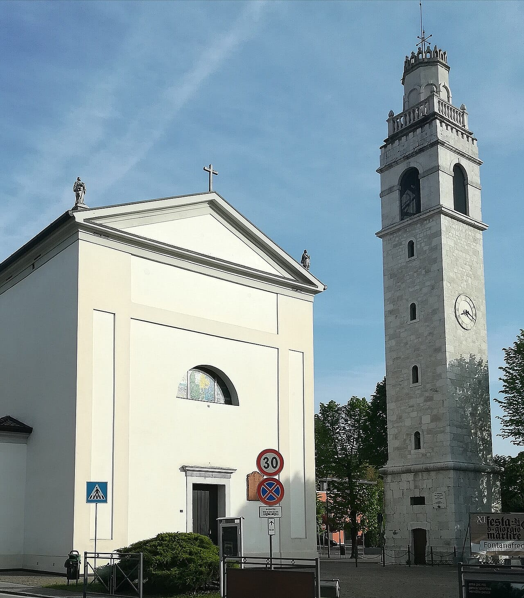

# Fontanafredda

Fontanafredda, in Serralunga d'Alba, is one of the few Barolo estates that can put a royal story, large-scale organic farming and a visitable village on the same itinerary. Its official account dates the beginning to 1858: the relationship between Vittorio Emanuele II, the first king of Italy, and Rosa Vercellana later became an agricultural and wine estate. Today the vineyards cover about 120 hectares, all certified organic, and cellar visits are handled through the "storytelling village", Villaggio Narrante.

Figure: Fontanafredda. Image: Marchetto da Trieste, CC BY-SA 4.0, via Wikimedia Commons ([source page](https://commons.wikimedia.org/wiki/File:Fontanafredda_-_chiesa_parrocchiale.jpg)).

## The king, Rosina and 1858

The estate's official history names 1858 as its founding year and the first king of Italy as its founder. The story appears repeatedly on the homepage: the king's relationship with Rosa Vercellana and the agricultural and wine business that followed, a more dramatic starting point than a tale of several generations of one family. History is history; quality still depends on sites and management. But the story explains why the buildings feel like a small domain rather than a single winery.

For a visitor, the important point is that this is not a royal-house museum but a working production and hospitality complex. Historic buildings, cellars, restaurants, accommodation and experience products are spread through the same village and can be linked on foot. Treating it as a destination rather than a passing stop suits its scale.

## The slopes of Serralunga d'Alba

Serralunga d'Alba lies in the eastern part of the Barolo zone, known for firmer, more tannic Barolo. The name refers to the long ridge, and the vineyards mostly face south or south-east, with wide variation in altitude and gradient. Fontanafredda's parcels lie in and around the village, on limestone and marl that drain quickly and force roots deep. These conditions ripen Nebbiolo slowly and preserve acidity.

The official site stresses 120 hectares of certified organic vineyard, a large area for the Barolo zone. Organic management at that scale is not easy: disease pressure, yield control and labour all have to be reorganised. On a visit you can see parcel markers and divisions, and understand how one village with different exposures produces different styles. Do not treat "Serralunga" as a single flavour; it is more a family of structural tendencies.

## From Nebbiolo to Barolo

[Nebbiolo](ref:nebbiolo) ripens late, carries high tannin and a garnet colour, and scents ranging from rose and red fruit to tar and liquorice. The Barolo [appellation](ref:appellation) requires pure Nebbiolo, at least three years' ageing with eighteen months in oak, and a minimum of five years before the word Riserva. Fontanafredda's range covers different villages and parcels, from entry-level Barolo to single vineyards and reserves, with wide differences in price and ageing potential.

[Oak](ref:oak) here is about structure rather than adding vanilla. Large casks preserve fruit and tannin framework; smaller barrels soften faster and add toast. The combination of size and toast level decides whether a wine is drinkable young. In the cellar, look at cask size, age and arrangement; that is more useful than memorising "French or Slavonian oak". The real test is whether this wine should be drunk now or given another five years.

## Villaggio Narrante: turning the cellar into a route

Villaggio Narrante is the estate's hospitality brand, literally a "storytelling village". It links historic buildings, vineyards, cellars, restaurants and accommodation into several experience routes: some cover only the historic cellar and a tasting, others add a vineyard walk or a food-and-wine pairing. The official visit page lists several products of different lengths and contents; when booking, check what is included, whether tasting is part of it, and whether children are welcome.

The village format has clear routes but risks becoming a theme park. To avoid crowds, take the first slot on a weekday morning; to study the cellar properly, choose a product that includes the historic cellar and the oak-ageing area rather than a short tasting-only visit. Do not touch cask racks, valves or pipes; floors in the fermentation area can be wet, so sturdy shoes are safer.

## The range and two comparisons

The first comparison is village level versus single vineyard. Village Barolo shows the general structure of Serralunga; a single vineyard magnifies one slope's character. Comparing the same vintage across levels teaches more about site than comparing different years. The second comparison is Barolo versus the estate's other Langhe reds. Fontanafredda also makes Barbera, Dolcetto and other wines that are drinkable earlier, useful reference points at the table.

If you have already visited [Gaja](ref:gaja), the contrast is sharper: Gaja is known for single vineyards and brand recognition, Fontanafredda for scale, historical narrative and village-style hospitality. Both sit inside the Barolo and Barbaresco system yet offer different models of a "famous estate". Do not use one to dismiss the other; first see where each puts its resources.

## Booking, arriving and season

The address is Via Alba 15, 12050 Serralunga d'Alba (CN), telephone +39 0173 626 111. Visits are booked through the Villaggio Narrante page, and the official contact page gives info@fontanafredda.it; check the booking page for current slots, lengths and prices. Alba is about fifteen minutes by car and Turin a little over an hour. Public transport reaches Alba, then a taxi or regional bus is needed; the estate sits on a slope, so walking in is not easy.

Spring and autumn are the most comfortable seasons; September and October bring harvest, when the cellars and vineyards are busiest, so book earlier. Winter is quiet and some experience products may be reduced; summer afternoons are hot and the vineyards offer little shade. Do not drink and drive; Langhe country roads are narrow, winding and poorly lit at night, so a designated driver or hired car is safer. Opening hours, bookings and prices are subject to official channels; this entry was verified on 2026-11-09, and coordinates should be confirmed through official channels.

**Short definition:** A Barolo estate in Serralunga d'Alba, founded in 1858 by Vittorio Emanuele II, the first king of Italy, with 120 hectares of certified organic vines and a "storytelling village"; cellar visits are booked through Villaggio Narrante.

Read Fontanafredda through the address, then the current opening status, and finally what the place is known for. The sequence matters.

The comparison with [Nebbiolo](ref:nebbiolo) and [Oak ageing](ref:oak) runs through address and space and operating status. Each answers a different question.

**Key facts.**

| Item | Detail |
| --- | --- |
| In one line | A Barolo estate in Serralunga d'Alba, founded in 1858 by Vittorio Emanuele II, the first king of Italy, with 120 hectares of certified organic vines and a "storytelling village"; cellar visits are booked through Villaggi… |
| Address | Via Alba 15, 12050 Serralunga d'Alba (CN), Italy |
| City and country | Serralunga d'Alba / Italy |
| Status | verified open |
| Official site | fontanafredda.it |

## References

- [Fontanafredda — contact page](https://www.fontanafredda.it/contatti/): Via Alba 15 address, telephone, visit entry and email.
- [Fontanafredda — English homepage](https://www.fontanafredda.it/en/): the 1858 founding, 120 hectares of organic vines and the estate's positioning.
- [Villaggio Narrante — cellar visits](https://www.villaggionarrante.it/cantine/visite-in-cantina/): visit products, historic cellar route and booking.
- [Barolo DOCG — Langhe consortium](https://www.langhevini.it/le-denominazioni-tutelate-dal-consorzio/barolo-docg/): 11 communes, ageing and Riserva rules.

Further reading: [Piedmont](ref:c-extra-1).

## Related images

Image: Piedmont vineyard in autumn. Credit: Giorgio Montersino, CC BY-SA 2.0, via Wikimedia Commons.. Credit: Giorgio Montersino, CC BY-SA 2.0, via Wikimedia Commons ([source page](https://commons.wikimedia.org/w/index.php?curid=5816942)). Related image for Fontanafredda.
