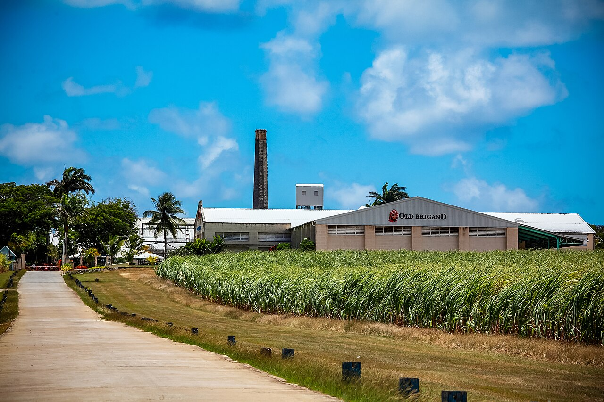

# Foursquare Rum Distillery

Foursquare Rum Distillery stands at Four Roads in Saint Philip, south-east Barbados, on the site of an old sugar factory and estate. Its visitor logic is the opposite of Mount Gay's: there is no compulsory guided tour and no choreographed brand pilgrimage. On weekdays you simply walk in, follow painted footprints and panels around the works, and end in the tasting room. The distillery is run by the R.L. Seale family, restarted in 1996 on the old sugar-factory site, and is known for pot and twin-column distillation, tropical ageing and a "no added sugar or colour" stance.

Figure: Foursquare Rum Distillery. Image: Unknown author Unknown author, CC BY 2.5, via Wikimedia Commons ([source page](https://commons.wikimedia.org/wiki/File:Foursquare_Rum_Distillery.jpg)).

## Four Roads: An Old Sugar Factory Still at Work

The address is Foursquare Rum Distillery, Four Roads, Saint Philip, Barbados, in the south-east of the island, some distance from Bridgetown and the south-coast resorts. The official visiting note is blunt: the easiest way to arrive is by taxi, about 13 km and 20 minutes from the Oistins area. Budget travellers can take a bus to Six Roads and walk about 1.6 km to Four Roads, but the country roads are narrow and the sun is strong, so this is not a walk for dusk or rain.

This page fixes no coordinates; use official channels for the exact location. The distillery is open on weekdays but closed at weekends and on bank holidays. It is not an all-day attraction, and lunch breaks or production schedules can affect which areas are accessible, so check the official visiting page before setting out; if you only want to buy rum, the tasting room and shop are more flexible than the production floor.

## The 1996 Restart and the Seale Family

Sugar was made on this site from 1636 until 1984. In 1996 the R.L. Seale family built today's distillery in the old sugar factory. The family's rum-trading history goes back to 1820, and Richard Seale is the fourth generation in the business; in 1993 the company bought Alleyne Arthur's, owner of Doorly's, Old Brigand and other brands, which laid the base for today's range. 1996 is therefore not the year a brand was invented but the year a merchant's experience was anchored in a new distillery.

That history explains why Foursquare feels both industrial and familial: it keeps the old sugar-factory buildings and machinery, and it keeps a merchant's judgment about liquid, pricing and export. The old equipment and panels are not scenery but part of the site's history. Link 1636, 1984 and 1996 in your head, and the space makes more sense than the single line "founded in 1996".

## Pot and Twin Columns: Blending Two Bodies

The still house contains a copper double-retort [pot still](ref:pot-still) and a continuous twin-column still. Pot distillation keeps more esters and a heavier body; column distillation gives a cleaner, lighter spirit; the distillery blends the two into different products rather than treating one as automatically superior. "Single blended rum" here means a blend of pot and column rums from the same distillery, not a mixture of liquids from different countries.

[molasses](ref:molasses) is the main raw material. It is fermented, [distilled](ref:distillation) and then aged in oak. The panels break fermentation, distillation and ageing into separate stops, which suits a self-guided visit but leaves you without a guide to explain the pot-versus-column difference. Read the basics of [pot stills](ref:pot-still) and distillation beforehand and the site becomes much easier to read.

## The Angels' Share in a Tropical Warehouse

Foursquare distils and ages in Barbados, in tropical warehouses without temperature control. Heat accelerates the exchange between spirit and oak, humidity keeps evaporation going, and the liquid lost each year is the angels' share. Tropical ageing gives deeper colour and fuller vanilla, caramel and dried-fruit notes in a relatively short time, and makes older stock scarcer and more expensive.

Blending after ageing is the house's core skill. The brand often describes itself as "no additives": no added sugar, no colour, no spices used to hide faults. That is a producer's position and a market identity, not a rule that every Barbados rum must follow. Understand [oak ageing](ref:oak-ageing) and [blending](ref:blend), then taste Doorly's and the Exceptional Cask Series, and the difference between "clean" and "thin" becomes easier to judge.

## The Range and the "No Additives" Argument

The range falls into several lines. Doorly's is the broadest, from white rum through 3, 5, 8 and 12 years to XO. R.L. Seale appears at higher ages and strengths. Old Brigand is more everyday. Foursquare Exceptional Cask Series is bottled in batches, often finished in sherry, madeira or bourbon casks at strengths above the standard bottlings. Recipes and vintages change, so read the back label rather than trusting a series name.

"No additives" is the most debated part of the house identity. Supporters say it makes rum as transparent as whisky; critics say it turns "purity" into a marketing label. The steadier view is that added sugar and colour affect taste and appearance and should be declared, but "no additives" does not automatically mean better, and not every traditional rum relies on additions. Put the category rules, raw materials and ageing claims of [rum](ref:rum) side by side and the argument becomes clearer.

## Open-House Visiting and the Tasting Room

Foursquare operates an open-house policy. No booking is needed and there is no fixed guided tour: enter during weekday business hours, follow the site, and finish in the tasting room. The official note says plainly that there are no organised tours but that there is a tasting room. For travellers used to reservations this means freedom and responsibility: do not cross production barriers, touch equipment or take photographs that interfere with work.

The tasting room usually offers single pours and flights, with the list and prices set on site; the shop sells some distillery-only or older bottlings. Non-drinkers can ask for a soft drink or simply visit the shop. This is not an accessible theme park: some ground is uneven and the production area is noisy and aromatic, so closed shoes are safer than sandals.

## Practical Notes and Route Connections

Foursquare combines well with the Mount Gay visitor centre on the south coast and St Nicholas Abbey on the east coast, but it is far from Mount Gay's northern distillery and should not be forced into the same day. The easiest plan is to leave the south coast in the morning, reach Four Roads around midday, tour and taste in the afternoon, and return before evening, with a car and driver throughout. It opens only Monday to Friday, unlike the Mount Gay visitor centre.

Set Foursquare beside [Mount Gay Distillery](ref:mount-gay-distillery) and two Barbados paths appear: one tells continuity through an old estate and double distillation, the other tells modernity through a converted sugar factory, open-house visiting and transparency. Both belong to the [Barbados](ref:barbados) region, but the visits, styles and price bands differ. There is no need to choose sides; walk both, then compare in the glass.

For Foursquare Rum Distillery, begin with the address. Then look at the current opening status, and finally ask what the place is known for. The answers point to different choices, not to a single score.