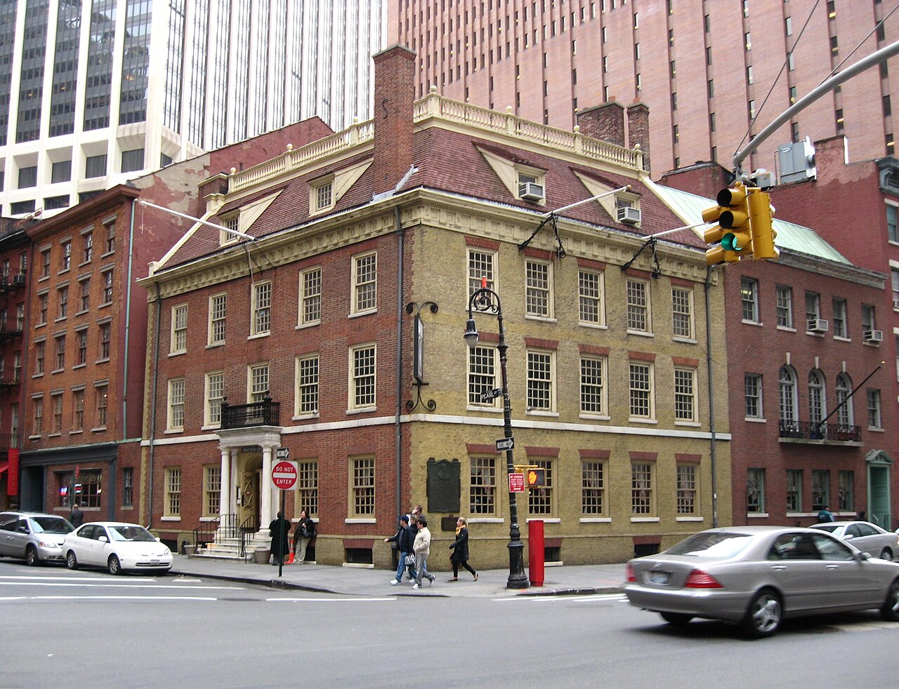

# Fraunces Tavern

Among the towers of Lower Manhattan's financial district, 54 Pearl Street is a brick building that makes pedestrians slow down. It was built in 1719 as a merchant's house, converted into a tavern in 1762, and on 4 December 1783 George Washington said farewell to his officers in its upstairs Long Room. Today the building carries two identities at once: a restaurant and bar that runs late on the lower floors, and a museum that requires a ticket upstairs. Knowing which floor you are on is the starting point for understanding the place.

Figure: Fraunces Tavern. Image: Jim.henderson, Public domain, via Wikimedia Commons ([source page](https://commons.wikimedia.org/wiki/File:Frauncestavern.JPG)).

## Place and history

The building was constructed in 1719 for the merchant Stephen Delancey as a substantial private residence. In 1762 Samuel Fraunces bought it and turned it into a tavern, which soon became one of the centres of Patriot activity in New York. Before the War of Independence, the New York Sons of Liberty met here; during the British occupation, Fraunces helped Patriots held on prison ships in the harbour while passing intelligence to the Continental Army. These details make "historic tavern" more than a decorative label: the building was a concrete political space.

1783 is the year most often told. On 25 November, after the last British troops left New York, Washington took part in the Evacuation Day celebration at the tavern. On 4 December he bade an emotional farewell to his officers in the Long Room upstairs. The main eyewitness account comes from Benjamin Tallmadge's memoir, which the museum displays as an important object. From 1785 to 1788, while New York was the national capital, the building also served as one of the first executive offices of the federal government, housing the departments of Foreign Affairs and War and the Board of the Treasury. In other words, this was simultaneously a tavern, a political club and a temporary government office, not simply a place to eat and drink.

In 1907, after a landmark restoration, Fraunces Tavern Museum was established. The museum today occupies a complex of five interconnected historic buildings and holds about eight thousand objects, including furniture, documents, personal items and art. It is a New York City landmark and is listed on the National Register of Historic Places. Keeping "built in 1719", "became a tavern in 1762" and "became a museum in 1907" as three separate timelines prevents the whole building from being described as an untouched colonial survival.

## The building and its rooms

From Pearl Street, the facade is Georgian brick, much lower than the surrounding office buildings, with an entrance that is not in the centre. The museum's main entrance is on the second floor at 54 Pearl Street and involves stairs or a lift; the accessible entrance is at 24/26 Water Street, but the museum warns that the lift is subject to intermittent outages, so a phone call before travelling is wise. The ground-floor restaurant and bar have their own entrance and telephone number and are run separately from the museum.

The Long Room is the most important historic space, upstairs. In 1776 the New York Provincial Congress banqueted Washington and his officers here, and the 1783 farewell took place in the same room. Today it is a museum gallery, not a private dining room you can simply sit down in. The other galleries are spread through the connected buildings and cover the Revolutionary War, the occupation and evacuation of New York, the early republic and the restoration of the building itself. The museum also interprets the Birch Trials and the Book of Negroes, a reminder that the "freedom" commemorated in this building was not extended to everyone in the same way.

The ground-floor restaurant preserves the old walls and timber beams, but its tables, bar and lighting belong to a modern hospitality business. It is not an immersive eighteenth-century tavern throughout the building; it is a historic shell with contemporary service. Visitors interested in architecture can look at the stairs, brickwork and low ceilings; visitors who only want dinner are not required to see the exhibition first.

## What to eat and drink

The restaurant follows an American tavern menu: raw oysters, New England clam chowder, crab cakes, Scotch eggs, a signature burger, steak, fish and chips and chicken pot pie, with weekend brunch and full dinner service. The drinks programme leans on beer, whiskey and cocktails, and there is a dedicated whiskey bar. Dish names, prices and service periods change, so check the official menu before ordering.

The seating rules are worth knowing in advance. The Independence Bar, Lafayette's Hideout and the Dingle Whiskey Bar are walk-in only, first come, first served. The Tallmadge Room, the Bissell Room and the Piano Bar Upstairs can be reserved. In practice, book if you want a full meal, and try your luck at the door if you only want a drink. Weekend brunch and holidays produce obvious queues, so do not schedule the museum too tightly around a meal.

There is no food or drink service inside the museum, and galleries do not allow food or beverages other than a sealed water bottle. Do not carry a restaurant glass upstairs, and do not eat or drink in the Long Room. If you only want the experience of drinking inside a historic building, the ground-floor bar is enough; if you want the exhibition, buy a separate museum ticket.

## Practical information

The address is 54 Pearl Street, New York, NY 10004, near the corner of Pearl and Broad Streets and within walking distance of South Street Seaport and Battery Park. The R/W to Whitehall Street–South Ferry, the 4/5 to Bowling Green, the 1 to South Ferry and the J/Z to Broad Street all serve the area; buses M20, M55 and M15 also stop nearby. Driving is impractical: parking in the financial district is expensive and scarce.

The museum is open daily from 12:00 to 17:00. Admission is $10 for adults, $5 for seniors aged 65 and over, students with valid ID and children aged 6–17, and free for children aged 5 and under and for active US military personnel and veterans with ID; disabled visitors and one attendant pay $5. Tickets are sold only at the second-floor front desk, with no advance sales; large groups should contact the museum beforehand. Public tours run on Fridays at 13:00, Saturdays at 12:00 and 15:00 and Sundays at 14:00, free with admission but subject to last-minute cancellation. Restaurant hours differ from museum hours and usually run late; check the restaurant website and booking page.

Allow 1–1.5 hours for the museum, or up to two hours if you read the panels and spend time in the Long Room; add 1–1.5 hours for lunch or dinner. Large bags can be left in the gift shop, but there are no lockers and valuables are left at your own risk. Personal non-commercial photography is allowed; flash, tripods and selfie sticks are prohibited, and commercial shoots require prior permission. This page was verified on 2026-11-08; hours, admission and menus are subject to official confirmation.

## Conduct and misunderstandings

The most common mistake is to treat Fraunces Tavern as a single historic stage set where the whole building is a bar. The museum and restaurant are separate operations with different hours, tickets and booking rules; the Long Room is a gallery, not a private dining room. The second mistake is to imagine the 1783 farewell as a banquet that can be reconstructed exactly: we know the date, the room and a few eyewitness recollections, but not a complete menu, seating plan or transcript. The third is to romanticise the American Revolution; the building also witnessed British occupation, the evacuation of Black Loyalists and the slavery question, and the exhibition does not avoid that complexity.

Do not touch objects, cross barriers or eat and drink in the galleries; children aged 12 and under must be accompanied by an adult. Large backpacks should be worn on the front or carried by hand; weapons, sharp objects and pets (other than service animals) are not allowed. In the restaurant, tip according to US custom, and remember that New York City tax is added to the bill; if you cancel a reservation, follow the restaurant's policy. If a commemorative event or re-enactment is taking place in the Long Room, keep quiet and do not walk through the performance area.

## See also

Fraunces Tavern is an American example of the [history of taverns](ref:taverns): a colonial tavern could serve as inn, courthouse, polling station and meeting house at once. Placing it in the wider story of [pubs and the city](ref:pub-and-city) shows how a historic building is reorganised into a museum and a restaurant. Its setting in the [United States](ref:usa) also connects it to a longer urban history of ports, immigration and finance; if you care mainly about what is in the glass, start with [beer](ref:beer) and then return to the building to see how drinking became public life.

Further reading: [A Ginjinha](ref:c-extra-1).
