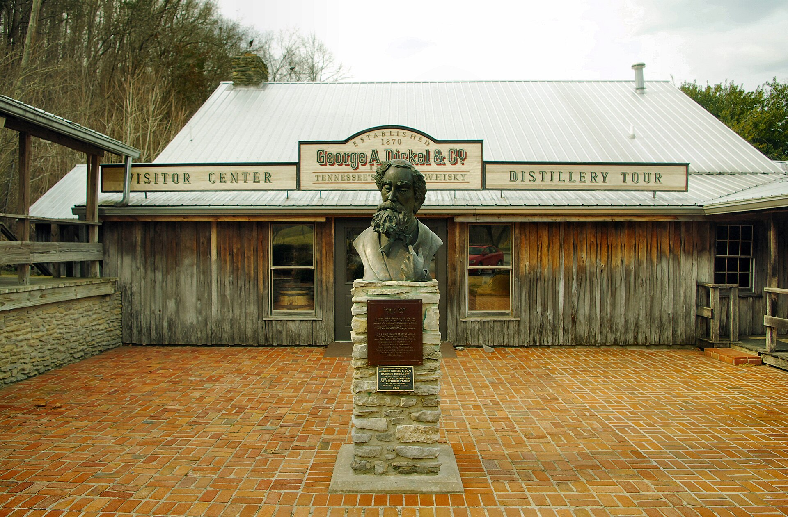

# George Dickel Distillery

George Dickel sits at Cascade Hollow near Tullahoma, Tennessee, tucked into a valley about half an hour to forty minutes from Jack Daniel's in Lynchburg. It is quieter than its neighbour and receives far fewer visitors, but the two make the same kind of spirit: a corn-led [Tennessee whiskey](ref:tnwhiskey), filtered through sugar-maple charcoal and made in Tennessee. If you have only seen Jack Daniel's, this is the other half of the same regional story.

Figure: Related photograph of George Dickel Distillery. Image: Brian Stansberry (photographer), CC BY 3.0, via Wikimedia Commons ([source page](https://commons.wikimedia.org/wiki/File:George-dickel-distillery-visitor-center-statue-tn1.jpg)).

## The other Tennessee distillery in the valley

Cascade Hollow takes its name from the falls and spring in the valley, and the site is surrounded by woodland rather than rows of commercial buildings. The distillery describes the property as about 600 acres, though the visitor route is compact: visitor centre, production rooms, barrel houses and tasting room are close together. Spring water runs down the slope into the site. Because the scale is small, the tour feels like walking through a working workshop rather than crossing a theme park.

It is about an hour from Nashville, an hour and twenty minutes from Chattanooga and half an hour to forty minutes from Lynchburg. The last stretch is country road, mobile signal can be patchy and navigation occasionally sends cars down the wrong fork; follow the signs near the end or save the route offline. No public transport reaches the distillery, so a rental car is the only realistic option, and the return should be arranged in advance.

## 1870 and 1878: the brand and the site

George A. Dickel was a German-born Nashville merchant who entered the whiskey business on his own account in 1870; the Cascade Hollow distillery began producing in 1878, and he bought a substantial share. The distillery closed during Prohibition, was rebuilt in the mid-twentieth century, and the brand and site have had a tangled history since. Today it sits under Diageo, operating as Cascade Hollow Distilling Co.

That history explains a label detail: 1870 is the brand's starting point, while 1878 is when this site began making whiskey. Unlike Jack Daniel's, Dickel long occupied the position of the smaller, slower, cheaper alternative, and only in the last two decades has it been taken more seriously. Its whiskeys have never had a large advertising budget; they spread by word of mouth, which is why the tour is plain, the shop is small and the staff have time for process questions.

## Chill filtration, maple charcoal and whisky without an "e"

Dickel's traditional claim is that its whiskey is "chill-charged": the new make is chilled before it passes through sugar-maple charcoal, then filled into new charred oak. Compared with room-temperature charcoal filtration, the cold liquid is thicker and flows more slowly, which the distillery says removes roughness more gently. The difference is not mystical, but it shows up most clearly in a side-by-side tasting.

The other detail is the spelling: Dickel writes whisky without an "e", following the Scottish convention, while most American producers write whiskey. The brand links this to its founder's preference and to a period when American spelling was not yet standardised. Read [distillation](ref:distillation) alongside [oak ageing](ref:oak) and the charcoal step takes its proper place: fermentation, cut points and cask do most of the work on aroma.

## The visit: what one hour shows and what it does not

The official page says the distillery is open Thursday to Tuesday and closed on Wednesday; Monday, Tuesday, Thursday, Friday and Saturday run 9:30 to 16:00, and Sunday 11:30 to 16:00. Tours last about an hour; reservations are encouraged, self-guided tastings are first come, and only visitors 21+ with ID may sample. Production runs Monday to Friday, so weekend tours still depart but will probably not show active distillation.

The guide explains the grain bill and why charcoal filtration precedes the barrel. About 25% of the tour takes place outdoors, hot in summer and cold in winter. There are stairs, so ask ahead if mobility is limited. Children may join with a "Minor" ticket; pets are not allowed in the visitor centre or distillery, apart from service animals. The distillery cannot legally ship bottles bought on site, so plan for luggage and state rules.

## The range: from No. 8 to single barrel

No. 8 is the entry point, light and sweet, good over ice or in a highball; No. 12 is fuller, with clearer spice and oak; Barrel Select is a single-cask selection and varies most; Bottled in Bond follows the federal bonded rules on strength and age; the 15-year-old Single Barrel and the Rye serve narrower audiences. The house style is drier and more grain-and-spice driven than Jack Daniel's, with less obvious charcoal.

For a first visit, the most useful comparison is No. 8 against No. 12: one distillery, similar mash, different age and blending. Then try a Barrel Select to see how much single casks differ. Do not order by age alone; older changes complexity and texture, not necessarily your enjoyment.

## Arriving, opening and reminders

The address is 1950 Cascade Hollow Rd, Tullahoma, TN 37388, USA. Coordinates should come from official channels; navigation to the address works, but the last few miles are unlit country road, so avoid planning the drive after dark. The visitor centre number is 931-408-2410, and a call before setting out can confirm the day's opening and tour availability; bad weather can delay or alter tours.

Food options nearby are limited, with a few restaurants in Tullahoma and more choice in Lynchburg. If you pair this with [Jack Daniel's](ref:jackdaniels) on the same day, do the larger distillery in the morning and Dickel in the afternoon for a calmer pace. Read the background on [Tennessee](ref:tennessee) and the wider [United States](ref:usa) before deciding whether to continue into Kentucky.

**At a glance:** A Tennessee whiskey distillery at Cascade Hollow near Tullahoma, Tennessee, with a brand traced to George A. Dickel's business in 1870 and a distillery that began producing in 1878; it is known for chilled sugar-maple charcoal filtration, whisky without the "e", and No. 8 and No. 12. 

Start with the address. From there, consider the current opening status, then what the place is known for. That is how a practical judgment about George Dickel Distillery is built.

Start with [Jack Daniel's Distillery](ref:jackdaniels) for address and space, then read [United States](ref:usa) for operating status. Seeing both keeps George Dickel Distillery from being confused with a neighbouring idea.

**Key facts.**

| Item | Detail |
| --- | --- |
| In one line | A Tennessee whiskey distillery at Cascade Hollow near Tullahoma, Tennessee, with a brand traced to George A. Dickel's business in 1870 and a distillery that began producing in 1878; it is known for chilled sugar-maple ch… |
| Address | 1950 Cascade Hollow Rd, Tullahoma, TN 37388, USA |
| City and country | Tullahoma / United States |
| Status | verified open |
| Official site | georgedickel.com |

**Sources and limits.** The key claims about George Dickel Distillery are checked against the following sources: George Dickel (Used to check the brand name, Cascade Hollow Distilling Co. and the core whiskey range), Tennessee Whiskey Trail, UNESCO (the entry's background, terminology and regulatory context). For current products, addresses or opening status, use georgedickel.com. Prices, batches and status change; the body is project-written and does not reproduce source text.

## Related images

Image: Jack Daniel's Distillery. Credit: Ben Jacobson ( Kranar Drogin ), CC BY 2.5, via Wikimedia Commons ([source page](https://commons.wikimedia.org/wiki/File:Jack_Daniel_Distillery_Lynchburg_TN_001.JPG)). Related image for George Dickel Distillery.
