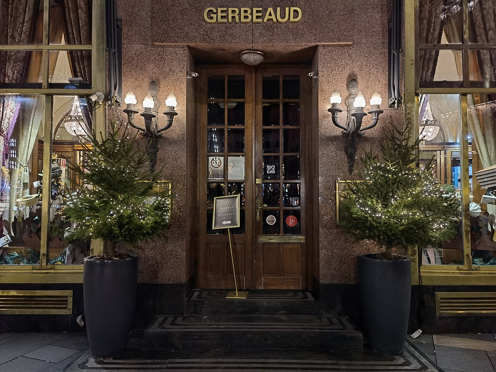
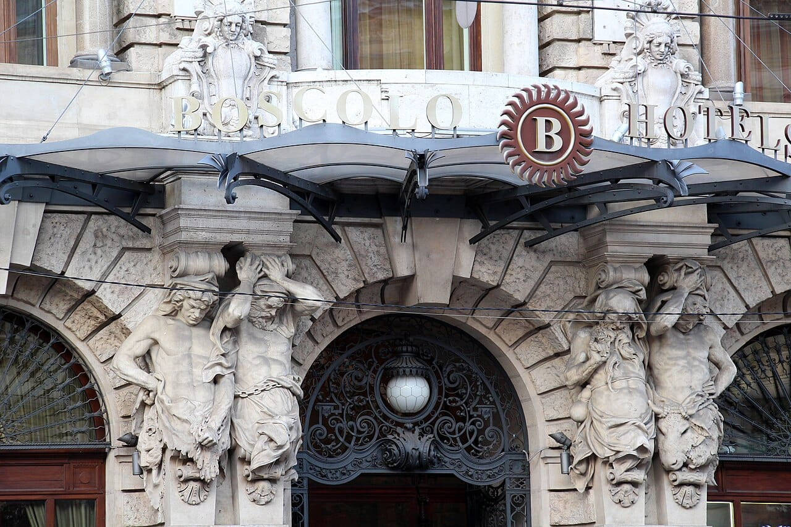

# Gerbeaud

On the north-west corner of Vörösmarty tér, Gerbeaud’s dark awning, gold lettering, and row of seats facing the square are almost a synonym for Budapest afternoon tea. In summer the terrace is full; in winter the windows fill with Christmas decorations. Inside, chandeliers, mirrors, marble counters, and a pastry display divide the space into a retail front and a café/restaurant rear. It does not overwhelm with a dome like New York Café; it uses the scale of an old patisserie to keep guests between cake and coffee.

Figure: The Gerbeaud facade on Vörösmarty tér 7–8, with its Christmas tree. Image: Random photos 1989, CC0, via Wikimedia Commons ([source page](https://commons.wikimedia.org/wiki/File:Budapest,_V%C3%B6r%C3%B6smarty_t%C3%A9r_7-8,_Gerbeaud-h%C3%A1z,_kar%C3%A1csonyfa,_1.jpg)).

## Location and history

Gerbeaud begins in 1858, when Henrik Kugler opened a confectionery on József nádor Square, selling chocolate, sweets, and pastries. In 1870, Kugler moved the shop to the present Vörösmarty tér site. In the 1880s, he invited the Swiss-trained confectioner Émile Gerbeaud to join him, and Gerbeaud eventually took over. The official English history page and the Catering chronology arrange the takeover as 1882/1884/1885; the safe formulation is “in the early-to-mid 1880s, Émile Gerbeaud became the principal, and the shop gradually took his name.”

Émile Gerbeaud turned a confectionery into a Budapest society drawing room. He brought French pastry technique and built the layered chestnut, chocolate, vanilla, and jam style that became the Gerbeaud house style; today’s Dobos torte, Esterházy torte, and seasonal Gerbeaud cakes belong to that line. Émile died on 8 November 1919, and his wife Esther Ramseyer ran the business until 1940. After nationalisation in 1948, the name became Vörösmarty; in 1984 the Gerbeaud name was restored. In 1995, the German businessman Erwin Müller bought the four-storey building; in 2004, Gerbeaud Gastronomy took over the operation. Today Gerbeaud is a historic brand under modern restaurant management, with the pastry counter and restaurant sharing the building.

## Architecture and space

The interior mixes turn-of-the-century café with French patisserie: high ceilings, chandeliers, mirrors, white and cream walls, dark wood, red and green velvet seating, and small marble tables. The front is the pastry counter and retail area, where cakes, chocolates, sweets, and gift boxes are arranged behind glass. The rear is café seating and restaurant tables; window seats face Vörösmarty tér and the Ferris wheel. The summer terrace is the most desirable; in winter, sit inside by the window and watch the Christmas lights and pedestrians.

The room is not large, the tables are close, and waiters carry coffee and cakes through narrow aisles. It works for afternoon tea, breakfast, a light lunch, or dinner, but not for opening a laptop. For photos, the pastry counter and chandeliers are the main subjects; do not photograph other guests or put a phone inside the glass. Terrace seating is usually host-controlled; inside, you can walk in and look for a table, but at peak times queue at the door.

## The drinks

Gerbeaud’s signature is pastry rather than a single cake. Dobos torte is the Hungarian classic: layers of sponge, chocolate cream, and a caramel-glazed top, cut with force and eaten with unsweetened cream or coffee. Esterházy torte is milder, built on walnut or almond layers and vanilla cream. The house cakes often combine chestnut, apricot, chocolate, and vanilla, with names changing by season; the counter labels are the most reliable guide.

For coffee, order a Wiener Melange, black coffee, hot chocolate, or tea. A high-sweetness Dobos works with black coffee or a tart fruit tea; Esterházy suits a Melange or latte. The drinks list covers Hungarian wine, Tokaji, champagne, and a few cocktails; in the afternoon, a Tokaji with cake works, while in the evening wine or a cocktail accompanies a meal. Prices are upper-mid-range for Budapest, with cakes and coffee as the main spend.

## How to drink

The best times are 09:00–11:00 or 15:00–17:00. In the morning the pastry counter is freshly stocked and window seats are easier; in the afternoon the terrace and interior fill. Because Gerbeaud does not take reservations, arrive early or avoid weekend afternoons. If you only want pastry, go straight to the retail counter; for cake and coffee at a table, wait for the host. The terrace is best in summer evening light; the interior is best in winter.

Look at the counter first, then tell the waiter the name; Dobos and Esterházy can be shared, while house cakes are usually one per person. Hot water for tea may be refilled, but coffee refills are not free. Service is usually included; a small tip is appropriate. If you order a full meal, ask whether dessert is included to avoid ordering twice.

## Practical information

- Address: Vörösmarty tér 7-8, 1051 Budapest.
- Hours: Monday–Thursday and Sunday 09:00–20:00; Friday–Saturday 09:00–21:00 (official Contact; holidays may differ).
- Transport: M1 Vörösmarty tér is at the square; trams 2 and 2B stop nearby.
- Reservations: not accepted; queue on site. Groups should split or come off-peak.
- Prices: cakes and coffee are upper-mid-range; full meals, afternoon tea, and wine are higher.
- Dress: smart casual; no strict dress code, though evening and holiday guests may dress up.
- Accessibility: a threshold at the main entrance and narrow aisles; call ahead about wheelchair access.

## Etiquette and common misconceptions

First, do not treat Gerbeaud as only a café; it is also a pastry shop and restaurant, and the retail front and rear dining area have different rules. Second, do not confuse Dobos with Sacher; Dobos is the Hungarian caramel-top cake, Sacher the chocolate-apricot cake. Third, do not assume the name has been Gerbeaud since 1858; 1858 is Kugler’s confectionery, and the Gerbeaud name settled in the 1880s. Fourth, do not use “the 1948 nationalisation” to explain today’s ownership; 1995 and 2004 are two further changes. Fifth, do not hold a terrace table for a photo session without ordering; at peak times the staff will ask you to order. Sixth, do not handle the cakes in the display; use the tongs or ask the staff.

## Nearby and routes

Step out of Gerbeaud and you are on Vörösmarty tér with the Budapest Eye; north are St. Stephen’s Basilica and Zrínyi utca; east are the Chain Bridge and the Hungarian Academy of Sciences. A good sequence is: breakfast or afternoon tea at Gerbeaud, Vörösmarty tér, St. Stephen’s Basilica, the Chain Bridge, and New York Café in the evening. For a Budapest pastry route, start at Gerbeaud for Dobos and Esterházy, then [New York Café](ref:newyork) for the ceiling and gold cappuccino; Vienna’s [Café Sacher](ref:sacher) and [Demel](ref:demel) place the Sachertorte rivalry in a wider context. For the Vienna café route, read [Café Central](ref:central) and the [Vienna coffee-house evening route](ref:vienna-route).

## Further reading and see also

- Gerbeaud official home: <https://gerbeaud.hu/en/>, for the address and current café/restaurant positioning.
- Gerbeaud history page: <https://gerbeaud.hu/en/gerbeaud-history/>, for 1858/1870/1880s/1919/1948/1984.
- Gerbeaud Contact: <https://gerbeaud.hu/en/contact/>, for hours and the no-reservation policy.
- Gerbeaud Catering history: <https://www.gerbeaudcatering.hu/our_history>, for Erwin Müller in 1995 and Gerbeaud Gastronomy in 2004.
- The nearby `place:new-york-cafe` is the “dome and gold” other pole; `place:cafe-sacher` and `place:demel` are Vienna’s two Sachertorte narratives.
- Related entries: [New York Café](ref:newyork), [Café Sacher](ref:sacher), [Demel](ref:demel), [Café Central](ref:central), [Vienna coffee-house evening route](ref:vienna-route)

Start with the address. From there, consider the current opening status, then what the place is known for. That is how a practical judgment about Gerbeaud is built.

[New York Café](ref:newyork) and [Demel](ref:demel) are the nearest useful comparisons: one clarifies address and space, the other tests operating status.

## Related images

Image: The gilded main hall and ceiling of New York Café. Credit: Fred Romero from Paris, France, CC BY 2.0, via Wikimedia Commons ([source page](https://commons.wikimedia.org/wiki/File:Budapest_-_New_York-palota_(37595301645).jpg)). Related image for Gerbeaud.
