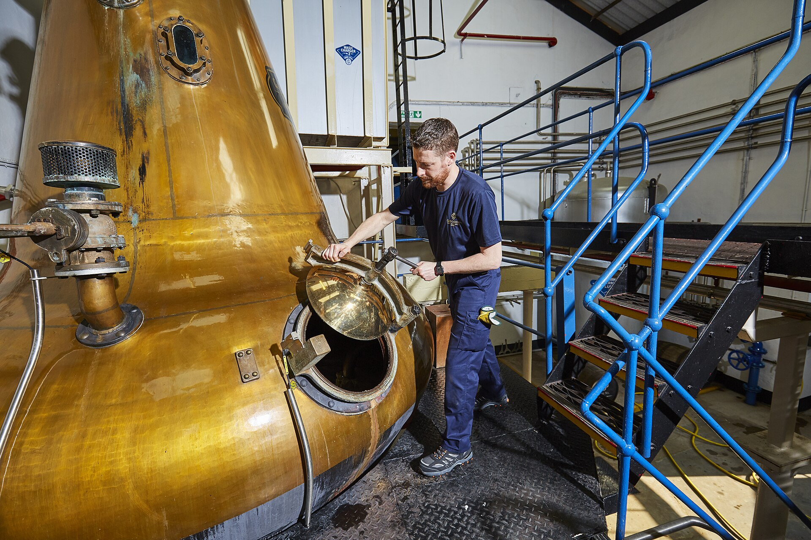

# Glen Scotia Distillery

Glen Scotia stands at 12 High Street in Campbeltown, with the town's main street at its door, the harbour a few minutes south and Longrow to the north. Stone walls, narrow doors, low warehouses and working equipment sit close together, and the visit feels like entering a distillery that has been part of the town for more than a century. The site was founded as Scotia in 1832 and now belongs to Loch Lomond Group. It is one of only three distilleries still operating in Campbeltown.

Figure: Related photograph of Glen Scotia Distillery. Image: Abbieclements, CC BY-SA 4.0, via Wikimedia Commons ([source page](https://commons.wikimedia.org/wiki/File:Glen_Scotia_Still.jpg)).

## A Victorian distillery on the town's main street

Campbeltown was known in the Victorian era as the whisky capital of the world, with ships crowding the harbour for casks. Glen Scotia keeps that scale: not a large modern plant, but a group of stone buildings arranged around a courtyard. The official page notes that the distillery is rich in original features and equipment, meaning that much of what visitors see was not rebuilt for tourism but is still used for production. For a visitor, this working old building explains both why Campbeltown prospered and why it declined. Tours gather at the visitor centre and cross the courtyard into production; the route has steps and narrow passages, so visitors with limited mobility should say so in advance.

## Ups and downs since 1832

Glen Scotia was founded as Scotia in 1832 and changed hands many times. Demand fell in the early 20th century, and the distillery was silent between 1928 and 1933 before being acquired by Block Brothers. The word Glen was added to the name in 1939. It later passed through companies including Hiram Walker, and in 1996 it was bought by the Loch Lomond Distillery Company, which later became Loch Lomond Group. Its revival has been organised around production: stills replaced, buildings maintained and maturation kept on site. In 2021 its 25 Year Old single malt was named best whisky in the world at the San Francisco World Spirits Competition, and in the same year the distillery was named Scotland's Distillery of the Year at the Scottish Whisky Awards.

## Small buildings, deliberate choices

Glen Scotia makes both peated and unpeated whisky, and the peated run usually occupies only about six weeks of the year. The distillery no longer malts its own barley and buys Scottish malted barley to its own specification, but mashing, fermentation and distillation remain on site. The official account says that fermentation has been lengthened, the malted barley is vatted and distillation is slower, while the overall process is unchanged. For visitors, the words to watch are slow and small: few stills, small washbacks, warehouses next door. [Campbeltown](ref:campbeltown) is the smallest protected Scotch whisky region, and the name on a label is a legal statement governed by [Scotch whisky](ref:scotland) rules. The maritime, saline and oily character comes partly from sea air and warehouse humidity, and partly from this production rhythm that does not chase maximum efficiency. The distillery uses different [oak casks](ref:oak-ageing), including bourbon, sherry and wine casks; Double Cask is a combination of two cask types.

## Double Cask, Victoriana and how to read the list

Double Cask is the place to start: bourbon casks bring vanilla and sweetness, sherry casks add dried fruit and spice, and the body keeps the saltiness and oiliness associated with Campbeltown. The 15 Year Old is rounder, while Victoriana deliberately moves towards the heavier Victorian style, with higher strength and a denser aroma. The 25 Year Old is the premium tier; single casks and annual releases vary more. The list can be read in three tiers: everyday, advanced and collector. Begin with Double Cask to fix the style, then compare the 15 Year Old and Victoriana for cask and strength, and only then move to older vintages and single casks. Do not treat older as automatically better, and do not reduce Campbeltown to heavy peat; Glen Scotia's peated whisky is only one part of the range.

## Tours and booking

The standard Whisky Distillery Tour lasts about one hour and costs GBP 15 per person, departing at 11:00 or 14:00 Monday to Friday and ending with a complimentary dram of Double Cask. The Warehouse Journey lasts about 45 minutes and costs GBP 12, focusing on palletised, racked and dunnage warehouses with a taste of new make spirit. The Dunnage Warehouse Experience lasts about two hours and costs GBP 65, runs at 14:00 Monday to Friday from April to October, and includes a five-dram cask strength tasting. The Distillery Manager Tour lasts about 2.5 hours and costs GBP 100, led by distillery manager Iain McAlister. Book all experiences on the official site; high season is busy, and confirm whether production is running, because the route changes on silent days.

## Planning half a day in Campbeltown

The address is Glen Scotia Distillery, 12 High Street, Campbeltown PA28 6DS. From Glasgow, the usual drive follows the A82 to Tarbert and then the A83 around the Kintyre peninsula; there is also a small airport. The town is compact, and Glen Scotia, [Springbank](ref:springbank) and Glengyle are walkable from one another, so two distilleries in half a day is realistic: Glen Scotia in the morning, Springbank in the afternoon, with lunch in town between them. Do not put a tasting immediately before or after driving; many roads around Campbeltown are single-track, and alcohol and the steering wheel cannot coexist. The distillery does not publish precise coordinates for citation, so follow official channels and street signs for navigation. Above all, this is a [single malt](ref:single-malt) production site in [Scotland](ref:scotland) before it is a tourist attraction; respecting the production rhythm matters more than getting an empty photograph of the still house.

Begin with the address, move on to the current opening status, and finish with what the place is known for. That order keeps the reading of Glen Scotia Distillery practical.

**Short definition:** Victorian single malt distillery at 12 High Street in Campbeltown, founded as Scotia in 1832 and now part of Loch Lomond Group. Known for maritime, oily whisky and expressions such as Double Cask and Victoriana, with a one-hour tour and dunnage warehouse tastings.

**Key facts.**

| Item | Detail |
| --- | --- |
| In one line | Victorian single malt distillery at 12 High Street in Campbeltown, founded as Scotia in 1832 and now part of Loch Lomond Group. Known for maritime, oily whisky and expressions such as Double Cask and Victoriana, with a o… |
| Address | Glen Scotia Distillery, 12 High Street, Campbeltown PA28 6DS, Scotland, United Kingdom |
| City and country | Campbeltown / United Kingdom |
| Status | verified open |
| Official site | glenscotia.com |

**Sources and limits.** The key claims about Glen Scotia Distillery are checked against the following sources: Glen Scotia / Loch Lomond Group (tour types, durations, prices, days and the complimentary Double Cask dram; no text copied; brands, expressions and the visit entry point; no text copied), Loch Lomond Group. For current products, addresses or opening status, use glenscotia.com. Prices, batches and status change; the body is project-written and does not reproduce source text.
