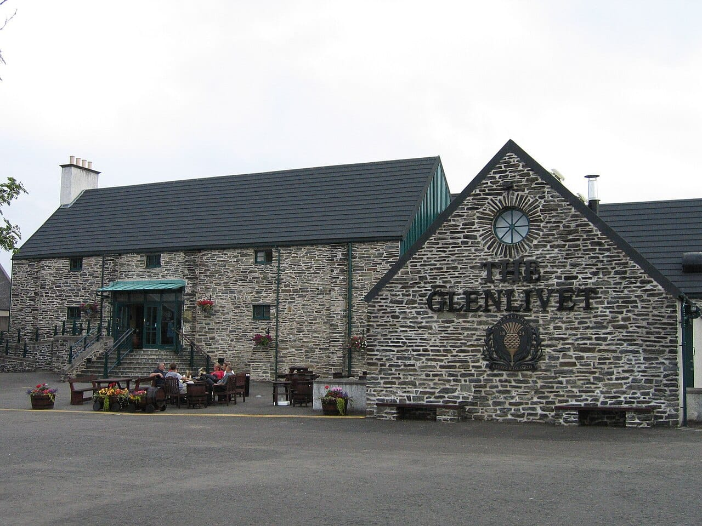

# The Glenlivet Distillery

From Ballindalloch, the B9008 climbs into the hills, passing pasture, drystone walls and thin woodland before the visitor centre and distillery buildings appear. This is not a town-centre distillery or the most photographed stop on the whisky trail, yet the name Glenlivet carries unusual weight in Scotch history: illicit distillation, the 1823 Excise Act and the first licence in the parish in 1824 all belong to this valley. Today the distillery tells that story clearly while operating as a large modern plant.

Figure: The Glenlivet Distillery. Photograph: The Glenlivet distillery. Credit: Kkonstan, CC BY 3.0, via Wikimedia Commons ([source](https://commons.wikimedia.org/w/index.php?curid=2808279)).

## Place and history

In 1824 George Smith obtained a licence to distil in the parish of Glenlivet, becoming the first legal distillery there. The step followed the Excise Act of 1823, which lowered duties and made licensed production viable, forcing people who had worked underground to choose a side. Distillery lore says Smith's decision angered neighbours and that he carried a pistol for protection. The story is part of the house narrative, but it points to something real: legalisation was not a natural evolution; it rearranged the interests of an entire valley.

The distillery was first built at Upper Drumin and moved to its present Minmore site in 1858. The name Glenlivet was then borrowed by many other distilleries, producing a crowd of labels with the suffix; after long legal and trademark disputes, The Glenlivet kept the definite article, while others could no longer use the place name on its own. The distillery is now part of Pernod Ricard's Chivas Brothers and is one of the group's most important single malt brands. In 2024 it marked its bicentenary.

That history helps when reading a label. The "The" is not decoration but a trace of the naming dispute; Glenlivet is both a place and a brand; and the present site is not the 1824 site. Keep those layers apart and "1824" stops meaning that the building in front of you is two hundred years old.

## The site and the visit

The visitor centre was refurbished in 2021, with reception, shop, tasting rooms and tour assembly in one building. A visit usually begins with the brand and the landscape, then moves through mashing, fermentation, distillation and warehousing. The plant is substantial, with orderly rows of stills and modern equipment working at production pace; the guides nevertheless set "modern" and "traditional" side by side, because the flavour still depends on water, malt and time.

Water is a detail worth catching. The distillery uses water from Josie's Well, named after a local spring; it filters through rock and peat, bringing minerals and a faint mossy note. Water does not determine the whole flavour, but it shapes mashing, fermentation and dilution, and it anchors the local story. If a guide mentions the well, remember the name; it is more specific than "pure mountain water".

The warehouse and maturation area usually come at the end. Glenlivet's spirit is relatively light and fruity, so cask influence is easy to taste: bourbon casks bring vanilla, coconut and pear, while sherry casks add dried fruit and spice. Whether the distillery still runs floor maltings, and where its malt comes from, can change with operational decisions; check the day's guide and the official page rather than trusting an old blog. Tours involve stairs and wet floors, so wear grippy shoes and bring a layer for the cold buildings.

## The range and tasting

The core range can be read as no-age-statement, standard ages and advanced. Founder's Reserve is the entry, emphasising pear, apple and a soft texture; the 12-year-old is the reference, with fruit, flowers and honey; a 14-year-old finished in Cognac casks adds grape and spice; 15, 18 and 21 year olds build complexity through age and cask selection; Nadurra is bottled at cask strength for drinkers who want the undiluted state. Names and availability vary by market, so check the back label.

On a first visit, use Founder's Reserve or the 12 to establish a baseline, then compare a sherry-led or older expression. Glenlivet's style is soft, fruity and approachable. That is not an absence of character but a structural choice: a relatively clear new make, longer fermentation and reflux produce a spirit that drinks well young yet can keep fruit through long maturation. Do not confuse soft with bland, and do not measure it by peat.

Distillery exclusives and single casks suit those who already know the standard range. Smell before tasting, sip slowly, and spit everything if you are driving. The shop carries core bottles and travel-retail exclusives; watch luggage weight and airline or ferry rules. Older bottles vary widely in price, so do not let the hunt for a trophy replace attention to whether you actually like the style.

## Practical information

The address is The Glenlivet Distillery, Ballindalloch, Banffshire AB37 9DB, Scotland. The distillery is on the B9008, about ten miles from Tomintoul; by car it is roughly half an hour from Ballindalloch, Aberlour or Grantown-on-Spey, with single-track sections that need extra time in winter. Public transport does not reach the door. The nearest stations are Elgin and Keith, followed by a bus, taxi or organised day tour; without a car, book a transfer in advance.

The distillery recommends pre-booking tours, especially in high season and at weekends. Experiences differ in length, whether a tasting is included, age limits and price, so confirm each point when booking. Production floors are wet and stairs are common; wear grippy shoes and bring a jacket. Visitors with mobility needs or children should ask about the route and age policy first. Opening hours and sessions change with the season; this entry was checked on 2026-11-08, so confirm on the official site before travelling.

Nearby are Ballindalloch Castle and the edge of the Cairngorms National Park; part of the Speyside Way also passes through this area. Combining the distillery with the castle or a walk requires attention to booking times and daylight. With only half a day, take one tour and stay for a glass at the visitor centre rather than rushing to the next distillery.

## Etiquette and around

A distillery is a production site, not a bar. Do not enter production areas without a booking, and do not touch equipment, racks or pipes; floors may be wet with water and draff. Avoid strong perfume and loud conversation in tastings, and use the spittoon. Check signs before photographing; some areas do not allow cameras or detailed process shots. Keep children close rather than letting them run through the buildings.

Anyone driving should not drink. Scotland's limit is stricter than England's, and rural roads are narrow and winding; even one glass can affect judgement. A chauffeur, a designated driver or a tour with transport is the safe choice. If nobody drinks, focus on the history, the buildings and the visitor displays, and take the tasting bottles home.

Nearby, Aberlour, Craigellachie and Dufftown continue the trail, while Elgin to the north offers its cathedral; south lies the Cairngorms, a different rhythm from distillery visits. Combining Glenlivet with Glenfiddich and Macallan is possible in a day, but leave enough driving and lunch time between bookings. For the basic framework, read [Scotch whisky](ref:scotch), [Speyside](ref:speyside) and [Whisky: an introduction](ref:whisky-intro).

Further reading: [Whisky](ref:c-extra-1), [A Ginjinha](ref:c-extra-2).

Read The Glenlivet Distillery through the address, then the current opening status, and finally what the place is known for. The sequence matters.