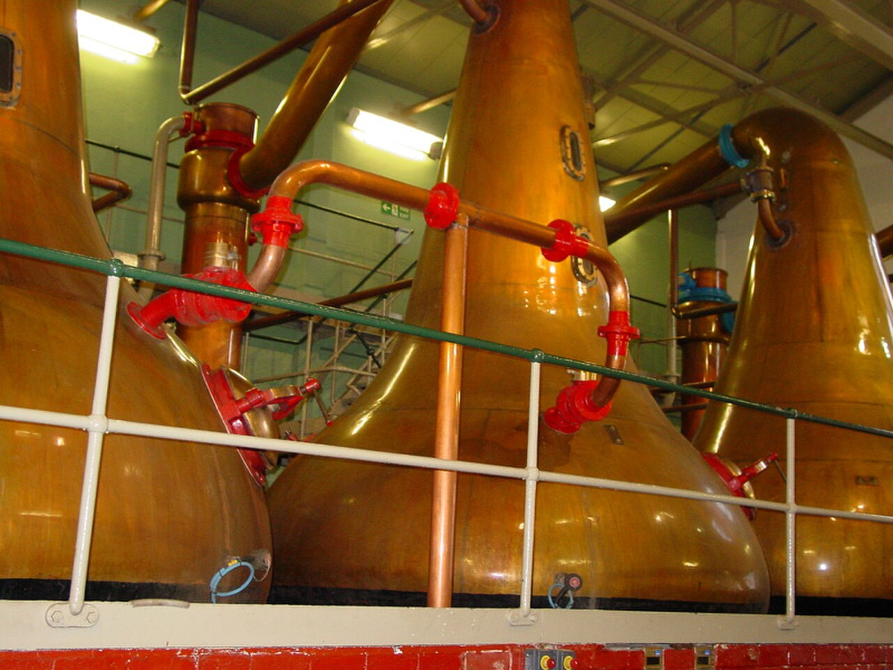

# Glenmorangie Distillery

Tain sits on the north-east coast of Scotland, looking across the Dornoch Firth. Glenmorangie stands just outside the town, between sea wind and barley fields, and its name comes from Gaelic, usually translated as "Valley of Tranquillity". Two things make it distinctive: the tallest stills in Scotland and the Tarlogie Springs, whose surrounding forest the distillery owns and protects. Put those together and a visit becomes more than a look at copper: it is a lesson in how equipment and water build a light spirit.

Figure: Glenmorangie Distillery. Image: Alan Jamieson, CC BY-SA 3.0, via Wikimedia Commons ([source page](https://commons.wikimedia.org/wiki/File:Glenmorangie_Distillery_-_panoramio.jpg)).

## Tain and the Dornoch Firth

Tain is a small royal burgh, with the North Sea to the north and Highland hills to the west. The distillery sits by the A9, about an hour's drive from Inverness. The climate is drier and windier than Speyside, and although sea fog rarely pushes into the site, the cool air affects fermentation and warehouse temperatures. The surrounding fields do not supply all the barley; like most modern Scotch distilleries, Glenmorangie buys malt from specialist maltings. "By the sea" is a useful clue to the house style, but it is not Islay: expect restraint, not seaweed and iodine.

## 1843: from farm to distillery

In 1843, the farmer William Matheson and his wife Anne built the distillery at Tain, converting an old brewery. Early whisky sold for shillings per gallon, the scale was small and the location remote; what the Mathesons really left behind was the site and its water. The distillery changed hands several times and is now part of LVMH. Official history also names the "16 Men of Tain", a long-serving group of craftsmen; today the phrase has become "24 Distillers of Tain".

## Scotland's tallest stills

The Still House is known to staff as the "Highland Cathedral". Its pot stills stand 5.14 metres (16 feet 10 inches) high, the tallest set in Scotland; the long, slender necks let only the lightest vapours reach the top, producing a high reflux and a cleaner, fruitier new make. The distillery uses the giraffe as a comparison, and the visitor centre repeats the motif. Still shape is not decoration: it decides how much heavy, oily vapour falls back into the pot and therefore the texture of the spirit. Keep that in mind when tasting The Original, and the pear, peach, citrus and cream notes make more sense.

## The visit: Still House, warehouses and visitor centre

The visitor centre was redesigned by Russell Sage Studio and contains a museum, a boutique and several boldly coloured tasting rooms. The Classic Tour lasts about an hour and follows mashing, fermentation, distillation and maturation before a two-dram tasting. Groups are capped at 12, children may join only the Classic Tour with a recommended age of 8 and over, and other experiences have age limits. Booking is recommended for tours; the visitor centre, shop and tasting bar need no reservation. The distillery uses traditional earth-floored warehouses, so expect racking and damp floors. Official guidance stresses that bourbon and sherry cask selection, plus later finishing, is the other half of the house style.

Hours change with the season: June to August is daily, September to May is Monday to Friday, the distillery and shop run 10 a.m. to 5 p.m. and the tasting bar 11 a.m. to 4.30 p.m.; the site closes for two weeks over Christmas and New Year. The visitor centre is accessible, but the old distillery route has steps and narrow passages, so anyone needing assistance should call ahead. All experiences have a 24-hour cancellation policy.

## The range: The Original and the cask series

The Original is the baseline; the official tour description now calls it a 12-year-old, matured mainly in bourbon casks, with citrus, peach, vanilla and honey and a soft rather than thin body. Lasanta is finished in sherry casks, bringing raisins, chocolate and spice; Quinta Ruban uses port pipes for red fruit and mint chocolate; Nectar D'Or uses Sauternes casks for apricot, honey and nuts; the 18-year-old leans towards dried fruit and oak; Signet uses heavily roasted malt for coffee, cocoa and spice. The common thread is a light base plus a clear cask finish, so taste the Original first and a finished expression second.

You do not need a high age statement for a first visit. Use the Original to establish the baseline, then choose one finished expression, Lasanta or Quinta Ruban, to see how wood pushes the same spirit in a different direction. If budget allows, try the 18-year-old or Signet to observe what age and dark-roast malt do to the body. Measures are small, so nose before sipping; drivers should not drink at all.

## Rules, region and practical notes

Scotch whisky rules require [single malt](ref:single-malt) to be made at one distillery from 100% malted barley, using [pot stills](ref:pot-still), matured in oak for at least three years and bottled at no less than 40% alcohol by volume, with distillate below 94.8% alcohol by volume. The "Highland" label is a protected regional name; the [Highlands](ref:highlands) are the largest of Scotland's five protected regions and cover a wide range of styles, so the label describes location rather than a single flavour.

The address is The Distillery, Tain, Ross-shire IV19 1PZ. By car, follow the A9 to Tain and take the signed entrance; Tain also has a railway station on the Highland line, reachable from Inverness, with a taxi or walk from there. Tours fill quickly in summer and at weekends, so book ahead; in winter only weekdays open, so confirm the day's schedule. Continuing inland, [Dalwhinnie](ref:dalwhinnie) makes a natural next stop; for regional and legal background, read the [Scotland](ref:scotland) and [Scotch whisky regulations](ref:swr) entries. The coordinates 57.8259, -4.0779 come from a public geographic listing; check official channels for the exact entrance.

**At a glance:** A single malt distillery in Tain, in the Scottish Highlands, founded in 1843 by William and Anne Matheson; known for Scotland's tallest pot stills, the Tarlogie Springs and a light, fruity house style, with a visitor centre offering bookable tours and tastings.

For Glenmorangie Distillery, begin with the address. Then look at the current opening status, and finally ask what the place is known for. The answers point to different choices, not to a single score.

[Single Malt Scotch Whisky](ref:single-malt) and [Scotland](ref:scotland) are the two useful reference points for Glenmorangie Distillery. [Single Malt Scotch Whisky](ref:single-malt) sets out address and space; [Scotland](ref:scotland) brings in operating status. Read them together.

**Key facts.**

| Item | Detail |
| --- | --- |
| In one line | A single malt distillery in Tain, in the Scottish Highlands, founded in 1843 by William and Anne Matheson; known for Scotland's tallest pot stills, the Tarlogie Springs and a light, fruity house style, with a visitor cen… |
| Address | The Distillery, Tain, Ross-shire IV19 1PZ, Scotland |
| City and country | Tain / United Kingdom |
| Status | verified open |
| Official site | glenmorangie.com |

## Related images

Image: Pot still. Credit: see Source, CC BY-SA 3.0, via Wikimedia Commons ([source page](https://commons.wikimedia.org/wiki/File:Sjb_whiskey_still.jpg)). Related image for Glenmorangie Distillery.
